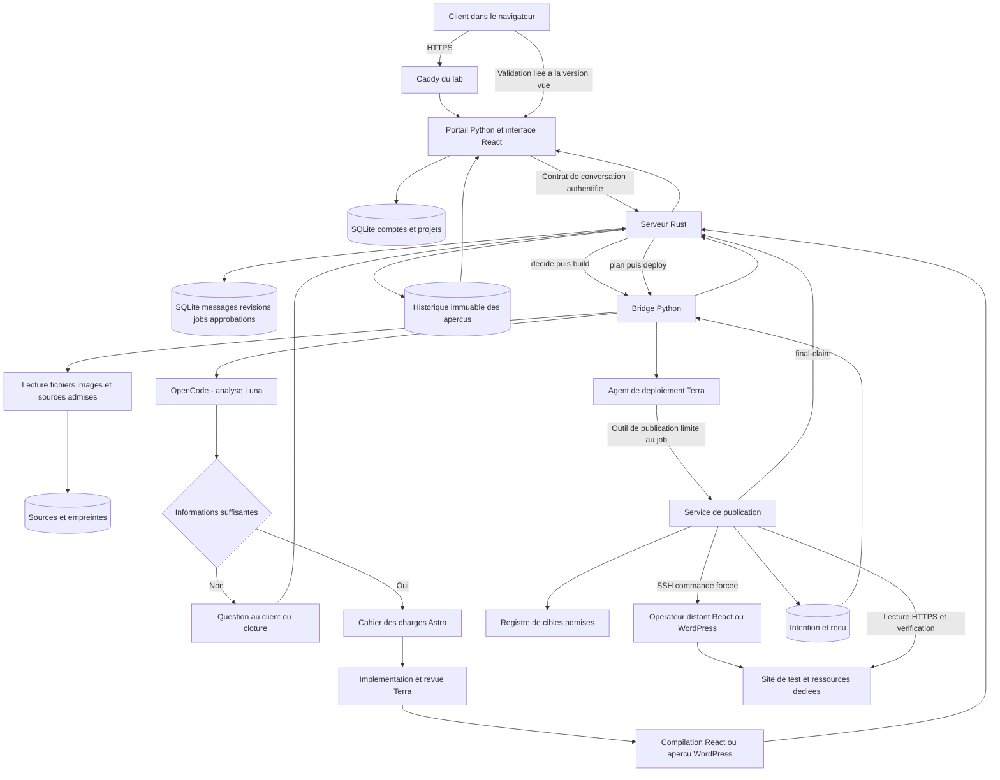
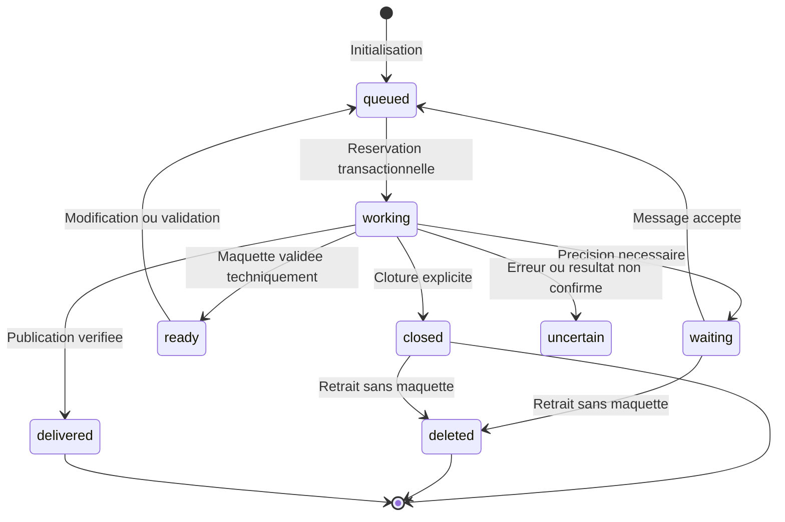
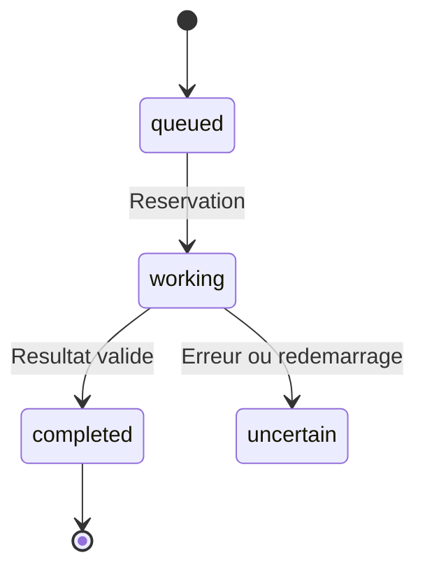

# Architecture du projet Atelier — version Rust

Référence au 30 octobre 2026 : **4162a4fcd18ebf9f948d60cadc36ded52394b43f**. La version installée, les cinq services et les ports ont été relus directement dans le lab. Le paquet installé contient 823 fichiers. Le pipeline de staging possède une référence indépendante, **4165993e12b987590213b6a1e4c0e52ad0e2d51f**, figée pour cette documentation ; son développement se poursuit.

Le périmètre demandé est désormais Rust uniquement. La base de développement n8n est retirée de cette mise à jour. Les modules JavaScript hérités que Python utilise encore sont des bibliothèques locales ; ils n’impliquent pas un serveur n8n dans ce parcours.

## Composants et responsabilités

| Composant | Entrées | Traitement | Résultat et stockage |
|---|---|---|---|
| Navigateur React/TypeScript | Compte client, description, messages, fichiers, validation de maquette | Présente les projets, l’état des tâches, les aperçus et le site livré | Requêtes HTTPS et affichage ; les décisions métier restent sur les serveurs |
| Portail Python | Requêtes HTTPS transmises par Caddy | Authentifie la session, contrôle le propriétaire, crée le projet et adapte le contrat de conversation | Base SQLite des comptes/projets ; requêtes authentifiées au serveur Rust |
| Serveur Rust | Message lié à un propriétaire, une révision et un identifiant de requête | Déduplique, valide fichiers/consentement, attribue une tâche, orchestre ses phases et conserve les états | Base SQLite métier, historique des maquettes, décisions, tâches et livraisons |
| Bridge Python | Job avec droit de traitement, messages, pièces jointes et aperçu précédent | Lit les sources, demande des précisions, rédige le cahier des charges, construit et contrôle la réponse du modèle | Journaux d’effets, sources admises, réponses et artefacts privés |
| OpenCode et modèles | Contexte borné, instructions de rôle et outils autorisés | Luna pour l’analyse, Astra pour le cahier des charges, Terra pour la réalisation/revue/publication | Réponses structurées et sessions tracées ; autorisations propres à l’opérateur |
| Constructeur React | Composant et styles générés, images admises et dépendances verrouillées | Compile et valide les fichiers ; conserve les pages et empreintes | Application autonome, aperçu isolé et version conservée |
| Service de publication Python | Maquette approuvée, plan et capacité limitée au job | Recontrôle le droit auprès de Rust, résout le registre de cibles et appelle une commande distante bornée | Intention durable, reçu de publication et résultat HTTPS vérifié |
| Opérateur distant de site | Action de publication liée à une admission et à une nouvelle racine de site | Publie React ou prépare WordPress/WooCommerce selon le choix client | Site, ressources propres et administration native si WordPress |
| Terraform / Ansible | Paramètres privés, révision, paquet et autorisations | Terraform gère la VM ; Ansible prépare le système, installe et vérifie les composants | État d’infrastructure et reçus privés, indépendants des données client |

## Schéma logique complet

## Déroulement et garanties du contrat

1. Le portail vérifie la session et la propriété avant d’appeler Rust. Le texte client ne choisit ni identité SSH ni destination technique.
2. Rust conserve le message avec sa révision et son reçu de déduplication. L’unicité de tâche par projet/révision empêche un second traitement identique.
3. Le travailleur réserve la tâche en transaction. Le bridge recontrôle son droit de traitement avant les opérations importantes.
4. La phase `decide` peut demander une précision ou clore la conversation. Une décision suffisante est enrichie par un cahier des charges Astra ; la phase `build` réalise la maquette.
5. Les fichiers précédents, images originales, sources et corrections restent attachés au projet. Une nouvelle maquette est ajoutée à l’historique ; l’ancienne reste consultable.
6. L’approbation doit porter sur la révision et l’empreinte de la maquette effectivement vue. Les ressources manquantes demandent une acceptation explicite avant livraison.
7. La phase `plan` établit le contrat de livraison. La phase `deploy` fait intervenir l’agent de déploiement et son outil de publication. Le service de publication compare les données reçues au `final-claim` fourni par Rust.
8. Le registre technique décide de la cible, de ses capacités, de la clé et de la confiance SSH. Une intention est enregistrée avant effet ; la réussite exige les contrôles de livraison.
9. Rust ne marque la livraison terminée qu’après réponse vérifiée du bridge. Un résultat incertain est conservé comme `uncertain` et demande réconciliation ; une panne ne se transforme pas en répétition automatique.

Le schéma décrit les états de la conversation : `queued` et `working` sont également inscrits dans la tâche. La première consultation initialise une conversation en attente de traitement. Le retrait logique `deleted` n’est admis que sans maquette, depuis waiting, closed ou deleted. Le contrôle de propriété s’applique aussi aux fichiers et à chaque version d’aperçu.

Ce second schéma décrit la tâche. Au redémarrage du serveur, les conversations et tâches restées `working` deviennent `uncertain` avec une erreur de réconciliation ; elles ne sont pas rejouées automatiquement.

## Technologies et dépendances

Le portail utilise React 19.2.6, TypeScript 5.9.3 et Vite 8.0.13. Le serveur Rust utilise tiny_http, rusqlite avec SQLite embarqué, serde/serde_json, UUID, SHA-256, base64 et ureq. La chaîne de construction documentée utilise Debian 13, Python 3.13, Node 24.19.0 et Rust 1.99.1 ; les verrous des dépendances font foi pour la construction. Le runtime ne doit pas télécharger un autre dépôt pour terminer une tâche.

React est le choix par défaut. WordPress ou WooCommerce doivent être soutenus par une demande explicite du client dans ses messages ou documents. Une demande incompatible est refusée ou clarifiée. Le site React livré ne reçoit pas d’identifiants d’administration WordPress fictifs. Une demande WordPress doit mener à l’installation et à la recette des fonctions natives prévues.

Les données restent séparées : comptes/projets du portail ; conversations/jobs/approbations dans Rust ; effets et sources dans le bridge ; sessions du modèle ; intentions/reçus du service de publication ; contenu final dans les conteneurs cibles. Le dépôt source et le paquet applicatif ne sont pas une sauvegarde de ces données.

## Références de code

| Responsabilité | Source |
| --- | --- |
| API et sessions | [https://github.com/yanisAitlamine/atelier-unifie/blob/4162a4fcd18ebf9f948d60cadc36ded52394b43f/portal/server/app.py](https://github.com/yanisAitlamine/atelier-unifie/blob/4162a4fcd18ebf9f948d60cadc36ded52394b43f/portal/server/app.py) |
| Adaptateur Rust | [https://github.com/yanisAitlamine/atelier-unifie/blob/4162a4fcd18ebf9f948d60cadc36ded52394b43f/portal/server/rust_chat.py](https://github.com/yanisAitlamine/atelier-unifie/blob/4162a4fcd18ebf9f948d60cadc36ded52394b43f/portal/server/rust_chat.py) |
| Orchestrateur et base métier | [https://github.com/yanisAitlamine/atelier-unifie/blob/4162a4fcd18ebf9f948d60cadc36ded52394b43f/backend/src/main.rs](https://github.com/yanisAitlamine/atelier-unifie/blob/4162a4fcd18ebf9f948d60cadc36ded52394b43f/backend/src/main.rs) |
| Phases du bridge | [https://github.com/yanisAitlamine/atelier-unifie/blob/4162a4fcd18ebf9f948d60cadc36ded52394b43f/bridge/integrations/opencode-engine/chat_operator.py](https://github.com/yanisAitlamine/atelier-unifie/blob/4162a4fcd18ebf9f948d60cadc36ded52394b43f/bridge/integrations/opencode-engine/chat_operator.py) |
| Transport et validation du modèle | [https://github.com/yanisAitlamine/atelier-unifie/blob/4162a4fcd18ebf9f948d60cadc36ded52394b43f/bridge/integrations/opencode-engine/engine.py](https://github.com/yanisAitlamine/atelier-unifie/blob/4162a4fcd18ebf9f948d60cadc36ded52394b43f/bridge/integrations/opencode-engine/engine.py) |
| Politique des modèles | [https://github.com/yanisAitlamine/atelier-unifie/blob/4162a4fcd18ebf9f948d60cadc36ded52394b43f/bridge/integrations/opencode-engine/model-policy.json](https://github.com/yanisAitlamine/atelier-unifie/blob/4162a4fcd18ebf9f948d60cadc36ded52394b43f/bridge/integrations/opencode-engine/model-policy.json) |
| Publication par agent | [https://github.com/yanisAitlamine/atelier-unifie/blob/4162a4fcd18ebf9f948d60cadc36ded52394b43f/bridge/integrations/opencode-engine/agent_delivery.py](https://github.com/yanisAitlamine/atelier-unifie/blob/4162a4fcd18ebf9f948d60cadc36ded52394b43f/bridge/integrations/opencode-engine/agent_delivery.py) |
| Service de publication | [https://github.com/yanisAitlamine/atelier-unifie/blob/4162a4fcd18ebf9f948d60cadc36ded52394b43f/bridge/integrations/wordpress/chat-publisher.py](https://github.com/yanisAitlamine/atelier-unifie/blob/4162a4fcd18ebf9f948d60cadc36ded52394b43f/bridge/integrations/wordpress/chat-publisher.py) |
| Publication React | [https://github.com/yanisAitlamine/atelier-unifie/blob/4162a4fcd18ebf9f948d60cadc36ded52394b43f/bridge/integrations/react-site/publisher.py](https://github.com/yanisAitlamine/atelier-unifie/blob/4162a4fcd18ebf9f948d60cadc36ded52394b43f/bridge/integrations/react-site/publisher.py) |
| Validation JavaScript locale héritée | [https://github.com/yanisAitlamine/atelier-unifie/blob/4162a4fcd18ebf9f948d60cadc36ded52394b43f/bridge/integrations/n8n/unified/engine-adapter.cjs](https://github.com/yanisAitlamine/atelier-unifie/blob/4162a4fcd18ebf9f948d60cadc36ded52394b43f/bridge/integrations/n8n/unified/engine-adapter.cjs) |

## Contrats des interfaces

| Interface | Entrées essentielles | Sortie / effet |
| --- | --- | --- |
| Portail POST /api/chat-projects | name, description ; session client | Projet chatOnly appartenant au client |
| Portail GET /api/projects/{id}/chat | Identifiant et session | État de conversation |
| Portail POST /api/projects/{id}/chat/message | revision, requestId, text, files, consent, viewedPreview | Message accepté, reçu et tâche ; conflit si révision dépassée |
| Rust POST /v1/snapshot | projectId, ownerId, initial | Initialisation ou état complet |
| Rust POST /v1/message | Projet, propriétaire, révision et message | Déduplication puis mise en file |
| Rust POST /v1/status et /v1/discard | projectId, ownerId | Possibilité de retrait ; retrait logique uniquement si admissible |
| Rust POST /v1/claim | jobId, claim | Validité de la tâche active à la bonne révision |
| Rust POST /v1/final-claim | jobId, claim | Données fiables avec approbation, maquette et plan |
| Rust POST /v1/file | projectId, ownerId, fileId | Métadonnées et octets encodés du fichier |
| Rust POST /v1/preview | projectId, ownerId, revision, path | Fichier de la version historique demandée |
| Bridge POST /v1/chat/{phase} | Phase decide/build/plan/deploy ; job et droit de traitement | Décision, maquette, plan ou reçu |
| Publication POST /v1/chat/delivery-target | Données de livraison approuvée | Identité publique de la cible admise |
| Publication POST /v1/chat/deliver | Données de livraison approuvée | Effet distant et reçu vérifié |

Les corps de messages Rust sont limités à 13 Mio, les réponses du bridge à 28 Mio et les requêtes entrantes du bridge à 40 Mio. Le portail borne aussi la taille et les types ; ces limites de transport ne remplacent pas les budgets par projet et fichier. Les endpoints internes sont authentifiés et les erreurs stables sont visibles dans les catalogues de fonctions.

## Parcours de lecture

| Document | Lien |
| --- | --- |
| Flux réseau | [https://github.com/yanisAitlamine/repo-partage-humains/blob/main/documentation%20yanis/FLUX-RESEAU-RUST.md](https://github.com/yanisAitlamine/repo-partage-humains/blob/main/documentation%20yanis/FLUX-RESEAU-RUST.md) |
| Tests détaillés | [https://github.com/yanisAitlamine/repo-partage-humains/blob/main/documentation%20yanis/PLAN-DE-TEST.md](https://github.com/yanisAitlamine/repo-partage-humains/blob/main/documentation%20yanis/PLAN-DE-TEST.md) |
| Inventaires | [https://github.com/yanisAitlamine/repo-partage-humains/blob/main/documentation%20yanis/catalogues-rust/INVENTAIRE-PROGRAMMES.md](https://github.com/yanisAitlamine/repo-partage-humains/blob/main/documentation%20yanis/catalogues-rust/INVENTAIRE-PROGRAMMES.md) |
| Configuration des agents | [https://github.com/yanisAitlamine/repo-partage-humains/blob/main/documentation%20yanis/CONFIGURATION-AGENTS-RUST.md](https://github.com/yanisAitlamine/repo-partage-humains/blob/main/documentation%20yanis/CONFIGURATION-AGENTS-RUST.md) |
