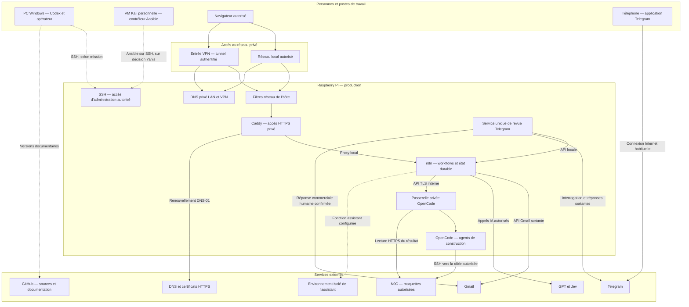
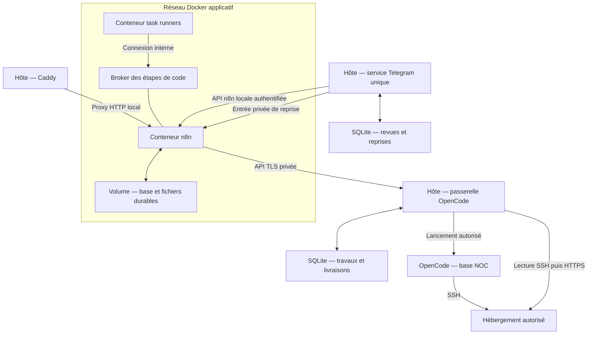
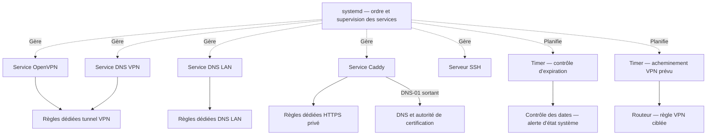
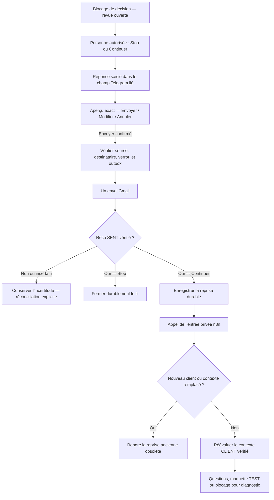
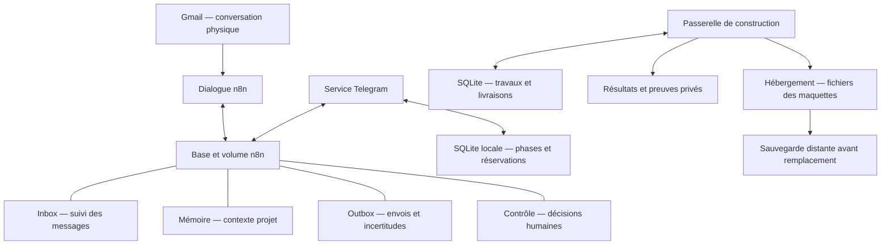

# Architecture complète du projet : machines, services, échanges, données et fichiers

Ce projet fait travailler ensemble plusieurs outils pour préparer une maquette de site à partir d’une discussion par mail. Gmail transporte la discussion. n8n organise les étapes. Des services d’IA aident à comprendre le besoin et à rédiger. Telegram permet à une personne de répondre aux blocages et d’approuver une livraison. OpenCode prépare la maquette sur l’hébergement autorisé. Le Raspberry Pi coordonne ces outils et conserve une partie de leur état.

Cette page explique **ce que fait chaque élément, avec qui il communique, ce qu’il lit, ce qu’il écrit et où chercher quand une étape bloque**. Elle conserve volontairement les détails utiles : simplifier le langage ne doit pas supprimer le schéma des services, le rôle des répertoires ou les limites des sauvegardes.

**Version documentaire : 15 octobre 2026.** Les résultats du 14 octobre et les évolutions documentées du 15 octobre sont distingués dans le texte. Une installation vérifiée ne prouve pas que tous les parcours humains ont déjà été essayés. Les rapports de référence conservent les preuves et leurs limites.

Cette édition est publique. Les schémas décrivent les liens fonctionnels avec des noms de rôle. La documentation privée d’exploitation contient les adresses réelles, les interfaces, les ports effectivement configurés, les domaines, les chemins absolus, les identités de service et les emplacements sensibles. Les noms de fichiers et chemins relatifs présentés ci-dessous sont des repères dans les sources ; ce ne sont pas des instructions de connexion au système réel.

Le catalogue s’appuie sur les guides et rapports consultés, les README des dépôts actifs et un repérage ciblé de leurs répertoires et fichiers importants. Il décrit les composants fonctionnels ; il ne prétend pas avoir ouvert chaque fichier, cache, dépendance ou ancien dossier de mission. Les constats de production restent ceux des vérifications datées citées, sans nouveau test applicatif créé par cette rédaction.

## 1. Comment lire cette architecture

Il est possible de commencer par la vue d’ensemble, puis de suivre le parcours d’un mail. Le catalogue des dossiers et des fichiers sert ensuite de référence quand on veut comprendre une modification ou préparer une reprise.

| Pour comprendre… | Lire… |
| --- | --- |
| Quelle machine fait quoi | Sections 2 et 3. |
| Les services du Pi et les échanges réseau | Sections 4 à 6. |
| Le trajet d’un mail et les décisions humaines | Sections 7 à 9, puis le [guide des workflows](WORKFLOWS-PIPELINE-PRINCIPAL.md). |
| La construction, le contrôle et la livraison d’une maquette | Section 10. |
| Les données qui doivent être conservées | Sections 11 et 12. |
| Les répertoires et fichiers importants | Sections 13 à 17. |
| Les changements d’administration, les sauvegardes et les limites de preuve | Sections 18 à 20. |
| Le sens d’un terme technique | Glossaire en section 21. |

Trois questions évitent une grande partie des malentendus :

1. **Parle-t-on d’un fichier source ou du programme installé ?** Un fichier peut avoir été corrigé dans un dépôt alors que le service utilise encore son ancienne copie.
2. **Parle-t-on d’un workflow enregistré ou de sa version publiée ?** Le brouillon et la version exécutée peuvent différer.
3. **Parle-t-on d’une configuration décrite, d’un test fictif ou d’un fonctionnement réel ?** Ces preuves n’ont pas la même portée.

## 2. Le rôle des machines et des fournisseurs

| Élément | Travail effectué | Données ou ressources concernées | Ce qui dépend de sa disponibilité |
| --- | --- | --- | --- |
| PC Windows de Yanis | Interface de travail avec Codex, rédaction, préparation de changements et accès opérateur autorisés. | Documentation locale, copies de sources et outils de travail. | La présence de l’opérateur et certaines interventions. Les automatisations du Pi n’exigent pas que ce PC reste allumé. |
| VM Kali personnelle de Yanis | Poste de contrôle Ansible pour les opérations d’administration expressément choisies. | Clones du contrôleur, inventaires et réglages privés de l’opérateur. | Les interventions lancées depuis cette VM. Son arrêt n’arrête pas n8n. |
| Raspberry Pi | Production n8n, services d’accès privé, passerelle OpenCode, revue Telegram et états locaux associés. | Base et fichiers n8n, travaux, réservations, contrôles humains, journaux et configurations installées. | La réception automatisée, le dialogue et les services locaux du parcours. |
| Routeur du réseau | Relie le réseau local à Internet et participe à l’acheminement du VPN. | Réglages réseau de l’infrastructure. | Les accès extérieurs et les connexions sortantes. Une règle du routeur et un filtre du Pi sont deux contrôles distincts. |
| Gmail | Reçoit les demandes et envoie les réponses dans les fils autorisés. | Mails, pièces jointes admissibles, identifiants de messages et confirmations d’envoi. | Les lectures et envois de mails. |
| Telegram | Affiche les demandes de décision et reçoit les actions des personnes autorisées. | Messages de revue, aperçus, boutons et diagnostics filtrés. | La possibilité de prendre une décision sur téléphone par ce canal. |
| Services d’IA | Aident au tri, à la rédaction, à l’extraction de citations et aux décisions prévues. | Le contexte autorisé transmis pour la tâche. | Les étapes qui appellent le fournisseur concerné. Une panne IA ne doit pas réarmer les envois. |
| Environnement isolé de l’assistant, tel que Daytona dans la configuration documentée | Fournit un environnement de travail à l’assistant intégré lorsque cette option est utilisée. | Ressources temporaires de l’assistant. | Cette fonction particulière. Ce n’est ni le stockage principal n8n ni l’hébergement des maquettes. |
| Hébergement N0C | Reçoit les fichiers de la maquette et les sert en HTTPS. | Répertoire autorisé de chaque réalisation et sauvegardes distantes associées. | La consultation du résultat et une partie de sa vérification. Le site ne s’exécute pas sur le Pi. |
| Fournisseur DNS et autorité de certification | Associent un nom à une adresse et permettent de certifier l’identité HTTPS du service. | Enregistrements DNS, preuves de contrôle et certificats. | La résolution du nom et le renouvellement du certificat, selon l’étape concernée. |
| GitHub | Conserve les versions des sources et des documents publiés dans les dépôts autorisés. | Code et documentation versionnés. | Le partage et la récupération des versions publiées. GitHub ne contient pas la base complète de production. |

**Kali appartient exclusivement à Yanis.** Ilyes et les agents ne doivent ni s’y connecter ni sonder son accès sans demande explicite de Yanis visant cette machine. Son apparition dans un schéma décrit son rôle ; elle ne partage pas son accès.

## 3. Vue d’ensemble des machines et des frontières d’accès

Les flèches ci-dessous représentent des échanges autorisés dans le fonctionnement décrit. Elles ne donnent pas une permission supplémentaire. « Privé » signifie que l’accès est limité au réseau ou aux acteurs prévus ; une authentification applicative peut rester nécessaire en plus.

Le téléphone communique avec Telegram, puis le service du Pi récupère la décision. Il n’est donc pas nécessaire d’ouvrir l’éditeur n8n à Internet pour utiliser les boutons Telegram. En revanche, consulter directement l’éditeur depuis un réseau extérieur nécessite l’accès privé prévu.

Le schéma distingue aussi **l’accès au Pi** de **l’accès à l’hébergement**. Une connexion SSH valide vers le Pi ne donne pas automatiquement les droits d’écrire un site sur N0C. La cible d’hébergement et les opérations permises doivent être autorisées séparément.

## 4. Les services d’infrastructure du Pi

### 4.1 Debian, systemd et les journaux

Debian est le système d’exploitation du Pi. **systemd** démarre et supervise les services persistants : pile n8n, Caddy, VPN, résolveurs DNS, passerelle et service Telegram. Une définition d’unité indique notamment quel programme lancer, sous quelle identité et dans quels dossiers il peut écrire.

Un service peut charger une copie installée d’un programme plutôt que le fichier actuellement ouvert dans le dépôt. Il faut donc suivre la chaîne complète : **source → copie installée → unité qui la lance → processus actif**. Modifier la première étape ne met pas les trois suivantes à jour automatiquement.

Les journaux système aident à savoir si un service a démarré ou échoué. Ils ne remplacent ni la base métier ni les registres d’envoi. Ils doivent aussi être traités comme potentiellement sensibles : une sortie brute peut contenir du contexte ou une erreur externe qu’un rapport public ne doit pas reproduire.

### 4.2 Docker et Docker Compose

**Docker** fait fonctionner n8n et les outils d’exécution dans des environnements séparés appelés conteneurs. **Docker Compose** décrit les conteneurs, les images utilisées, les réseaux et les montages de stockage.

Le conteneur n8n peut être remplacé sans effacer automatiquement les données durables : elles sont conservées dans un **volume Docker**. À l’inverse, supprimer le volume détruirait des données que le simple téléchargement de l’image ne permettrait pas de récupérer.

| Élément | Rôle | Point de vigilance |
| --- | --- | --- |
| Moteur Docker | Lance les conteneurs et gère leurs réseaux et volumes. | Un accès administrateur Docker donne des pouvoirs importants sur l’hôte. |
| Projet Compose | Regroupe les éléments de cette pile applicative. | Changer seulement le chemin du dossier ne garantit pas de créer une instance indépendante : les noms du projet et des volumes comptent aussi. |
| Conteneur n8n | Exécute les workflows et utilise la base et les connexions configurées. | L’image du programme et la base n8n sont deux objets différents. |
| Task runners | Exécutent les étapes de code dans un conteneur séparé. | Ils n’ont pas le même accès au stockage des connexions que le processus n8n. Leur présence ne rend pas tout code automatiquement sûr. |
| Broker des runners | Relie n8n aux exécutants de code. | C’est une interface interne de la pile, destinée aux exécutants prévus. |
| Réseau Docker applicatif | Permet les échanges internes nécessaires. | Un service joignable dans ce réseau n’a pas à être publié vers Internet. |
| Volume durable | Conserve la base et les fichiers n8n au-delà du cycle d’un conteneur. | Il faut le sauvegarder avec les éléments nécessaires à sa réutilisation. |

La vue interne rend visibles les interfaces qui ne doivent pas être confondues avec l’éditeur HTTPS :

Le broker n’est pas une porte d’entrée publique de n8n. Le volume n’est pas un service réseau. Les deux SQLite de services sont des stockages locaux distincts de la base n8n, même si leurs informations décrivent le même parcours métier.

### 4.3 Caddy, HTTPS et le renouvellement des certificats

**Caddy est le point d’entrée HTTPS de n8n.** Le navigateur se connecte à Caddy ; Caddy transmet ensuite la demande à n8n sur une interface locale du Pi. Ce rôle s’appelle un **proxy inverse**.

Le chiffrement HTTPS protège le transport et le certificat permet au navigateur de vérifier le nom du service. L’application n8n conserve ensuite ses propres comptes et droits. Posséder un accès réseau au service ne remplace donc pas une connexion au bon compte n8n.

Le fonctionnement documenté utilise **DNS-01** pour prouver le contrôle du domaine lors de l’obtention ou du renouvellement du certificat. Caddy effectue cette preuve auprès du fournisseur DNS. Il n’est pas nécessaire de rendre l’éditeur n8n public pour répondre à un challenge HTTP ou TLS entrant.

Les recettes historiques décrivaient un autre mode de renouvellement avec une entrée HTTPS publique. Elles ne doivent pas être suivies comme si elles décrivaient encore le réseau actuel. Une restauration doit rétablir le bon binaire Caddy, son module DNS, son filtre et ses réglages privés avant de redémarrer le service.

### 4.4 OpenVPN et les deux services DNS privés

**OpenVPN crée un tunnel réseau authentifié pour les personnes autorisées.** Le tunnel donne les accès prévus par sa configuration ; il n’accorde pas une permission générale d’administrer le Pi ou de parcourir le réseau local.

Deux fonctions DNS sont distinguées :

| Résolveur | Utilisateur | But concret |
| --- | --- | --- |
| DNS du réseau local | Poste présent sur le LAN et configuré pour l’utiliser. | Retrouver le service privé par son nom depuis le réseau local. |
| DNS du VPN | Client connecté au tunnel et utilisant les paramètres DNS appropriés. | Retrouver le service privé par son nom à travers le VPN. |

Ces deux résolveurs sont des processus et des configurations séparés. Une correction du DNS local n’exige pas forcément un redémarrage du VPN. Une panne du DNS peut empêcher le nom de fonctionner alors que le serveur et le tunnel sont encore disponibles.

Un navigateur qui impose son propre DNS sécurisé peut ignorer le résolveur privé attendu. Le bon diagnostic consiste à vérifier quelle résolution le client utilise, puis l’accès prévu ; ouvrir l’éditeur à Internet ne corrige pas cette différence.

### 4.5 Pare-feu, accès SSH et tâches périodiques

Le pare-feu de l’hôte utilise des règles dédiées aux différentes fonctions : accès HTTPS privé, VPN et DNS. Une règle destinée au DNS local ne doit pas effacer les règles du VPN ou de Docker. Les contrôles de l’hôte complètent les règles du routeur ; supprimer l’un de ces contrôles change l’exposition réelle.

**SSH** fournit un accès distant authentifié. Les comptes personnels ont leurs propres droits. Le compte collaborateur documenté ne possède pas les pouvoirs de l’opérateur de production : il n’a pas automatiquement accès à sudo, à Docker, aux sources privées ou aux identités de Yanis. Les accès sortants vers GitHub, un fournisseur IA et N0C ont aussi leurs authentifications distinctes.

Les tâches périodiques documentées comprennent notamment le contrôle de l’expiration des éléments VPN et le maintien de la règle d’acheminement VPN prévue sur le routeur. Un timer systemd planifie une tâche ; il n’est pas le service applicatif qui traite les mails. Le contrôle d’expiration ne renouvelle pas à lui seul les certificats ou les accès.

Les flèches « gère » représentent la supervision, pas un trafic utilisateur. Les règles de filtre sont les barrières qui s’appliquent aux échanges correspondants. Ce second schéma complète le schéma applicatif sans publier les interfaces réelles ni la carte des accès.

### 4.6 Découverte locale et interface d’administration du proxy

Le service de découverte locale Avahi utilise mDNS pour aider les postes du réseau local à retrouver le nom de la machine. Il est distinct des résolveurs DNS privés qui orientent le navigateur vers n8n sur le LAN ou dans le VPN. La découverte du nom ne donne pas une autorisation d’accès à n8n.

Caddy dispose aussi d’une interface d’administration locale, différente de l’interface HTTPS présentée aux utilisateurs. La documentation privée donne son adresse et son port observés. Cette interface ne doit pas être assimilée à un nouvel accès public à l’éditeur.

La reprise ponctuelle des workflows est encore autre chose : elle attend puis rappelle le traitement concerné. Il ne faut pas en déduire qu’un second programme permanent parcourt tous les échecs et les relance librement.

## 5. Les services applicatifs du Pi

| Composant | Ce qu’il reçoit | Ce qu’il fait | Ce qu’il produit ou conserve |
| --- | --- | --- | --- |
| n8n | Déclenchements Gmail, appels internes, décisions et résultats de services. | Exécute les workflows, applique leurs gardes et organise les échanges. | États métier, tables de suivi, exécutions et appels vers les autres étapes. |
| Service privé de décision Jev | Contexte client vérifié préparé par le dialogue. | Sélectionne les citations et rend la décision prévue : continuer, brief prêt ou revue. | Décision et éléments de provenance à contrôler avant utilisation. |
| Passerelle OpenCode | Demande de construction émise par le parcours autorisé. | Vérifie l’enveloppe de demande, enregistre le travail et lance le constructeur dans son périmètre. | Travail durable, statut, résultat et preuve de maquette selon les contrôles. |
| OpenCode et base de contrôle NOC | Mission, cible autorisée et critères de réalisation. | Planifie, délègue la construction à un implémenteur puis demande une revue. | Fichiers du site sur la cible distante et résultat structuré. |
| Vérificateur d’artefact | Référence du travail, révision et destination attendue. | Compare l’index lu sur l’hébergement par SSH à celui effectivement servi en HTTPS. | Preuve liée à ce travail ; refus si le contenu ou les marqueurs ne correspondent pas. |
| Service unique de revue Telegram | Événements du bot et dossiers de revue n8n. | Contrôle l’identité, la fraîcheur et le rattachement ; gère la saisie, l’aperçu, la confirmation et les modules de décision. | État local durable et mises à jour des dossiers concernés. |
| Module de validation des maquettes | Résultat construit et décision humaine associée. | Présente le résultat et rattache le choix au travail et à sa révision. | Décision exploitable pour autoriser ou refuser la livraison précise. |
| Module de liaison Jev–Telegram | Blocage de décision nécessitant une personne. | Associe la revue au message, au fil, au projet et à la révision attendus. | Revue native et contrôle humain durable du fil. |
| Module de reprise immédiate commerciale | Réponse humaine confirmée et événements de contrôle correspondants. | Enregistre une reprise durable et sollicite l’entrée n8n privée prévue. | États d’enregistrement et de dispatch, sans réexécuter un ancien envoi. |
| Module de diagnostic Telegram | États, étapes et codes filtrés. | Présente le suivi sans recopier le corps des mails, les prompts ou les secrets. | Messages de diagnostic et suivi durable des notifications concernées. |

Plusieurs lignes correspondent à des **modules d’un même service**, et non à autant de démons indépendants. En particulier, les extensions de revue commerciale, de validation des maquettes et de diagnostic ne justifient pas de démarrer plusieurs consommateurs du même bot Telegram.

### Le service Telegram est un consommateur unique

Le Pi interroge Telegram depuis une connexion sortante. C’est le **polling** : il demande au service externe les événements disponibles. Une seule instance doit consommer les événements du bot concerné. Un second programme qui interrogerait le même bot pourrait perturber la réception des boutons et des réponses.

Le service conserve son état dans SQLite et utilise des protections locales contre une double instance sur le même état. Ces protections ne remplacent pas la coordination : un autre programme utilisant le même bot avec un état différent resterait un problème d’exploitation.

### La passerelle est une interface privée, pas un terminal public

La passerelle OpenCode accepte les opérations applicatives prévues, dans le réseau interne autorisé et avec leur authentification. Elle ne transforme pas le brief du client en autorisation d’exécuter une commande arbitraire sur le Pi ou de choisir librement un hébergement.

Le domaine suggéré dans un mail ne suffit pas à décider où écrire. Le registre opérateur, la cible de test fixée par le parcours, les droits SSH et les contrôles de chemin déterminent la destination réellement permise.

## 6. Protocoles, interfaces et exposition

Une **interface** est un point de contact entre deux programmes. Un **protocole** définit la manière dont ils échangent. Un **port** distingue un service réseau sur une adresse. Enfin, l’**exposition** décrit qui peut réellement atteindre ce service après prise en compte de l’écoute, du routage et des filtres.

Un programme peut écouter sans être accessible depuis Internet. Inversement, publier un port par erreur peut rendre joignable un service qui devait rester interne. C’est pour cela que la documentation d’exploitation doit suivre ces quatre notions séparément.

### 6.1 Matrice fonctionnelle publique

| Origine → destination | Interface / protocole | Zone prévue | Usage |
| --- | --- | --- | --- |
| Navigateur autorisé → Caddy | HTTPS chiffré et certificat vérifié. | LAN ou VPN autorisé. | Éditeur n8n et fonctions web privées permises au compte. |
| Caddy → n8n | Proxy HTTP local. | Même Pi, interface locale. | Transmettre la requête à l’application après le point d’entrée HTTPS. |
| Client distant → OpenVPN | Tunnel VPN authentifié, transport UDP dans la configuration documentée. | Entrée VPN prévue, puis réseau privé limité. | Accéder aux services explicitement autorisés. |
| Client LAN ou VPN → DNS privé correspondant | DNS sur UDP ou TCP selon la requête. | Réseau autorisé de chaque résolveur. | Résoudre le nom du service vers sa destination privée. |
| Poste autorisé → service SSH du Pi | SSH avec identité et clé d’hôte vérifiées. | Conditions d’accès propres au compte. | Lecture, préparation ou administration couvertes par la mission. |
| Runners ↔ n8n | Les runners se connectent au broker côté n8n ; les tâches et résultats circulent sur cette connexion. | Réseau Docker applicatif. | Exécuter les étapes de code prévues. |
| n8n → passerelle OpenCode | API privée en TLS, authentifiée. | Réseau applicatif explicitement permis. | Soumettre un travail, consulter son statut et réserver une livraison. |
| Service Telegram → n8n | API applicative locale authentifiée. | Même serveur, accès du service. | Lire et mettre à jour les dossiers de revue et de contrôle. |
| Service Telegram → entrée de reprise n8n | Appel privé authentifié. | Chemin interne de reprise du 15 octobre. | Signaler un événement durable sans transmettre un nouveau corps de mail dans la demande. |
| n8n ou service Telegram → Gmail | API Gmail sur HTTPS. | Sortie Internet authentifiée. | Lire les sources autorisées et envoyer les réponses sous leurs gardes. |
| Service Telegram → Telegram | API Telegram sur HTTPS, interrogation sortante. | Sortie Internet. | Recevoir les événements et afficher les demandes de décision. |
| Dialogue / agents → fournisseurs IA | API du fournisseur sur HTTPS. | Sortie Internet autorisée. | Analyse, décision, rédaction ou construction selon le rôle. |
| Agents NOC → hébergement autorisé | SSH avec vérification de la cible. | Hôte distant autorisé. | Lire et écrire dans la racine de mission prévue. |
| Vérificateur → hébergement | Lecture SSH puis lecture HTTPS sans redirection. | Cible du travail concerné. | Comparer le fichier attendu au contenu réellement servi. |
| Caddy → fournisseur DNS et autorité de certification | Échanges sortants DNS-01 et ACME. | Services externes de certification. | Obtenir ou renouveler le certificat sans rendre l’éditeur public. |
| Outils de travail → GitHub | Transport Git authentifié autorisé. | Service externe de versionnement. | Récupérer ou publier les sources et documents prévus. |

À titre de vocabulaire, HTTPS utilise couramment TCP 443, SSH TCP 22 et DNS UDP/TCP 53. **Ces exemples sont les ports conventionnels des protocoles ; ils ne constituent pas la cartographie des ouvertures réelles de ce projet.** La matrice privée indique les interfaces et ports effectivement configurés, les adresses et les restrictions par compte.

### 6.2 Ce qui est privé, public ou interne

- **L’éditeur n8n est privé.** Le fait qu’il possède un nom de domaine et un certificat reconnu n’en fait pas un service librement accessible depuis Internet.
- **Le point d’entrée VPN a son propre rôle.** Il permet d’établir un tunnel ; il ne publie pas automatiquement n8n, SSH ou le réseau local.
- **Les interfaces des runners et de la passerelle restent internes.** Elles sont destinées aux programmes autorisés, pas à un navigateur client quelconque.
- **Le bot Telegram utilise une connexion sortante du Pi.** Les personnes passent par Telegram, sans ouverture entrante supplémentaire de n8n pour ce parcours.
- **La maquette TEST est servie par l’hébergement distant.** Son accessibilité et celle de l’éditeur privé sont deux sujets différents.
- **Les données privées restent protégées même dans un dépôt privé.** Aucun emplacement Git n’est une destination acceptable pour une valeur de secret.

## 7. Les workflows et leurs responsabilités

Un **workflow** est un parcours d’étapes n8n. Il peut être déclenché par un événement, un autre workflow, un appel interne ou une action manuelle. Son existence ne signifie pas qu’il est actif ni que sa dernière version enregistrée est publiée.

| Fonction | Responsabilité principale | Pourquoi elle est séparée |
| --- | --- | --- |
| Réception des mails et suivi | Filtrer les entrées, mettre les messages en attente, réserver le traitement, appeler le dialogue et suivre le résultat. | Un mail ne doit pas être traité deux fois parce que deux événements arrivent ensemble. |
| Dialogue commercial et brief | Relire la conversation, distinguer client et assistant, préparer la décision, demander des précisions ou produire le brief. | Comprendre le besoin demande son propre contexte et ses gardes de provenance. |
| Maquette puis validation humaine | Soumettre une construction permise, attendre son résultat, vérifier la maquette, faire approuver puis livrer. | Une construction réussie et une livraison autorisée sont deux étapes distinctes. |
| Journal d’événements | Conserver des événements utiles au suivi et réveiller les branches prévues. | Le suivi ne doit pas dépendre uniquement d’un écran d’exécution resté ouvert. |
| Reprise ponctuelle | Attendre puis rappeler le traitement ciblé dans les limites prévues. | Reprendre une erreur précise n’autorise pas à rejouer tous les échecs ni les envois. |
| Alerte technique | Signaler les blocages ou erreurs qui nécessitent une attention. | Un incident technique ne doit pas être confondu avec une approbation métier. |
| Service de décision Jev | Fournir au dialogue une décision étayée par le contexte client. | Le tri, la rédaction et le choix de suffisance n’ont pas le même rôle. |
| Entrée privée de reprise commerciale | Recevoir l’événement de reprise immédiate prévu au 15 octobre. | La reprise transporte une référence contrôlée ; elle ne crée pas une nouvelle source client. |

Le guide détaillé des workflows explique les états, déclenchements et gardes de chaque étape. Cette architecture montre où ces traitements s’appuient sur les services et les données.

## 8. Le trajet d’un mail, expliqué concrètement

### 8.1 Recevoir et réserver le message

Un mail arrive dans Gmail. Le workflow de réception commence par vérifier qu’il est admissible : compte TEST prévu, période autorisée, source acceptable et absence de notification automatique à écarter. Le message accepté rejoint une **file de travail**, c’est-à-dire une liste persistante de choses à traiter.

Le processeur doit ensuite réserver ce travail. Cette réservation, aussi appelée **claim**, empêche deux traitements de prendre le même message. Le verrou du processeur protège la partie du parcours qui doit rester coordonnée.

L’appel au dialogue est **synchrone** dans cette partie : la réception attend son résultat avant d’établir le bilan du message. Cela ne signifie pas que toutes les étapes futures, notamment une longue construction, doivent rester dans le même appel.

### 8.2 Relire la conversation et distinguer les auteurs

Le dialogue utilise le fil Gmail physique et vérifie son rattachement au bon projet. Une mémoire métier facilite le suivi, mais ne doit pas remplacer silencieusement la source autoritative quand le parcours exige le fil complet.

Les messages du client et ceux de l’assistant n’ont pas le même sens. Si l’assistant a proposé « je peux ajouter un paiement », cela ne prouve pas que le client a demandé et accepté cette fonction. Une réponse écrite par une personne dans Telegram puis envoyée avec le compte assistant reste un **message sortant de l’assistant**.

Un historique incomplet, une identité ambiguë, un contenu client dont l’extraction n’est pas attestée ou une pièce jointe non vérifiée doivent demander une revue plutôt que devenir un besoin inventé.

### 8.3 Comprendre, décider et répondre

GPT conserve le tri, le conseil et la rédaction prévus. Jev choisit les citations client utiles puis classe le cas. La décision et sa provenance sont vérifiées avant d’être utilisées.

| Décision | Sens pour une personne | Conséquence prévue |
| --- | --- | --- |
| `CONTINUE` | Il manque encore des éléments ou la discussion doit continuer. | Préparer les questions ou la réponse adaptée, sous les gardes d’envoi. |
| `READY` | Le contexte vérifié suffit à préparer la première maquette prévue. | Produire un brief sourcé et permettre la branche de prototype TEST si ses autres gardes passent. |
| `BLOCKED` | Une incertitude exige un arbitrage humain. | Ouvrir la revue, sans inventer une réponse ou forcer la construction. |

Un remerciement ou une demande « où en est-on ? » ne doit pas être interprété comme un nouveau brief prêt à construire. Les états `ACK` et `STATUS` servent justement à reconnaître ces intentions dans les contrôles du parcours.

### 8.4 Enregistrer un résultat sans confondre les registres

Le bilan d’un mail et l’état de son envoi sont deux choses différentes. `REPLIED`, `REVIEW`, `IGNORED` et `ATTENTION` décrivent le traitement du message. `SENT`, `SENDING` et `UNKNOWN` appartiennent au suivi de l’envoi. Une exécution n8n peut aussi avoir son propre état technique de succès ou d’échec.

Exemple : Gmail peut avoir accepté le mail, puis une mise à jour de table peut échouer. Le traitement technique demande alors une réparation, mais il ne faut pas renvoyer le mail. La reprise doit rapprocher les preuves existantes et terminer l’enregistrement.

Les motifs précis de toutes les situations `ATTENTION` doivent être lus dans le dossier concerné. Ce mot seul n’indique pas si la cause est un problème de source, une erreur technique ou un résultat à réconcilier.

## 9. Les interventions humaines et la reprise du dialogue

### 9.1 Répondre à un blocage depuis Telegram

Le service présente le contexte et les motifs utiles à la personne autorisée. Selon la revue concernée, la personne choisit Stop ou Continuer, écrit sa réponse dans le champ dédié puis confirme **l’aperçu exact** avant Gmail.

Le champ Telegram est lié à un message et à un auteur. Un texte libre posté ailleurs dans le groupe ne doit pas être interprété comme une réponse à n’importe quelle revue. Les contrôles portent aussi sur le bot, le groupe, la révision, le message, l’expiration et l’absence d’un client plus récent.

Avant un envoi réel, le service vérifie notamment la source Gmail actuelle, le destinataire autorisé, le dossier encore ouvert, le verrou et les réservations existantes. Après la demande d’envoi, un reçu Gmail cohérent doit confirmer le message, le fil et son état envoyé.

### 9.2 Stop, Continuer et le changement du 15 octobre

**Stop** ferme durablement le fil dans le contrôle métier après l’envoi confirmé prévu par la décision humaine. Le système ne doit pas traiter les mails suivants de ce fil comme si cette fermeture n’avait jamais existé.

Le parcours du 14 octobre décrivait **Continuer** comme une attente du prochain mail client après la réponse humaine. L’évolution documentée le 15 octobre ajoute une **réévaluation immédiate du contexte client déjà disponible**, après confirmation du mail humain envoyé. Il n’est donc plus nécessaire d’affirmer qu’un nouveau mail client est toujours indispensable pour reprendre cette décision.

Cette reprise ne transforme pas la réponse de l’opérateur en exigence client. Elle réutilise le contexte client vérifié et conserve la distinction entre les auteurs. Si un nouveau mail client arrive entre-temps, l’ancienne reprise devient obsolète et ne doit pas écraser le contexte plus récent.

L’enregistrement et le déclenchement de cette reprise ont leurs états durables. Un état d’interface comme `RESUME_QUEUED` signifie que la reprise est enregistrée ; il ne prouve pas que le dialogue est terminé ni qu’une maquette a été construite. Un accusé de réception interne a la même limite.

Les vérifications de l’installation du 15 octobre décrivent des tests de régression, un banc n8n fictif, les refus d’accès attendus et un diagnostic d’activation Telegram reçu. À elles seules, elles ne démontrent pas le parcours complet d’un nouveau client, avec sa réponse humaine, sa réévaluation puis sa livraison finale. Un nouvel essai humain doit être suivi comme une preuve séparée.

Le [rapport 41](RAPPORT-41-reprise-telegram-et-diagnostic.md) détaille l’installation, les tests, la réception des diagnostics et les limites de cette évolution. Il décrit aussi la mise à disposition des workflows concernés dans l’espace personnel du collaborateur, sans élargissement au rôle administrateur. Les droits du compte dans l’interface et les permissions d’une clé API personnelle restent deux sujets distincts.

### 9.3 La relance après deux heures est un autre mécanisme

La relance concerne une discussion restée ouverte après un précédent envoi confirmé. Elle ne répare pas tous les échecs et ne remplace pas la décision humaine.

Une seule relance est possible dans le fil selon les règles documentées, après deux heures et sous les contrôles de source, d’absence de nouvelle réponse, de verrou et d’outbox. Les états `SENDING` et `UNKNOWN` ne sont pas remis automatiquement en attente. Si l’on ne sait pas si le précédent mail est parti, la bonne étape est de vérifier sa situation, pas d’en envoyer un second.

Les deux heures sont un **minimum**. La candidature est examinée à l’occasion d’un événement utile dans le parcours : la relance est opportuniste, sans minuteur permanent dédié qui garantirait son départ à la deuxième heure exacte.

## 10. Construire, vérifier et livrer une maquette

### 10.1 La construction et la livraison n’ont pas la même autorisation

Lorsque le brief est suffisant et cohérent, le parcours peut lancer automatiquement la **première maquette TEST** dans sa cible fixe autorisée. La validation humaine finale intervient après construction pour porter sur un résultat consultable.

Cette autorisation est limitée. Elle ne donne pas une permission générale de déployer un site complet en production, d’activer un paiement réel, de créer un domaine ou d’écrire sur une autre cible. Le mode de réalisation, la cible et les opérations possibles restent contrôlés.

### 10.2 Le travail reçoit une identité et une révision

La passerelle conserve un travail durable, ou **job**. La **révision** représente le contenu exact du prompt de construction par une empreinte. Un changement du prompt produit une nouvelle révision ; une approbation ancienne ne doit pas s’appliquer à ce nouveau contenu.

Les travaux visant une même racine distante sont coordonnés pour éviter deux constructions simultanées dans ce périmètre. La déduplication reconnaît aussi les soumissions déjà connues selon leur identité et leur cible. Elle ne doit pas réutiliser comme preuve un ancien travail qui ne disposait pas du contrat de vérification actuel.

Si un processus s’arrête au mauvais moment, le travail peut rester `running` ou une file peut rester `queued` sans exécutant. Ces situations demandent une réconciliation explicite des processus et des preuves ; recréer librement un second travail pourrait doubler les écritures.

### 10.3 Les agents travaillent sur l’hébergement autorisé

La base NOC contient les règles et profils de mission. Le planificateur transmet la réalisation à un implémenteur, puis demande une revue. Les fichiers du site sont écrits sur l’hébergement distant par SSH, dans la seule racine autorisée.

Chaque nouvelle maquette possède son propre dossier et sa propre URL. Elle ne doit pas remplacer l’index racine du site de test ni les fichiers d’une autre maquette. Avant remplacement, une sauvegarde restaurable est requise. Pour un nouveau dossier, l’absence préalable et le retour arrière par isolation doivent être attestés.

Les agents doivent aussi pouvoir lire les règles de coordination et publier leur intention. L’incident décrit dans le rapport 36 a montré qu’une commande autorisée pouvait encore échouer à cause d’un chemin extérieur interdit ou d’un montage en lecture seule dans le service. Les droits du shell de l’opérateur et ceux du processus de service doivent donc être distingués.

### 10.4 Le contrôle d’artefact vérifie une preuve positive

Un code de sortie normal d’OpenCode ne prouve pas qu’un nouveau site a été construit. Le résultat doit respecter un format strict, correspondre au bon travail et à sa révision et attester la revue et la sauvegarde prévues.

Le vérificateur lit ensuite l’index attendu par SSH et le contenu réellement servi en HTTPS. Il refuse les redirections, contrôle les marqueurs du travail et de la révision, puis compare l’empreinte des octets. Cette comparaison évite de livrer une ancienne page simplement parce qu’une URL répond avec succès.

```mermaid
flowchart LR
    BRIEF["Brief client vérifié"] --> JOB["Travail et révision enregistrés"]
    JOB --> PLAN["Planificateur OpenCode"]
    PLAN --> BUILD["Implémenteur — fichiers sur N0C"]
    BUILD --> REVIEW["Revue indépendante déclarée"]
    REVIEW --> STRICT["Résultat structuré exact"]
    STRICT --> SSH["Lire l’index attendu par SSH"]
    STRICT --> HTTP["Lire l’URL exacte par HTTPS"]
    SSH --> HASH["Vérifier marqueurs et égalité des octets"]
    HTTP --> HASH
    HASH --> HUMAN["Validation humaine de cette maquette"]
    HUMAN -->|"Approbation"| RESERVE["Réserver cette livraison précise"]
    RESERVE --> SEND["Gmail — envoyer le lien"]
    SEND --> SENT["Vérifier le reçu SENT et enregistrer le résultat"]
```

La portée du contrôle reste précise : il vérifie l’index comparé. Il ne certifie pas automatiquement tous les assets, les formulaires, les interactions, les paiements ou une restauration complète des archives. Le runner reçoit aussi l’attestation du planificateur sur la revue et la sauvegarde ; cette déclaration n’est pas une inspection indépendante de chaque archive par le runner.

### 10.5 La décision humaine porte sur un résultat précis

La validation finale est liée au travail, à la révision et à la preuve du résultat. Elle ne peut pas être réutilisée pour approuver une version remplacée. Après approbation, une réservation durable évite qu’un second traitement lance la même livraison.

L’attente de validation finale est persistée dans n8n. Le module Telegram vérifie que le clic correspond à la bonne exécution en attente, puis transmet la décision pour reprendre cette attente. Le workflow n8n poursuit ensuite les contrôles, la réservation de livraison et Gmail. Le module de validation ne fait pas lui-même l’envoi final du lien.

Le suivi d’envoi exige ensuite la preuve Gmail attendue. Si le résultat externe est incertain, l’envoi reste à réconcilier. Il n’existe pas de garantie universelle d’envoi « exactement une fois » contre toutes les pannes ou contre un programme extérieur qui contournerait les mêmes verrous.

Le [rapport 36](RAPPORT-36-test-reel-maquette-et-validation.md) atteste un cas réel de construction, contrôle, approbation humaine et livraison Gmail. Ce cas commençait avec un brief déjà disponible : il ne rejouait pas tout le dialogue depuis un nouveau mail entrant.

## 11. Les données : plusieurs stockages pour plusieurs responsabilités

Il ne suffit pas de sauvegarder « le projet » comme s’il s’agissait d’un seul dossier. Les sources, les workflows actifs, les états locaux et les fichiers distants n’ont pas le même lieu ni le même cycle de vie.

| Stockage fonctionnel | Contenu | Producteur / lecteur | Pourquoi il compte |
| --- | --- | --- | --- |
| Gmail | Messages physiques, fils et éléments de confirmation. | Gmail et les clients API autorisés. | Source de la conversation et preuve externe de certains envois. |
| Base durable n8n | Définitions, connexions chiffrées, tables de suivi et états applicatifs. | n8n et ses interfaces autorisées. | Le parcours réellement configuré et son état métier ne sont pas reconstruits par une simple image Docker. |
| Fichiers durables n8n | Éléments stockés dans le volume selon les fonctions utilisées. | n8n. | Ils doivent rester cohérents avec la base et la configuration restaurée. |
| Inbox métier | Messages collectés et bilans de traitement. | Réception et dialogue. | Savoir ce qui attend, a été traité ou demande une revue. |
| Mémoire projet | État et contexte métier rattachés au projet. | Dialogue et mises à jour humaines vérifiées. | Conserver la continuité sans confondre les projets ou inventer la provenance. |
| Outbox métier | Réservations, tentatives et résultats d’envois. | Parcours d’envoi concernés. | Prévenir un second envoi et conserver les incertitudes. |
| Contrôle humain du fil | Fermeture, attente ou reprise décidée dans le circuit prévu. | Liaison Jev–Telegram et workflows contrôlés. | Empêcher une fermeture ou une décision humaine d’être oubliée au prochain traitement. |
| SQLite du service Telegram | Demandes, phases, auteurs, réservations et suivi des modules installés. | Service unique et modules de revue. | Continuer de façon cohérente après redémarrage sans réactiver d’anciens boutons ou envois. |
| SQLite de la passerelle | Travaux de construction, révisions, têtes de projet et réservations de livraison. | Runner et API privée. | Dédupliquer et empêcher la livraison d’une révision remplacée. |
| Résultats privés de travaux | Payloads, sorties bornées, résultats structurés et preuves selon les fichiers concernés. | Passerelle et opérateur autorisé. | Reconstituer le diagnostic sans les publier dans Git. |
| Répertoire de chaque maquette sur l’hébergement | HTML et assets du résultat. | Agents NOC ; serveur web distant ; vérificateur en lecture. | C’est le contenu que le lien de livraison dessert effectivement. |
| Sauvegardes de l’hébergement | État précédent avant les remplacements concernés. | Agent autorisé et opérateur. | Préparer un retour arrière sans toucher une autre maquette. |
| Journaux et diagnostics filtrés | Événements techniques, étapes, codes et compteurs. | Services, système et opérateurs. | Comprendre un incident ; ce n’est pas une sauvegarde complète de l’état métier. |

Le schéma n’implique pas qu’une sauvegarde de l’un couvre les autres. Une archive de n8n ne contient pas nécessairement le dernier état de la passerelle, du service Telegram, des comptes Linux ou de l’hébergement distant.

Les flèches de ce schéma représentent des **flux de données et de stockage**, pas toujours l’initiateur d’une connexion réseau. La conversation Gmail est obtenue par des lectures API demandées par le système ; elle ne suppose pas un webhook Gmail public entrant vers n8n.

## 12. Les protections contre les doublons et les reprises dangereuses

Les protections se complètent. Aucune ne remplace toutes les autres.

| Protection | Question à laquelle elle répond | Exemple concret |
| --- | --- | --- |
| Filtre d’entrée | A-t-on le droit de traiter cette source ? | Écarter une auto-notification ou un message hors période. |
| Verrou du processeur | Un autre traitement utilise-t-il déjà cette partie du parcours ? | Éviter deux modifications concurrentes de l’état d’un fil. |
| Claim du travail | Qui a pris ce message ou ce job ? | Une seule exécution récupère l’élément en attente. |
| Idempotence | Cette même demande a-t-elle déjà été enregistrée ? | Reconnaître une soumission identique après une nouvelle sollicitation. |
| Révision | Le contenu est-il toujours celui qui a été examiné ? | Refuser l’approbation d’une maquette dont le brief a changé. |
| Contrôle de fraîcheur Gmail | Un nouveau message client est-il arrivé ? | Rendre obsolète une réponse ou reprise basée sur l’ancien contexte. |
| Réservation de livraison | Un autre traitement a-t-il déjà réservé cet envoi de résultat ? | Empêcher deux livraisons de la même révision. |
| Outbox | Que sait-on de la tentative d’envoi ? | Conserver `UNKNOWN` après un timeout au lieu de renvoyer sans savoir. |
| Reçu externe | Gmail confirme-t-il le message attendu comme envoyé ? | Finaliser un envoi sur preuve plutôt que sur une phrase d’agent. |
| Décision humaine liée | La bonne personne a-t-elle approuvé ce bon résultat ? | Refuser un vieux bouton ou une confirmation rattachée à une autre révision. |

Une reprise correcte repart de la preuve disponible et du dernier état autoritatif. Elle ne remet pas toutes les tables à zéro. En particulier, **restaurer une ancienne outbox après un envoi peut faire oublier ce qui est déjà parti** et provoquer un nouvel envoi.

## 13. Les espaces de travail et leur destination

Les noms ci-dessous sont fonctionnels ou relatifs aux dépôts. Les chemins absolus d’exploitation et les permissions réelles sont dans la documentation privée.

| Espace | Ce qu’on y met | Ce qui le consomme | Ce que sa présence ne prouve pas |
| --- | --- | --- | --- |
| Projet de travail Windows | Guides locaux, copies et outils de préparation. | Opérateur et Codex. | Une copie locale n’est pas forcément un clone Git ni la source active du Pi. |
| `Humain/` dans le contexte Windows | Documentation de reprise et références humaines locales selon leur classement. | Lecteur humain et agent de reprise autorisé. | Une référence historique ne garantit pas son actualité. |
| `Technique/` dans le contexte Windows | Sources copiées, documentation technique et outils de travail. | Opérateur, revue et préparation. | Les copies ne sont pas synchronisées automatiquement avec le Pi. |
| Clones sources de production du Pi | Dépôts utilisés pour préparer et intégrer les changements. | Opérateur et agents dans le périmètre de mission. | Le commit courant n’est pas forcément la copie installée par un service. |
| Répertoire privé de la pile n8n | Description Compose et configuration de l’instance actuelle. | Compose et scripts d’exploitation. | Le défaut d’une recette neuve peut être différent de cette installation existante. |
| Dossiers installés des services | Copies des modules effectivement lancés. | Unités systemd et interpréteurs. | Une correction du dépôt n’y est pas automatiquement propagée. |
| Espaces d’état des services | SQLite, réservations, résultats et fichiers durables locaux. | Service propriétaire et opérateur autorisé. | Ils ne sont pas de simples caches supprimables. |
| Espace de coordination partagé | Protocole, état de reprise et annonces d’intention ou de fin. | Personnes et agents du projet. | Une annonce est déclarative ; elle ne constitue pas un verrou atomique ou une autorisation humaine. |
| Copies de travail partagées | Sources candidates préparées par les collaborateurs. | Collaborateurs et revue. | Elles ne sont pas exécutées directement sous les droits de production et ne se synchronisent pas seules. |
| Espace humain sensible du Pi | Références d’exploitation réservées aux personnes autorisées. | Opérateurs et collaborateurs dans leurs droits. | Une copie dans cet espace n’est pas une autorisation d’exporter son contenu publiquement. |
| Dépôt documentaire privé | Architecture détaillée, inventaire des secrets sans valeurs et guides spécialisés autorisés. | Lecteur humain et agent autorisés. | Un dépôt privé ne doit contenir aucune clé privée, valeur de secret ou archive de données. |
| `documentation yanis/` dans le dépôt public | Guides et rapports publics de Yanis, anonymisés. | Lecteurs du dépôt partagé. | Aucun service de production n’exécute ce dépôt. |
| `documentation ilyes/` dans le dépôt public | Documents de l’autre auteur. | Lecteurs et auteur concerné. | Une mission sur les guides de Yanis n’autorise pas à réécrire ceux d’Ilyes. |
| Dossier isolé de préparation d’une mission | Candidats, preuves et préimages utiles à une intervention précise. | Agents désignés et intégrateur. | Une proposition terminée n’est pas un résultat installé ou publié. |
| Répertoire de chaque maquette sur N0C | Livrable propre à un travail autorisé. | Serveur web distant et vérificateur. | Ce n’est pas une application de production complète par défaut. |

## 14. Le dépôt `n8n-services` : carte des dossiers

Ce dépôt contient les recettes de service, les scripts d’exploitation, les exports de workflows et les intégrations. Le tableau donne les entrées et sorties habituelles des fichiers pour expliquer leur rôle. Il ne propose pas de les exécuter sur la production.

### 14.1 Installation et exploitation

| Chemin relatif ou fichier | Lecteur / exécutant | Rôle, entrées et sorties | Effet d’une modification |
| --- | --- | --- | --- |
| `README.md` | Humain et agent de reprise. | Présente l’installation, le cycle de service et les limites ; contient aussi des recettes historiques à recouper avec les avertissements récents. | Change l’explication, sans modifier la production. |
| `deploy.sh` | Opérateur pour une installation autorisée. | Prépare une pile neuve à partir des options et des sources. Le Pi existant n’est pas adopté automatiquement. | Change la recette future ; ne lance aucune migration par sa seule édition. |
| `config/versions.sh` | Recette de déploiement. | Centralise les versions et références d’images prévues. | Une édition n’est pas une mise à niveau des conteneurs ou de la base existants. |
| `lib/` | Script de déploiement. | Fonctions et génération communes. | Change la préparation des fichiers candidats. |
| `lib/render.py` | Déploiement source. | Génère des configurations à partir des paramètres autorisés. | Un rendu créé n’est pas forcément installé ni chargé. |
| `lib/platforms/` | Détection et installation de plateforme. | Adapte les paquets et opérations à l’OS pris en charge. | Ne doit pas servir à supposer qu’une autre distribution est validée. |
| `templates/` | Générateur ou opérateur de déploiement. | Modèles d’unités et configurations. | Les fichiers déjà installés gardent leur contenu jusqu’à l’étape d’intégration prévue. |
| `templates/n8n-stack.service.in` | Génération puis systemd après installation. | Décrit le démarrage et l’arrêt de la pile. | Un modèle modifié n’a pas encore été chargé par systemd. |
| `templates/caddy.service` | Installation puis systemd. | Décrit l’identité et le lancement de Caddy. | Doit rester cohérent avec les compléments privés de l’installation réelle. |
| `runtime/` | Commandes d’exploitation installées ou scripts autorisés. | Démarrage, contrôles, sauvegarde et restauration. | Les sources peuvent différer des copies déjà installées. |
| `runtime/check-config.sh` | Précontrôles du cycle d’exploitation. | Vérifie les préconditions nécessaires sans remplacer un essai complet. | Change les contrôles du script concerné après intégration. |
| `runtime/actions.sh` | Commandes d’exploitation. | Partage les actions et enchaînements du cycle de service. | Peut toucher plusieurs commandes qui l’utilisent ; les effets réels doivent être examinés avant exécution. |
| `runtime/snapshot.py` | Sauvegarde. | Produit une sauvegarde cohérente avec archives et contrôles d’intégrité. | La présence du script ne prouve pas qu’un snapshot récent existe. |
| `runtime/restore.sh` | Restauration opérateur autorisée. | Vérifie et restaure un snapshot dans les conditions prévues, notamment le volume cible. | Ce n’est pas une commande à lancer pour une correction documentaire. |
| `runtime/n8n-demarrer` | Opérateur autorisé. | Entrée du démarrage installé. | Démarrer n’est pas restaurer les données manquantes. |
| `runtime/n8n-sauvegarder` | Opérateur autorisé. | Entrée de sauvegarde, avec état des services à préserver. | Une sauvegarde peut interrompre temporairement l’accès. |
| `runtime/pi-eteindre` | Opérateur autorisé. | Organise la sauvegarde et l’arrêt contrôlé. | Une extinction réellement terminée doit être distinguée de la simple acceptation de la commande. |
| Raccourcis de démarrage, sauvegarde, redémarrage et extinction à la racine | Opérateur. | Appellent le mécanisme d’exploitation installé prévu. | Ne doivent pas être confondus avec un nouveau provisionnement. |
| `tests/` | Vérification autorisée des composants concernés. | Cas de sauvegarde, restauration et exploitation selon leurs harnais. | Le résultat ne vaut que pour les conditions du test ; les restrictions Ansible restent séparées. |

### 14.2 Export des workflows et reprise

| Chemin relatif ou fichier | Rôle | Points à retenir |
| --- | --- | --- |
| `workflows/README.md` | Explique le contenu et l’usage des exports. | Lire avant un import ou une comparaison. |
| `workflows/draft/` | Exports des versions enregistrées en brouillon. | Un brouillon peut différer de ce qui s’exécute. |
| `workflows/published/` | Exports des définitions publiées relevées. | Un export est une photographie datée ; il ne publie rien par lui-même. |
| `workflows/manifest.json` | Relie les exports, leurs versions et leurs empreintes selon le format retenu. | Aide à vérifier une correspondance ; ne contient pas les données de production. |
| `recovery/README.md` | Ordre de récupération, éléments privés nécessaires et limites. | Complète la restauration n8n avec les services ajoutés ensuite. |
| `recovery/export-workflows.py` | Prépare les exports ciblés de définitions. | Un export nettoyé ne sauvegarde ni historique client ni valeurs des connexions. |
| `recovery/collect-private.py` | Collecte les éléments privés prévus pour la reprise. | Son contenu produit est sensible et reste hors Git. |
| `recovery/seal.py` | Chiffre le paquet de reprise selon la procédure. | Le chiffrement ne remplace pas la protection de la clé et une copie indépendante. |
| `recovery/verify-private.py` et `verify-sealed.py` | Vérifient les éléments ou le coffre prévu. | Une vérification d’archive ne vaut pas restauration complète des services. |
| `recovery/extract-private.py` | Extraction contrôlée pour une reprise autorisée. | Ne doit pas être utilisée pour afficher les secrets dans un contexte de rédaction. |
| `recovery/restore-extra.py` et `restore-bridge.sh` | Réintègrent les éléments additionnels prévus par la procédure. | Doivent suivre l’ordre de restauration et le mode HTTPS privé actuels. |
| `recovery/repositories.json` | Références des sources nécessaires à la reprise. | Retrouver les dépôts ne retrouve pas les bases et secrets. |
| `recovery/tests/` et fichiers de vérification datés | Cas de contrôle et preuves historiques. | Une date ancienne ne certifie pas le contenu courant de tous les services. |

### 14.3 Intégrations du dialogue et des mails

| Dossier / fichier relatif | Responsabilité | Entrées et sorties importantes |
| --- | --- | --- |
| `integrations/client-capabilities/` | Explique les capacités que le dialogue peut annoncer au client. | Politique textuelle et documentation ; aucune autodécouverte des lecteurs installés. |
| `policy.txt`, `first-reply-policy.txt`, `FIRST-REPLY.md` dans ce dossier | Règles d’annonce et première réponse. | Texte à intégrer aux prompts ; leur présence ne prouve pas seule la publication du prompt. |
| `integrations/mail-events/` | Préparation du traitement et des notifications sur événements. | Générateur candidat, tests et export ciblé. |
| `integrations/reminders/` | Préparation de la relance unique dans le fil. | Générateur candidat et tests des gardes temporelles, de source, de verrou et d’envoi. |
| `generate_candidate.py` dans ces intégrations | Produit un graphe candidat à partir du contexte prévu. | Sortie de préparation ; ne publie pas spontanément le workflow actif. |
| `export_targeted.py` dans les intégrations concernées | Met à jour les seules définitions visées. | Nécessite de préserver les autres changements et de vérifier les versions. |
| `integrations/decision-production/adapter.js` | Prépare le contexte client et applique les décisions Jev. | Fil physique, identité, projet, provenance ; décision contrôlée et brief sourcé. |
| `integrations/decision-production/production_bridge.py` | Relie la revue Jev au service Telegram existant. | Source, inbox, projet, révision ; réservation durable, revue et contrôle du fil. |
| `integrations/decision-production/commercial_resume.py` | Enregistre et déclenche la reprise immédiate ajoutée le 15 octobre. | Événement lié à la revue et au reçu humain confirmé ; états de préparation, dispatch et résultat. |
| Tests `test_adapter.js`, `test_production_bridge.py`, `test_hooks.py`, `test_commercial_resume.py`, `test_resume_integration.py` | Vérifient les contrats et cas limites de ces composants. | Fictifs ou intégrés selon le harnais ; leur portée doit être précisée dans le rapport de validation. |

### 14.4 Intégrations Telegram

| Dossier / fichier relatif | Responsabilité | Ce qui doit rester clair |
| --- | --- | --- |
| `integrations/telegram-review/worker.py` | Boucle du consommateur Telegram et dispatch vers les modules. | Il s’agit du consommateur unique du bot concerné. |
| `integrations/telegram-review/runtime.py` | Politique de revue et d’envoi Gmail, contrôles et état durable. | Un aperçu n’envoie rien ; l’envoi réel garde les gardes et la preuve Gmail. |
| `integrations/telegram-review/debug_trace.py` | Suivi filtré des étapes et diagnostics du parcours. | Les diagnostics excluent corps de mails, prompts, sorties brutes et secrets. |
| `integrations/telegram-review/config.example.json` | Structure d’exemple de configuration. | Exemple public uniquement ; la configuration réelle reste privée et ne se copie pas dans Git. |
| Tests `test_worker.py`, `test_runtime.py`, `test_debug_trace.py` | Cas de source, identité, fraîcheur, envoi, reprises et diagnostics. | Les mocks ne prouvent pas à eux seuls un clic humain ou un Gmail réel. |
| `integrations/telegram-build-approval/build_approval.py` | Validation de livraison liée à la maquette et à sa révision. | Le clic ne vaut pas approbation d’un autre résultat. |
| `integrations/telegram-build-approval/prepare_workflow.py` | Prépare les adaptations du workflow de construction. | La sortie candidate doit encore être intégrée et publiée sur autorisation. |
| `integrations/telegram-strict/` | Règles de boutons, annulation et signalement des blocages techniques. | Les textes historiques doivent être lus avec les actualisations plus récentes. |
| `integrations/telegram-strict/technical_blocks.py` | Classement et suivi des blocages techniques prévus. | Un blocage technique ne constitue pas une décision de livraison. |
| Tests et fichiers de garde de `telegram-strict/` | Contrôlent les cas prévus par cette adaptation. | Leur réussite n’installe pas le module dans le service. |

### 14.5 Intégration OpenCode

| Chemin relatif | Responsabilité | Effet et limites |
| --- | --- | --- |
| `integrations/opencode/README.md` | Contrat actif, historique, installation et limites. | La section active remplace explicitement certaines anciennes règles conservées plus bas. |
| `integrations/opencode/server.py` | API TLS privée. | Transporte les opérations prévues et leurs erreurs filtrées ; ne donne pas un shell libre. |
| `integrations/opencode/runner.py` | Validation, déduplication, file, lancement et réservation de livraison. | Conserve les travaux et leurs états ; ne réarme pas les incertitudes aveuglément. |
| `integrations/opencode/artifact.py` | Preuve du contenu réellement servi. | Compare l’index SSH/HTTPS, les marqueurs et les empreintes dans les limites décrites. |
| `integrations/opencode/register-target.py` | Enregistrement opérateur d’une destination vérifiée. | Ne doit pas être exposé comme une opération libre de l’API de construction. |
| `integrations/opencode/commercial-guard.js` | Garde amont du brief transmis au constructeur. | L’existence du fichier source ne suffit pas à connaître le nœud actuellement publié. |
| `integrations/opencode/workflow.json` | Définition portable de l’intégration. | Export source ; les références et la version publiée de l’instance doivent être vérifiées. |
| `integrations/opencode/n8n-opencode-bridge.service` | Source de l’unité de passerelle. | Les compléments installés peuvent affiner les droits sans apparaître dans ce seul fichier. |
| `integrations/opencode/tests/` | Vérifie runner, workflow et preuves selon les cas. | Des tests locaux ne remplacent pas la lecture du résultat réellement servi. |

### 14.6 Le laboratoire de décision

`integrations/decision-lab/` conserve l’environnement de comparaison et d’essai séparé. Il contient notamment `engine.js`, les définitions de workflows, `decision_lab_native.py`, les tests, le comparatif et des vérifications datées.

Ce laboratoire permet de tester une décision, un cas fictif ou une revue native sans présenter chaque essai comme une évolution du parcours commercial. Il ne faut pas confondre son workflow personnel non publié avec le service Jev de production, même s’ils partagent des idées ou des modules.

La bonne question n’est donc pas seulement « ce fichier existe-t-il ? », mais « quel workflow appelle cette version, dans quel projet, avec quels droits et quelle publication ? ». Les identifiants exacts restent dans la référence privée.

### 14.7 Le dossier `Ansible/`

| Chemin relatif | Travail prévu | Statut à comprendre |
| --- | --- | --- |
| `Ansible/README.md` | Prérequis, périmètres et commandes futures autorisées à l’opérateur. | La migration historique a été préparée et relue statiquement ; ses tests restent réservés à Yanis. |
| `Ansible/site.yml` | Provisionnement natif d’une machine neuve prévue. | Refuse l’adoption automatique de la production existante. |
| `Ansible/inspect.yml` | Inspection prévue par la procédure. | Sa présence ne vaut pas autorisation d’exécution dans une mission documentaire. |
| `Ansible/startup.yml`, `stop.yml`, `restart.yml` | Cycle des services. | Les effets doivent être explicitement couverts par la demande. |
| `Ansible/backup.yml`, `restore.yml`, `shutdown.yml` | Sauvegarde, restauration et extinction contrôlées. | Opérations distinctes ; une acceptation asynchrone ne prouve pas leur fin. |
| `Ansible/roles/` | Règles d’installation et leurs tâches. | Recettes préparées, pas photographie exhaustive de l’installation active. |
| `Ansible/tasks/` | Contrôles communs aux opérations. | Les préconditions participent au refus d’une mauvaise cible. |
| `Ansible/inventories/`, `group_vars/`, `vars/` | Exemples et paramètres du contrôleur. | Les exemples versionnés ne doivent contenir aucune identité ou valeur privée réelle. |
| `Ansible/swarm/` | Sources de la coordination partagée et de ses permissions. | Le protocole source et le journal vivant ont des cycles distincts. |
| `Ansible/telegram-review/` et `telegram-build-approval/` | Déploiements séparés des composants de revue. | Leur autorisation historique ne lève pas les réserves sur les autres rôles. Ces anciennes recettes ne réinstallent pas à elles seules tous les modules Jev, blocages, reprise et diagnostic ajoutés ensuite. |

## 15. Les autres dépôts et bases de contrôle

### 15.1 `DevLinuxSetup` : préparer les outils de développement

Ce dépôt installe ou configure l’environnement de développement : terminal, Neovim, outils et profil OpenCode. Il est distinct de la pile n8n. Une correction d’apparence Neovim n’exige donc pas de redémarrer le service de messagerie.

| Chemin relatif | Consommateur / utilité | Effet attendu |
| --- | --- | --- |
| `README.md` | Humain, plateformes prises en charge et procédure. | Explique ce qui est installé et ce qui reste manuel. |
| `DevLinuxSetup.sh` | Opérateur lors d’un setup autorisé. | Installe ou prépare l’environnement selon ses options, en préservant les composants existants selon les contrôles prévus. |
| `neovim/` | Installation puis Neovim. | Fragments d’apparence, complétion, serveurs de langage et préparation associée. |
| `neovim/devlinuxsetup-appearance.lua` | Neovim. | Apparence du profil ; ne modifie pas les workflows n8n. |
| `neovim/devlinuxsetup-completion.lua` et `devlinuxsetup-lsp.lua` | Neovim et plugins concernés. | Complétion et intégration des serveurs de langage. |
| `neovim/install-servers.lua` | Préparation des outils de langage. | Téléchargements et installation prévus par le profil. |
| `terminal/devlinuxsetup-tmux.conf` | tmux. | Configuration de sessions terminal ; ce n’est pas une unité de service n8n. |
| `opencode/devlinuxsetup-luna.json` | Profil OpenCode installé selon le setup. | Définit les rôles et modèles configurés, sans authentification. |
| `opencode/opencode-wrapper.sh.in` | Génération du lanceur OpenCode. | Sélectionne le profil prévu sans imposer une clé dans le dépôt. |
| `Ansible/` | Contrôleur personnel autorisé. | Variante de préparation native, séparée de la production n8n. |
| `tests/` | Vérification du setup selon le périmètre autorisé. | Ne valide pas automatiquement une installation réelle complète. |

Les versions mentionnées par les recettes ne doivent pas être prises pour un relevé permanent des processus actifs. L’architecture décrit les responsabilités ; un contrôle daté reste nécessaire pour affirmer la version réellement installée.

### 15.2 `PIAgentControl` : déléguer du travail sur le Pi

Depuis la règle du 15 octobre, **seul Yanis, personnellement, utilise OpenCode depuis cette base**. Codex et les autres agents ne doivent ni y lancer une session, ni la reprendre, ni déclencher son utilisation indirectement. La description des rôles ci-dessous explique les sessions que Yanis peut ouvrir lui-même ; elle n’est pas une recommandation aux agents de lancer cette base. Les permissions de la chaîne NOC restent distinctes.

| Fichier | Rôle | Limite |
| --- | --- | --- |
| `README.md` | Explique le parcours de délégation et la différence avec NOC. | N’autorise pas lui-même une mission ou un redémarrage. |
| `AGENTS.md` | Consignes de travail de la base. | Les chemins et opérations d’une mission doivent rester dans l’autorisation humaine. |
| `opencode.json` | Charge les consignes et configure `planificateur`, `implementeur` et `revue`. | Configuration de rôles, pas partage de l’identité API ou SSH. |
| `.gitignore` | Exclut secrets et résultats de session selon les motifs prévus. | Un ignore ne supprime pas un secret déjà committé et ne remplace pas la revue du diff. |

Pour les travaux conséquents, le planificateur cadre la mission, un ou plusieurs implémenteurs réalisent les tâches indépendantes, puis la revue examine le résultat. Les sous-agents ne délèguent pas à leur tour dans le profil documenté. Le modèle configuré doit être relu dans le profil applicable ; seul un relevé de session permet d’attester le modèle réellement utilisé lors d’une exécution donnée.

Les agents Pi peuvent écrire sur le Pi dans leur périmètre de mission. Leurs permissions logicielles ne sont pas une isolation complète du système : l’autorisation humaine, les règles de fichiers et les droits Linux continuent de s’appliquer.

### 15.3 `NOCAgentControl` / dépôt `NOCAgent` : travailler sur l’hébergement

| Fichier | Rôle | Limite |
| --- | --- | --- |
| `README.md` | Décrit la base et la préparation d’une mission NOC. | Certaines formulations historiques doivent être recoupées avec le contrat actif du prototype et ses validations finales. |
| `AGENTS.md` | Règles actives de réalisation et de coordination. | N’autorise ni une autre cible ni une production générale. |
| `opencode.json` | Rôles, outils et permissions de la base. | Une commande autorisée peut encore être bloquée par les droits de chemin ou le service qui la lance. |
| `AGENTS.production.md` | Ancienne configuration conservée comme copie inactive pour l’opérateur. | Ne doit pas être restaurée automatiquement. |
| `Ansible/` | Préparation autorisée d’une base de contrôle générale. | Ne construit pas de site et ne transfère pas les identifiants privés. |
| `.env.example` | Exemple facultatif pour l’opérateur. | Les agents de mission ne doivent pas lire les valeurs privées de l’opérateur. |

Les fichiers du site sont écrits sur l’hébergement par SSH, dans la racine autorisée. Les annonces de coordination sont la seule exception locale prévue pour ces missions : elles n’autorisent pas un dossier de travail de site sur le Pi ou le PC, ni une modification libre des profils NOC pendant la construction.

### 15.4 `OpenVPNDeploy` : accès privé, DNS et certification

Ce dépôt privé conserve les recettes d’accès réseau. Le lecteur public doit en comprendre les responsabilités sans recevoir la carte des accès ou l’inventaire des identités.

| Chemin relatif | Utilité | Précaution de lecture |
| --- | --- | --- |
| `README.md` | Procédure, état historique, accès et échéances. | Les compléments DNS-01 et LAN remplacent certaines descriptions initiales. |
| `install.sh` | Installation neuve des composants VPN selon les préconditions. | Ne signifie pas qu’il faut le réexécuter sur la production. |
| `bootstrap-pki.py` | Création initiale de l’autorité et des identités. | Ne sert pas à renouveler la production existante. |
| `preflight.py` | Contrôles préalables des éléments VPN. | Un refus protège d’un état invalide ; ne pas le contourner sans diagnostic. |
| `check-expiry.py` | Vérification de l’expiration. | Détecte une échéance ; ne la renouvelle pas automatiquement. |
| `manage-crl.py` | Gestion de la liste des révocations depuis la procédure privée de récupération. | Les révocations existantes doivent être conservées ; l’autorité privée reste hors Pi. |
| `configure-runtime.py` et `Caddyfile.vpn` | Recette historique d’intégration VPN/HTTPS. | À lire avec le mode DNS-01 actuel et les modifications intervenues depuis. |
| `templates/` | Modèles VPN, DNS, pare-feu et unités ou timers. | Les valeurs spécifiques d’une installation restent à adapter et vérifier. |
| `lan-dns/` | Résolveur DNS local distinct du VPN et règles dédiées. | Ne doit pas modifier les autres tables de filtrage. |
| `lan-dns/dnsmasq.conf` | Réponse locale prévue et transmission des autres requêtes. | Exemple de rôle ; la configuration active reste privée. |
| `caddy-dns/` | Caddy avec module DNS, challenge DNS-01 et filtre HTTPS privé. | Évite de reprendre un Caddy stock et d’ouvrir l’éditeur pour renouveler le certificat. |
| `caddy-dns/build.sh` | Construction du binaire avec le module attendu. | Un binaire produit n’est pas forcément celui que systemd lance. |
| `caddy-dns/Caddyfile` | Source de configuration du proxy et du mode de certificat. | Une configuration résolue peut contenir des données privées et ne doit pas être publiée. |
| Fichiers d’unités, de filtre et tests de ces dossiers | Ordre de démarrage et contrôles des sous-composants. | Un test statique ou historique ne vaut pas contrôle réseau complet à la date de lecture. |

### 15.5 `TelegramOpencodeServer` : candidat séparé

Ce projet prépare un autre usage : piloter des sessions OpenCode dans les sujets d’un forum Telegram privé. Il est distinct du service de revue Gmail et de validation des maquettes décrit plus haut.

Son README indique une validation hors ligne et une compatibilité OpenCode encore à vérifier avant lancement réel. Il ne faut donc pas l’ajouter à la liste des services de production actifs. Un code présent et testé hors ligne reste un candidat tant que l’installation, la compatibilité, les droits et l’essai opérateur n’ont pas été vérifiés et autorisés.

## 16. Les fichiers installés : ce qui est réellement lu au fonctionnement

Le catalogue source explique comment préparer un système. L’exploitation doit aussi identifier ses fichiers effectivement installés. Voici leur rôle public, sans emplacement privé.

| Fichier ou famille | Programme qui le lit | Pourquoi il est important | Quand l’édition agit |
| --- | --- | --- | --- |
| `compose.yaml` de l’instance | Docker Compose. | Conteneurs, réseaux, images, volumes et santé de la pile. | Lors de l’opération Compose appropriée ; l’édition seule ne recrée pas les conteneurs. |
| Complément Compose de l’assistant, si activé | Docker Compose. | Montage et réglages propres à l’assistant optionnel. | Seulement s’il est effectivement inclus dans la configuration de lancement. |
| Configuration privée d’environnement de la pile | Compose et services prévus. | Références et éléments privés nécessaires à la cohérence de l’instance. | Selon le programme et son cycle de chargement ; aucune valeur n’est publiée. |
| `Caddyfile` installé | Caddy. | Noms servis, interfaces, proxy et mode de certification. | Après validation et chargement autorisés. |
| Unité `n8n-stack.service` | systemd. | Démarrage et arrêt de la pile existante. | Après intégration et cycle systemd appropriés. |
| Unité `caddy.service` et ses compléments | systemd. | Identité, durcissement, module et dépendances de Caddy. | Le processus actif peut garder l’ancienne version jusqu’au chargement prévu. |
| Règles de filtre HTTPS privé, VPN et DNS | nftables et unités de chargement. | Exposition réelle et séparation des réseaux. | Lors de l’application contrôlée ; lire le fichier ne prouve pas les règles chargées. |
| Configuration OpenVPN, certificats publics et liste de révocation | Service VPN et précontrôles. | Tunnel, accès individuels et refus des identités révoquées. | Selon rechargement ou redémarrage autorisé ; les procédures privées précisent les effets. |
| Configurations des résolveurs DNS | Processus DNS correspondant. | Résolution correcte depuis le LAN ou le VPN. | Après chargement par le bon service, sans confondre les deux résolveurs. |
| Unités et timers d’expiration ou d’acheminement VPN | systemd et scripts associés. | Exécution planifiée du contrôle ou de la maintenance ciblée. | Une unité installée, activée et actuellement exécutée sont trois états distincts. |
| Configuration du service SSH et droits des comptes | Serveur SSH et système. | Identités acceptées, provenance permise et restrictions. | Une modification demande les contrôles propres à l’accès distant ; aucune action de ce type n’est nécessaire pour éditer ce guide. |
| Unité `n8n-opencode-bridge.service` et compléments | systemd. | Programme, identité, écriture autorisée et durcissement de la passerelle. | Après intégration et chargement autorisés. |
| Modules installés du service Telegram | Interpréteur du service. | Code réellement consommé pour les revues et leurs extensions. | Selon le mode d’import et le cycle de redémarrage prévu. |
| Configuration privée du service Telegram et registres optionnels | Service et modules concernés. | Accès API, tables et fonctions activées. | La présence d’un exemple source ne prouve pas que la fonction est activée. |
| SQLite des services | Programme propriétaire. | Réservations, phases et état durable. | C’est une donnée active ; la remplacer peut effacer des preuves récentes. |
| Configuration et règles OpenCode de la base choisie | OpenCode. | Agent, modèle, outils et permissions de mission. | La session doit charger la configuration prévue ; une ancienne session peut conserver son contexte. |

La documentation privée précise pour chaque fichier son chemin exact, son propriétaire, sa provenance, son statut Git et la sauvegarde attestée. Le tableau public fournit le sens fonctionnel sans exposer ces détails d’accès.

## 17. Sources, candidats, installation, publication et sauvegarde

Ces mots décrivent des étapes différentes du travail. Ils doivent rester visibles dans les comptes rendus.

| Situation | Ce qu’on peut affirmer | Ce qui reste à faire ou à vérifier |
| --- | --- | --- |
| Un fichier source existe. | Le code ou la recette est disponible dans cet emplacement. | Sa revue, son intégration et son usage effectif. |
| Un candidat est préparé. | Une proposition concrète existe sans remplacer automatiquement l’original. | Le diff, la préservation des changements concurrents et les contrôles autorisés. |
| Des tests fictifs passent. | Les cas testés répondent comme prévu dans le harnais. | Le chargement natif, les expressions et l’environnement réel concernés. |
| Une copie est installée. | Le fichier a été placé à l’emplacement prévu. | Le programme actif a-t-il chargé cette copie ? |
| Un workflow est enregistré. | Le brouillon contient cette définition. | Sa version publiée peut être différente. |
| Un workflow est publié. | La définition publiée a été mise à jour. | Son exécution réelle et les effets externes doivent être vérifiés séparément. |
| Un service est actif. | Son processus ou son état systemd correspond au contrôle réalisé. | L’ensemble du parcours utilisateur peut encore contenir un défaut. |
| Un commit est local. | Cette version est enregistrée dans l’historique local. | La publication distante et sa correspondance ne sont pas encore prouvées. |
| Un commit est publié et relu à distance. | Les fichiers attendus sont récupérables depuis le dépôt autorisé. | Les données non versionnées et les services ne sont pas sauvegardés par ce commit. |
| Une archive a une empreinte correcte. | Les octets correspondent au contrôle d’intégrité. | La couverture, l’indépendance du support et la restauration réelle restent des sujets distincts. |

Exemple : une correction de reprise peut avoir passé ses tests, être présente dans le dépôt et ne jamais être exécutée si le service importe une ancienne copie installée. À l’inverse, un correctif installé peut fonctionner tout en restant non committé dans les sources. La passation doit décrire les deux états.

Les copies d’Ilyes pour Drive, PDF, mémoire ou parcours après maquette restent à classer selon leur intégration réellement attestée. Un lecteur candidat n’est pas une capacité de production parce qu’un accès Google existe ou parce qu’un test isolé a réussi.

Les capacités de pièces jointes doivent aussi rester précises : extraire le texte d’un PDF contenant du texte ne prouve pas une lecture OCR des pages scannées, une compréhension visuelle des images ou le téléchargement automatique de liens externes. Le dialogue doit annoncer les limites effectivement vérifiées.

## 18. Coopération entre les personnes et les agents

Le projet combine des actions humaines et des agents qui peuvent travailler en parallèle. La coordination sert à préserver le travail de chacun et à savoir quelle version est en cours d’intégration.

1. L’agent lit les règles applicables, l’état et les annonces récentes.
2. Il annonce la mission humaine, les fichiers ou blocs concernés, les opérations et les contrôles prévus.
3. Il vérifie les nouvelles annonces et l’état réel avant d’écrire.
4. Si un autre agent réserve le même fichier, les responsabilités sont clarifiées avant de continuer cette écriture.
5. Il publie une fin avec le résultat, les preuves, les limites et les réservations qu’il libère.

Une annonce n’est pas un verrou atomique. Deux agents peuvent encore écrire ensemble s’ils ne respectent pas les règles. Une réservation n’expire pas simplement parce qu’un message est ancien. Le journal n’est pas non plus une autorité qui peut élargir la demande humaine.

Les rapports doivent distinguer **agent lancé**, **travail terminé**, **résultat intégré** et **résultat vérifié**. Ils indiquent le rôle, le modèle lorsqu’il est attesté, les fichiers confiés, les corrections issues de la revue et le travail direct de l’intégrateur. Aucun coût ou gain ne doit être inventé.

La séparation des espaces contribue à cette coopération : copies candidates partagées, sources actives privées, documentation publique et références sensibles ont des destinations différentes. Donner une copie publique de code à un collaborateur ne partage pas l’identité de production ni les secrets de l’opérateur.

## 19. Administration, sauvegarde et reprise après incident

### 19.1 Le rôle d’Ansible

Ansible décrit des changements d’administration reproductibles : paquets, comptes, fichiers, permissions, unités et opérations de service. Le contrôleur personnel de Yanis envoie ces changements vers la cible par SSH lorsqu’une mission les autorise.

Les rôles de migration initiaux ont été préparés et relus statiquement ; leurs tests et applications restent réservés à Yanis. Une opération distincte déjà autorisée sur le VPN, la coordination ou Telegram ne lève pas cette réserve générale. Il ne faut pas non plus présenter un nouveau provisionnement comme une adoption automatique de l’installation existante.

### 19.2 Ce qu’une sauvegarde cohérente doit couvrir

Pour retrouver le système, il faut pouvoir récupérer les éléments qui fonctionnent ensemble :

- La base et les fichiers durables n8n.
- La configuration de l’instance et les éléments nécessaires au déchiffrement de ses connexions.
- Les versions ou références d’images compatibles avec cette base.
- Les configurations et compléments des services d’accès : Caddy DNS-01, filtres, VPN et DNS.
- Les modules installés et l’état durable des services Telegram et de construction.
- Les comptes, groupes, droits et règles d’accès nécessaires aux fonctions récupérées.
- Les références de sources et la documentation permettant d’ordonner la reprise.
- Les fichiers de l’hébergement distant et leur procédure de retour arrière, dans leur périmètre propre.

Toutes les archives n’ont pas cette couverture. Une sauvegarde historique antérieure à l’ajout d’un composant ne contient pas magiquement ce composant. La collecte doit être actualisée et sa couverture vérifiée.

Une copie conservée seulement sur le Pi ne protège pas contre la perte du Pi. Une sauvegarde sensible doit être chiffrée, protégée et copiée sur un support indépendant. L’archive et la clé de récupération ont leurs propres règles de protection. Aucune valeur de secret, clé privée ou archive de données ne va dans Git, même privé.

### 19.3 Retour arrière du code et retour arrière des données

Revenir au code précédent peut être utile après un défaut. Revenir à une ancienne base d’envois peut, au contraire, faire oublier un mail déjà envoyé et autoriser un doublon.

Les procédures doivent donc distinguer le retour arrière des **fichiers et graphes** de la conservation des **outbox, réservations, décisions humaines et résultats incertains**. Après un effet externe confirmé, on réconcilie l’état ; on ne restaure pas aveuglément une photographie antérieure comme si l’effet pouvait être annulé.

### 19.4 Une restauration complète reste une preuve à obtenir

Le contrôle d’intégrité d’une archive, l’extraction fictive de données et la vérification d’un script sont utiles. Ils ne prouvent pas encore que la totalité du service peut repartir sur une autre machine avec ses accès privés, ses états, ses connexions et ses garanties.

Les [procédures de continuité](PROCEDURE-CONTINUITE-RUN.md) et de [reprise d’activité](PROCEDURE-REPRISE-ACTIVITE.md) donnent le cadre opérateur. Les chemins et éléments privés sont dans la référence autorisée. Les anciennes commandes des rapports sont des traces datées et ne doivent pas être exécutées sans vérifier leur pertinence actuelle.

## 20. Ce qui est attesté et ce qui reste à observer

| Sujet | Preuve disponible dans les références | Limite à conserver |
| --- | --- | --- |
| Construction et livraison d’une maquette | [Rapport 36](RAPPORT-36-test-reel-maquette-et-validation.md) : travail réel, contrôle du contenu, revue, approbation humaine et Gmail confirmé. | Le dernier essai partait d’un brief existant ; réception et lecture du mail destinataire ainsi que toutes les interactions du site non inspectées. |
| Jev dans le dialogue commercial | [Rapport 38](RAPPORT-38-jev-parcours-commercial-reel.md) : décisions réelles sur cas fictifs, bancs intégrés, publication et lectures de contrôle. | Aucun parcours complet nouveau client → revue humaine → Gmail → réponse client → maquette démontré par cette mission. |
| Guides du pipeline | [Rapport 39](RAPPORT-39-documentation-workflows.md) : lectures et rédaction documentaire. | Pas de preuve de fonctionnement réel créée par le seul travail de documentation. |
| Réécriture en français clair | [Rapport 40](RAPPORT-40-documentation-en-francais-clair.md) : guides réorganisés et publiés. | La réécriture ne déploie rien et ne transforme pas un résultat candidat en capacité active. |
| Reprise immédiate après réponse humaine du 15 octobre | [Rapport 41](RAPPORT-41-reprise-telegram-et-diagnostic.md) et README de production : modules et graphes intégrés, tests de régression et banc natif fictif, diagnostics réels reçus. | Enregistrement ou acceptation de la reprise distincts de sa fin ; le rapport ne prouve pas un nouveau parcours client réel jusqu’à livraison. |
| DNS-01 et accès HTTPS privé | Sources de reprise et vérifications historiques datées. | Les essais réseau restent limités aux interfaces et origines effectivement testées. |
| VPN depuis un client extérieur | Contrôles historiques de tunnel, DNS, filtres et révocation documentés. | La première connexion depuis un vrai client extérieur n’est pas prouvée par un test dans un environnement isolé. |
| Sauvegardes | Snapshots et coffres datés selon les composants. | Couverture actuelle indépendante hors Pi et restauration complète à confirmer lorsque non attestées. |
| Rôles Ansible de migration | Préparation et revue statique documentées. | Tests, syntaxe, lint, mode de contrôle et déploiement restent réservés à Yanis. |
| `TelegramOpencodeServer` | README et validation hors ligne. | Compatibilité, installation et fonctionnement réel non attestés ; candidat distinct du bot de revue actif. |

Pour diagnostiquer un problème, suivre le premier endroit où la preuve manque. Si Gmail a confirmé l’envoi, vérifier la finalisation des tables. Si la construction existe mais que la preuve HTTPS échoue, vérifier la cible et les octets servis. Si une reprise est enregistrée, vérifier son dispatch puis l’exécution suivante avant de conclure que le dialogue est terminé. Cette démarche évite de « tout relancer » alors que certaines actions ont déjà eu lieu.

## 21. Glossaire

| Terme | Explication simple |
| --- | --- |
| API | Interface par laquelle deux programmes se transmettent des demandes et des résultats. |
| Artefact | Résultat concret d’un travail ; ici, la maquette et la preuve qui la rattache au bon job. |
| Authentification | Vérification de l’identité utilisée pour accéder à un service. |
| Autorisation | Droit de réaliser une opération donnée ; être authentifié ne donne pas tous les droits. |
| Brief | Description vérifiée du besoin à transmettre au constructeur. |
| Bridge / passerelle | Programme qui relie deux systèmes avec un contrat contrôlé. |
| Broker | Point de liaison qui distribue les tâches aux exécutants prévus. |
| Claim | Réservation indiquant qu’un traitement a pris le travail. |
| Commit | Version enregistrée dans l’historique Git. |
| Conteneur | Environnement d’exécution géré par Docker. |
| Déploiement | Installation et chargement des fichiers ou définitions nécessaires à un service. |
| DNS | Système qui traduit un nom de service en adresse réseau. |
| DNS-01 | Preuve de contrôle d’un domaine par son DNS pour obtenir ou renouveler un certificat. |
| Empreinte / hash | Résumé calculé d’un contenu pour vérifier son identité ; ce n’est pas un chiffrement du contenu. |
| File | Liste persistante de travaux en attente. |
| Idempotence | Mécanisme qui reconnaît une demande déjà traitée pour éviter de refaire l’effet prévu. |
| Inbox | Registre des entrées reçues et de leur traitement. |
| Job | Travail de construction identifié et suivi. |
| LAN | Réseau local du site. |
| Lease / bail | Réservation valable selon des conditions de durée et de propriété prévues. |
| Loopback | Interface qui permet à un programme de communiquer localement sur sa propre machine. |
| Outbox | Registre durable des réservations, tentatives et résultats d’envoi. |
| Poller / polling | Programme qui interroge régulièrement un service pour recevoir ses événements. |
| Proxy inverse | Service qui reçoit la connexion du client et la transmet à l’application interne. |
| Publication n8n | Choix de la définition de workflow destinée à l’exécution selon le mode prévu. |
| Réconciliation | Vérification des preuves existantes pour réparer l’état sans répéter aveuglément un effet. |
| Révision | Identité d’une version précise du contenu utilisé pour le travail. |
| SQLite | Base de données stockée dans un fichier, utilisée ici par plusieurs composants pour leurs états respectifs. |
| SSH | Protocole d’accès distant authentifié utilisé pour l’administration ou les opérations sur la cible autorisée. |
| Synchrone | L’appelant attend la fin de l’opération avant de continuer sa suite. |
| Asynchrone | L’appelant peut continuer sans attendre la fin du travail lancé ; il faut suivre son résultat séparément. |
| systemd | Gestionnaire Linux qui lance, supervise et planifie les services. |
| TLS / HTTPS | Protection chiffrée du transport et vérification de l’identité du service selon son certificat. |
| Volume Docker | Stockage durable séparé du cycle de vie du conteneur. |
| VPN | Tunnel authentifié donnant les accès privés explicitement autorisés. |
| Webroot | Racine des fichiers servis par un site ; les sauvegardes privées doivent rester hors de cet espace. |
| Workflow | Parcours d’étapes automatisées dans n8n. |

Pour continuer : [workflows expliqués](WORKFLOWS-PIPELINE-PRINCIPAL.md), [sommaire public](SOMMAIRE-PUBLIC.md), [passation](PASSATION.md), [continuité](PROCEDURE-CONTINUITE-RUN.md) et [reprise d’activité](PROCEDURE-REPRISE-ACTIVITE.md).
