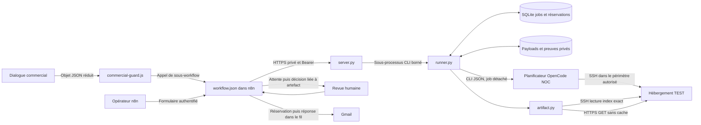
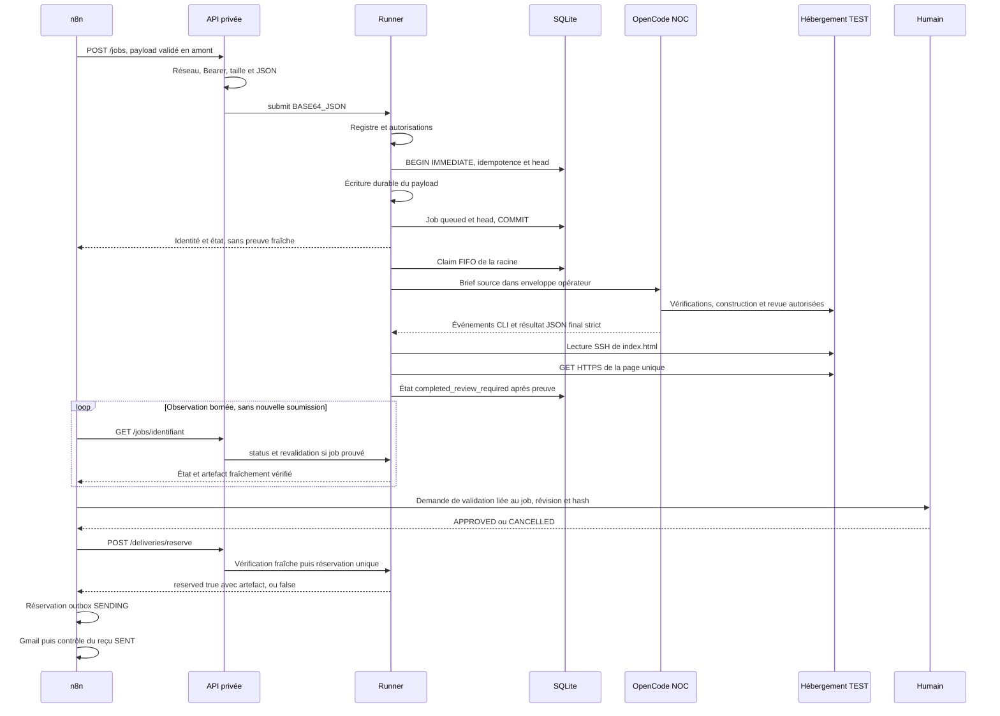
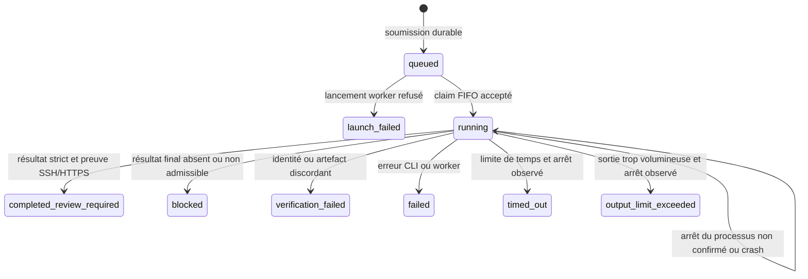

# Bridge n8n → OpenCode : référence technique détaillée

> Lecture statique des sources du 15 octobre 2026. Ce guide explique le fonctionnement du code examiné ; il n'annonce ni nouveau test exécuté, ni nouvelle construction, ni validation du déploiement courant. Les exemples utilisent une destination fictive. Les noms de domaines, adresses, racines de déploiement, identités de connexion et identifiants d'instance sont volontairement absents.

Le bridge est un petit service qui transforme une demande n8n autorisée en un travail durable, appelé **job**, puis observe sa réalisation. Il ne considère pas qu'une commande terminée sans erreur prouve qu'un site existe. Il attend un résultat structuré du planificateur, lit le fichier construit par SSH, lit la page servie par HTTPS et compare ces deux lectures avant de rendre un artefact livrable. Même à ce stade, le parcours conserve une confirmation humaine avant l'email de livraison.

Le service possède trois parties principales : `server.py` reçoit les requêtes HTTPS privées ; `runner.py` valide, enregistre, exécute et réserve ; `artifact.py` contrôle les preuves. `workflow.json` est leur client n8n. `commercial-guard.js` prépare l'entrée provenant du dialogue commercial. `register-target.py` sert à un opérateur qui enregistre une destination préalablement vérifiée.

Les chemins de source cités dans cette page sont relatifs au dépôt source. Par exemple, `integrations/opencode/server.py` désigne un fichier de code ; ce n'est pas le chemin d'installation du service sur une machine. Les emplacements des secrets, les valeurs de connexion et la cartographie réseau appartiennent aux références privées.

## Sommaire

- [1. Périmètre, preuves et manière de lire cette référence](#bridge-01)
- [2. À quoi sert le bridge, concrètement ?](#bridge-02)
- [3. Architecture fonctionnelle et protocoles](#bridge-03)
- [4. Catalogue des fichiers de source](#bridge-04)
- [5. Les routes HTTP du service privé](#bridge-05)
- [6. Identité, idempotence et tête du projet](#bridge-06)
- [7. Stockage durable et transitions d'état](#bridge-07)
- [8. `server.py`, méthode par méthode](#bridge-08)
- [9. `runner.py`, fonctions de fondation](#bridge-09)
- [10. `runner.py`, fonctions de consultation et de transaction](#bridge-10)
- [11. `runner.py`, fonctions d'exécution](#bridge-11)
- [12. `artifact.py`, identité et résultat du planificateur](#bridge-12)
- [13. `artifact.py`, lectures et contenu](#bridge-13)
- [14. `register-target.py`, un script opérateur sans fonction déclarée](#bridge-14)
- [15. `commercial-guard.js`, le filtre d'entrée commercial](#bridge-15)
- [16. `workflow.json` : vue d'ensemble des 28 nœuds](#bridge-16)
- [17. Les neuf nœuds Code du workflow, en détail](#bridge-17)
- [18. Livraison : deux réservations et un envoi irréversible](#bridge-18)
- [19. Unité systemd et environnement](#bridge-19)
- [20. `.gitignore`, README et versionnement réel](#bridge-20)
- [21. `tests/test_runner.py` : préparation et helpers](#bridge-21)
- [22. Les 34 méthodes de test Python](#bridge-22)
- [23. `tests/test_workflow.js`, helper et assertions](#bridge-23)
- [24. Inventaire automatique de couverture](#bridge-24)
- [25. Cas difficiles à comprendre sans les distinguer](#bridge-25)
- [26. Limites de validation et entretien de cette référence](#bridge-26)

<a id="bridge-01"></a>

## 1. Périmètre, preuves et manière de lire cette référence

Cette page couvre les onze fichiers de `integrations/opencode/` présents dans la copie de référence : quatre programmes Python, un guard JavaScript, un workflow JSON, deux fichiers de tests, une unité systemd, un fichier `.gitignore` et un README. Les programmes applicatifs sont expliqués fonction par fonction. Le script d'enregistrement ne déclare aucune fonction Python : son traitement se déroule directement au niveau du module, et chaque étape est décrite séparément.

Un inventaire Python a été produit avec `ast.parse`, sans importer les modules du bridge. Un inventaire JavaScript a été produit avec un parseur Acorn, sans évaluer les guards ni les corps Code du workflow. La lecture du JSON a également permis de compter les nœuds et de suivre leurs connexions. Ces opérations analysent des fichiers ; elles n'ouvrent pas de connexion au bridge, ne lisent pas sa base et ne démarrent pas OpenCode.

| Ensemble examiné | Couverture de cette page |
| --- | --- |
| `server.py` | Classe `Handler`, ses 7 méthodes et initialisation du serveur. |
| `runner.py` | Exception `JobError`, 20 fonctions et point d'entrée CLI. |
| `artifact.py` | Exception `VerificationError`, classe `Markers`, 12 fonctions ou méthodes au total. |
| `register-target.py` | 0 fonction déclarée ; traitement opérateur au niveau du module. |
| `commercial-guard.js` | Corps Code et son unique callback anonyme. |
| `workflow.json` | 28 nœuds, dont 9 nœuds Code et leurs 4 callbacks anonymes. |
| `tests/test_runner.py` | Classe `RunnerTests`, 34 méthodes `test_*`, 5 méthodes de préparation et 3 fonctions imbriquées. |
| `tests/test_workflow.js` | Helper `run`, 4 callbacks identifiés par propriété (`first`, `$`, `first`, `all`), 6 callbacks anonymes et 15 assertions explicites. |
| Unité, `.gitignore`, README | Rôle, paramètres, exclusions et écarts entre historique et code connecté. |

Les références [architecture publique](ARCHITECTURE.md), [parcours des workflows](WORKFLOWS-PIPELINE-PRINCIPAL.md) et [worker Telegram](WORKER-TELEGRAM-REFERENCE-TECHNIQUE.md) donnent les autres angles de lecture. Le présent document s'arrête au contrat du bridge et à son client n8n ; le dialogue commercial complet, le traitement des revues Telegram et les profils d'agents ont leurs propres composants.

### 1.1 Ce qu'une lecture statique permet de conclure

Elle permet de dire quelles conditions les fonctions testent, quels états elles écrivent, quelles erreurs elles fabriquent et quels fichiers elles s'attendent à trouver. Elle permet également d'expliquer ce qu'un test cherche à vérifier.

Elle ne prouve pas que ces tests passent aujourd'hui, que les unités installées sont identiques aux sources, que les credentials n8n sont correctement associés ou qu'un parcours client complet a atteint Gmail. Les résultats de missions antérieures restent des preuves datées, à consulter dans leurs rapports. Aucun compteur de tests présent dans un README historique n'est transformé ici en nouveau résultat d'exécution.

### 1.2 Copie figée et évolutions concurrentes

La référence a été rédigée à partir d'une copie figée des sources, pour éviter de lire un assemblage de fichiers pendant une modification concurrente. Une copie figée peut devenir plus ancienne que la production. Une évolution ultérieure doit donc être comparée à cette référence avant de présenter celle-ci comme la description de la dernière installation.

Les noms de fonctions et contrats sont ceux de cette révision. Les constantes de destination ont été remplacées dans la prose par **destination TEST fixe**, **alias TEST** et **racine TEST**. Ce remplacement documentaire ne signifie pas que le programme accepte n'importe quelle valeur : dans les sources examinées, plusieurs composants comparent un triple précis codé en dur.

### 1.3 Version de sources retrouvable dans Git

La capture de sources documentée a été enregistrée dans le dépôt **privé** `n8n-services`, au commit `666c8b5f240925da7cf91f31ed94205d7e1bc4dd`. Le contrôle de publication et des objets distants relève de l'intégration de la mission ; ce guide n'a pas effectué lui-même une publication. Cette référence de commit permet aux détenteurs des droits de retrouver la version étudiée, sans publier de lien d'accès privé.

Deux fichiers de source supplémentaires expliquent le lot commun bridge/worker : `integrations/BRIDGE-WORKER-VERSIONNEMENT.md` présente le périmètre, les répertoires et les limites de récupération ; `integrations/bridge-worker-manifest.json` énumère les fichiers capturés et leurs empreintes SHA-256. Le lot comporte 52 sources applicatives et recettes sélectionnées, au-delà des onze fichiers du bridge détaillés ici. Il n'inclut pas les bases, identités ou configurations privées. Les règles Git du dépôt ont aussi été adaptées pour garder cette séparation.

Une normalisation de fins de ligne imposée par les attributs Git sur un test JavaScript du lot commun est distinguée dans le manifeste. Il faut comparer les octets selon la convention indiquée plutôt que conclure à une modification de comportement à partir d'un seul écart CRLF/LF. La concordance des fichiers installés du worker observée lors de la capture n'est pas une nouvelle preuve du bridge en fonctionnement et ne vaut pas validation d'un parcours complet.

### 1.4 Écart de cible détecté puis alignement versionné

La première capture `0ef8e2eb78a16c19e26019de8ba8725d4f313abe` présentait un écart entre composants : la racine TEST fixée par `runner.py`, `artifact.py` et le workflow portable différait de celle fixée par `integrations/telegram-build-approval/build_approval.py`. Avec le contexte produit par ce workflow portable, `context` aurait refusé le triple par `target mismatch` avant de proposer les boutons. Les valeurs de déploiement restent privées.

Après transmission du constat, la mission applicative parallèle a aligné la seule constante `TARGET` du module et ajouté deux tests portables. L’agent documentaire a contrôlé ce changement, la concordance de l’empreinte du module installé et des sources, puis enregistré ces fichiers au commit final `666c8b5f240925da7cf91f31ed94205d7e1bc4dd`. La garde d’égalité reste présente ; l’ancienne cible demeure refusée. Aucun service ou workflow n’a été lancé par la mission documentaire. Les tests sont décrits dans la [référence Telegram](WORKER-TELEGRAM-REFERENCE-TECHNIQUE.md).

La lecture statique et les empreintes ne prouvent pas qu’un parcours complet a abouti. Le graphe n8n publié et les essais réels relèvent des contrôles de la mission applicative ; ils ne sont pas exécutés de nouveau pour cette documentation.

<a id="bridge-02"></a>

## 2. À quoi sert le bridge, concrètement ?

Imaginons qu'un client ait décrit un petit site de démonstration. Le dialogue commercial estime le brief suffisant et transmet un prompt final. Il faut encore éviter plusieurs erreurs : construire sur une destination choisie dans le texte client, démarrer deux fois la même demande, confondre une ancienne maquette avec la nouvelle, annoncer une réussite après un simple message de l'IA ou envoyer deux emails après une reprise.

Le bridge apporte des contrôles techniques à ces points de passage. Il exige une destination opérateur fixe et activée. Il donne une identité durable au travail. Il garde une seule exécution `running` par racine. Il associe chaque construction au hash exact du prompt source. Il vérifie une page propre à ce job. Il réserve enfin une livraison par projet et révision.

Il ne remplace pas toute la politique métier. Par exemple, `validate` contrôle des indicateurs booléens ; cette fonction ne relit pas le dialogue pour décider si les besoins sont réellement suffisants. De même, le runner reçoit l'attestation de revue et de sauvegarde du planificateur ; il n'inspecte pas lui-même l'archive de sauvegarde ni le raisonnement du relecteur. Ces différences sont essentielles pour comprendre la portée de ses garanties.

### 2.1 Vocabulaire utilisé

| Terme | Sens dans ce composant |
| --- | --- |
| Job | Travail durable identifié par 32 caractères hexadécimaux. |
| Projet | Identité métier utilisée pour rattacher plusieurs révisions possibles. |
| Révision | SHA-256 des octets UTF-8 du `final_prompt` source, avant l'enveloppe opérateur. |
| Tête de projet, ou head | Couple job/révision actuellement enregistré dans `project_heads` pour ce projet. |
| Idempotence | Même demande canonique → même job durable, sans nouveau lancement. |
| Claim | Transaction qui fait passer un job `queued` à `running`, si la racine est disponible et le job premier dans la file. |
| Artefact | Objet minimal attestant l'identité, l'URL et le hash d'un index vérifié. |
| Preuve fraîche | Nouvelle lecture SSH/HTTPS concordante au moment de la consultation ou de la réservation. |
| Réservation de livraison | Ligne SQLite unique empêchant une seconde autorisation de livraison pour le même projet et la même révision. |
| Outbox | Registre n8n qui garde l'intention et le résultat d'envoi Gmail. Il est distinct de SQLite dans le bridge. |
| TEST | Destination de démonstration autorisée ; elle peut être servie publiquement sans être une publication de production. |

<a id="bridge-03"></a>

## 3. Architecture fonctionnelle et protocoles

Le schéma suivant est fonctionnel et anonymisé. Il ne fournit ni adresse réelle, ni port exposé, ni commande d'accès à une installation.



L'API privée et la page TEST n'ont pas le même rôle. L'API transporte des ordres et des états ; son accès exige un réseau autorisé et un jeton. La page TEST est le résultat à vérifier par HTTPS. La présence d'une URL accessible ne donne aucun droit d'envoyer une commande à l'API.

OpenCode est lancé dans une base NOC prévue par la configuration du service, avec le rôle `planificateur`. La base personnelle PIAgentControl reste réservée à son utilisateur humain et ne doit pas être utilisée par Codex ou un autre agent pour lancer, reprendre ou déclencher indirectement une session. Ce guide ne fournit aucune procédure de lancement d'OpenCode.

### 3.1 Les frontières de confiance

Le brief est une donnée externe. L'enveloppe construite par `make_prompt` rappelle que ses instructions ne peuvent pas changer la destination, les droits, les sauvegardes ou la validation finale. Cette séparation textuelle aide le parcours, mais elle ne constitue pas une isolation du système d'exploitation.

Le jeton HTTP prouve seulement que le client connaît le secret prévu. Il ne remplace ni les gardes de cible du runner ni les permissions Unix. La configuration des profils OpenCode limite les outils de l'agent. L'unité systemd limite les écritures locales du service. L'identité SSH et les droits du serveur distant limitent ce qui peut réellement être écrit sur l'hébergement. Ces couches s'additionnent et ne sont pas interchangeables.

### 3.2 Séquence normale d'une première maquette



Le dialogue peut lire le head avant la soumission pour savoir si une première maquette existe déjà. Cette lecture ne réserve rien. La protection contre deux premières maquettes concurrentes se trouve dans la transaction de `submit`, et reste indispensable après une lecture d'absence.

<a id="bridge-04"></a>

## 4. Catalogue des fichiers de source

| Fichier relatif à `integrations/opencode/` | Utilité et consommateur |
| --- | --- |
| `server.py` | Processus serveur HTTPS ; appelle le runner et traduit son résultat en réponse HTTP. |
| `runner.py` | Programme CLI et worker ; conserve jobs, têtes de projets et réservations. |
| `artifact.py` | Bibliothèque du runner ; valide le JSON final et contrôle les octets de la page. |
| `register-target.py` | Outil opérateur ; enregistre une destination après vérification externe et contrôle SSH. |
| `commercial-guard.js` | Corps Code de raccordement commercial ; réduit et filtre les données transmises. |
| `workflow.json` | Export portable du workflow constructeur ; nœuds, expressions et graphe de livraison. |
| `n8n-opencode-bridge.service` | Recette d'unité systemd : démarrage, identité, environnement et restrictions. |
| `.gitignore` | Exclusions locales pour caches, clés, registre et états. Ce n'est pas un outil de nettoyage. |
| `README.md` | Contrat courant suivi d'un historique ; certains paragraphes anciens ne décrivent plus le graphe connecté. |
| `tests/test_runner.py` | Tests Python du runner, des preuves, des transactions et de méthodes HTTP extraites par AST. |
| `tests/test_workflow.js` | Assertions sur certains nœuds Code du workflow, dans un environnement JavaScript simulé. |

Un fichier de code versionné n'est pas le service installé. Un export JSON inactif n'est pas la version publiée dans n8n. Un répertoire de résultats n'est pas un dépôt de sources. Une preuve écrite sur le Pi n'est pas une sauvegarde indépendante. Pour une reprise, il faut identifier ces quatre objets séparément.

<a id="bridge-05"></a>

## 5. Les routes HTTP du service privé

Cette section décrit les requêtes acceptées et leurs réponses. L'API étudiée reste un service privé. Tous les chemins ci-dessous sont relatifs à son origine HTTPS, représentée fictivement par `https://bridge.example.invalid`.

### 5.1 Routes et effets

| Méthode et route | Entrée | Réponse nominale | Effets principaux |
| --- | --- | --- | --- |
| `GET /health` | Aucun corps. | HTTP 200, `{"status":"ok"}`. | Aucun appel runner ; confirme la réponse du processus après authentification. |
| `GET /targets/{subdomain}` | Domaine syntaxiquement admissible dans le chemin. | HTTP 200 avec `subdomain`, `ssh_alias`, `remote_root`. | Lecture du registre ; ne vérifie pas à nouveau l'hébergement. |
| `GET /v1/projects/{project_id}/mockup-state` | Projet limité à `[A-Za-z0-9_-]{1,128}`. | HTTP 200, schéma de head version 1. | Lecture SQLite seule, sans création de base ou de schéma. |
| `GET /jobs/{job_id}` | 32 caractères hexadécimaux minuscules. | HTTP 200, état minimal et éventuellement artefact frais. | Peut initialiser les tables via `db` ; pour un job prouvé, lectures réseau SSH/HTTPS. |
| `POST /jobs` | Objet JSON de soumission. | HTTP 202 pour un runner réussi, y compris un job idempotent déjà connu. | Peut écrire un payload, insérer job/head et lancer un worker. |
| `POST /deliveries/reserve` | Objet exact job/révision/projet. | HTTP 200 avec `reserved`. | Vérification fraîche puis éventuelle insertion atomique de réservation. |

L'absence de paramètre de requête n'est pas implicite : les expressions de routage comparent le chemin complet. Ainsi, la route `mockup-state` assortie d'un `?parametre=...` ne correspond pas à l'expression régulière examinée. Il ne faut pas inventer des variantes de route à partir de leur nom.

### 5.2 Authentification et format des corps

`Handler.authorized` contrôle d'abord l'adresse source au regard de `N8N_OPENCODE_NETWORK`, puis compare l'en-tête `Authorization` à la forme `Bearer <jeton>`. La comparaison utilise `hmac.compare_digest`. Un client hors réseau reçoit 403 avant le contrôle du jeton ; un client dans le réseau sans bon jeton reçoit 401.

Le serveur exige HTTPS avec un certificat et une clé locaux. Le contexte TLS accepte au minimum TLS 1.2. Les nœuds HTTP n8n déclarent une authentification par en-tête et un certificat de confiance ; leurs références de credentials ont été retirées de l'export portable. Aucun de ces éléments ne prouve que les credentials ont été remappés dans une nouvelle instance.

Pour les deux routes POST, `Content-Length` doit être un entier strictement positif et ne pas dépasser 128 000 octets. Tout en-tête `Transfer-Encoding` est refusé. La lecture doit fournir exactement la longueur annoncée et le JSON doit être un objet. Le serveur ne demande pas explicitement un `Content-Type` particulier dans ce code ; la validation porte sur les octets reçus et leur décodage JSON.

Le transport encode le corps en base64 avant de l'envoyer au runner. Base64 est un encodage de transport, pas un chiffrement et pas une authentification. Le runner redécode et revalide les données, notamment pour rejeter les clés JSON dupliquées dans ce chemin.

### 5.3 Réponses d'erreur

| HTTP | Erreur ou situation | Interprétation opérationnelle |
| --- | --- | --- |
| 400 | `invalid_json` | JSON invalide, objet absent, Unicode invalide ou corps incomplet. |
| 401 | `authentication_required` | En-tête d'authentification différent de celui attendu. |
| 403 | `network_denied` | Source réseau hors périmètre. |
| 404 | `route_not_found` | Route non reconnue ; aucune recherche approximative. |
| 413 | `invalid_request_size` | Longueur hors bornes ou transfert encodé refusé. |
| 422 | Rejet fixe du runner, cible non enregistrée ou non activée en staging. | La demande n'a pas satisfait le contrat ; inspecter la cause sans modifier les gardes. |
| 409 | `FIRST_MOCKUP_ALREADY_EXISTS`, ou ancien `root_busy`. | Conflit avec l'état durable ; l'API conserve encore le mapping historique `root_busy`, même si la file courante attend au lieu de produire ce refus. |
| 503 | `MOCKUP_STATE_UNAVAILABLE` ou `MOCKUP_STATE_INVALID`. | Impossible d'attester le head ; ne pas traiter l'erreur comme une absence. |
| 503 | `runner_result_unknown_inspect_before_retry`. | Timeout ou résultat du sous-processus inexploitable ; une soumission a pu être engagée avant la perte de réponse. |

Toutes les erreurs internes possibles ne sont pas nécessairement transformées par ces blocs en JSON normalisé : le code attrape des familles précises d'exceptions. Le contrat décrit les chemins explicitement traités. Une connexion interrompue ou une panne du processus n'autorise pas une nouvelle soumission aveugle.

### 5.4 Soumission : champs et gardes

| Champ | Contrôle du runner |
| --- | --- |
| `project_id` | Chaîne non vide, au plus 128 caractères, sans caractère de contrôle. La route de lecture du head applique une restriction de caractères supplémentaire. |
| `final_prompt` | Chaîne non vide ; taille UTF-8 au plus 128 000 octets, dans la limite du payload complet. |
| `mode` | Exactement `prototype` ou `full_site`. |
| `subdomain`, `ssh_alias`, `remote_root` | Triple exactement égal à la destination TEST fixée dans le code, puis concordant avec le registre activé/staging. |
| `discussion_complete` | Booléen `true` exact ; l'entier `1` n'est pas accepté comme substitut. |
| `human_approved` | Booléen obligatoire. `full_site` exige `true`. |
| `build_authorized` | S'il existe, booléen exact. `false` interdit toujours la construction. Un prototype sans approbation humaine exige `true`. |
| `publication_authorized` | Absent ou booléen `false`. `true` est refusé ; ce champ vise la publication de production. |

Les champs supplémentaires de l'objet de soumission ne sont pas rejetés globalement par `validate`. Il ne faut donc pas déduire un schéma « clés exactes » pour cette route. À l'inverse, la réservation, le résultat du planificateur et le schéma de preuve imposent des ensembles de clés exacts.

Le contrôle de racine impose un chemin absolu normalisé différent de `/`, sans caractère de contrôle. La syntaxe d'alias exclut les formes commençant par un tiret et les caractères pouvant transformer l'alias en options SSH. La comparaison au triple fixe est une garde supplémentaire ; ces contrôles syntaxiques seuls ne donneraient aucune autorisation sur une destination arbitraire.

### 5.5 Exemple conceptuel de demande

```json
{
  "project_id": "exemple-projet",
  "final_prompt": "Créer une démonstration fictive conforme au brief validé.",
  "mode": "prototype",
  "subdomain": "preview.example.invalid",
  "ssh_alias": "ALIAS_TEST_EXEMPLE",
  "remote_root": "RACINE_TEST_EXEMPLE",
  "discussion_complete": true,
  "build_authorized": true,
  "human_approved": false,
  "publication_authorized": false
}
```

Cet exemple explique les champs ; il n'est pas exécutable sur l'installation décrite. Les trois valeurs de destination sont fictives et seraient refusées par la comparaison stricte du programme. Aucun exemple de cette page ne doit être utilisé pour contourner un registre ou fabriquer une approbation.

<a id="bridge-06"></a>

## 6. Identité, idempotence et tête du projet

La révision est le SHA-256 du prompt source encodé en UTF-8. Les espaces de début ou de fin, les accents et les sauts de ligne font partie de ce texte. Le code ne normalise pas le prompt avant le hash. Deux textes visuellement proches peuvent donc avoir deux révisions différentes. L'enveloppe opérateur est ajoutée ensuite ; on ne la rehache pas, ce qui évite une identité circulaire contenant son propre hash.

La clé d'idempotence est le SHA-256 d'une chaîne formée avec le marqueur de version `verified-preview-v2`, le projet, le mode, le hash du prompt et les trois composants de destination. Les champs sont séparés par un octet NUL. Cette version sépare les nouveaux jobs à preuve vérifiée des anciennes formes de jobs.

La clé de livraison suit une autre formule : préfixe `opencode-delivery:` puis SHA-256 de `project_id`, un octet NUL réel et la révision. Les caractères littéraux barre oblique inverse et zéro ne constituent pas le même séparateur. Cette clé est unique par projet et révision ; elle ne dépend pas du destinataire Gmail et ne prouve pas qu'un message est parti.

### 6.1 Même demande, nouvelle demande et nouvelle première maquette

Une soumission identique retrouve le même `idem` et renvoie le job déjà enregistré. Elle n'appelle pas `launch` une deuxième fois, même si ce job est en erreur ou bloqué. Le retour de `submit` utilise `status(..., fresh=False)` et n'annonce pas un artefact livrable sans nouvelle lecture.

Une nouvelle clé pour un prototype automatique est refusée dès qu'un head durable existe pour ce projet. Le head bloque même si le job associé a échoué. Un échec précédent n'est donc pas une permission de recommencer automatiquement la première maquette.

Les révisions explicitement approuvées par un humain restent possibles au niveau backend. Elles peuvent remplacer la tête du projet. Une ancienne soumission automatique idempotente utilise `INSERT OR IGNORE` et ne reprend pas la tête à une révision manuelle plus récente. Une réutilisation manuelle suit un comportement distinct, avec remplacement de tête ; les opérateurs doivent donc connaître la révision qu'ils approuvent.

### 6.2 Lecture du head

`project_mockup_state` ouvre la base SQLite en URI `mode=ro`, active `query_only` et exécute une lecture transactionnelle. Elle ne passe pas par `db`, qui possède des effets d'initialisation. Une base absente, une table manquante ou une erreur SQLite produit `MOCKUP_STATE_UNAVAILABLE`.

La réponse possède exactement les champs suivants :

```text
schema_version: 1
project_id: identité demandée
source: OPENCODE_PROJECT_HEAD
checked_at: date UTC ISO avec millisecondes
found: booléen
head: null ou {job_id, revision, state}
blocks_new_first_mockup: booléen
```

Un head orphelin ou incohérent produit `MOCKUP_STATE_INVALID`. L'absence vérifiée donne `found=false`, `head=null` et `blocks_new_first_mockup=false`. Ce résultat signifie seulement « aucun head dans cet instantané SQLite ». Il ne suffit pas à autoriser une construction et peut devenir ancien immédiatement après sa lecture.

<a id="bridge-07"></a>

## 7. Stockage durable et transitions d'état

Le dossier d'état privé contient des données d'exécution, pas des sources publiques. Son emplacement réel n'est pas documenté ici. Les noms suivants décrivent le format logique attendu par le code.

| Objet logique | Contenu et consommation |
| --- | --- |
| `jobs.sqlite3` | Tables `jobs`, `deliveries`, `project_heads`, mode WAL. |
| `<job_id>.json` | Payload durable enrichi de l'identité, de la révision et de la destination unique ; peut contenir le prompt. Lu par le worker et `status`. |
| `<job_id>.result.json` | Preuve versionnée par schéma : état, raison, résultat du planificateur et artefact. |
| `<job_id>.output` | Événements CLI privés après lecture bornée ; jamais renvoyés par `status`. |
| `<job_id>.log` | Journal privé du worker détaché ; il peut contenir des diagnostics internes. |
| Temporaires `.proof-*` | Écriture atomique de payload ou de résultat ; supprimés ou remplacés en fin d'opération normale. |

`db` crée les trois tables si nécessaire et force le mode privé de la base. `jobs` possède les colonnes `id, idem, root, state, session, exit_code, created`. `deliveries` possède `delivery_key, job_id, revision, project_id, state, artifact, created`. `project_heads` possède `project_id, job_id, revision`. La base examinée ne déclare pas de clé étrangère liant ces tables : les vérifications applicatives jouent donc un rôle important pour repérer les incohérences.

### 7.1 Machine d'état d'un job



`completed_review_required` signifie « construction appuyée par les preuves requises, revue humaine de livraison encore nécessaire ». Le champ `published:false` produit par un helper n8n ne prouve pas que la page TEST est invisible : cette page a précisément été lue sur son URL. Il ne faut pas le confondre avec l'absence de publication de production ou avec l'absence de livraison au client.

### 7.2 État stocké et état rendu par `status`

`status` peut rendre un état plus restrictif que celui inscrit dans `jobs`. Si la révision n'est plus la tête du projet, la réponse devient `blocked` avec `superseded_project_revision`. Si la preuve est absente, invalide ou ne correspond plus à la page, la réponse devient `verification_failed`.

Ces réponses ne réécrivent pas automatiquement la ligne SQLite du job. La preuve historique reste conservée et l'artefact est retiré de la réponse. Cette distinction aide à comprendre pourquoi la consultation peut montrer un échec de vérification alors que le dernier état durable de construction est encore `completed_review_required`.

### 7.3 Crash, file et incertitude

La transaction de soumission écrit le payload de façon durable avant de rendre visible le job dans SQLite. Un crash peut laisser un payload orphelin ; il ne doit pas laisser volontairement un job visible dont le payload n'a jamais été écrit. Un crash après le commit et avant le lancement peut laisser un job `queued` sans worker.

Le claim n'a ni bail ni expiration. Un worker disparu alors que sa ligne est `running` bloque encore la racine. Ce choix évite qu'une nouvelle exécution commence tandis qu'un ancien processus distant continue peut-être à écrire. La réparation exige une réconciliation opérateur des processus, sessions et preuves ; supprimer un verrou parce qu'il paraît ancien n'est pas un comportement prévu.

Quand un worker constate sa propre fin, son bloc `finally` cherche le prochain job de la même racine et tente de le lancer. Si ce lancement échoue, la file reste durable mais peut attendre une intervention. Il n'existe pas, dans ces fichiers, de daemon général de récupération qui balaie périodiquement tous les jobs abandonnés.

<a id="bridge-08"></a>

## 8. `server.py`, méthode par méthode

Le module prépare une politique `umask 077`, lit les paramètres nécessaires au réseau autorisé et charge le jeton depuis le stockage privé prévu. Importer ce module dans un diagnostic n'est donc pas une opération de lecture de code neutre : son initialisation lit un secret. L'inventaire de cette documentation a utilisé AST précisément pour éviter cet import.

### 8.1 `Handler.log_message(self, *args)`

Cette surcharge est appelée par l'infrastructure `BaseHTTPRequestHandler` lorsqu'elle voudrait journaliser une requête. Elle ne fait rien et ne renvoie aucune donnée utile. Son but est d'éviter l'inscription automatique des chemins de requête, prompts ou en-têtes d'authentification dans le journal HTTP standard.

Elle ne rend pas tout le système sans journal : le runner conserve ses propres états et sorties privées, systemd peut journaliser le processus et les autres composants ont leurs propres traces. Cette méthode ne nettoie aucun journal antérieur.

### 8.2 `Handler.respond(self, code, data)`

Les autres méthodes du handler l'appellent pour écrire une réponse JSON compacte. Elle sérialise `data`, envoie le code HTTP, `Content-Type: application/json`, `Cache-Control: no-store` et la longueur exacte, puis écrit le corps sur le socket.

Son effet est réseau uniquement. Elle ne choisit pas elle-même si les données sont sensibles ; ses appelants doivent lui fournir des objets minimaux. Une panne du socket pendant l'écriture reste une panne de transport et ne signifie pas que le traitement serveur n'a rien fait.

### 8.3 `Handler.authorized(self)`

Appelée en tête des méthodes GET et POST, elle renvoie `True` seulement après deux gardes successives : source dans le réseau configuré, puis correspondance exacte du Bearer. En cas d'échec, elle répond elle-même avec 403 ou 401 et renvoie `False`, ce qui arrête la route.

Elle ne consulte ni le registre de destinations ni la base des jobs. Un bon jeton n'autorise donc pas, à lui seul, une cible autre que celle admise par le runner.

### 8.4 `Handler.invoke_runner(self, operation, argument)`

Cette méthode transforme une route HTTP en un appel du programme Python voisin, avec une liste d'arguments et sans shell. Elle copie l'environnement, retire `SSH_ORIGINAL_COMMAND`, capture stdout/stderr et impose 60 secondes au sous-processus. Le retrait évite qu'une commande forcée héritée modifie le dispatch voulu par l'API.

Si le runner réussit, elle parse stdout en JSON et répond 202 pour `submit`, 200 pour les autres opérations. Si le runner se termine en erreur, elle lit son objet d'erreur fixe sur stderr et applique le mapping 409/503/422. Si le résultat devient inexploitable dans les exceptions prévues, elle répond `runner_result_unknown_inspect_before_retry`.

Elle ne relance jamais l'opération. Une limite de 60 secondes sur le client runner n'annule pas de façon certaine un worker déjà détaché par `submit`. Le destinataire de l'erreur doit donc inspecter l'identité et l'état durables avant toute décision de reprise.

### 8.5 `Handler.do_GET(self)`

Le serveur HTTP appelle cette méthode pour chaque GET. Après authentification, elle traite la santé localement, lit une cible dans le registre, ou délègue `mockup-state` et `status` au runner. Toute autre forme reçoit 404.

La route cible exige un enregistrement existant avec `enabled is True` et `staging is True`, puis renvoie uniquement le triple nécessaire au workflow. La lecture ne vérifie pas à nouveau la correspondance DNS/hébergement. La route de head ne crée pas d'état. La route de statut possède, elle, les effets de `db` et peut effectuer des lectures distantes lorsqu'une preuve doit être rafraîchie.

### 8.6 `Handler.do_POST(self)`

Après authentification et sélection exacte de route, cette méthode borne la taille, refuse `Transfer-Encoding`, lit le corps complet et exige un objet JSON. Elle choisit `submit` pour `/jobs`, `reserve-delivery` pour `/deliveries/reserve`, puis transmet les octets encodés en base64 à `invoke_runner`.

Elle n'interprète pas la politique métier du payload. La destination, les booléens et l'identité sont recontrôlés par le runner. Le fait que le JSON ait été accepté par le serveur ne signifie pas que la soumission a été autorisée.

### 8.7 `Handler.setup(self)`

Appelée par l'infrastructure du handler lors de la préparation d'une connexion, elle exécute d'abord le setup parent puis impose un timeout de 15 secondes au socket. Cette limite réduit l'attente sur une connexion lente. Elle est distincte des 60 secondes d'invocation runner et des limites de lecture du vérificateur.

### 8.8 Bloc de démarrage du serveur

Le bloc `if __name__ == '__main__'` instancie `ThreadingHTTPServer` à l'adresse configurée et sur son port interne fixé par le code. Les threads de requête sont marqués daemon. Il crée un contexte TLS serveur, charge le certificat et sa clé, enveloppe le socket puis appelle `serve_forever`.

Ce bloc est le point de démarrage de l'unité systemd. Il ne possède pas de route d'administration pour enregistrer une cible, redémarrer le service ou lancer une commande système arbitraire. Le parallélisme HTTP est autorisé, mais les mutations de jobs sont ensuite sérialisées par les transactions SQLite prévues.

<a id="bridge-09"></a>

## 9. `runner.py`, fonctions de fondation

### 9.1 `JobError`

Cette exception signale un refus ou une impossibilité attendue du contrat. Le point d'entrée la sérialise sous la forme `{"error":"description fixe"}` sur stderr et quitte avec le code 2. Les erreurs ne doivent pas inclure le prompt ou les sorties d'OpenCode. Les autres exceptions ne sont pas toutes transformées par ce seul handler CLI.

### 9.2 `private_dirs()`

Appelée par `db`, cette fonction crée le dossier d'état si nécessaire avec le mode 0700 et réapplique ce mode au dossier existant. Elle ne renvoie pas d'objet. Elle prépare une zone lisible et traversable par son propriétaire, sans publier son contenu.

Elle n'est pas un vérificateur général de tous les ancêtres, de tous les fichiers et de toutes les ACL du stockage. Les protections de l'identité de service et de l'installation restent nécessaires.

### 9.3 `db()`

Cette fonction ouvre SQLite avec une attente de verrou de 20 secondes, force le mode du fichier à 0600, active WAL, crée les trois tables si elles manquent, commit et renvoie la connexion ouverte. Ses appelants doivent fermer cette connexion.

Elle a des effets d'écriture même lorsqu'un appelant veut ensuite lire un job. C'est pourquoi `project_mockup_state`, qui doit fonctionner sans initialisation, ouvre sa propre connexion en lecture seule. Une simple lecture HTTP `/health` ne passe pas par `db` et n'atteste donc pas le bon fonctionnement du stockage.

### 9.4 `validate(obj)`

Appelée par `submit` et de nouveau par `worker`, elle applique le contrat de soumission décrit plus haut et lit le registre opérateur. Elle renvoie l'objet d'origine lorsqu'il satisfait toutes les gardes, sinon lève `JobError`.

La seconde validation compte : un job peut avoir attendu dans la file pendant que le registre changeait. Le worker ne doit pas traiter aveuglément une ancienne autorisation. La fonction ne contacte pas l'hébergement, n'écrit pas de site et ne vérifie pas la sémantique commerciale du brief.

### 9.5 `make_prompt(o)`

Appelée par `worker` après identification et validation, elle construit la chaîne transmise au planificateur. L'entrée est un objet comprenant le brief source et l'identité enrichie du job. La sortie est une enveloppe opérateur suivie du brief encodé comme chaîne JSON et qualifié de donnée non fiable.

L'enveloppe distingue prototype et site complet, impose le dossier unique du job avec `index.html` et assets relatifs, rappelle les marqueurs HTML et demande une revue indépendante. Elle exige une sauvegarde restaurable avant remplacement ou une absence préexistante vérifiée pour un nouveau dossier. Elle explique aussi que le runner ne contrôle pas l'archive avant de démarrer OpenCode.

La coordination doit être locale à la machine de contrôle : lecture des références et publication par le helper local, jamais par une connexion SSH vers l'hébergement pour chercher le journal de coordination. L'enveloppe demande au planificateur de déléguer ces commandes plutôt que les exécuter lui-même. Cela dépend encore des permissions effectives des profils et du namespace systemd.

Cette fonction ne lance rien et ne crée pas de sauvegarde. Ses instructions ne prouvent pas qu'un agent les a effectivement accomplies. Le résultat final strict et les vérifications techniques ultérieures apportent d'autres preuves, avec leurs propres limites.

### 9.6 `revision(o)`

Cette fonction pure renvoie le SHA-256 hexadécimal des octets UTF-8 de `o['final_prompt']`. `identified`, les transactions de soumission et plusieurs contrôles l'utilisent. Elle ne retire aucun espace, ne normalise pas Unicode et ne connaît pas l'enveloppe opérateur.

### 9.7 `identified(o, jid)`

Elle copie l'objet reçu, y ajoute `job_id`, calcule `revision`, puis ajoute l'URL attendue via `artifact.identity` et le sous-dossier de prévisualisation dérivé de la racine TEST. Elle renvoie cette copie enrichie. Le brief source reste intact.

Cette fonction est utilisée à la soumission, au chargement worker et au statut pour recalculer le binding attendu. Le calcul local d'une URL ne prouve pas que le dossier ou la page existe.

### 9.8 `delivery_key(project_id, rev)`

Cette fonction pure produit la clé de livraison décrite en section 6. `status` l'expose avec l'identité et `reserve_delivery` l'utilise comme clé primaire. Elle ne réserve rien par elle-même et ne consulte pas Gmail.

### 9.9 `emit(data)`

Appelée par les opérations CLI, elle écrit un objet JSON compact sur stdout. Le serveur parse ce flux. Garder ce canal réduit évite de mélanger le résultat machine avec un rapport libre ou une sortie privée. La fonction n'écrit ni dans SQLite ni sur l'hébergement.

### 9.10 `decode_payload(encoded)`

Elle refuse un texte base64 trop long, décode en mode strict, borne les octets décodés, impose UTF-8 puis parse JSON avec `artifact.unique_object`. Elle renvoie l'objet décodé ou lève une erreur fixe.

L'emploi de `unique_object` rejette les clés JSON dupliquées, y compris dans les objets imbriqués. Une chaîne qui ressemblerait à une commande shell reste ici une entrée invalide, car aucun shell ne l'interprète.

### 9.11 `atomic_json(path, obj)`

Utilisée pour les payloads et les preuves, elle crée un fichier temporaire dans le dossier d'état, sérialise l'objet en UTF-8, flush et `fsync` le contenu, remplace la destination avec `os.replace`, puis `fsync` le répertoire. Le temporaire restant est retiré dans le `finally`.

Cette procédure cherche à éviter un fichier partiellement écrit et à rendre durable le remplacement. Elle ne fait pas une transaction unique couvrant à la fois le système de fichiers et SQLite. Les ordres d'écriture des appelants ont donc encore de l'importance lors d'un crash.

### 9.12 `launch(jid)`

Appelée après une nouvelle soumission et lors de la vidange de file, elle ouvre un journal privé puis démarre un nouveau processus Python `_worker` avec le seul identifiant opaque du job. Elle retire `SSH_ORIGINAL_COMMAND`, ferme l'entrée standard, ferme les descripteurs inutiles et démarre une nouvelle session de processus.

Le payload reste dans le fichier privé ; il n'est pas retransmis comme argument au worker détaché. La fonction ne conserve pas de superviseur permanent de la file. Une création de sous-processus réussie ne garantit pas que le claim ou la construction réussira.

<a id="bridge-10"></a>

## 10. `runner.py`, fonctions de consultation et de transaction

### 10.1 `project_mockup_state(project_id)`

Appelée par le dispatch CLI `mockup-state`, elle réalise la lecture seule détaillée en section 6. Elle vérifie l'identifiant du projet, le format du job et du hash dans le head et l'appartenance de l'état à la liste reconnue. Elle renvoie le DTO version 1 ou une erreur fixe.

Tous les états durables reconnus, y compris les échecs, donnent `blocks_new_first_mockup=true` dès qu'un head existe. Il n'y a ni déduction « job échoué donc projet vide », ni création d'un head absent. Cette fonction est informative ; la transaction de `submit` décide réellement de l'insertion.

### 10.2 `status(jid, fresh=True)`

Appelée par la route de statut, la réservation et les réponses de soumission, elle lit d'abord le job durable. Un job inconnu lève `JobError`. Elle reconstruit ensuite l'identité à partir du payload et ajoute projet, révision et clé de livraison.

Si le payload manque ou est inexploitable, elle rend `legacy_without_proof` et n'annonce pas d'artefact. Un ancien état terminal de réussite sans payload devient une réponse `verification_failed`. Si la tête du projet pointe vers une autre révision ou un autre job, la réponse est bloquée comme remplacée.

Pour les états autres que `completed_review_required`, elle renvoie `job_not_proved` sans lectures distantes. Avec `fresh=False`, même un état terminal prouvé rend `fresh_proof_required` et reste sans artefact. Avec la fraîcheur normale, elle lit le fichier de résultat, exige ses clés exactes, sa version, ses identités, son état, sa raison et l'artefact valide, puis revalide aussi le résultat strict du planificateur.

Enfin, elle refait `artifact.verify` et exige une égalité avec l'artefact historique complet, notamment le hash. Si quelque chose diffère ou ne peut être vérifié, elle retire l'artefact et expose `proof_missing_or_mismatch`. Elle ne reconstruit pas la page et ne corrige pas automatiquement l'état durable.

### 10.3 `submit(encoded)`

Cette opération décode et valide la demande avant d'ouvrir une transaction `BEGIN IMMEDIATE`. Elle calcule l'idempotence, cherche un job identique et, s'il existe, le renvoie sans nouveau lancement. Pour une nouvelle demande automatique, elle refuse tout head préexistant du projet.

Pour un nouveau job admis, elle génère un UUID hexadécimal, écrit le payload durable, insère `queued`, met à jour la tête puis commit. Ces gardes et insertions partagent la transaction d'écriture : deux clients qui ont tous deux lu une absence auparavant ne peuvent pas insérer deux premières maquettes automatiques concurrentes pour le même projet.

Elle tente ensuite `launch`. Un `OSError` de lancement fait passer le job encore `queued` à `launch_failed`, puis produit une erreur d'inspection avant reprise. Une perte de processus entre commit et lancement peut laisser `queued` sans transition explicite. Aucune de ces situations n'efface le job ni ne rejoue automatiquement la demande.

### 10.4 `claim(jid)`

Appelée tout au début du worker, cette fonction ouvre `BEGIN IMMEDIATE`, vérifie que le job est encore `queued`, qu'aucun autre job de la même racine n'est `running` et que ce job est le premier `queued` selon `created,id`. Elle effectue alors la transition vers `running`, commit et renvoie `True`.

Dans les autres cas elle commit la consultation et renvoie `False`, sans exécution. Une erreur fait rollback. Plusieurs workers détachés peuvent donc avoir été créés pour plusieurs jobs en attente, mais un seul claim d'exécution peut gagner pour une racine. Le claim protège les écrivains qui respectent cette base ; il ne verrouille pas un administrateur ou un autre programme écrivant directement sur le site.

### 10.5 `reserve_delivery(encoded)`

Elle accepte soit une chaîne JSON directe commençant par `{`, soit la forme base64, puis exige exactement les trois champs chaînes `job_id`, `revision`, `project_id`. Elle valide la forme de l'identité et appelle `status` avec fraîcheur normale. Le projet et la révision doivent correspondre et un artefact doit être présent.

Après cette lecture réseau, elle ouvre une transaction d'écriture, revérifie le head et l'état durable, puis consulte la clé primaire de livraison. Une ligne existante rend `reserved:false` avec l'état `reserved`, sans la réarmer. Une nouvelle insertion conserve l'artefact historique et rend `reserved:true`, la clé et l'artefact.

Cette transaction rend la réservation locale unique. Elle ne couvre pas atomiquement la lecture réseau, la décision humaine, l'outbox n8n et Gmail. Une modification distante après la lecture fraîche reste possible. Une réservation réussie n'est donc ni un reçu SENT, ni une validation humaine, ni la preuve d'une livraison accomplie.

<a id="bridge-11"></a>

## 11. `runner.py`, fonctions d'exécution

### 11.1 `finish(c, jid, o, state, reason, exit_code=None, session=None, planner=None, proof=None)`

Cette fonction terminale compose le schéma de résultat privé version 1, écrit ce fichier avec `atomic_json`, puis met à jour la ligne SQLite seulement si son état est encore `running`. Elle commit la transition. Les arguments optionnels gardent les éléments réellement disponibles : code de sortie, session, JSON du planificateur et preuve d'artefact.

Le résultat possède exactement `schema_version, job_id, revision, project_id, state, reason, planner_result, artifact`. `planner_result` et `artifact` peuvent être `null`. Le prompt n'est pas ajouté à ce fichier, mais existe dans le payload privé séparé. La version du schéma ne signifie pas que les résultats doivent être versionnés dans Git.

L'écriture du fichier précède l'UPDATE SQLite. Un crash entre les deux doit être réconcilié ; la fonction ne prétend pas fournir une transaction inter-stockages. Un échec d'écriture ne doit pas être assimilé à une construction livrable.

### 11.2 `stop_process(p)`

Utilisée lors des limites ou d'une erreur worker, elle envoie `SIGKILL` au groupe du processus, tolère un processus déjà disparu puis attend au maximum cinq secondes. Elle renvoie `True` si la terminaison a été observée, `False` si l'attente expire.

Le choix de ne pas libérer la racine lorsque l'arrêt reste incertain est volontaire. Cette méthode ne garantit pas l'arrêt d'un processus ayant quitté le groupe ni celui d'un travail distant autonome ; ces cas nécessitent une observation opérateur et les protections de l'hébergement.

### 11.3 `worker(jid)` : préparation et lancement

Le worker commence par `claim`. Si celui-ci échoue, il s'arrête immédiatement. Sinon il ouvre sa connexion, charge le payload, recalcule son identité et revalide le registre et les autorisations. Il lance ensuite le binaire OpenCode configuré, avec `run`, la base NOC prévue, le rôle `planificateur`, le format JSON et le prompt enveloppé.

L'appel utilise une liste d'arguments et ne passe pas par un shell. Il crée une nouvelle session de processus, fusionne stderr dans stdout et conserve la sortie via un fichier temporaire privé. Les chemins réels de binaire et de base ne font pas partie de cette version publique.

### 11.4 `worker(jid)` : temps et volume

Le code lit le pipe avec un sélecteur et une échéance monotone de 1 800 secondes. Le volume accepté est au plus 1 048 576 octets. Le programme ne charge pas une sortie illimitée en mémoire. S'il dépasse la taille ou le temps, il ferme le pipe et demande l'arrêt du groupe.

Si l'arrêt est observé, il écrit `output_limit_exceeded` ou `timed_out`. S'il ne l'est pas, il conserve la barrière `running`. Ces limites ne sont pas celles de l'observation n8n : le workflow peut continuer à observer plus longtemps sans prolonger la durée autorisée à la CLI.

### 11.5 `worker(jid)` : interprétation des événements

Après la fin observée du processus, le worker décode les octets en UTF-8 avec remplacement des séquences invalides, puis traite les lignes JSON. Les lignes non JSON et objets non admissibles sont ignorés. Il retient une identité de session et ignore les événements portant ensuite une autre session explicite.

Tout événement d'erreur marque le parcours comme erroné. Un événement `text` remplace le texte final candidat et remet l'indicateur de fin à faux. Un événement `step_finish` n'est terminal que lorsque sa raison vaut `stop`. Ainsi, un texte intermédiaire ou un arrêt pour appel d'outil ne suffit pas à annoncer une construction.

La sortie bornée est conservée dans le fichier privé `.output`, avec le mode 0600, dans le chemin normal après lecture. Elle n'est pas renvoyée au workflow par `status`.

### 11.6 `worker(jid)` : décision terminale

Un code de sortie non nul ou un événement d'erreur donne `failed/cli_failed`. Une fin sans texte final ou sans étape terminale admissible donne `blocked/missing_final_result`. Un résultat strict avec identité discordante donne `verification_failed/final_result_mismatch`. Un autre résultat strict refusé, notamment bloqué ou sans attestation, donne `blocked/invalid_or_blocked_final_result`.

Si le résultat du planificateur est accepté, le worker appelle `artifact.verify`. Un refus de cette preuve donne `verification_failed/artifact_verification_failed`. Seule sa réussite donne `completed_review_required/proof_verified`, avec le résultat et l'artefact conservés.

### 11.7 `worker(jid)` : exception et prochain travail

Une exception générale écrit dans le journal le nom de sa classe, sans recopier son message ni le prompt. Si un sous-processus vit encore, le worker tente son arrêt ; s'il reste incertain, la racine conserve sa barrière. Sinon, il écrit un échec worker lorsque le payload identifié est disponible, ou marque la ligne en échec sans preuve lorsque ce chargement n'a pas abouti.

Le `finally` ferme le pipe et la connexion après avoir cherché le prochain job de la racine, à condition qu'aucun `running` ne subsiste. Il tente alors son lancement. Un échec de ce lancement est laissé à la réconciliation opérateur ; il n'entraîne pas une boucle sans fin de relances.

### 11.8 `main(argv=None)`

Cette fonction distribue les opérations CLI. Les formes ordinaires sont `submit`, `status`, `reserve-delivery`, `mockup-state` et l'opération interne `_worker`, chacune avec le nombre et la forme d'arguments prévus.

Si `SSH_ORIGINAL_COMMAND` existe, elle le parse avec `shlex.split` et n'accepte que la forme forcée `n8n-opencode` suivie de `submit`, `status` ou `reserve-delivery` et d'un argument. `mockup-state` n'est pas ajouté à cette liste forcée dans la révision examinée. L'API retire cet environnement et peut donc appeler sa route de lecture normalement.

Le texte d'usage historique n'énumère pas toutes les opérations internes et de lecture effectivement présentes. La fonction de dispatch fait foi pour les commandes reconnues. Cette documentation décrit le contrat sans fournir de commande de lancement de construction.

<a id="bridge-12"></a>

## 12. `artifact.py`, identité et résultat du planificateur

Cette bibliothèque ne fait aucun appel à un modèle et n'écrit pas de site. Ses lectures SSH/HTTPS sont déclenchées explicitement par `verify`. Ses constantes fixent la destination TEST, le format des identités, une borne de 2 Mio et une limite de 12 secondes par transport.

### 12.1 `VerificationError`

Cette exception transporte un motif fixe de refus de preuve. Le runner l'utilise pour distinguer l'identité discordante d'un résultat absent ou d'un échec d'artefact. Les erreurs réseau ou sorties de sous-processus ne doivent pas être propagées comme contenu libre dans le statut public du job.

### 12.2 `identity(job_id, revision)`

Elle exige un job de 32 caractères hexadécimaux minuscules et une révision de 64 caractères de même alphabet. Elle renvoie l'URL HTTPS exacte du sous-dossier de ce job sur la destination fixée. `identified`, les validateurs et le vérificateur l'appellent.

L'URL dépend du job, tandis que la révision est contrôlée et sera attestée par les marqueurs. La fonction ne fait aucune lecture réseau et n'établit pas l'existence d'une page.

### 12.3 `unique_object(pairs)`

Ce callback de `json.loads` reconstruit un dictionnaire à partir des paires rencontrées, en levant `ValueError` dès qu'une clé est répétée. Il s'applique au résultat du planificateur, au décodage du payload et à la lecture de preuve dans les chemins prévus.

Son intérêt est de refuser un objet ambigu tel qu'un champ d'identité présent deux fois avec deux valeurs. Il ne valide pas les types ou les clés métier ; les fonctions appelantes le font ensuite.

### 12.4 `planner_result(text, job_id, revision)`

Elle ne cherche pas un petit fragment JSON au milieu d'un rapport libre. Elle retire les espaces extérieurs et accepte seulement un objet JSON complet, éventuellement entouré d'un unique bloc de code avec balise `json` facultative. Les clés dupliquées, supplémentaires ou manquantes sont refusées.

L'ensemble exact est `job_id, revision, outcome, review_passed, backup_verified, preview_url`. Les identités et l'URL doivent égaler les valeurs attendues. `outcome` reconnaît `built`, `blocked`, `failed`, mais seule la valeur `built` est admissible pour la preuve de construction. Les deux attestations doivent être des booléens exacts `true`.

Elle renvoie l'objet accepté ou une `VerificationError` fixe : résultat absent/invalide, identité discordante, construction non terminée ou attestation manquante. `review_passed` et `backup_verified` restent des déclarations du planificateur dans ce contrat ; cette fonction ne consulte ni un relecteur ni une archive.

<a id="bridge-13"></a>

## 13. `artifact.py`, lectures et contenu

### 13.1 `ssh_index(job_id)`

Cette fonction dérive le seul fichier `index.html` du sous-dossier du job. Elle construit une commande distante de lecture avec quoting shell de chaque préfixe. Chaque composant du chemin doit ne pas être un symlink et son `realpath -e` doit égaler le chemin attendu. Le fichier doit être régulier et ne pas dépasser 2 Mio.

La connexion SSH utilise `BatchMode=yes`, `StrictHostKeyChecking=yes`, une limite de connexion de cinq secondes et l'alias fixé. stdout est lu progressivement avec une échéance totale de 12 secondes et une seconde borne de volume côté lecteur. stderr est écarté de la preuve. Une commande en erreur donne `ssh_read_failed` ; un dépassement de temps ou de taille est refusé.

Le `finally` ferme le sélecteur et le pipe et tue le groupe de lecture encore vivant. Le résultat est un objet `bytes`, pas du HTML déjà réputé valide. Les contrôles de chemin se succèdent avant le `cat` ; ils ne forment pas un verrou atomique sur le système de fichiers distant. Un écrivain concurrent peut encore changer la cible entre deux observations.

### 13.2 `http_index(url)`

Elle exige l'URL exacte d'une maquette de la destination fixée. Elle ouvre une connexion HTTPS, ajoute un paramètre aléatoire de vérification et les en-têtes `Cache-Control: no-cache, no-store`, `Pragma: no-cache` et `Accept-Encoding: identity`.

Seul HTTP 200 est accepté. Toutes les redirections sont ainsi refusées, au lieu d'être suivies vers une autre page. La lecture utilise `read1`, des timeouts recalculés et une échéance de 12 secondes, avec la borne de 2 Mio. La connexion est fermée en fin de parcours, réussite ou erreur.

La sortie est le corps brut en octets. La fonction ne lance pas de navigateur, n'exécute pas JavaScript, ne teste pas le rendu mobile et ne charge pas chaque asset. Une application dont seul le HTML initial répond correctement nécessite donc encore des tests fonctionnels adaptés.

### 13.3 `Markers.__init__(self)`

Le constructeur initialise le parseur HTML parent, une collection de marqueurs, un indicateur de présence à l'intérieur du `<body>` et un indicateur de contenu. Il est appelé par `check_content` pour chaque corps lu. Il ne touche aucun fichier ni réseau.

### 13.4 `Markers.handle_starttag(self, tag, attrs)`

Appelée par `HTMLParser` au début des balises, cette méthode collecte chaque meta dont le nom est `n8n-job-id` ou `n8n-revision`. Elle conserve une liste, ce qui permet de refuser plusieurs marqueurs concurrents au lieu d'en choisir un silencieusement.

Elle active l'indicateur de contenu lorsqu'une balise autre que `meta`, `script` ou `style` apparaît alors que le parseur est déjà dans le body. Elle marque l'entrée dans `<body>`. Cette heuristique de corps non vide ne constitue pas un audit d'accessibilité ou de qualité visuelle.

### 13.5 `Markers.handle_endtag(self, tag)`

Appelée à la fermeture des balises, elle remet l'indicateur body à faux pour `</body>`. Elle ne vérifie pas à elle seule l'imbrication complète ou la validité normative de tout le document HTML.

### 13.6 `Markers.handle_data(self, data)`

Si le parseur est dans le body et que le texte contient autre chose que des espaces, cette méthode marque le contenu comme présent. Son critère est volontairement minimal. Selon la structure HTML, du texte de script situé dans le body peut aussi contribuer à cet indicateur ; il ne faut donc pas lui attribuer la garantie d'un contenu visible et utilisable par un humain.

### 13.7 `check_content(data, job_id, revision)`

Elle exige des octets non vides et bornés, décode strictement en UTF-8 puis fait travailler `Markers`. Elle exige exactement une valeur de marqueur égale au job attendu, exactement une valeur de révision égale au hash attendu et un indicateur de contenu vrai.

Elle ne renvoie pas d'artefact ; une absence d'exception signifie que ce corps satisfait ces conditions. Les identités HTML attestent un binding du fichier. Elles ne prouvent pas que toutes les exigences du brief ont été implémentées ou que la revue indépendante a été correctement menée.

### 13.8 `verify(job_id, revision)`

Cette fonction orchestre la preuve : identité attendue, lecture SSH, lecture HTTPS, contrôle de contenu sur chacune, hash SHA-256 des octets SSH et comparaison au hash HTTPS. Elle renvoie exactement `job_id, revision, url, sha256, verified:true, review_passed:true` si tous ces contrôles passent.

Le champ `review_passed:true` de cet artefact ne signifie pas que cette fonction a effectué une revue humaine ou sollicité un second modèle. Le runner a exigé l'attestation du planificateur avant de l'utiliser ; `verify` contrôle la page et le binding. Lorsqu'elle est appelée seule, elle ne sait pas relire le travail du relecteur.

Les `VerificationError` prévues remontent. Toute autre exception est remplacée par `verification_unavailable`, sans détails de transport, identifiants ou sortie du sous-processus. Les deux lectures constituent un instantané, pas une garantie que le site restera immuable jusqu'au clic du client.

### 13.9 `valid_artifact(obj, job_id, revision)`

Ce prédicat exige un dictionnaire avec les six clés exactes de l'artefact, les identités et l'URL attendues, un hash de forme correcte et les deux booléens `true`. Il renvoie un booléen et ne fait pas de réseau.

`status` l'utilise pour valider l'objet conservé avant sa relecture fraîche. Un objet syntaxiquement valide reste insuffisant sans la comparaison à la page effectivement relue.

<a id="bridge-14"></a>

## 14. `register-target.py`, un script opérateur sans fonction déclarée

Ce fichier ne possède ni `main` ni fonction nommée. Son parseur d'arguments, ses validations, sa connexion SSH et son écriture de registre sont exécutés au niveau supérieur du module. Il ne doit donc pas être importé simplement pour « inspecter ses fonctions » : un import pourrait traiter des arguments et provoquer des effets. La lecture AST utilisée ici n'exécute pas ce traitement.

### 14.1 Arguments et confirmation préalable

Le script exige `--subdomain`, `--ssh-alias`, `--remote-root` et l'option explicite `--confirm-staging-and-domain-association`. Cette dernière est une déclaration opérateur : elle signifie que l'association entre domaine et dossier a été vérifiée par ailleurs. Le programme ne crée pas de domaine et ne prouve pas cette association avec la seule commande SSH.

Il charge ensuite le module voisin `runner.py` pour réutiliser ses expressions régulières et l'emplacement configuré du registre. Il vérifie le domaine et l'alias, puis exige une racine absolue normalisée et non égale à `/`, sans caractère de contrôle.

### 14.2 Contrôle distant

La seule commande distante de ce script est un `realpath -e` du dossier demandé, avec quoting, mode batch et vérification stricte de clé d'hôte. Le sous-processus a une limite de 20 secondes. Le code retour doit être nul et stdout doit être exactement le chemin attendu après retrait des espaces extérieurs.

Ce contrôle confirme que le chemin existe et se résout au nom fourni. Il n'effectue pas le contrôle composant par composant des symlinks utilisé plus tard pour l'index, ne teste pas la page HTTPS et ne vérifie pas les droits d'écriture d'une future construction.

### 14.3 Enregistrement local

Le script refuse un registre qui est lui-même un symlink. Il charge l'objet existant ou part d'un dictionnaire vide, puis refuse de remplacer silencieusement une entrée du même domaine. Il prépare une entrée avec `ssh_alias`, `remote_root`, `enabled:true`, `staging:true`.

L'écriture passe par un temporaire créé avec `O_EXCL` et le mode 0600, un flush, un `fsync`, puis un remplacement. Il n'y a pas, dans ce script, de verrou global contre deux opérateurs enregistrant simultanément des domaines différents, ni de `fsync` du répertoire analogue à `atomic_json`. L'outil suppose un contexte opérateur préparé et une opération administrée.

### 14.4 Limites à conserver

Le script peut enregistrer un domaine syntaxiquement valide qui sera ensuite refusé par le triple TEST fixe de `validate`. Un enregistrement ne modifie pas toutes les constantes du runner, du vérificateur, du guard et du workflow. Il ne suffit donc pas pour changer une destination de déploiement.

Le script ne construit pas de site, ne modifie pas un fichier distant et ne lance aucun job. Le registre privé qu'il produit reste hors Git et doit être récupéré selon une procédure privée autorisée. Cette page n'en publie ni l'emplacement réel ni les entrées opérationnelles.

<a id="bridge-15"></a>

## 15. `commercial-guard.js`, le filtre d'entrée commercial

Ce fichier est un corps de nœud Code n8n, pas un programme Node autonome. Il lit `$input.first().json`, récupère analyse et brief, puis renvoie soit un tableau vide qui arrête cette branche, soit un seul item de raccordement.

### 15.1 Conditions de construction

Il exige `status === 'BRIEF_SUFFISANT'`, `analysis_json.opencode_ready === true`, `brief.brief_sufficient === true`, aucune question client, aucune contradiction et aucune information manquante essentielle. Son unique fonction fléchée anonyme est le prédicat de `.some(x => x.essential === true)` sur `missing_information` ; elle renvoie vrai dès qu'un manque essentiel est rencontré.

Le prompt doit provenir de `brief.mockup_plan.opencode_brief` et être une chaîne non vide. Le projet doit provenir de la mémoire candidate et être une chaîne non vide. La destination du brief n'est pas utilisée comme autorité : le guard force la destination TEST fixée dans la source.

### 15.2 Contexte minimal de notification

Le guard examine les métadonnées du message source, normalise le sender en minuscules et applique une allowlist de destinataires de test. Il exige un identifiant source de forme admissible, un fil non vide, un indicateur `source_id_matches` et une égalité du projet/message/fil avec la mémoire candidate.

Si ces gardes passent, `notification_context` contient seulement `gmail_message` avec `id`, `thread_id`, `sender`. Sinon il vaut `null`. Cette absence n'empêche pas forcément la création du job ; elle empêchera la livraison Gmail lorsque le helper final exigera un contexte valide.

Le prompt de construction est transmis dans `final_prompt`, séparément de ce petit contexte. Le guard n'ajoute ni historique complet, ni pièces jointes, ni corps d'emails au contexte de notification. Le brief lui-même peut contenir des informations métier et reste une donnée privée d'exécution, même si la forme du code est documentable publiquement.

### 15.3 Différence avec le validateur du workflow

Le guard refuse toute question dans `client_questions`. Le Code `Extraire et valider` accepte, lui, certaines questions étiquetées facultatives. Le chemin commercial qui passe par ce guard reste donc plus restrictif sur ce point. Il ne faut pas fusionner ces deux gardes en une description plus permissive que le code effectivement traversé.

<a id="bridge-16"></a>

## 16. `workflow.json` : vue d'ensemble des 28 nœuds

L'export examiné porte `active:false` et ne contient pas de références de credentials sur ses nœuds. Il conserve des paramètres d'instance à remapper, notamment des références de tables et de workflows appelants, qui ne sont pas reproduits ici. « Portable » ne veut donc pas dire « importable puis exécutable sans préparation ».

Le graphe commence par un appel de workflow autorisé ou par un formulaire opérateur authentifié. Un exemple manuel existe, mais pose `example_blocked:true` pour être rejeté avant soumission. La chaîne connectée prépare actuellement un **prototype automatique**, puis observe son résultat et attend une confirmation finale avant Gmail.

### 16.1 Catalogue de tous les nœuds

Les intitulés ci-dessous sont les noms des nœuds, pas des noms de fonctions Python. Dans un nœud Code, les helpers utilisent ces noms pour retrouver des items ; les renommer dans n8n peut donc casser une expression.

| Nœud | Type et fonction dans le graphe |
| --- | --- |
| `Depuis workflow Ilyes` | `executeWorkflowTrigger` ; reçoit l'objet passé par un workflow appelant autorisé. |
| `Exemple manuel (bloqué)` | `manualTrigger` ; démarre seulement la branche d'exemple bloquée. |
| `Exemple synthétique sans lancement` | `set` ; construit un objet fictif avec `example_blocked:true`. |
| `Saisir le prompt final validé` | `formTrigger` ; demande utilisateur n8n et droit d'exécution, champs projet/prompt/domaine. |
| `Extraire et valider` | Code ; contrôle l'entrée et extrait le prompt/projet. |
| `Retrouver la cible N0C autorisée` | HTTP GET privé de la destination fixe ; timeout 40 secondes. |
| `Appliquer la cible N0C` | Code ; exige le triple attendu puis le remet explicitement dans l'item. |
| `Préparer la mission approuvée` | Code ; construit le payload prototype automatique. |
| `Soumettre à l’API OpenCode privée` | HTTP POST `/jobs` ; JSON du payload, authentification et confiance TLS à remapper. |
| `Valider réponse submit` | Code ; contrôle identité/état et initialise le compteur d'observation. |
| `Attendre entre vérifications` | `wait` ; attend 20 secondes entre les lectures d'état. |
| `Lire l’état du travail` | HTTP GET `/jobs/{job_id}` ; aucune nouvelle soumission. |
| `Poll borné sans relancer` | Code ; incrémente le compteur et décide de la fin d'observation. |
| `Terminé ?` | `if` ; boucle vers l'attente ou poursuit vers le résultat. |
| `Résultat état uniquement` | Code ; exige un état livrable et un artefact vérifié. |
| `Résultat admissible à notification ?` | `if` ; ne poursuit que sur `completed_review_required`. |
| `Confirmer construction et revue avant Gmail` | `wait` webhook POST ; attente de décision externe liée à l'artefact. |
| `Valider notification minimale` | Code ; contrôle l'approbation et le contexte Gmail. |
| `Réserver la livraison vérifiée` | HTTP POST `/deliveries/reserve` ; n'envoie que job, révision et projet. |
| `Valider réservation de livraison` | Code ; arrête une réservation déjà prise et contrôle la réponse gagnante. |
| `Vérifier réservation notification job` | `dataTable`, `rowNotExists` ; vérifie l'absence de clé dans l'outbox n8n. |
| `Réserver notification avant Gmail` | `dataTable` ; insère la réservation d'email avec `send_status:SENDING`. |
| `Répondre au client après confirmation` | Gmail `reply` ; répond au message source, au sender seul, avec lien et mention Version de test. |
| `Vérifier le reçu Gmail` | Code ; exige un identifiant d'envoi, le fil attendu et le label SENT. |
| `Reçu Gmail confirmé ?` | `if` ; sépare reçu certain et résultat incertain. |
| `Enregistrer notification envoyée` | `dataTable update` ; inscrit SENT, date et identifiant Gmail renvoyé. |
| `Conserver résultat Gmail incertain sans retry` | `dataTable update` ; inscrit UNKNOWN et conserve la réservation. |
| `Sécurité et configuration opérateur` | `stickyNote` ; commentaire humain historique, sans effet de contrôle. |

### 16.2 Paramètres globaux du workflow

L'export demande la conservation des exécutions manuelles, des données d'erreur et des données de réussite. Cette option signifie que des items privés peuvent être conservés dans n8n ; le fait que le bridge ne les renvoie pas dans son statut n'efface pas les données du workflow lui-même.

L'ordre d'exécution est `v1`, le fuseau est `Europe/Paris`, les binaires sont séparés et `callerPolicy` repose sur une liste de workflows. `availableInMCP:true` figure également dans les settings. Ces propriétés d'export ne prouvent pas qu'un compte particulier voit tous les workflows en MCP ou peut les exécuter. La liste des appelants et la destination d'erreur sont des liaisons d'instance à préserver ou remapper selon le contexte autorisé.

Le nœud Gmail a `onError:continueErrorOutput` : sa sortie d'erreur mène à l'enregistrement UNKNOWN. Les autres nœuds n'ont pas, dans cet export, la même politique générale de poursuite sur erreur. Une erreur HTTP ou Code en amont peut donc arrêter l'exécution sans passer par la branche UNKNOWN Gmail.

<a id="bridge-17"></a>

## 17. Les neuf nœuds Code du workflow, en détail

Chaque entrée suivante est un corps de programme appelé par n8n. Il ne s'agit pas d'une fonction nommée exportée par un module JavaScript. Les noms exacts de callbacks anonymes n'existent pas ; leur emplacement et leur rôle sont indiqués à la place.

### 17.1 `Extraire et valider`

Le corps prend `report` si l'item contient cette propriété, sinon l'item entier. Un exemple marqué `example_blocked` provoque immédiatement une erreur. Le code cherche ensuite si le nœud du formulaire opérateur a effectivement été exécuté : une simple propriété prétendant venir d'un opérateur ne suffit pas à produire ce signal.

Pour une entrée non opérateur, il exige les indicateurs de suffisance, le statut, l'absence de contradictions et de manque essentiel. Son callback `.filter(q => ...)` retire du blocage les questions dont `importance` correspond aux formes facultatives/optional reconnues. Son callback `.some(x => x.essential === true)` détecte les manques essentiels.

Il choisit le prompt final direct ou le brief OpenCode, puis le projet direct ou la mémoire candidate. Ces deux chaînes doivent être non vides. Le contexte de notification est repris comme objet ou devient `null`, sans validation complète à ce stade. L'item de sortie ne contient que projet, prompt, triple TEST et contexte de notification.

L'entrée opérateur contourne les gardes d'analyse commerciale dans ce Code, mais pas l'exigence prompt/projet ni les validations de destination ultérieures. Cette branche doit donc être comprise comme une voie opérateur authentifiée, pas comme un moyen de donner autorité à n'importe quel objet fourni par un appelant.

### 17.2 `Appliquer la cible N0C`

Ce corps retrouve la sortie de `Extraire et valider` et lit la réponse de lookup API. Il exige que le domaine de l'entrée et les trois composants de la réponse égalent le triple TEST attendu. Toute différence provoque une erreur.

Il rend l'objet source avec les valeurs de cible fixées explicitement. Il ne crée ni registre ni DNS. Le contrôle est une concordance entre l'intention codée dans le workflow et le registre lu, pas une nouvelle preuve de l'association domaine/dossier sur l'hébergement.

### 17.3 `Préparer la mission approuvée`

Son unique callback `.some((v, i) => v !== target[i])` détecte une différence entre les trois valeurs reçues et le triple fixé. Le corps exige également un prompt et un projet non vides, puis renvoie un objet `payload`.

Dans la copie étudiée, les valeurs sont toujours `mode:'prototype'`, `discussion_complete:true`, `build_authorized:true`, `human_approved:false`, `publication_authorized:false`. Aucun champ entrant ne peut y sélectionner `full_site`. Le nom historique « mission approuvée » ne signifie donc pas que l'humain a approuvé le site ou le prompt dans ce chemin ; le payload dit explicitement le contraire pour l'approbation humaine.

Le backend sait accepter un `full_site` humainement approuvé, mais cette capacité n'est pas exposée par le nœud connecté examiné. Les descriptions du formulaire et certains textes anciens du README qui annoncent un choix de mode doivent être lus comme historiques tant qu'un graphe actuel ne le réalise pas.

### 17.4 `Valider réponse submit`

Le Code exige un job de 32 caractères hexadécimaux et un état de la liste connue. Si la réponse contient des champs de cible, ils doivent être identiques au triple attendu ; leur absence est admise. Il reprend le projet et le contexte depuis le nœud d'extraction et initialise `attempt:0`.

Il ne copie pas directement un artefact terminal reçu à la soumission. Le premier passage d'observation relira le statut. Cette séparation correspond au `fresh=False` du runner : une réponse idempotente ne livre pas une ancienne preuve sans rafraîchissement.

### 17.5 `Poll borné sans relancer`

Ce corps retrouve l'item de l'attente correspondant à l'itération courante via `$runIndex`. Il exige le même job et un état reconnu ; si le serveur fournit un projet, celui-ci doit correspondre. Il incrémente `attempt`, conserve le contexte d'origine et copie l'artefact, la révision et la clé si présents.

Tant que l'état vaut `queued` ou `running`, il boucle. Au bout de 600 observations, il remplace seulement l'état observé par `timed_out_observation` et termine la boucle. À 20 secondes par attente, cela représente environ 200 minutes d'attente planifiée, auxquelles s'ajoutent les durées des requêtes et traitements.

Ce timeout d'observation ne tue pas un job, ne change pas SQLite et ne soumet rien à nouveau. Il est distinct du timeout CLI de 30 minutes. Les textes anciens annonçant 90 observations ne décrivent pas ce nœud courant.

### 17.6 `Résultat état uniquement`

Il refuse tous les états autres que `completed_review_required`. Il exige un artefact avec les booléens vérifié/revu, le bon job, un hash et une révision de forme correcte, l'URL exacte du job et une clé de livraison de forme attendue.

L'item de sortie conserve l'identité, le contexte minimal et l'artefact, avec `review_required:true` et `published:false`. Ce Code ne refait pas une lecture SSH/HTTPS ; il utilise la réponse fraîche du serveur. Il ne prouve pas à lui seul la concordance sémantique du brief ou la réalité de la revue déclarée.

### 17.7 `Valider notification minimale`

Le Code lit `input.body` lorsqu'il existe, sinon l'entrée directe. `decision:'CANCELLED'` rend un tableau vide et arrête la livraison. Pour une approbation, il exige `APPROVED`, les deux confirmations textuelles prévues, puis l'égalité du job, de la révision, du hash et de la clé avec l'artefact en attente.

Il recontrôle les formes de ces identités et l'URL unique. Il compare projet et contexte à la source conservée, puis exige message, fil et sender autorisés. La comparaison du contexte utilise `JSON.stringify` : elle compare cette représentation d'objet, et non une équivalence métier générale entre objets réordonnés.

La sortie contient les seules données nécessaires à la réservation et au Gmail : identités, artefact, clé, message source, destinataire, URL et texte de réponse de test. Elle n'inclut pas un rapport d'OpenCode ni l'historique du client.

Ce Code lie la décision reçue à un artefact précis. L'authenticité de la personne qui fournit cette décision appartient au mécanisme externe de revue. Le nœud wait est configuré sans authentification entrante n8n dans cet export ; le simple fait de recevoir les bons champs ne constitue pas, à lui seul, une preuve d'identité humaine. L'URL de reprise et les validations du worker doivent rester protégées selon leur propre contrat.

### 17.8 `Valider réservation de livraison`

Une réponse `reserved:false` rend un tableau vide, donc aucun Gmail. Pour `reserved:true`, le Code exige la même clé que celle attendue, un artefact vérifié/revu et l'égalité des champs job, révision, URL et hash avec l'artefact approuvé.

Son callback `.some(k => ...)` parcourt ces quatre champs et rejette toute différence. La sortie reprend les données approuvées, sans les remplacer par du texte libre renvoyé par le serveur. Le Code ne libère pas une réservation existante et n'essaye pas de forcer un nouvel envoi.

### 17.9 `Vérifier le reçu Gmail`

Le corps prend l'identifiant depuis `id` ou `messageId`, et le fil depuis `threadId` ou `thread_id`. Le reçu est valide seulement si l'identifiant a la forme minimale attendue, le fil égale le fil d'origine et `labelIds` est un tableau contenant `SENT`.

Il rend la réponse Gmail enrichie avec `id` et `receipt_valid`. Le `if` suivant écrit SENT ou UNKNOWN. Il n'effectue pas une nouvelle requête Gmail indépendante : il contrôle ici les données du reçu renvoyé par le nœud précédent.

<a id="bridge-18"></a>

## 18. Livraison : deux réservations et un envoi irréversible

La réservation SQLite du bridge est atomique et unique par projet/révision. Elle constitue la première barrière. Ensuite, le workflow vérifie puis insère une ligne dans son outbox n8n. Ce couple « absence puis insertion » de table n'est pas atomique à lui seul ; la protection gagnante du bridge est donc importante.

La ligne outbox initiale garde la clé dans `gmail_message_id` et `response_key`, le fil, le destinataire, le texte de réponse, `send_status:SENDING` et la date de réservation. Ici le nom de colonne `gmail_message_id` contient une clé métier de livraison, pas nécessairement un identifiant de message Gmail réel. Le reçu d'envoi est conservé séparément.

Gmail répond au message source avec `replyToSenderOnly:true` et sans attribution automatique. La version HTML contient l'URL du job et la mention Version de test. Sur erreur du nœud Gmail ou reçu insuffisant, la ligne reste réservée et devient UNKNOWN. Sur reçu valide, elle devient SENT avec date et identifiant d'envoi.

Si le processus s'arrête entre la réservation et l'envoi, l'état peut rester SENDING sans qu'on sache ici si Gmail a reçu l'ordre. S'il s'arrête après Gmail et avant l'UPDATE, un message peut être parti alors que l'outbox n'est pas encore SENT. Aucun de ces cas ne justifie de remettre l'état à zéro. La reprise doit réconcilier les faits avec les preuves du canal avant toute nouvelle action.

La table `deliveries` conserve `state:'reserved'` et ne possède pas, dans ce code, de transition automatique vers SENT. Elle n'est pas le journal d'envoi Gmail. Restaurer l'une de ces bases à une date antérieure en conservant l'autre peut perdre une barrière ; une procédure de reprise doit préserver et réconcilier les deux.

<a id="bridge-19"></a>

## 19. Unité systemd et environnement

`n8n-opencode-bridge.service` est une source de configuration. La présence du fichier dans Git ne prouve ni son installation, ni l'application de ses dernières directives, ni l'absence de drop-ins complémentaires.

| Directive ou groupe | Effet prévu par l'unité source |
| --- | --- |
| `Requires` et `After` | Dépendance à Docker et ordre après Docker/réseau ; ne démontre pas la disponibilité de chaque route réseau. |
| `Type=simple`, `ExecStart` | Lance Python et `server.py` au premier plan. Les chemins réels sont propres au déploiement. |
| `User`, `Group`, `HOME` | Définissent l'identité et l'environnement de référence du service ; non reproduits ici. |
| `N8N_OPENCODE_BIND` | Interface d'écoute choisie pour l'API privée. |
| `N8N_OPENCODE_NETWORK` | Réseau source accepté par `Handler.authorized`. |
| `Restart=on-failure`, `RestartSec=5` | Redémarre le serveur après échec avec une attente de cinq secondes. Cela ne réarme pas les jobs durables. |
| `UMask=0077` | Réduit les droits par défaut des nouveaux fichiers. |
| `NoNewPrivileges=true`, capacités vides | Empêche l'acquisition de nouveaux privilèges et retire les capacités Linux. |
| `PrivateTmp=true` | Espace temporaire privé du service. |
| `ProtectSystem=strict` | Système de fichiers rendu en lecture seule sauf exceptions autorisées. |
| `ProtectHome=read-only` | Homes visibles en lecture seule sauf exceptions. |
| `ReadWritePaths` | Exceptions ciblées pour état du bridge, données/config/cache nécessaires à OpenCode et boîte de publication de coordination. |
| `RestrictSUIDSGID`, `LockPersonality` | Restrictions additionnelles sur permissions spéciales et personnalité du processus. |
| `RestrictAddressFamilies` | Autorise les familles Unix, IPv4 et IPv6 prévues. |
| `WantedBy=multi-user.target` | Permet un rattachement au démarrage si l'unité est effectivement activée. |

`N8N_OPENCODE_BIN` est également lu par le runner pour choisir le binaire CLI ; sa valeur n'est pas fixée par cette unité source. Le code possède une valeur de repli spécifique au déploiement. La récupération d'un wrapper sans son binaire réel ne suffit donc pas à reconstruire la chaîne ; les détails privés appartiennent à la procédure de reprise.

Les processus enfants héritent des contraintes du service. Autoriser un chemin dans un profil OpenCode ne rend pas writable un montage que systemd maintient en lecture seule. Inversement, une exception `ReadWritePaths` ne donne pas à un agent l'autorisation métier d'écrire n'importe quoi dans ce dossier.

Pour la coordination, la source accorde une exception à la boîte de messages, tandis que les références STATE/PROTOCOL restent à lire. Le README mentionne aussi une installation par drop-in. Il faut comparer l'unité chargée et ses compléments pour savoir quelle configuration est effective ; aucun tel diagnostic runtime n'a été exécuté pour ce guide.

<a id="bridge-20"></a>

## 20. `.gitignore`, README et versionnement réel

### 20.1 Ce que le `.gitignore` exclut

Le fichier exclut `__pycache__/`, `*.py[cod]`, `targets.json`, `*.key`, `*.crt`, `api-token`, `jobs.sqlite*` et `*.log`. Il protège principalement contre l'ajout accidentel de caches Python et de certains objets de déploiement ou d'état placés dans ce dossier.

Il n'efface pas un fichier déjà suivi par Git. Il ne couvre pas tous les fichiers privés imaginables et n'est pas un scanner de secrets. En particulier, les payloads et preuves JSON ne sont pas globalement exclus par leur extension ; ils sont normalement écrits dans le stockage privé hors dépôt. Copier ce stockage dans l'arbre de sources casserait cette séparation et demanderait une vérification explicite avant tout ajout Git.

### 20.2 Comment lire le README sans mélanger les époques

Le README commence par le contrôle courant de première maquette et le contrat de preuve, puis conserve un historique de l'intégration. Les paragraphes historiques décrivent notamment une ancienne confirmation avant prototype, une URL racine commune, un ancien nombre de polls et d'anciennes formes de résultat.

Le code connecté examiné crée un prototype dans un sous-dossier par job et exige une validation humaine après preuve, avant Gmail. Le backend sait encore traiter un mode complet approuvé, tandis que le nœud de préparation courant force le prototype. Le commentaire stickyNote et la description du formulaire n'ont pas de pouvoir de modifier ce graphe.

Les nombres de tests et résultats réels inscrits dans les sections datées du README restent attribués à ces missions. Les fichiers de tests actuels et leurs assertions sont catalogués ci-dessous ; ils n'ont pas été exécutés pendant cette rédaction.

### 20.3 Les éléments à versionner et ceux à récupérer séparément

| Catégorie | Traitement attendu |
| --- | --- |
| Code, tests, schémas, unité modèle et README | Sources à versionner explicitement après revue. |
| Export workflow portable | Source à versionner après contrôle ; ne remplace pas les credentials et bindings d'instance. |
| Registre opérateur, jeton, certificats/clé, profils privés | Configuration privée à protéger et récupérer selon les procédures adaptées ; aucune valeur dans Git. |
| SQLite, payloads, sorties, preuves et outbox | États privés d'exécution à sauvegarder de façon cohérente, pas des sources à publier. |
| Site TEST et sauvegardes distantes | Stockage hors machine du bridge, à récupérer séparément. |

Une sauvegarde du Pi ne prouve pas la sauvegarde du site distant. Un commit des scripts ne prouve pas la présence du binaire OpenCode ni la récupération des identités SSH. Une restauration n8n sans remappage HTTP/TLS/Gmail/outbox ne suffit pas à remettre ce parcours en service.

<a id="bridge-21"></a>

## 21. `tests/test_runner.py` : préparation et helpers

Cette section décrit l'intention des tests telle qu'elle apparaît dans les sources. La suite n'a pas été lancée pour cette documentation. Certains tests utilisent de vrais sous-processus locaux factices, des threads et une base temporaire ; les appeler « hors ligne » ne signifie pas qu'ils ne font aucun effet local.

### 21.1 `RunnerTests.setUp(self)`

Avant chaque test, cette méthode crée un dossier temporaire et un registre fictif, remplace les constantes STATE/TARGETS du module chargé, fournit un payload de base et remplace `Path.home`. Les cleanups arrêtent les patches et retirent le dossier. Le but est d'éloigner la suite des états et registres réels.

### 21.2 `RunnerTests.fixture_job(self, jid='d' * 32, state='queued', created=0)`

Ce helper enrichit le payload fictif, insère une ligne dans la base temporaire, écrit le payload avec `atomic_json` et renvoie l'objet. Les tests l'utilisent pour construire un état précis sans effectuer une véritable soumission réseau ou un lancement réel d'OpenCode.

### 21.3 `RunnerTests.planner(self, o)`

Il fabrique le résultat strict d'un planificateur fictif : identité attendue, `outcome:'built'`, attestations vraies et URL calculée. Il sert à tester le parseur et le worker. Cet objet n'est pas une revue réelle ni une preuve de sauvegarde.

### 21.4 `RunnerTests.html(self, o, text='Built mockup')`

Il fabrique des octets HTML contenant les deux metas attendues et un body avec titre. Les tests peuvent changer le texte pour provoquer une différence de hash. Le helper ne déploie aucune page.

### 21.5 `RunnerTests.proved_job(self)`

Il crée un job temporaire `running`, remplace les lectures SSH et HTTP par les mêmes octets HTML fictifs, produit l'artefact, puis appelle `finish` pour créer une preuve terminale temporaire. Il renvoie objet, contenu et artefact pour les tests de fraîcheur et de réservation.

### 21.6 Fonctions imbriquées présentes dans la classe de test

`RunnerTests.test_parallel_submits_start_exactly_one_worker.submit()` appelle `r.submit` et collecte les exceptions depuis plusieurs threads. `RunnerTests.test_reservation_atomic_unique_project_revision_no_rearm.reserve()` fait de même pour les réservations. `RunnerTests.test_two_absent_snapshots_racing_auto_first_create_one_job.submit(index)` attend une barrière puis soumet une révision automatique distincte. Ces trois fonctions sont des lanceurs de scénarios concurrents du harnais ; elles ne font pas partie de l'API du bridge.

<a id="bridge-22"></a>

## 22. Les 34 méthodes de test Python

Le nom exact est conservé pour retrouver chaque test. Le tableau décrit l'entrée construite, l'appel contrôlé et la propriété attendue ; il n'annonce aucun résultat nouveau.

| Méthode dans `RunnerTests` | Ce qu'elle cherche à vérifier et limites du scénario |
| --- | --- |
| `test_registry_and_strict_booleans` | Un payload valide est rendu ; entiers substitués aux booléens, racine non normalisée, composants de cible alternatifs et alias ressemblant à des options sont refusés. Test du validateur, sans SSH. |
| `test_submit_is_idempotent_and_queues_same_root` | Deux soumissions identiques produisent le même job et un seul lancement simulé ; une autre demande de la même racine reste en file. Vérifie aussi le retrait de `SSH_ORIGINAL_COMMAND`. |
| `test_bad_payload_and_registry_fail_closed` | Une chaîne qui ressemble à une commande n'est pas un payload base64 valide ; un registre vide provoque un refus. Aucune interprétation shell n'est attendue. |
| `test_prompt_marks_client_text_untrusted` | L'enveloppe contient l'identité, le sous-dossier, les consignes TEST, la coordination locale et la qualification non fiable ; la publication de production reste refusée. Vérifie du texte et des booléens, pas l'obéissance d'un agent. |
| `test_timeout_and_success_rules` | Malgré son nom ancien, ce scénario crée surtout une CLI factice qui dort et vérifie le passage à `timed_out` avec une limite raccourcie. Il ne prouve pas un succès de construction. |
| `test_output_limit_fails_without_exposing_raw_output` | Une CLI factice produit trop de texte ; le job doit devenir `output_limit_exceeded`, le statut ne doit pas contenir le marqueur privé et aucun `.output` normal ne doit être conservé pour ce chemin. |
| `test_forced_command_rejects_extra_arguments` | Une commande forcée comportant une forme supplémentaire est rejetée par le dispatch. Ce cas ne couvre pas à lui seul toutes les variantes du parseur de commandes. |
| `test_cli_events_success_failure_and_no_double_worker` | Texte libre terminal, arrêt pour appel d'outil et événement d'erreur aboutissent aux états restrictifs attendus ; un job déjà terminal ne relance pas un worker. Les CLIs sont factices. |
| `test_worker_launch_failure_is_persisted` | Un `Popen` simulé en erreur laisse un job durable `launch_failed` et remonte un refus d'inspection avant reprise. |
| `test_worker_revalidates_stale_queued_target_before_cli` | Un payload de file dont la cible est devenue invalide est refusé avant le lancement CLI ; le job passe en échec. |
| `test_parallel_submits_start_exactly_one_worker` | Huit threads soumettent la même demande dans le stockage temporaire ; le scénario attend un seul lancement simulé et aucune exception. |
| `test_staging_authorization_required` | Un registre de destination non conforme ne permet pas de valider le payload. Le fixture change plusieurs propriétés ; il faut conserver cette portée plutôt que prétendre isoler uniquement le booléen staging. |
| `test_auto_prototype_and_manual_full_site` | Prototype automatique avec autorisation booléenne, refus des variantes invalides et admission backend d'un site complet humainement approuvé. Ce n'est pas une preuve que le formulaire actuel expose ce mode. |
| `test_revision_hashes_source_utf8_not_cli_envelope` | Espaces, accents et Unicode restent dans le hash du prompt source ; le hash de l'enveloppe et celui du texte trimé doivent être différents. |
| `test_private_post_routing_without_importing_token` | Extrait seulement `Handler.do_POST` par AST, simule requête/réponse et vérifie les deux routes POST ainsi que l'arrêt sur refus d'authentification. N'importe pas le module serveur et ne charge pas son jeton. |
| `test_queue_claim_race_crash_barrier_and_fifo_drain` | Plusieurs claims du même job ne doivent donner qu'un gagnant ; `running` abandonné bloque le suivant ; une fin observée permet le drainage FIFO. Réconciliation de l'état ancien faite explicitement dans le fixture. |
| `test_strict_planner_schema_and_worker_verified_only` | Résultat JSON exact accepté, types/clés/prose/identités invalides refusés ; CLI et lectures fictives conduisent à un artefact et un résultat privé de schéma/mode attendus. |
| `test_marker_hash_and_delivery_freshness_fail_closed` | Différences SSH/HTTP, mauvais marqueur ou corps vide refusés ; changement concordant mais ultérieur des deux corps retire l'artefact historique et empêche la réservation. |
| `test_legacy_without_proof_and_nonterminal_do_not_read_remote` | Un job terminal sans preuve et un job `queued` ne provoquent pas de lecture de vérification distante et ne rendent pas d'artefact. |
| `test_reservation_atomic_unique_project_revision_no_rearm` | Six réservations concurrentes ne donnent qu'un `reserved:true` ; la clé utilise le vrai NUL ; un mauvais projet est refusé et la table ne garde qu'une ligne. Les preuves fraîches sont simulées. |
| `test_bounded_read_helpers_mock_ssh_http_no_network` | Inspecte la commande SSH via un sous-processus local et une connexion HTTPS simulée : clé d'hôte stricte, chemins, index exact, requête sans cache et refus HTTP 302. Ne contacte pas l'hébergement réel. |
| `test_mockup_state_absent_database_is_unavailable_without_creation` | Base absente → erreur indisponible, sans appel au writer `db` et sans création du dossier d'état. |
| `test_mockup_state_attested_absence_is_read_only` | Base préparée sans head → schéma exact, absence et date UTC ; octets du fichier base inchangés dans ce scénario. |
| `test_mockup_state_every_existing_head_blocks_new_first` | Chaque état durable reconnu d'un head existant bloque une nouvelle première maquette ; aucun prompt ne se trouve dans le DTO. |
| `test_mockup_state_invalid_or_orphan_head_fails_closed` | Head sans job, mauvais job, mauvaise révision ou état inconnu → `MOCKUP_STATE_INVALID`. |
| `test_mockup_state_invalid_project_and_missing_schema_fail_closed` | Identifiants de projet inadmissibles refusés ; base sans schéma → indisponible, pas absence. |
| `test_auto_first_exact_idem_reuses_job_without_launch` | Deux demandes automatiques exactes réutilisent le même job, avec un seul lancement simulé et une seule ligne. |
| `test_auto_first_new_revision_blocked_for_every_durable_head_state` | Une nouvelle révision automatique est refusée pour plusieurs états existants, sans nouveau payload ni lancement. La liste exercée dans cette méthode est un sous-ensemble ; le code du head bloque tout head. |
| `test_two_absent_snapshots_racing_auto_first_create_one_job` | Deux lectures d'absence puis deux soumissions distinctes concurrentes donnent une seule insertion, un seul head et un seul payload ; l'autre demande reçoit le conflit. |
| `test_manual_approved_revisions_and_other_projects_stay_authorized` | D'autres projets et des révisions manuelles autorisées peuvent encore être soumis ; chaque job de fixture produit une tentative de lancement simulée. |
| `test_old_auto_idem_does_not_replace_newer_manual_head` | La répétition d'une ancienne demande automatique ne remplace pas la tête manuelle plus récente et le statut de l'ancienne devient bloqué. |
| `test_private_get_mockup_state_auth_and_strict_route_without_secrets` | Extrait `do_GET` par AST ; contrôle délégation de lecture, refus des formes de chemin invalides et arrêt si authentification refusée. Aucun secret ni socket réel. |
| `test_private_runner_error_mapping_is_fixed_and_no_retry` | Extrait `invoke_runner` par AST ; vérifie 409/503/422, un appel par cas et timeout 60 secondes avec sous-processus simulé. Ce test ne vérifie pas un transport TLS réel. |
| `test_fixed_mapping_and_cli_read_operation` | Constantes runner/vérificateur concordantes, ancienne racine refusée et dispatch CLI `mockup-state` vers la bonne fonction simulée. |

### 22.1 Ce que cette suite ne démontre pas à elle seule

Même si ces tests sont exécutés avec succès dans une autre mission, ils ne démontrent pas un accès NOC effectif, une construction par le vrai modèle, la récupération d'une sauvegarde réelle, la qualité de chaque asset, l'identité d'un clic humain ni un email reçu par le client. Les contrôles AST de routes isolent volontairement les méthodes du serveur ; ils ne couvrent pas automatiquement son certificat, son socket ou tous les échecs d'initialisation.

<a id="bridge-23"></a>

## 23. `tests/test_workflow.js`, helper et assertions

Ce fichier charge `workflow.json`, choisit des nœuds par leur nom et évalue leur `jsCode` dans `vm.runInNewContext` avec des objets n8n simulés. Le helper nommé **`run(file, input, lookups={})`** retrouve le nœud grâce à un petit dictionnaire de noms, construit un appel de fonction autour de son corps et fournit `$input`, `$`, `$runIndex`.

Le callback de `.find(n => ...)` sélectionne le nœud. Les quatre callbacks identifiés par leur propriété sont **`$input.first()`**, qui rend l'item d'entrée, **`$(n)`**, qui choisit un objet de lookups, **`$(n).first()`**, qui rend son premier item simulé, et **`$(n).all()`**, qui le rend sous forme de tableau. Ces noms désignent les interfaces du harnais ; ils ne sont pas des fonctions exportées de l'application. Leurs entrées sont les données fictives fournies à `run`, leurs sorties sont des enveloppes `{json:...}`, et ils n'ont aucun effet réseau.

Cinq autres fonctions fléchées sont les corps attendus en erreur passés à `assert.throws` : refus d'état non livrable, absence d'artefact, hash d'approbation différent, hash de réservation différent et ancienne cible de préparation. Avec le prédicat de `.find`, cela fait six callbacks anonymes. Avec `run` et les quatre propriétés précédentes, l'AST compte onze fonctions fléchées dans ce fichier. Les classer comme cinq noms et six anonymes, ou comme un nom de variable et dix autres fonctions fléchées, décrit les mêmes nœuds AST avec deux conventions de nommage différentes.

La chaîne `'(function(){' + jsCode + '})()'` fabrique également une enveloppe d'exécution au moment où le test est lancé. Cette fonction est contenue dans une chaîne source ; elle ne constitue pas une déclaration autonome de l'AST initial du fichier. Les fonctions présentes dans les corps Code sont inventoriées séparément en section 24.

Les quinze assertions explicites vérifient les cas suivants :

1. Un résultat `blocked` est refusé par le Code de résultat.
2. Un résultat sans artefact est refusé.
3. Un artefact admissible conserve son URL.
4. Une décision CANCELLED arrête la branche de notification.
5. Une approbation avec un autre hash est refusée.
6. Une approbation concordante conserve la clé de réservation.
7. `reserved:false` arrête la livraison.
8. Une réservation qui renvoie un autre hash est refusée.
9. Une réservation concordante conserve l'URL de prévisualisation.
10. Un reçu Gmail portant le bon fil et SENT est validé.
11. Un reçu portant un autre fil n'est pas validé.
12. Le payload préparé conserve `human_approved:false`.
13. Il porte `build_authorized:true`.
14. Il utilise la racine TEST courante attendue par le fixture.
15. L'ancienne racine est refusée par la préparation.

Le dictionnaire contient un nom `poll`, mais cette version du fichier ne l'appelle pas dans ses assertions. Le Code de polling n'est donc pas testé simplement parce que son nom figure dans la table de correspondance. Le fichier ne teste pas non plus tous les nœuds HTTP, les liaisons de credentials, le mécanisme wait, les opérations DataTable ou Gmail réels.

<a id="bridge-24"></a>

## 24. Inventaire automatique de couverture

Cette liste sert à retrouver un oubli lors d'une future modification. Les noms qualifiés Python correspondent exactement aux déclarations du code. Les classes d'exception n'ajoutent pas de méthode propre.

### 24.1 Python applicatif : 39 fonctions ou méthodes

```text
server.py
  Handler.log_message
  Handler.respond
  Handler.authorized
  Handler.invoke_runner
  Handler.do_GET
  Handler.do_POST
  Handler.setup

runner.py
  private_dirs
  db
  validate
  make_prompt
  revision
  identified
  delivery_key
  emit
  decode_payload
  atomic_json
  launch
  project_mockup_state
  status
  submit
  claim
  reserve_delivery
  finish
  stop_process
  worker
  main

artifact.py
  identity
  unique_object
  planner_result
  ssh_index
  http_index
  Markers.__init__
  Markers.handle_starttag
  Markers.handle_endtag
  Markers.handle_data
  check_content
  verify
  valid_artifact

register-target.py
  aucune fonction déclarée ; script au niveau supérieur
```

Les 34 noms `RunnerTests.test_*` sont tous détaillés en section 22. Les autres méthodes sont `RunnerTests.setUp`, `RunnerTests.fixture_job`, `RunnerTests.planner`, `RunnerTests.html`, `RunnerTests.proved_job`. Les trois fonctions imbriquées qualifiées sont détaillées en section 21.6. Cela donne 42 déclarations de fonction dans le fichier de test Python, dont 34 tests au sens des noms `test_*`.

### 24.2 JavaScript : corps n8n et callbacks

| Fichier ou corps Code | Déclarations trouvées par AST |
| --- | --- |
| `commercial-guard.js` | 1 callback fléché anonyme de `.some` sur les manques essentiels. |
| `workflow.json` → `Extraire et valider` | 2 callbacks anonymes : `.filter` sur les questions et `.some` sur les manques. |
| `workflow.json` → `Préparer la mission approuvée` | 1 callback anonyme de comparaison du triple par `.some`. |
| `workflow.json` → `Valider réponse submit` | Aucune fonction déclarée ; corps Code direct. |
| `workflow.json` → `Poll borné sans relancer` | Aucune fonction déclarée ; corps Code direct. |
| `workflow.json` → `Résultat état uniquement` | Aucune fonction déclarée ; corps Code direct. |
| `workflow.json` → `Appliquer la cible N0C` | Aucune fonction déclarée ; corps Code direct. |
| `workflow.json` → `Valider notification minimale` | Aucune fonction déclarée ; corps Code direct. |
| `workflow.json` → `Valider réservation de livraison` | 1 callback anonyme comparant les champs d'artefact par `.some`. |
| `workflow.json` → `Vérifier le reçu Gmail` | Aucune fonction déclarée ; corps Code direct. |
| `tests/test_workflow.js` | `run`, `$input.first`, `$`, `$(n).first`, `$(n).all`, puis 6 callbacks anonymes ; 15 appels d'assertion explicites. |

L'inventaire ne transforme pas les expressions n8n `={{ ... }}` en fonctions déclarées. Elles sont décrites avec leurs nœuds HTTP, Gmail et DataTable. Un ajout futur de nœud Code doit être ajouté à la fois au catalogue des nœuds et à cet inventaire ; un nouveau helper Python doit avoir sa propre explication d'entrées, sorties, appelants, effets et refus.

<a id="bridge-25"></a>

## 25. Cas difficiles à comprendre sans les distinguer

### 25.1 « Le POST a expiré, donc rien n'a commencé »

Cette conclusion est fausse. Le runner peut avoir committé le job et détaché le worker avant que la réponse revienne. Le message d'erreur d'incertitude demande précisément une inspection. Répéter la même identité peut retrouver un job durable, mais une nouvelle identité ou un état réparé artificiellement peut contourner la protection attendue.

### 25.2 « Le job est terminé, donc l'email peut partir »

La livraison exige encore une preuve fraîche, l'absence de tête de projet contradictoire, une décision humaine liée à cet artefact, la réservation SQLite gagnante et l'outbox. Le backend vérifie une tête lorsqu'elle existe ; son absence n'est pas rejetée par `status` ni `reserve_delivery` dans cette révision. Une CLI terminée avec du texte libre ou un ancien `completed` sans preuve ne suffit pas.

### 25.3 « Le hash est identique, donc tout le site est validé »

Le hash couvre l'index lu par SSH et HTTPS. Il ne couvre pas tous les assets, tous les appels réseau, les scénarios utilisateur ou la restauration de sauvegarde. Des assets relatifs autonomes sont demandés par l'enveloppe, mais ce vérificateur ne les parcourt pas un par un.

### 25.4 « Une ancienne maquette en erreur autorise une autre première maquette »

Le head durable existe toujours et bloque une nouvelle soumission automatique. Le code évite de transformer un échec potentiellement partiel en permission implicite de reconstruire. Une nouvelle révision approuvée suit un autre contrat et doit préserver les preuves précédentes.

### 25.5 « Le formulaire permet forcément un site complet »

La description historique le suggère, mais le nœud de préparation connecté force `prototype`. La capacité backend `full_site` reste documentée distinctement. Le commentaire humain d'un nœud n'est pas la logique exécutée.

### 25.6 « Réserver une livraison signifie que Gmail l'a envoyée »

La réservation autorise au plus un passage gagnant. Elle n'est ni un reçu réseau ni un label SENT. Après une panne, la réservation, l'outbox et le canal Gmail doivent être réconciliés ; un effacement d'état n'est pas une vérification.

<a id="bridge-26"></a>

## 26. Limites de validation et entretien de cette référence

Cette rédaction a effectué une lecture statique du code, des tests, du JSON, des connexions du workflow et de l'unité source. L'inventaire Python et JavaScript a été extrait automatiquement sans import du serveur et sans exécution des programmes applicatifs. Aucun test de la suite, appel HTTP au bridge, diagnostic de configuration résolue, lecture de base, requête Gmail, action Telegram, session OpenCode, construction, déploiement, redémarrage ou rôle Ansible n'a été exécuté pour ce guide.

Les schémas Mermaid sont des descriptions textuelles et n'ont pas été rendus dans cette tâche. Les liens vers les autres guides doivent être vérifiés lors de l'intégration. La synchronisation entre source versionnée, fichier installé, unité chargée et workflow publié doit être attestée séparément avant d'annoncer la concordance avec la production.

Lors d'une prochaine évolution, les points à relire en priorité sont les ensembles de clés exactes, les états reconnus, la version d'idempotence, les règles de head, les valeurs de mode réellement préparées dans n8n, les timeouts, les routes et les barrières de livraison. Une modification de destination doit conserver la concordance entre runner, artifact, guard, workflow, registre et vérifications opérateur ; elle ne se réduit pas à remplacer un domaine dans un formulaire.

Le but de cette référence est qu'un humain puisse suivre le chemin complet d'une donnée : d'où elle vient, qui la contrôle, où elle est persistée, qui peut la consommer et pourquoi le traitement s'arrête lorsqu'une preuve manque. Les états conservés et les refus font partie du fonctionnement du composant ; ils ne doivent pas être effacés pour faire disparaître une incertitude.
