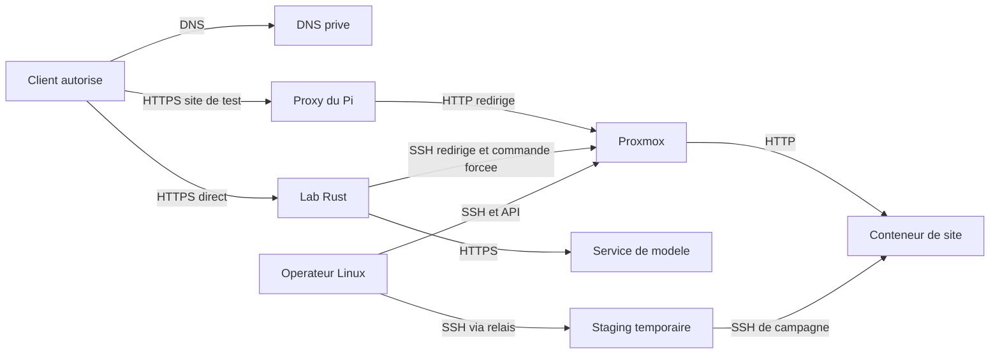

# Plan des flux réseau — Atelier Rust

Les rôles désignent les machines et services ; leurs adresses réelles sont réservées à la documentation privée. HTTP est le protocole interne ; HTTPS chiffre l’accès navigateur et les échanges externes ; SSH transporte les opérations distantes de publication et d’administration.

| Départ | Destination | Protocole / port | Objet | Contrôle |
| --- | --- | --- | --- | --- |
| Client distant | Passerelle VPN | UDP 1194 | Tunnel privé | Certificat personnel et règles du réseau |
| Client LAN/VPN | DNS privé | UDP/TCP 53 | Résolution du lab et des domaines de test | Vue DNS adaptée au réseau |
| Navigateur autorisé | HTTPS du lab | TCP 443 | Interface et API du portail | TLS, session et contrôle du propriétaire |
| Caddy du lab | Portail local | HTTP TCP 4182 | Transmission des routes du portail | Écoute sur boucle locale |
| Portail | Rust local | HTTP TCP 4196 | Création/consultation de conversation, messages, fichiers, versions | Jeton interne et identité du propriétaire |
| Rust | Bridge local | HTTP TCP 4195 | decide, build, plan, deploy | Jeton, job, révision et droit de traitement |
| Bridge | Rust local | HTTP TCP 4196 | Vérification des droits et états avant effet | Liaison exacte au job |
| Bridge / outil de l’agent | Publication locale | HTTP TCP 4197 | Cible et publication approuvée | Jeton interne et capacité limitée |
| Publication | Rust local | HTTP TCP 4196 | final-claim | Comparaison du contenu fiable et du contenu demandé |
| Bridge | OpenCode local | Processus local et outils dédiés | Sessions des rôles et publication demandée par l’agent | Politique commune et outil borné |
| OpenCode | Service de modèle | HTTPS TCP 443 | Analyse, spécification, réalisation et revue | Profil d’authentification opérateur sélectionné |
| Lecteur de sources | Sites externes admis | HTTPS 443 / HTTP 80 selon source | Lecture et archivage bornés | Contrôles d’URL, d’adresse résolue, de taille et de type |
| Publication du lab | Hyperviseur puis conteneur cible | SSH TCP redirigé vers 22 | Commande forcée de l’opérateur de site | Clé de publication, clé d’hôte et admission |
| Navigateur ou vérificateur | Proxy des sites de test | HTTPS TCP 443 | Lecture du site publié | Certificat de domaine et contrôle des octets |
| Proxy des sites | Hyperviseur puis conteneur | HTTP TCP redirigé vers 80 | Service du contenu final | Règles source/destination du pare-feu |
| Opérateur autorisé | Hyperviseur | SSH 22 et API HTTPS 8006 | Inspection, Terraform, Ansible | Compte personnel, sudo vérifié séparément, rôle API |
| Opérateur via relais | VM de lab ou staging | SSH TCP 22 | Installation et vérification | Clé dédiée et identité d’hôte épinglée |
| Staging temporaire | Deux cibles de test | SSH TCP 22 avec règles temporaires | Alternance de destination par scénario | Règles de campagne et reçus de retrait |
| Construction / système | Dépôts de dépendances et distribution | HTTPS 443, HTTP 80 si dépôt configuré | Installation des prérequis uniquement | Versions verrouillées et empreintes |
| Système invité | Résolveur et synchronisation horaire configurés | DNS 53 ; NTP UDP 123 si configuré | Résolution et horodatage | Dépendance système ; NTP non inspecté dans cette mission |

## Lecture des trajets

Le domaine du lab emprunte un accès direct à son service HTTPS. Le proxy du Pi sert les domaines des sites livrés. Les ports internes 4182, 4195, 4196 et 4197 sont locaux à la VM. Les lectures de sources et le transport du modèle sont deux flux externes distincts. La disponibilité du staging et de ses règles est attachée à la campagne en cours, pas au fonctionnement permanent du lab.

Les fichiers de sources, images et preuves sont des données du projet ; les profils d’authentification et clés ne doivent pas emprunter le contexte envoyé au modèle. Les contrôles de lecture réseau n’autorisent pas une nouvelle cible de publication.
