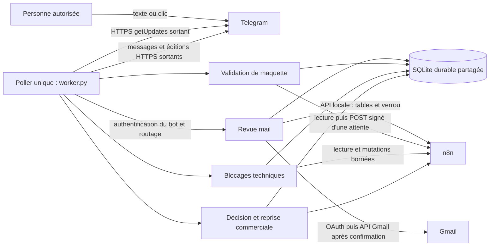
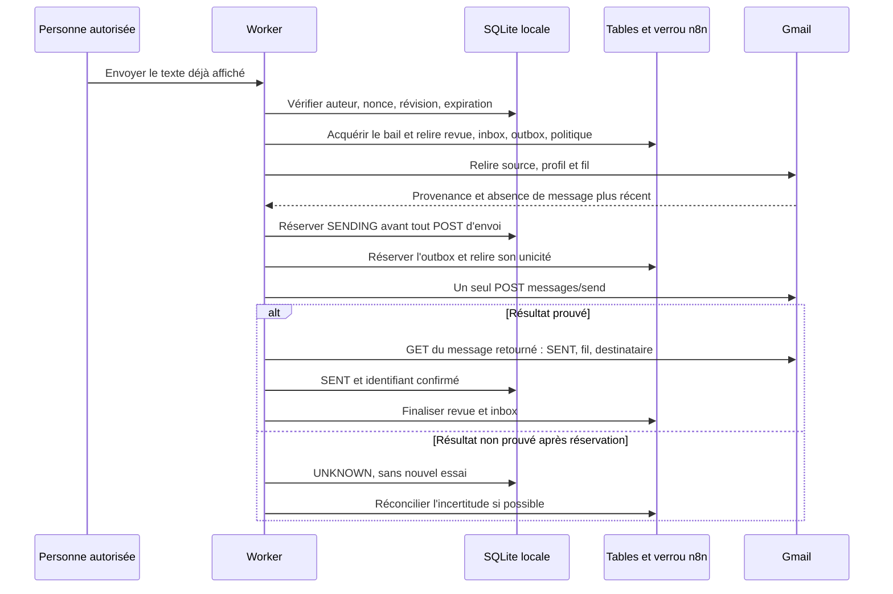
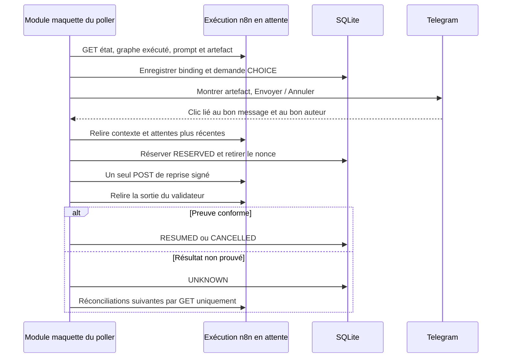
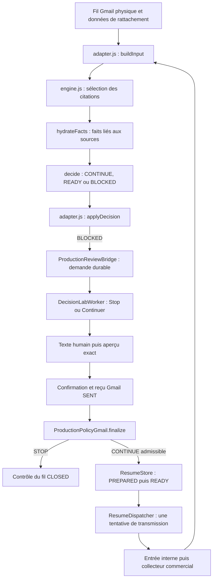
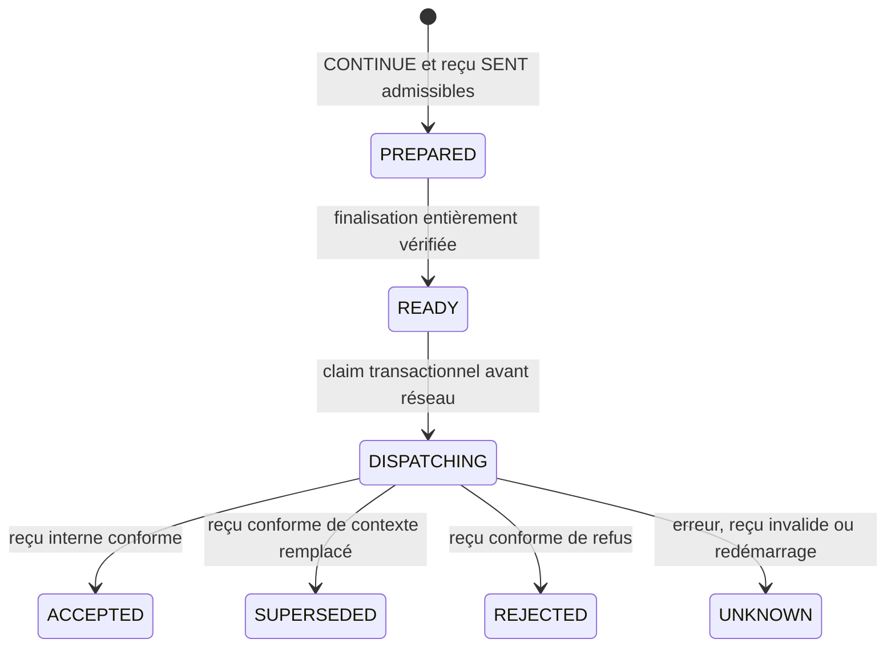

<!-- BEGIN RUST-DOCUMENTATION-20261030 -->
> **Document historique.** Les faits et résultats ci-dessous restent ceux de leur date. La référence courante du projet Rust est [https://github.com/yanisAitlamine/repo-partage-humains/blob/main/documentation%20yanis/SOMMAIRE-PUBLIC.md](https://github.com/yanisAitlamine/repo-partage-humains/blob/main/documentation%20yanis/SOMMAIRE-PUBLIC.md).
<!-- END RUST-DOCUMENTATION-20261030 -->

# Worker Telegram : référence technique expliquée, fichier par fichier et fonction par fonction

> Règle d'hébergement du 22 octobre 2026 : production applicative uniquement sur
> prod-1 ; Pi limité au load balancer / reverse proxy HTTPS, VPN et DNS interne ;
> développement et recette sur des VM de lab distinctes. Les emplacements et
> déploiements Pi décrits dans la capture historique ci-dessous ne sont plus des
> prescriptions d'installation. Aucun alignement applicatif Pi/prod-1 n'est demandé.

Version documentaire du 15 octobre 2026. Sources de référence : capture immuable des composants, puis conservation dans le dépôt privé `n8n-services` au commit `666c8b5f240925da7cf91f31ed94205d7e1bc4dd`. Les chemins de ce document sont relatifs à ce dépôt. Les adresses, identifiants de workflows, destinataires, jetons, chemins d’installation et données de clients réels restent dans la documentation privée.

Ce guide décrit du code lu. Sa rédaction n’a lancé ni le worker, ni ses tests, ni un workflow, ni un déploiement Ansible. L’inventaire des fonctions repose sur une lecture de l’arbre syntaxique Python, sans importer les modules. La concordance des huit modules installés avec la capture a été contrôlée séparément par empreintes ; cette concordance ne prouve ni un parcours humain complet ni l’égalité de tous les graphes n8n publiés avec les anciens préparateurs conservés dans Git.

## Sommaire

- [1. Ce que fait ce service, expliqué à partir d’une situation concrète](#telegram-01)
- [2. Carte des fichiers et ordre de lecture](#telegram-02)
- [3. Les objets à ne pas confondre](#telegram-03)
- [4. `worker.py` : formats, configuration et stockage](#telegram-04)
- [5. `Worker` : de la notification au résultat durable](#telegram-05)
- [6. `worker.py` : processus principal et adaptateur Telegram](#telegram-06)
- [7. `runtime.py` : politique Gmail, bail et preuves](#telegram-07)
- [8. `debug_trace.py` : comprendre les étapes sans publier les données métier](#telegram-08)
- [9. `build_approval.py` : approuver l’artefact d’une maquette précise](#telegram-09)
- [10. `technical_blocks.py` : signaler un problème sans rejouer son effet](#telegram-10)
- [11. Préparateurs et exportateurs conservés : portée et effets exacts](#telegram-11)
- [12. Configuration, unité et recettes Ansible](#telegram-12)
- [13. Lire les tests : ce qu’ils spécifient et ce qu’ils ne prouvent pas](#telegram-13)
- [14. `test_runtime.py` : le parcours mail complet simulé](#telegram-14)
- [15. `test_debug_trace.py` : preuve de projection et non-répétition](#telegram-15)
- [16. `test_build_approval.py` : reprise de maquette et preuves de livraison](#telegram-16)
- [17. `test_technical_blocks.py` : détection et actions à portée bornée](#telegram-17)
- [18. `test_commercial.cjs` : garde JavaScript et fonctions anonymes](#telegram-18)
- [19. Raccordements à la décision et à la reprise commerciale](#telegram-19)
- [20. Diagnostic raisonné : partir de la preuve manquante](#telegram-20)
- [21. Couverture de cette référence et limites de validation](#telegram-21)
- [22. Glossaire utile pour lire les fonctions](#telegram-22)
- [23. Ce que ces modules font ensemble](#telegram-23)
- [24. Les données à reconnaître avant de lire les fonctions](#telegram-24)
- [25. `engine.js` : décider à partir d’un contexte sourcé](#telegram-25)
- [26. `adapter.js` : faire entrer les preuves Gmail dans le moteur](#telegram-26)
- [27. `decision_lab_native.py` : la conversation humaine dans Telegram](#telegram-27)
- [28. `production_bridge.py` : relier la décision à la revue et au contrôle du fil](#telegram-28)
- [29. `commercial_resume.py` : une transmission durable à tentative unique](#telegram-29)
- [30. Les tests : ce qu’ils cherchent et comment leurs doubles fonctionnent](#telegram-30)
- [31. Les artefacts SDK/JSON du laboratoire](#telegram-31)
- [32. Dépendances, appels et limites d’exploitation](#telegram-32)
- [33. Retrouver la version des sources et ses limites](#telegram-33)

<a id="telegram-01"></a>

## 1. Ce que fait ce service, expliqué à partir d’une situation concrète

Une analyse n8n peut avoir besoin d’une réponse humaine. Elle conserve alors le message dans ses tables métier et inscrit une revue en attente. Le worker découvre cette revue, publie une demande dans Telegram, reçoit le choix d’une personne autorisée et vérifie que ce choix concerne encore le bon message et le bon texte. Si le choix implique un Gmail, il contrôle de nouveau le fil Gmail, prend un verrou et réserve l’envoi avant l’appel réseau. Pour les Gmail et les POST de reprise réservés, une réponse réseau manquante laisse un résultat incertain qui interdit une nouvelle tentative automatique. Certaines notifications Telegram initiales n’ont pas cette réservation préalable et peuvent être répétées si leur acquittement est perdu ; leurs limites sont détaillées dans les fonctions concernées.

Le même processus héberge plusieurs modules. Le module de revue mail gère la rédaction et la confirmation d’une réponse. Le module de validation de maquette reprend une attente n8n après approbation de l’artefact. Le module de blocages signale les problèmes et permet de les prendre en charge sans rejouer le travail. Les modules de décision et de reprise commerciale utilisent ce même socle ; leur contrat est présenté dans la partie consacrée à ces raccordements.

Un seul composant lit `getUpdates` sur Telegram. Les modules ne sont pas plusieurs robots concurrents : ils reçoivent successivement la liste des mises à jour et retirent celles de leur propre famille de boutons. Cela évite qu’un clic destiné à une validation de maquette soit interprété comme un texte de réponse mail, ou qu’un second poller consomme le clic avant le premier.



Les flèches de ce schéma désignent l’initiateur des appels. Telegram ne se connecte pas à un webhook public du worker. Le worker ouvre les connexions vers Telegram. L’approbation de maquette ouvre, elle, un appel local vers une attente n8n : ce POST n’est pas une connexion entrante publique vers le worker.

<a id="telegram-02"></a>

## 2. Carte des fichiers et ordre de lecture

| Fichier relatif | Responsabilité et lecteur principal |
|---|---|
| `integrations/telegram-review/worker.py` | Point d’entrée, poller unique, stockage SQLite de revue mail, interfaces Telegram et tables n8n, orchestration des modules. À lire pour comprendre qui appelle quoi. |
| `integrations/telegram-review/runtime.py` | Politique Gmail réelle : provenance, autorisation, bail, réservation, unique appel d’envoi et réconciliation. À lire avant toute modification susceptible de produire un mail. |
| `integrations/telegram-review/debug_trace.py` | Projection technique limitée des exécutions n8n vers Telegram. Une trace n’est pas une preuve d’envoi métier. |
| `integrations/telegram-build-approval/build_approval.py` | Association d’un bouton à une exécution en attente, un projet et un artefact précis ; reprise signée, puis preuve de résultat. |
| `integrations/telegram-build-approval/prepare_workflow.py` | Transformation historique d’un graphe fourni en mémoire. Ce préparateur n’est pas la définition garantie du graphe actuellement publié. |
| `integrations/telegram-strict/technical_blocks.py` | Détection et prise en charge des blocages, avec reprise vers revue humaine de certaines erreurs IA attestées. Aucun retry d’envoi ou de construction. |
| `integrations/telegram-strict/export_targeted.py` | Script d’export privé ciblé à effets de fichiers au niveau du module. Ce n’est pas une bibliothèque à importer pour l’inspecter. |
| `integrations/telegram-strict/commercial-guard.json` | Fragment JavaScript de garde d’un ancien raccord commercial : brief suffisant et provenance minimale de notification. |
| `integrations/telegram-review/config.example.json` | Exemple de structure de configuration ; contient des valeurs propres à une installation et une divergence de suffixe d’état expliquée plus loin. Il ne constitue pas une configuration universelle prête à démarrer. |
| `Ansible/telegram-review/deploy.yml` | Recette autonome d’installation du socle et de son unité systemd, avec choix de déploiement et d’activation explicites. |
| `Ansible/telegram-build-approval/deploy.yml` | Recette additive historique qui copie deux fichiers dans une installation déjà présente. Elle ne déploie pas tous les modules ajoutés ensuite. |
| `integrations/decision-lab/engine.js` et `integrations/decision-production/adapter.js` | Moteur de décision sourcée et adaptation des preuves Gmail ; référence détaillée dans les sections complémentaires de ce guide. |
| `integrations/decision-lab/decision_lab_native.py` | Dialogue de décision humaine dans le poller commun. |
| `integrations/decision-production/production_bridge.py` | Passage des décisions de production vers la revue puis la finalisation humaine. |
| `integrations/decision-production/commercial_resume.py` | Événements durables de reprise commerciale et transmission à tentative unique. |
| Définitions SDK/JSON de `integrations/decision-lab/` | Sources générées historiques du laboratoire, décrites avec leurs écarts au moteur actuel. |
| `integrations/BRIDGE-WORKER-VERSIONNEMENT.md` et `integrations/bridge-worker-manifest.json` | Périmètre enregistré dans Git et empreintes des fichiers, sans états d’exécution. |

Les cinq fichiers Python de tests du socle sont documentés dans la seconde moitié de sa référence, y compris leurs fixtures, doublures et fonctions imbriquées. Leur présence rend les intentions vérifiables par lecture ; elle ne signifie pas qu’ils ont été exécutés pendant cette mission.

<a id="telegram-03"></a>

## 3. Les objets à ne pas confondre

Une **source** est le message ou l’exécution qui motive le travail. Une **revue** est la ligne métier n8n qui demande une décision humaine. Une **notification** est un message Telegram dont le worker a obtenu un identifiant. Une **prévisualisation** est un texte exact proposé à l’envoi, lié à son auteur. Une **réservation** est la trace durable qui interdit de tenter de nouveau une opération dont le résultat pourrait déjà exister.

Le **nonce** est un jeton aléatoire de bouton. Il n’est ni l’autorisation d’un utilisateur, ni un jeton OAuth : il rattache un clic à une version courte et temporaire de l’interface. La **révision** change lorsqu’un brouillon ou son contexte évolue. Le **binding** est une empreinte d’un ensemble de faits : source, projet, graphe, prompt, artefact ou contexte selon le module. Aucun de ces trois mécanismes ne remplace les contrôles d’acteur, de groupe, de message Telegram, de bot, de fraîcheur ou de politique.

Il existe plusieurs outbox. L’outbox SQLite protège la confirmation locale d’une revue mail. L’outbox n8n matérialise la réservation partagée avec la chaîne de traitement. La table `build_requests` protège un POST de reprise n8n. Les tables de notifications protègent, elles, un `sendMessage` Telegram. Une notification Telegram incertaine ne signifie donc pas forcément qu’un Gmail est incertain ; lire la table et le statut exacts est indispensable.

### 3.1 Les barrières successives d’un envoi mail



Le verrou de processus, le bail métier et les réservations répondent à trois problèmes différents. `flock` empêche deux instances locales d’ouvrir la même boucle de travail sur le même état. Le bail `processor_lock` coordonne les mutations métier avec le processeur n8n. L’outbox empêche de refaire un effet externe déjà tenté. Un verrou expiré ne supprime pas une réservation ; un redémarrage ne supprime pas une incertitude.

### 3.2 Statuts durables de la revue mail locale

| Statut | Lecture humaine et suite autorisée dans ce code |
|---|---|
| `WAIT_TEXT` | Revue ouverte ; proposition affichée ou saisie attendue. Les boutons et la demande de saisie ont leurs propres liaisons et délais. |
| `PREVIEW_NOTIFYING` | Le texte a été préparé et son affichage est en cours. Une interruption ne permet pas de supposer qu’un aperçu complet est visible. |
| `PREVIEW` | Aperçu confirmé par un identifiant Telegram. L’auteur peut envoyer, modifier ou annuler dans les conditions prévues. |
| `PREVIEW_NOTICE_UNKNOWN` | Affichage de l’aperçu non prouvé. Le nonce est retiré ; aucun Gmail n’a été réservé par cette seule transition. |
| `SENDING` | Envoi réservé localement. L’état est irréversible vers une nouvelle prévisualisation automatique. Au redémarrage, il devient `UNKNOWN`. |
| `SENT` | Résultat Gmail relu et confirmé. Si les tables métier ne sont pas finalisées, seules ces écritures sont reprises. |
| `UNKNOWN` | Résultat d’envoi non prouvé après réservation. Ni modification, ni annulation de revue, ni renouvellement de boutons d’envoi ne le réarment. |
| `CANCEL_PENDING` | Intention humaine d’annulation persistée ; les tables doivent encore être réconciliées, éventuellement après libération du bail. |
| `CANCELLED` | Annulation métier terminée. Le dossier n’est pas réouvert au redémarrage. |

Les valeurs `REPLIED`, `REVIEW`, `ERROR`, `ATTENTION` et `IGNORED` appartiennent aux données métier de l’inbox, pas à cette machine d’état SQLite. Leur rapprochement est explicite dans les fonctions décrites ci-dessous ; on ne doit pas les substituer les unes aux autres parce que leurs libellés semblent proches.

<a id="telegram-04"></a>

## 4. `worker.py` : formats, configuration et stockage

### 4.1 Fonctions de préparation du contenu

**`json_object(value)`** reçoit une valeur potentiellement déjà structurée ou une chaîne JSON. Un dictionnaire est retourné directement ; une chaîne valide donne son dictionnaire ; un JSON de type liste, une chaîne invalide, une valeur absente ou un type incompatible donnent `{}`. Cette tolérance sert à lire les champs historiques des tables sans casser toute la boucle. Elle ne certifie ni la provenance ni la validité métier de ce qu’elle retourne.

**`reply_body(value)`** ne conserve qu’une chaîne non vide après nettoyage des bords. Elle ajoute la mention exacte `Version de test` à la fin si elle n’y figure pas déjà sous la forme attendue. La sortie est le corps qui doit ensuite être affiché et haché ; le code ne doit pas afficher un texte puis ajouter silencieusement cette mention seulement au moment du Gmail. Une entrée vide ou non textuelle produit une chaîne vide et ne devient pas une réponse exploitable.

**`telegram_chunks(text, limit=3500)`** découpe sans tronquer le texte, en comptant les unités UTF-16 que Telegram utilise pour ses limites. Un emoji peut occuper deux unités : compter seulement les caractères Python donnerait une taille trompeuse. La fonction retourne la liste ordonnée des fragments ; elle n’envoie rien. Ses appelants conservent cet ordre et n’installent les boutons d’envoi que sur le fragment final de l’aperçu.

**`review_notice(review)`** transforme une revue existante en trois sorties : message principal, détails complémentaires, réponse suggérée exacte. Elle rassemble les motifs de revue et de triage, les constats de pièces jointes et de périmètre, les incohérences et demandes de clarification ; elle reprend le sujet et le contenu client provenant de la revue. Le sujet est borné pour l’affichage principal, mais les longs motifs et le texte client complet sont envoyables en compléments. La proposition vient d’une réponse déjà présente dans l’analyse, reçoit la mention de test et est désactivée si sa taille dépasse la borne prévue. Cette fonction ne demande aucune nouvelle analyse IA et n’invente pas une réponse manquante. Elle est appelée lors de la création ou de la mise à niveau contrôlée d’une notification.

**`digest(text)`** calcule SHA-256 sur le texte encodé en UTF-8. Il sert à rattacher le corps enregistré à celui qui sera réservé. Deux textes visuellement proches mais différents, par exemple avec un espace ou un saut de ligne supplémentaire, produisent des empreintes différentes ; c’est voulu pour la confirmation du texte exact.

### 4.2 `Config` et `Config.load`

`Config` est une dataclass immuable. Ses champs rassemblent les références de tables n8n, l’identité attendue du bot, le groupe autorisé, les approbateurs, les destinataires admis, la date de coupure, le fichier d’état et les moyens d’authentification n8n/Telegram/Gmail. Les valeurs sensibles ne sont pas reproduites ici. L’immuabilité empêche une fonction de modifier discrètement la politique de configuration au milieu d’un traitement ; elle n’empêche pas l’administrateur de changer le fichier pour un prochain démarrage.

**`Config.load(path)`** lit les métadonnées du fichier avant le JSON : lien symbolique et permissions trop ouvertes sont refusés. Le jeu de clés doit correspondre exactement aux champs attendus. Les références obligatoires doivent être des chaînes non vides, les approbateurs des entiers positifs, et les destinataires des adresses normalisées. L’URL d’API et le chemin d’état sont comparés à des valeurs locales compilées ; la fonction n’accepte donc pas n’importe quelle URL ou un chemin arbitraire passé dans un exemple. Une erreur de forme ou de permission bloque le démarrage plutôt que de choisir une destination de secours. Ce chargeur principal ne vérifie pas à lui seul que le propriétaire est root : cette propriété vient de la recette d’installation. Les registres optionnels ont des contrôles supplémentaires décrits dans la boucle principale.

Il existe une divergence attestée dans `config.example.json` : l’exemple emploie le suffixe `.sqlite3`, tandis que `Config.load` exige le chemin compilé avec `.sqlite`. Il faut lire cet exemple comme inventaire de champs, puis produire une configuration privée conforme à la version installée. Renommer librement un ancien état ou créer une base vide pour satisfaire un suffixe ferait perdre les réservations : aucune telle opération n’est proposée par ce guide.

### 4.3 Ce que persiste `Store`

Le stockage local est une partie de la décision, pas un cache jetable. La table `requests` conserve source, corps, empreinte, révision, auteur, statuts, liaisons Telegram, nonces, échéances et preuves de finalisation. `notifications` rattache chaque source au message initial et au bot. `outbox` garde la réservation locale d’envoi. `updates` déduplique les mises à jour Telegram ; `kv` garde l’offset et le point d’activation. Les migrations sont additives : elles ajoutent les colonnes manquantes sans effacer l’historique.

Le corps d’une réponse, la proposition, son contexte et certaines références métier sont privés dans cette base. Une empreinte ne signifie pas que toute la ligne est anonymisée. Cette distinction vaut aussi pour `build_requests`, qui peut conserver le prompt exact : les bases d’état n’ont pas leur place dans le dépôt public.

**`Store.__init__(path)`** crée le dossier d’état avec une permission privée, ouvre SQLite, impose le mode privé au fichier, active WAL, crée les tables et complète les colonnes historiques manquantes. Ses effets portent sur le stockage local seulement ; les conversions d’états interrompus sont effectuées ensuite par l’initialisation des workers. Une erreur d’ouverture ou de migration remonte et empêche une boucle partiellement initialisée.

**`Store.commit()`** expose un commit SQLite explicite aux appelants qui ont effectué une séquence d’écritures. Il ne valide pas des conditions métier par lui-même. Le nom ne doit pas être confondu avec un commit Git ou une preuve d’envoi externe.

**`Store.once(source, body, chat, message, actor, context=None)`** crée une demande pour une nouvelle source et retourne `True`. Si elle existe déjà et reste modifiable (`WAIT_TEXT` ou `PREVIEW`), il actualise le corps, son empreinte et la révision, invalide l’ancien nonce et revient à la saisie ; il retourne `False` car aucune nouvelle source n’a été insérée. Une source terminale n’est pas remise en attente. Le contexte initial contient les références de revue/inbox, le destinataire, le fil et l’empreinte de la revue : il est fixé à partir des données métier, pas du texte du bouton.

**`Store.notified(source)`** vérifie l’existence d’une notification enregistrée et retourne un booléen. Ce contrôle évite un nouveau message initial à chaque tour de boucle. Il prouve la présence d’une trace locale, pas la lecture du message par un humain.

**`Store.save_notification(source, chat, message, bot)`** insère une liaison notification avec `INSERT OR IGNORE`. Une liaison existante n’est donc pas écrasée arbitrairement. Les valeurs proviennent d’une réponse Telegram positive ; leur association sert ensuite au contrôle exact des callbacks.

**`Store.set_preview_message(source, message)`** enregistre le message final de l’aperçu pour une demande au statut `PREVIEW`. C’est ce message, et non la notification initiale, qui doit porter les boutons de confirmation d’un brouillon modifié. La fonction ne produit pas elle-même l’aperçu et ne remplace pas la vérification d’acquittement faite par son appelant.

**`Store.replace_untouched_notification(source, chat, message, bot)`** traite une ancienne notification que Telegram ne permet plus d’éditer. Son échange conditionnel exige une demande encore vierge : attente de texte, corps vide, auteur initial nul, pas de clé de réponse ni d’outbox. Il met alors à jour ensemble la demande et sa liaison de notification. S’il ne peut prouver cette situation unique, il lève une erreur plutôt que de rattacher une décision déjà commencée à un autre message.

**`Store.save_proposal(source, suggested, nonce, expires, extra)`** enregistre la proposition exacte, le nonce des boutons initiaux, leur échéance, la version de présentation et la liste des détails restants. L’index de détail repart au début de cette nouvelle présentation. Cette méthode prépare le contrôle « tout le texte prévu a été livré » avant un envoi direct de proposition.

**`Store.mark_update(uid)`** insère l’identifiant d’une mise à jour dans une clé primaire SQLite et retourne si l’insertion est nouvelle. Cette déduplication est durable pour ce stockage. Elle n’équivaut pas à une garantie distribuée générale d’exécution exactement une fois : l’effet externe est protégé séparément par réservation.

**`Store.cursor()`** lit l’offset Telegram enregistré dans `kv` et retourne zéro s’il n’existe pas encore. **`Store.advance(offset)`** remplace cette valeur par la représentation du prochain offset ; le poller l’appelle après avoir distribué le lot. Le redémarrage reprend donc le curseur connu et les tables de mises à jour absorbent les doublons encore présentés.

**`Store.get(source)`** lit une demande et la retourne sous forme de dictionnaire, ou `None` si elle manque. Elle n’en change aucun statut. Les méthodes de confirmation relisent ce dictionnaire juste avant leurs propres contrôles ; une ancienne copie conservée par un appelant ne devient pas une autorisation permanente.

**`Store.preview(source, actor, now=None)`** n’ouvre une prévisualisation que pour une demande en attente et appartenant à l’acteur attendu. Elle génère un nonce aléatoire, une échéance de quinze minutes et la clé de réponse logique fondée sur la source. Sa mise à jour rattache l’aperçu à la révision courante. Elle retourne le nonce ou une absence de nonce si la situation n’est pas éligible ; elle n’envoie aucun message Telegram.

**`Store.invalidate_preview(source, body, actor)`** remplace le texte d’un aperçu encore modifiable, augmente la révision et retire nonce, échéance et clé de réponse avant retour à `WAIT_TEXT`. Le bouton d’un aperçu précédent ne peut alors plus approuver le nouveau corps. Une réservation ou un état terminal n’est pas une cible de cette méthode.

**`Store.reserve(source, nonce, actor, now=None)`** est le point de non-retour local de l’envoi. Elle exige une prévisualisation actuelle, le bon auteur, un nonce non expiré, une empreinte cohérente et l’absence d’outbox pour cette source. Dans une transaction SQLite, elle insère l’outbox `SENDING` et fait passer la demande à `SENDING`. Elle retourne un booléen ; un refus laisse l’aperçu sans appeler Gmail. Après succès, une erreur réseau n’autorise plus un retour automatique à la saisie.

**`Store.terminal(source, status, sent_message_id=None)`** accepte seulement `SENT` ou `UNKNOWN` et ne transforme que les lignes en `SENDING`. Elle actualise ensemble la demande et l’outbox locale ; un succès conserve l’identifiant Gmail et l’heure. Une valeur de statut inattendue lève une erreur. La fonction ne fait ni GET de preuve ni POST Gmail : la preuve doit être obtenue par `Worker.confirm` avant de lui demander `SENT`.

### 4.4 `TableAPI` et contrôle d’une réponse Telegram

**`TableAPI.__init__(request, key, base)`** reçoit un transport HTTP injectable, une clé API et une base d’API. Cela permet aux tests de substituer un faux transport sans parler à n8n. Le constructeur n’effectue pas de découverte réseau et ne réduit pas les droits techniques de la clé à certaines tables.

**`TableAPI.rows(table, query=None)`** lit les pages de cent lignes de la table, transmet un filtre JSON éventuel et regroupe les résultats. Elle vérifie la forme `data`, le type du curseur et l’absence de cycle ; une limite de mille curseurs empêche une pagination sans fin. Une page invalide lève `ValueError`. Un résultat vide correctement formé reste différent d’une API illisible.

**`TableAPI.insert(table, row)`** appelle la route d’insertion des tables avec une liste d’une ligne et demande le retour des lignes. **`TableAPI.update(table, row_id, data)`** refuse des données vides puis utilise la route de mise à jour conditionnée par l’identifiant, avec retour des données. Ces helpers transportent une mutation demandée par la politique ; ils ne vérifient pas à eux seuls l’état de la revue, l’acteur ou la présence d’une réservation.

**`safe_update_matches(message, chat, bot_id, allow, chat_id)`** répond par un booléen à une question précise : ce texte est-il une réponse d’un humain admis, dans le groupe prévu, au message prévu émis par le bot prévu ? Elle rejette notamment un autre acteur, un auteur bot, un `sender_chat` et une réponse à un autre message ou à un autre bot. Son paramètre `chat` est ici le contexte de liaison, pas seulement un numéro de conversation. Elle est utilisée pour accepter une saisie ForceReply ; un texte libre dans le groupe n’est pas automatiquement une réponse de revue.

<a id="telegram-05"></a>

## 5. `Worker` : de la notification au résultat durable

### 5.1 Construire le worker et reprendre son état

**`Worker.__init__(config, store, tables, telegram, gmail, clock=time.time)`** conserve les dépendances et une horloge injectable. La séparation des interfaces rend visible ce qui relève de SQLite, de Telegram, des tables et de Gmail. Ce constructeur ne lance pas de thread et ne crée pas un second poller.

**`Worker.initialize()`** vérifie `getMe` contre le nom de bot attendu et conserve son identité. Il refuse une URL de webhook déjà enregistrée : il ne supprime pas ce webhook pour s’approprier le bot. Il inscrit une date d’activation persistante, puis transforme les envois locaux `SENDING` interrompus en `UNKNOWN`. Les aperçus dont l’affichage n’est pas prouvé deviennent `PREVIEW_NOTICE_UNKNOWN`, sans nonce réutilisable. L’initialisation ne considère donc pas le redémarrage comme un moyen de nettoyer les échecs et recommencer.

### 5.2 Recevoir et modifier un texte

**`Worker.handle_text(source, update)`** cherche la demande de saisie dédiée enregistrée pour cette source. Il contrôle l’acteur de cette demande, son expiration et toutes les liaisons via `safe_update_matches`, puis accepte seulement une chaîne non vide de trois mille caractères au maximum. Il normalise le corps avec la mention de test et appelle `show_preview` pour une demande encore modifiable. Un mauvais message retourne `False` sans envoyer ni réserver de Gmail.

**`Worker.request_edit(source, actor)`** exige un approbateur autorisé, un dossier modifiable sans outbox et une revue toujours en attente avec la même empreinte. Un ancien aperçu est invalidé avant d’ouvrir la nouvelle saisie. La méthode envoie une demande ForceReply et exige un identifiant de message dans l’acquittement ; elle persiste ensuite cet identifiant, l’auteur et les quinze minutes de validité, puis invalide les boutons de proposition initiale. Un autre membre pourtant autorisé ne peut pas répondre à la place de celui qui a ouvert cette saisie.

**`Worker.show_preview(source, body, actor)`** prépare ou remplace le brouillon, invalide les anciennes liaisons et obtient un nouveau nonce. Avant le réseau, elle persiste `PREVIEW_NOTIFYING`, puis affiche le destinataire et le corps exact. Elle n’active `PREVIEW` qu’après une réponse Telegram prouvant le message final de l’aperçu. En cas d’exception ou d’acquittement absent, elle retire le nonce et conserve `PREVIEW_NOTICE_UNKNOWN` ; un ancien aperçu visible ne peut pas être rattaché à un nouveau texte non affiché. Aucun Gmail n’est réservé à cette étape.

### 5.3 Traiter les boutons de la notification initiale

**`Worker.handle_proposal(cb)`** reconnaît les familles `propose:`, `sendproposal:`, `edit:` et `dismiss:`. Elle retrouve le nonce de proposition et vérifie demande encore vierge, groupe, message initial, bot, acteur admis, expiration, revue inchangée et inbox encore en revue. `edit:` ouvre ForceReply ; `dismiss:` appelle l’annulation durable. `propose:` conserve l’ancien sens d’un bouton déjà affiché et ouvre un aperçu supplémentaire. `sendproposal:` approuve directement la réponse exacte déjà affichée, seulement si tous ses compléments ont été livrés : la méthode rattache alors le texte à l’auteur et emprunte la même confirmation Gmail que le parcours édité. Si les gardes précédant la réservation refusent cet envoi direct, les boutons de la proposition peuvent rester utilisables après restauration contrôlée de l’attente. Une action reconnue mais interdite est acquittée comme refusée, elle n’est pas redirigée vers un autre module.

Le parcours courant et le parcours historique ont donc des nombres de clics différents. La présence de la branche `propose:` dans le code conserve la signification d’anciens messages Telegram ; elle ne signifie pas que les nouveaux boutons imposent systématiquement deux confirmations successives.

### 5.4 Annuler sans effacer une réservation

**`Worker.cancel(source, actor)`** accepte une revue modifiable sans outbox et un acteur autorisé. Sa première écriture est `CANCEL_PENDING`, avec retrait des nonces et demandes de saisie : l’intention est durable avant une éventuelle indisponibilité des tables ou du verrou. Elle tente `reconcile_cancel`, puis retire au mieux les claviers de la notification et de l’aperçu. Une impossibilité momentanée de réconciliation laisse `CANCEL_PENDING`. `SENDING`, `UNKNOWN` et `SENT` ne sont jamais annulés par cette voie.

**`Worker.reconcile_cancel(req)`** demande à la politique Gmail de clôturer uniquement les tables métier de cette revue. Si cette opération réussit, elle inscrit `CANCELLED` et la finalisation locale. Si elle échoue, l’intention reste à reprendre ; la méthode ne contourne pas un bail occupé et ne tente aucun envoi.

### 5.5 Confirmer un Gmail et réconcilier les tables

**`Worker.confirm(source, nonce, actor, callback_chat)`** vérifie le groupe, l’aperçu, son auteur précis, son nonce et sa durée. Elle appelle ensuite `gmail.validate_confirmation` : ce contrôle de politique acquiert le bail et relit les données avant la réservation locale. Cet appel précède le propre `try/finally` de réservation et d’envoi du worker ; une exception remontée par le validateur préalable n’est donc pas couverte par ce `finally`. Seulement après accord, `Store.reserve` rend l’essai unique, puis `gmail.send` réserve l’outbox partagée et effectue le POST. Le résultat n’est accepté qu’avec un identifiant cohérent et un GET Gmail dont le message porte `SENT`, le bon fil et le destinataire exact. Une exception après réservation conduit à `UNKNOWN`, y compris quand le réseau a pu réussir ; le `finally` de ce bloc tente la libération du bail. Quand l’envoi est prouvé, l’écriture locale `SENT` précède la réconciliation des tables : une panne de finalisation ne rétrograde pas ce succès en permission de renvoi.

**`Worker.reconcile(req)`** appelle seulement `gmail.finalize`, puis marque `finalized=1`. Elle sert au cas « Gmail confirmé envoyé, tables encore incohérentes ». Elle ne rappelle pas `send`, ne refabrique pas un message et ne réutilise pas le nonce.

**`Worker.reconcile_pending()`** parcourt trois familles durables : annulations encore à finaliser, succès `SENT` non finalisés, et `UNKNOWN` dont l’outbox partagée doit être marquée incertaine. Chaque ligne est traitée séparément ; une exception est journalisée et laisse le travail de réconciliation ouvert. Ce mot « reprise » concerne les écritures d’état, jamais une répétition du POST Gmail.

### 5.6 Distribuer les événements et actualiser l’interface

**`Worker.process_updates(updates)`** ignore ou déduplique les identifiants de mise à jour invalides/déjà enregistrés. Les textes antérieurs au point d’activation ne sont pas acceptés comme nouvelles saisies. Les réponses texte sont associées aux demandes ForceReply ; les callbacks passent d’abord par les boutons de proposition, puis par les boutons d’aperçu `send:`, `editpreview:` et `cancel:`. L’identité du bot, le groupe, le message et l’auteur de l’aperçu sont contrôlés avant l’action. Les refus sont acquittés sans créer un envoi métier. La méthode retourne un nombre traité, pas une liste à distribuer : elle constitue le dernier étage du routage du poller.

**`Worker.sync_reviews()`** finit d’abord les détails en attente et renouvelle les boutons éligibles. Elle sélectionne ensuite les revues `PENDING` après la coupure, avec source, inbox en `REVIEW` et destinataire admis. Une notification déjà connue n’est pas répétée. Une ancienne présentation peut être actualisée une seule fois si elle reste vierge, sans réservation et avec la même empreinte métier ; si Telegram interdit son édition, une notification de remplacement est créée puis reliée par échange conditionnel. Pour une nouvelle revue, le message, son contexte et sa proposition sont persistés après acquittement avant d’envoyer les compléments. L’envoi initial précède donc sa première trace SQLite : si Telegram reçoit le message mais que l’acquittement est perdu, un tour suivant peut le répéter. Le filtre optionnel `skip_review` permet au raccord de décision de posséder certaines revues sans créer deux interfaces concurrentes.

**`Worker.refresh_buttons()`** ne s’intéresse qu’aux dossiers ouverts sans outbox, dont revue et inbox correspondent encore. Après expiration, elle édite le clavier du message connu avec un nouveau nonce et une nouvelle échéance. Elle ne persiste ce nouveau nonce qu’après l’acquittement de l’édition, et ne remplace pas une demande de saisie encore active. Elle n’envoie pas de rappel périodique et ne touche pas les statuts terminaux ou incertains.

**`Worker.send_notice_details(req)`** reprend la liste des compléments au dernier index durable. Chaque fragment confirmé avance l’index ; un échec laisse le reste à envoyer lors d’un tour suivant. L’index avance après l’appel Telegram, sans réservation préalable du fragment : une réception suivie d’une perte d’acquittement peut donc produire un doublon de ce complément. Cette reprise est limitée à des messages de contexte Telegram et ne rejoue pas le mail. Le contrôle d’envoi direct de proposition exige que l’index atteste tous les fragments prévus.

<a id="telegram-06"></a>

## 6. `worker.py` : processus principal et adaptateur Telegram

### 6.1 `main()` et l’ordre exact du travail

**`main()`** charge la configuration demandée par l’argument `--config`, prend un verrou de fichier exclusif non bloquant et construit le stockage, l’API Telegram, l’API de tables et la politique Gmail. Un verrou déjà occupé interrompt le démarrage ; ouvrir une seconde copie du service avec le même état ne doit pas créer un concurrent discret. Les erreurs d’initialisation conduisent au code de sortie prévu pour l’échec de démarrage.

Les modules additionnels sont importés depuis l’installation, avec un recours aux dossiers voisins du dépôt pour les sources. Le worker de maquette et le worker de blocages partagent le même stockage et le même adaptateur Telegram. Le raccord de décision peut substituer `ProductionPolicyGmail` à la politique standard et installer `skip_review` pour que les revues qu’il possède ne soient pas notifiées une seconde fois par le parcours historique.

Trois registres optionnels sont lus avec des jeux de clés stricts. Le registre de décision référence ses tables ; son lien symbolique ou ses permissions d’écriture trop ouvertes sont refusés. Le registre de reprise commerciale contient l’entrée privée et son authentification : il doit être un fichier régulier privé possédé par root et ne peut être utilisé sans les raccords de décision/production nécessaires. Le registre de trace ne contient qu’un booléen `enabled`, avec contrôles de fichier régulier, propriétaire et permissions. Ces contrôles ne donnent pas aux fichiers le droit de définir librement du code ou d’ajouter des champs inconnus.

À chaque tour, `main()` suit cet ordre : trace technique éventuelle ; réconciliations mail ; synchronisation du raccord de production ; synchronisation des revues mail, des maquettes et des blocages ; lecture Telegram ; synchronisation de l’interface de décision ; distribution des mises à jour aux modules de décision, de maquette, de blocages puis au worker mail. Les modules intermédiaires retournent les mises à jour qui ne leur appartiennent pas. Le prochain offset est calculé sur le lot reçu initialement, puis persisté après le traitement.

La reprise commerciale est sollicitée après les finalisations humaines et après libération du bail Gmail détenu par le raccord. Elle ne doit pas courir au milieu d’une confirmation encore propriétaire du verrou. Les erreurs de synchronisation de modules sont isolées et journalisées pour préserver la boucle quand cela est prévu ; cela ne transforme pas leur action en réussite.

La lecture Telegram utilise un long polling de dix secondes ; la boucle prévoit aussi une pause de dix secondes. Une erreur réseau ordinaire entraîne une attente courte de cinq secondes avant le prochain tour. Ce comportement de boucle ne répète pas un POST métier réservé : les états SQLite continuent de le bloquer. Un HTTP `409` sur le polling provoque une sortie spécifique, car il indique un conflit de consommateur ; l’unité systemd est configurée pour ne pas relancer automatiquement sur cette sortie. Le code ne tente pas de gagner une course permanente contre un autre poller.

### 6.2 Transport HTTP commun

**`http_json(method, url, **kwargs)`** assemble les paramètres d’URL, le corps JSON éventuel et les en-têtes, effectue la requête avec un délai borné, puis décode le JSON de réponse. Il utilise la bibliothèque standard et propage les erreurs HTTP, réseau et de décodage. Il ne comporte pas de retry automatique et ne constitue pas un journal expurgé de secrets : un appelant ne doit pas afficher une URL portant un jeton sous prétexte que ce helper l’a construite. Le transport injectable de `TableAPI` est cette fonction en fonctionnement réel.

### 6.3 Toutes les méthodes de `TelegramAPI`

| Méthode exacte | Entrées, sortie, effets et responsabilité |
|---|---|
| `TelegramAPI.__init__(token)` | Construit la base de l’API du bot à partir du jeton reçu. Ne vérifie pas encore son identité et n’envoie rien. L’URL construite doit rester privée puisqu’elle contient l’authentification du bot. |
| `TelegramAPI.call(method, payload=None)` | Appelle une méthode Bot API en POST JSON, exige `ok` et retourne `result`. Un échec Telegram ou HTTP est remonté. C’est la frontière réseau commune ; elle n’inclut pas de répétition automatique d’un `sendMessage`. |
| `TelegramAPI.get_me()` | Demande `getMe`. `Worker.initialize` compare le nom puis conserve l’identifiant reçu ; posséder un jeton valide pour un autre bot ne suffit pas. |
| `TelegramAPI.webhook_info()` | Lit `getWebhookInfo`. L’appelant refuse un webhook présent ; cette méthode ne le supprime pas et ne modifie pas le mode de réception. |
| `TelegramAPI.updates(offset)` | Demande `getUpdates` depuis l’offset durable, avec délai de long polling et seuls types `message`/`callback_query`. Retourne la liste reçue ; le calcul et la persistance du prochain offset restent dans `main`. |
| `TelegramAPI.proposal_buttons(nonce, suggested)` | Produit le clavier initial. Une réponse suggérée exploitable ajoute Envoyer avec `sendproposal:` ; Modifier et Annuler utilisent leurs familles dédiées. La sortie est une structure JSON, pas un appel réseau. |
| `TelegramAPI.preview_buttons(nonce)` | Produit Envoyer, Annuler et Modifier pour un aperçu, avec `send:`, `cancel:` et `editpreview:`. Le nonce est opaque ; le corps du mail ne voyage pas dans le callback. |
| `TelegramAPI.refresh_buttons(chat, message, nonce, kind, suggested)` | Édite uniquement le clavier d’un message existant, en choisissant le contrat proposition ou aperçu. Le statut et le nouveau nonce ne doivent être persistés par l’appelant qu’après cet acquittement. |
| `TelegramAPI.notify(chat, text, nonce, suggested)` | Envoie la notification initiale avec son clavier de proposition et retourne la réponse Telegram. Cette méthode n’enregistre pas elle-même la source : `sync_reviews` doit conserver l’identifiant retourné. |
| `TelegramAPI.edit_notification(chat, message, text, nonce, suggested)` | Essaie de remplacer le texte et le clavier d’une ancienne notification. Un HTTP 400 correspondant précisément à un message non éditable retourne `None`, pour permettre le remplacement sous gardes ; les autres erreurs remontent. Elle ne décide pas seule qu’un second message est sûr. |
| `TelegramAPI.detail(chat, message, text)` | Envoie un complément rattaché au message initial. Il peut contenir le contexte privé d’une revue ; il ne porte pas la confirmation d’un autre texte et n’est pas une preuve de livraison Gmail. |
| `TelegramAPI.edit_prompt(chat, message, text)` | Envoie une demande ForceReply dédiée en réponse à la notification. La réponse fournit le nouvel identifiant que `request_edit` lie à l’acteur et à son expiration. Elle ne modifie pas le corps du brouillon avant la saisie humaine. |
| `TelegramAPI.preview(chat, reply_to, text, nonce)` | Découpe le texte en unités UTF-16, envoie chaque fragment dans l’ordre et pose le clavier seulement sur le dernier. Retourne l’identifiant du dernier message. Une exception avant la fin rend l’affichage non prouvé, même si certains fragments sont déjà visibles. |
| `TelegramAPI.answer_callback(callback_id, text=...)` | Répond à l’interaction par `answerCallbackQuery`, avec texte borné et alerte. Elle acquitte un clic ; elle ne crée pas une nouvelle notification ordinaire dans le groupe et ne prouve pas l’effet métier. |
| `TelegramAPI.clear_buttons(chat, message)` | Retire le clavier du message connu. Le cas Telegram « message non modifié » est toléré comme opération déjà réalisée ; les autres erreurs sont propagées. Retirer un clavier ne retire aucune réservation SQLite ou n8n. |
| `TelegramAPI.feedback(chat, message, text)` | Conserve l’interface historique, mais son effet courant est seulement de retirer les boutons via `clear_buttons`. Le texte reçu n’est pas envoyé comme message de routine supplémentaire. Le résultat métier durable doit être lu dans les états appropriés. |

### 6.4 L’adaptateur volontairement incapable d’envoyer

`DisabledGmail` sert aux scénarios qui doivent prouver qu’aucun Gmail réel n’est possible. **`DisabledGmail.validate_confirmation(*args, **kwargs)`** retourne un refus de confirmation. **`DisabledGmail.send(*args, **kwargs)`** et **`DisabledGmail.get_message(*args, **kwargs)`** lèvent une erreur au lieu d’imiter un succès réseau. Ce n’est pas un mode de production permettant d’ignorer les preuves ; c’est une doublure qui échoue de manière fermée.

<a id="telegram-07"></a>

## 7. `runtime.py` : politique Gmail, bail et preuves

### 7.1 Fonctions de normalisation

**`fingerprint(row)`** construit une représentation JSON canonique des champs de revue pertinents : références de source et de fil, destinataire, contenu, motif, analyse et rattachement de projet. Il en retourne SHA-256. `sync_reviews`, la modification, la confirmation et l’annulation comparent cette empreinte ; une analyse ou un contexte changé invalide une décision prise sur l’ancienne revue. L’empreinte n’est pas une preuve que le contenu est correct, seulement qu’il n’a pas changé dans les champs couverts.

**`exact_address(value)`** exige une chaîne sans CR, LF ou caractère nul et une seule adresse analysable. Elle normalise la casse et rejette les listes de destinataires et formes incompatibles avec l’adresse simple attendue. Les contrôles Gmail utilisent sa sortie pour éviter qu’un affichage apparemment unique devienne plusieurs destinataires ou une injection d’en-têtes. Une entrée invalide lève `ValueError`.

**`headers(message)`** transforme les en-têtes Gmail en dictionnaire avec noms normalisés en minuscules. Les doublons de `From`, `Reply-To` et `Message-ID` sont refusés : sélectionner arbitrairement le premier d’un doublon pourrait cacher une ambiguïté de provenance. La fonction ne lit pas le corps du message ; ses sorties servent aux contrôles de source et à la construction d’un reply.

**`utc_now()`** retourne une date UTC sous forme textuelle terminée par `Z`. Elle sert aux traces de réservation/finalisation. Elle n’utilise pas la zone locale du poste pour représenter une échéance métier.

### 7.2 Construction et accès à Gmail

**`PolicyGmail.__init__(config, tables, transport=None, clock=time.time)`** reçoit la politique, les tables, un transport Gmail optionnel et une horloge. Il initialise le cache OAuth, l’identité de bail détenue et le contexte de confirmation. L’injection de transport permet aux tests d’inspecter chaque appel sans réseau ; elle ne change pas le contrat des vérifications.

**`PolicyGmail.token()`** réutilise un access token encore assez longtemps valide ; sinon elle échange le refresh token avec l’identifiant et le secret OAuth pour en obtenir un nouveau. La durée de cache tient compte d’une marge avant expiration. L’appel est borné par un délai réseau et ses erreurs remontent. Aucun jeton n’est une donnée de diagnostic à afficher ou à copier dans le document.

**`PolicyGmail.call(method, path, payload=None)`** invoque le transport injecté lorsqu’il existe ; sinon elle appelle Gmail avec le Bearer fourni par `token`, un corps JSON éventuel et un délai borné. Elle retourne la réponse structurée et ne répète pas un POST. Ses chemins sont des routes Gmail relatives, pas une possibilité de choisir une destination externe depuis un callback.

**`PolicyGmail.get_message(mid)`** refuse un identifiant ne respectant pas la forme hexadécimale attendue puis demande les métadonnées du message. Cette lecture sert à prouver la source ou le résultat envoyé sans télécharger inutilement le corps. Une mauvaise forme bloque avant la requête.

**`PolicyGmail.patch_where(table, conditions, data)`** applique une mise à jour de table avec une conjonction de conditions d’égalité. Elle est utilisée pour le verrou et les transitions contrôlées ; elle permet d’inclure l’ancien état et le propriétaire attendu. Le retour HTTP seul n’établit pas que la ligne voulue a changé : les opérations sensibles relisent ensuite leurs preuves.

### 7.3 Bail partagé avec le processeur

**`PolicyGmail.acquire(for_send=True)`** vérifie la ligne de configuration activée et, pour un envoi, l’autorisation `allow_gmail_send`. Le verrou processeur doit être `IDLE`. La méthode crée un propriétaire unique, demande conditionnellement `BUSY` avec un bail de dix minutes, puis relit l’état et le propriétaire avant d’annoncer une acquisition réussie. Pour une annulation, `for_send=False` permet la clôture alors que les Gmail sont désactivés ; la configuration générale doit tout de même rester active. Cette procédure utilise l’API de tables et sa relecture, sans prétendre ici démontrer l’atomicité interne du serveur n8n.

**`PolicyGmail.release()`** tente de remettre le verrou à l’état libre seulement s’il est encore `BUSY` et appartient au propriétaire détenu localement. Si cet appel se termine normalement, elle efface ensuite les références locales correspondantes. Si le PATCH lève une exception, cette dernière étape du corps n’est pas exécutée : le bail et ses références locales peuvent rester présents. Cette panne n’autorise pas à libérer le verrou d’un autre traitement ni à effacer une outbox ; le dispatcher de reprise ne doit pas supposer que la libération est prouvée.

**`PolicyGmail.verify_lease()`** relit le propriétaire et le statut, puis exige au moins deux minutes de bail restant. Elle est rappelée près des effets sensibles : détenir un verrou au début d’une longue série de lectures ne suffit pas si le bail a été perdu ou approche de son terme. Un bail perdu ou trop court lève une erreur avant le POST Gmail.

### 7.4 Vérifier que le choix humain est toujours pertinent

**`PolicyGmail.check_tables(req)`** retrouve la revue par son identifiant enregistré, exige qu’elle soit toujours `PENDING`, de même empreinte et liée à la source, au fil et au destinataire de la demande. Elle sélectionne de même l’inbox par son identifiant ; celle-ci doit encore être `REVIEW`, avec métadonnées de source conformes. Le destinataire doit appartenir à la liste admise et aucune ligne d’outbox ne doit réserver la source physique ou la clé logique de réponse. La politique globale et celle d’envoi sont également relues. Tout écart fait échouer la confirmation ; le texte du bouton ne peut pas fournir un autre destinataire pour contourner ces contrôles. La sélection par identifiant ne doit pas être décrite comme un contrôle supplémentaire de cardinalité de toutes les lignes portant la même source.

**`PolicyGmail.check_gmail(req)`** demande les métadonnées de la source, le profil de la boîte et le fil complet en métadonnées. Source et fil doivent correspondre ; `From` doit être le destinataire prévu, `Reply-To` doit être absent ou identique, et `Message-ID` doit avoir une forme exploitable pour un reply. La source doit encore exister dans le fil et aucun message plus récent ne doit le rendre obsolète, quelle que soit l’identité de cet auteur plus récent. Le sujet est contrôlé contre l’injection d’en-têtes. La sortie contient les faits nécessaires à l’envoi : source, identifiant RFC, boîte et sujet.

**`PolicyGmail.validate_confirmation(req, tables, config)`** est l’entrée de politique appelée par `Worker.confirm`. Elle acquiert le bail, exécute les deux vérifications et conserve le contexte vérifié pour l’envoi. Un échec tente de libérer le bail, puis nettoie ce contexte et retourne un refus seulement si cette libération termine normalement. Si `release` lève une exception, le nettoyage et le retour faux suivants ne sont pas exécutés ; cette exception remonte avant le bloc de réservation/envoi de `Worker.confirm`. L’appelant doit encore réserver localement ; cet accord n’effectue aucun Gmail et n’est pas une autorisation réutilisable sans les relectures de `send`.

### 7.5 Réserver, envoyer une seule fois, finaliser sans renvoyer

**`PolicyGmail.send(body, recipient, thread, source)`** exige le contexte de confirmation et la correspondance exacte des paramètres avec celui-ci. Elle recontrôle tables et Gmail sous bail, vérifie le temps restant, puis insère une outbox n8n `SENDING` avec la source, la clé de réponse, le corps et ses références. Elle relit par `response_key` et exige une seule ligne, le statut `SENDING` et le destinataire attendu. Cette relecture ne compare pas le corps, le fil ou l’identité Gmail de source ; elle ne prouve donc pas l’égalité intégrale de l’outbox avec les paramètres. Le message MIME utilise la boîte authentifiée en expéditeur, un seul `To`, le sujet de reply, les références RFC et le texte UTF-8 exact ; aucun CC/BCC n’est ajouté. Une dernière vérification du bail précède l’unique `messages/send`. La méthode retourne sa réponse sans boucle de retry ; `Worker.confirm` assure ensuite la preuve GET du résultat. Une exception entre la réservation et cette preuve doit conserver l’incertitude.

**`PolicyGmail.finalize(req)`** n’accepte qu’une demande `SENT` avec identifiant envoyé. Elle exige l’outbox correspondante unique, sans identifiant de résultat contradictoire, la marque `SENT`, clôt la revue avec `MANUAL_REPLY_SENT` et place l’inbox en `REPLIED`. La relecture de confirmation concerne la revue et l’inbox ; ce socle ne relit pas l’outbox après son UPDATE `SENT`. La spécialisation de production ajoute ses propres contrôles, décrits plus loin. Ce travail peut être répété pour réconcilier des tables après un Gmail déjà prouvé ; il n’appelle jamais `messages/send`.

**`PolicyGmail.mark_unknown(req)`** cherche une réservation partagée unique correspondant à la demande et ne transforme que son `SENDING` en `UNKNOWN`, avec le code d’incertitude. Elle ne fabrique pas un identifiant envoyé et ne réarme rien. Si la preuve d’unicité manque, l’opérateur doit examiner le conflit au lieu de déduire un nouvel essai possible.

**`PolicyGmail.cancel(req)`** prend le bail sans exiger l’autorisation d’envoi, puis vérifie de nouveau revue, empreinte, inbox et absence de réservation. Une revue déjà résolue est admissible seulement si sa décision est précisément l’annulation humaine attendue. L’inbox doit correspondre à la source et être encore en revue ou déjà annulée. La méthode vérifie le bail, clôt la revue en `HUMAN_CANCELLED`, passe l’inbox à `CANCELLED`, relit les résultats et libère le verrou en sortie. Elle ne retire aucune ligne d’outbox et n’annule pas un Gmail tenté.

<a id="telegram-08"></a>

## 8. `debug_trace.py` : comprendre les étapes sans publier les données métier

Ce module observe une liste limitée de workflows et leurs changements de statut. Il ne s’abonne pas à tous les workflows accessibles et n’ouvre pas de connexion Telegram supplémentaire. La projection autorise des noms d’étapes, codes, états et compteurs ; elle exclut les corps de mails, questions complètes, prompts, sorties brutes des modèles, en-têtes privés et messages d’erreur bruts. Les références réelles restent dans les notifications privées, pas dans cette documentation publique.

**`diagnostic(execution)`** parcourt les données de résultat afin de produire cette projection. Elle borne le nombre de noms d’étapes et ne conserve les valeurs d’états/codes que si leur forme correspond au jeu de caractères autorisé. Elle extrait notamment les états des sous-objets de décision, les codes de motifs et le nombre d’éléments manquants/questions/contradictions, sans reprendre leur texte. Elle associe certains états connus à une explication humaine, indique les horaires et, en cas d’erreur, seulement un nom de nœud admissible. La sortie est une chaîne de diagnostic, pas un objet d’analyse ni une preuve de réussite commerciale.

**`DebugTrace.__init__(store, tables, telegram, chat_id, clock=time.time)`** crée les tables additives de métadonnées, événements et exécutions encore suivies dans la base partagée. Le point d’activation est persisté pour ne pas annoncer tout l’historique au redémarrage. Toute notification de trace restée `SENDING` devient `UNKNOWN`, car Telegram a pu la recevoir avant une interruption. Le constructeur ne répète pas ces notifications.

**`DebugTrace.api(path)`** effectue un GET n8n authentifié via l’adaptateur existant. Les chemins sont construits par le module ; il n’accepte pas une URL de lecture fournie par Telegram. Une erreur remonte au traitement de la trace.

**`DebugTrace.tick()`** limite le rythme de scan à un passage toutes les vingt secondes. Il parcourt les pages d’exécutions avec bornes de pages et de curseurs ; les exécutions plus anciennes que le point d’activation arrêtent le parcours utile. Les exécutions `running` ou `waiting` restent suivies dans SQLite et sont relues même si elles sortent des pages récentes. Chaque couple exécution/statut est une clé d’événement : une même transition n’est pas annoncée à chaque tour. Après vérification de l’exécution détaillée, la projection est réservée `SENDING` avant les messages Telegram. Tous les fragments confirmés donnent `SENT` ; une exception donne `UNKNOWN`, sans répétition du `sendMessage`. La fonction n’essaie pas de réparer l’exécution observée.

**`DebugTrace.tick.old(r)`**, fonction imbriquée, analyse l’heure de début d’une ligne et la compare à l’activation persistante. Elle sert seulement à borner le scan temporel. Une date non exploitable ne devient pas une affirmation que la ligne est ancienne ; les autres filtres restent applicables.

<a id="telegram-09"></a>

## 9. `build_approval.py` : approuver l’artefact d’une maquette précise

### 9.1 Ce qui est réellement approuvé

La branche courante gérée est `FINAL_REVIEW`. Le lancement de construction ne nécessite plus l’ancienne étape Telegram `BUILD`. Le worker attend que n8n soit arrêté sur la revue finale d’une maquette, montre l’artefact et reçoit Envoyer ou Annuler. Envoyer reprend cette attente n8n avec un objet de confirmation ; le workflow puis le bridge restent responsables des opérations suivantes, dont la validation avant livraison Gmail. Le module de maquette ne poste pas lui-même un mail de livraison.

La révision d’artefact est SHA-256 du prompt exact UTF-8. La clé logique de livraison est dérivée du projet, d’un octet nul et de cette révision. Le job, la révision, l’URL dédiée, l’empreinte du fichier et les drapeaux `verified`/`review_passed` doivent tous concorder. Une capture d’écran ou une réponse HTTP 200 seule ne suffit pas à établir cette correspondance.



### 9.2 Helpers et validation de contexte

**`digest(value)`** sérialise une valeur JSON avec ordre de clés et séparateurs stables, puis calcule SHA-256. Contrairement au helper homonyme de `worker.py`, son entrée est une structure, pas seulement une chaîne. Il sert notamment au binding du contexte ; cette égalité de nom ne justifie pas de remplacer l’un par l’autre sans examiner leurs contrats.

**`chunks(text, limit=3500)`** découpe le texte en unités UTF-16 sans le tronquer. Son usage dans `show` permet de placer le clavier sur le dernier message d’un affichage neuf. Il ne décide pas de l’autorisation d’approuver.

**`node_output(run_data, name)`** exige exactement une exécution du nœud nommé et exactement un objet JSON dans sa première branche principale. Une absence, plusieurs runs, plusieurs items ou une forme ambiguë lèvent `ValueError`. Le module ne choisit pas arbitrairement une sortie de nœud pour construire la provenance.

**`context(execution, config)`** est le validateur central. Il exige une exécution numérique du workflow prévu, au statut `waiting`, avec le graphe réellement exécuté correspondant. Le dernier nœud doit être l’attente finale admise ; celle-ci doit être un Wait webhook POST, avec marqueur, réponse et paramètres attendus. La connexion suivante doit mener au validateur de code prévu, dont la garde d’annulation est reconnue. Une pile d’attente présente doit également pointer vers ce Wait unique.

Cette même fonction rapproche les sorties d’extraction et d’application de cible : projet, prompt et cible doivent être identiques et conformes à la cible explicitement bornée dans cette version. Elle contrôle ensuite résultat non publié, projet et job, provenance Gmail admissible, artefact vérifié/revu, URL dédiée au job, SHA-256 et révision du prompt, ainsi que clé logique de livraison. Sa sortie rassemble exécution, projet, étape, prompt et preuves d’artefact avec un binding de tous ces éléments. Elle n’exporte pas le jeton signé dans ce contexte durable. Toute incohérence ferme l’interface au lieu de présenter une approbation approximative.

**`_NoRedirect.redirect_request(req, fp, code, msg, headers, newurl)`** retourne `None`. L’ouvreur HTTP refuse ainsi de suivre une redirection du POST de reprise. La signature de reprise et sa charge ne sont pas transférées vers une destination différente parce qu’un serveur aurait renvoyé une redirection.

### 9.3 `ExecutionAPI` : lectures et unique POST signé

**`ExecutionAPI.__init__(tables, config, resume_transport=None)`** réutilise le transport authentifié des tables et refuse une base différente de l’API locale compilée. Il accepte une doublure explicite du transport de reprise pour les tests. Il ne démarre aucun scan ou poller à sa construction.

**`ExecutionAPI.read(path, params=None)`** effectue un GET n8n avec la clé API. **`ExecutionAPI.waiting()`** parcourt les exécutions en attente du workflow concerné, cent par page, avec validation de forme et borne de curseurs ; le paramètre booléen d’API est la chaîne minuscule `'false'`. **`ExecutionAPI.get(eid)`** exige un identifiant numérique puis lit le détail avec `'true'`. Ces méthodes retournent les données ; `context` en vérifie la sémantique avant l’interface ou une reprise.

**`ExecutionAPI.resume(execution, body)`** récupère le `resumeToken` signé de l’exécution fraîchement lue. Il exige un identifiant numérique et un jeton non vide de taille bornée, puis construit l’URL locale de reprise avec le suffixe marqué et la signature. Le POST utilise une ouverture sans redirection et un délai de quinze secondes, sans transmettre la clé API vers cette route ni enregistrer le token dans Telegram ou SQLite. Une réponse HTTP 2xx vaut acquittement de transport seulement ; `resume_outcome` doit relire le résultat métier. Aucune répétition du POST n’est intégrée.

### 9.4 Toutes les opérations de `BuildApprovalWorker`

**`BuildApprovalWorker.__init__(config, store, tables, telegram, bot_id, api=None, clock=time.time, delivery_reader=None)`** crée les tables additives `build_requests` et `build_delivery_notifications`, avec leurs colonnes récentes d’artefact, de job et de clé de livraison. Les demandes historiques `BUILD` encore actionnables deviennent `LEGACY_BLOCKED`, nonce retiré. Les réservations `RESERVED` interrompues deviennent `UNKNOWN`. Le prompt exact peut être enregistré dans la table privée ; seule la signature de reprise reste éphémère.

**`BuildApprovalWorker.row(eid, stage)`** retourne le dictionnaire d’une demande identifiée par exécution/étape, ou aucune ligne. **`BuildApprovalWorker.set_status(row, status)`** actualise cette demande dans une transaction. Ces méthodes ne valident pas à elles seules le contexte d’une exécution ; les appelants doivent fournir un état prouvé.

**`BuildApprovalWorker.show(row, preview=False)`** crée un nonce de vingt-quatre caractères hexadécimaux et quinze minutes de validité. Pour une nouvelle notification, elle présente un titre, l’URL de l’artefact et la consigne d’envoi ou d’annulation dans des fragments ordonnés, avec Envoyer/Annuler sur le dernier ; elle conserve l’identifiant acquitté. Le job, la révision et l’empreinte restent dans le contexte persistant vérifié : cette méthode ne les affiche pas dans le texte de notification. Le nouveau message est envoyé avant la persistance de son identité, sans réservation de notification préalable ; si son acquittement est perdu, un scan ultérieur peut donc le répéter. Pour un message existant, elle renouvelle le clavier sur ce même message. La persistance rattache nonce, révision, mode et message à une demande encore ouverte. Le paramètre `preview` est conservé dans la signature mais n’ouvre pas un second parcours courant ; il ne faut pas lui attribuer un effet absent du corps de fonction.

**`BuildApprovalWorker.notify_deliveries()`** annonce une maquette envoyée seulement après plusieurs preuves : outbox `SENT` de la famille de livraison attendue, source logique égale à la clé, destinataire admis, identifiant envoyé exploitable et revue locale finale reprise avec décision `APPROVED` et même clé. Un format historique de clé est toléré uniquement pour une revue déjà reprise avant migration. Le module relit ensuite Gmail et exige identifiant, label `SENT`, fil et unique destinataire conformes. Avant Telegram, il réserve la notification en `UNKNOWN` pour empêcher un doublon après perte d’acquittement ; un succès la marque `SENT`. Un drapeau d’outbox sans preuve Gmail ne produit aucune annonce.

**`BuildApprovalWorker.resume_outcome(row, cancelled)`** effectue jusqu’à trois lectures du résultat n8n, sans nouveau POST. L’annulation n’est prouvée que par une sortie vide attendue du validateur et une exécution terminée avec succès. L’approbation finale exige projet, clé de réservation, job et artefact identiques à ceux approuvés. Elle retourne `CANCELLED`, `RESUMED` ou `UNKNOWN`. Les branches de lecture historiques ne rendent pas l’ancienne étape `BUILD` de nouveau admissible au contexte courant.

**`BuildApprovalWorker.sync()`** commence par les annonces de livraison et la réconciliation par lecture des `UNKNOWN` avec décision connue. Elle termine ensuite le scan des attentes avant de modifier les demandes ouvertes : une liste partielle n’est pas traitée comme une preuve d’absence. Les contextes invalides et les exécutions disparues sont exclus ; les autres erreurs réseau remontent. Par projet, l’exécution numérique la plus récente prime ; les anciennes deviennent `SUPERSEDED`, un binding changé devient `CHANGED`, et une nouvelle attente valide est enregistrée `CHOICE`. Une demande ouverte sans message ou expirée obtient une nouvelle révision et un affichage/renouvellement, sans reposer un POST réservé.

**`BuildApprovalWorker.body(row)`** fabrique l’objet d’approbation à partir de l’artefact déjà enregistré : `decision=APPROVED`, références de job, révision, empreinte et clé de livraison. Elle refuse une étape autre que `FINAL_REVIEW`. Le callback fournit un choix et un nonce, pas un prompt libre, une URL libre ou un destinataire de livraison.

**`BuildApprovalWorker.callback(cb)`** reconnaît les seules décisions et la forme exacte de nonce prévues. Elle contrôle humain autorisé, absence de bot/auteur anonyme, groupe admis de type groupe ou supergroupe, message précis émis par le bot, statut ouvert et échéance. Elle relit l’exécution, reconstruit le binding, recherche une attente plus récente pour le même projet et exige le jeton signé avant réservation. Une suppression donne `DELETED`, un changement de contexte `CHANGED`, une impossibilité de reprendre `BLOCKED` ; ces états ne lancent rien.

Quand tout concorde, cette méthode inscrit conditionnellement `RESERVED`, retire le nonce et conserve auteur/décision **avant** l’acquittement Telegram et le POST. Elle retire au mieux le clavier, effectue un unique `resume`, puis classe le résultat d’après `resume_outcome`. Une exception après réservation donne `UNKNOWN`. Ni un double clic, ni un redémarrage, ni une réponse HTTP ambiguë ne réactive la réservation.

**`BuildApprovalWorker.process_updates(updates)`** consomme seulement le namespace `build:` et retourne les autres mises à jour dans l’ordre. Elle exige un identifiant d’update entier, déduplique durablement via le store et acquitte aussi les doublons/refus sans supprimer un clavier encore valide pour quelqu’un d’autre. La déduplication est enregistrée avant le traitement de ce callback : les états de réservation et de lecture assurent ensuite la sécurité d’une interruption. Cette fonction ne lit jamais elle-même `getUpdates`.

### 9.5 Cible du module : écart initial et correction intégrée

La capture initiale `0ef8e2eb78a16c19e26019de8ba8725d4f313abe` contenait une ancienne constante `TARGET` dans `build_approval.py`, différente de la racine imposée par le runner, le vérificateur et le workflow portable du bridge. `context` exige leur égalité exacte : avec ce graphe, l’ancien module aurait refusé `target mismatch` avant une demande d’approbation exploitable.

La mission applicative parallèle a ensuite aligné une seule constante et ajouté deux tests portables. La version finale documentée `666c8b5f240925da7cf91f31ed94205d7e1bc4dd` conserve ce correctif, sans changer les autres fonctions de production de ce module. L’agent documentaire a confirmé la concordance de l’empreinte du fichier installé avec la source ; il n’a pas redémarré le service ni exécuté le parcours. La garde d’égalité demeure stricte et les nouvelles régressions sont expliquées en section 16.5.

Ces tests utilisent des fixtures. Leur description ne remplace pas une preuve de chargement du module par le processus ni un essai humain complet, qui relèvent du rapport de la mission applicative. Les paramètres de déploiement réels ne sont pas publiés ici.

<a id="telegram-10"></a>

## 10. `technical_blocks.py` : signaler un problème sans rejouer son effet

### 10.1 Pourquoi une alerte possède elle aussi une machine d’état

Le module ne doit pas annoncer la même erreur à chaque tour. Il conserve donc une ligne par source, avec type de blocage, contexte, binding, révision, nonce, échéance et liaison Telegram. `NOTIFYING` est inscrit avant l’appel réseau ; un résultat inconnu devient `NOTICE_UNKNOWN`. Une alerte visible et actionnable est `PENDING`. Une source disparue des preuves devient `RESOLVED` ; une prise en charge ordinaire devient `CANCELLED`. Pour un effet incertain, `ACK_UNCERTAIN` signifie seulement « l’humain a pris connaissance du problème » : la réservation et l’incertitude métier demeurent.

Les boutons ont une portée volontairement limitée. **Réexaminer** relit les preuves ; il n’exécute pas un retry du workflow. **Annuler** peut clôturer une inbox terminale non réservée, mais ne stoppe pas un job et n’annule pas un mail déjà tenté. Pour les autres familles, ce bouton prend en charge l’alerte sans supprimer la trace source. Cette signification dépend du type de blocage, que `description` explique dans le texte affiché.

### 10.2 Fonctions de format et construction

**`obj(value)`** retourne un dictionnaire déjà fourni ou décodé depuis JSON ; une forme ou une valeur invalide donne `{}`. Elle rend les lectures de métadonnées historiques tolérantes, sans autoriser une mutation sur la seule foi d’un JSON décodé.

**`stamp(value)`** convertit une date ISO ou un nombre en secondes Unix. Les grands nombres sont interprétés comme millisecondes ; une date sans fuseau est traitée en UTC. Les erreurs de type, de date ou de dépassement retournent zéro. Les filtres de coupure excluent alors les dates non attestées au lieu de les considérer récentes.

**`digest(value)`** hache une sérialisation JSON canonique. Le module l’utilise pour le binding de l’alerte et pour conserver une preuve de métadonnées d’inbox sans recopier celles-ci dans le contexte technique. Il ne déchiffre ni n’authentifie une source par lui-même.

**`TechnicalBlockWorker.__init__(config, store, tables, telegram, bot_id, clock=time.time)`** refuse une base d’API différente de la base locale attendue et une coupure temporelle invalide. Il réutilise `store.db`, crée `technical_blocks` et `technical_updates`, ajoute `ui_pending` aux bases anciennes et convertit les `NOTIFYING` interrompus en `NOTICE_UNKNOWN`. La table d’updates est séparée de celle des autres modules pour que leur déduplication ne consomme pas les actions étrangères.

**`TechnicalBlockWorker.rows()`** retourne toutes les alertes locales sous forme de dictionnaires, en déduisant les noms de colonnes du curseur. **`TechnicalBlockWorker.read(path, params=None)`** effectue un GET n8n avec la clé API existante ; ses erreurs sont visibles par l’appelant et ne deviennent pas une liste vide de blocages.

### 10.3 Recueillir et rapprocher les preuves

**`TechnicalBlockWorker.executions(force=False)`** découvre seulement les workflows de sa liste bornée qui sont visibles et actifs pour le compte courant. Un GET de workflow refusé en 403 ou absent en 404 est ignoré sans chercher à élargir les droits ; les autres erreurs remontent. Le cache de visibilité et de résultats dure soixante secondes, sauf lecture forcée des résultats. Pour chaque workflow retenu, la fonction pagine les exécutions `error` et `crashed` après la coupure, rejette celles qui ont déjà un `retrySuccessId`, relit leur détail et n’en extrait que la dernière étape et un code technique. Les pages et curseurs sont contrôlés et bornés ; elle ne rejoue aucune exécution.

**`TechnicalBlockWorker.recovery_active(row, control)`** distingue un travail encore légitimement en cours d’un travail abandonné. Pour `PROCESSING`, le verrou doit être `BUSY`, appartenir au dernier worker de cette ligne et avoir un bail encore valide. Pour `RETRY_REQUESTED`/`RETRY_WAIT`, les métadonnées doivent annoncer une tentative de un à deux, une échéance cohérente après la coupure et au plus deux heures dans le futur, sans dépassement de la tolérance de dix minutes après échéance. Elle retourne un booléen. Une simple étiquette `PROCESSING` ne suffit pas à masquer un crash connu, qui est rapproché dans `collect`.

**`TechnicalBlockWorker.local_rows(name)`** vérifie l’existence d’une table SQLite puis en retourne les dictionnaires, ou une liste vide si ce module n’a pas encore créé cette table. Les noms proviennent des appels internes codés, pas d’une entrée Telegram. Ce helper permet au module de fonctionner avec ou sans les tables de maquette ou de revue additionnelles.

**`TechnicalBlockWorker.reserved(source, outbox)`** retourne vrai si une réservation existe pour la source dans l’outbox n8n ou l’outbox SQLite. Le statut précis de cette réservation n’est pas utilisé pour autoriser un nouvel effet : sa présence suffit à rendre une annulation destructive interdite et une promotion de revue inéligible.

**`TechnicalBlockWorker.inbox_context(row)`** projette uniquement l’identifiant de ligne, la référence Gmail, l’état, le code d’erreur, le dernier worker et une empreinte des métadonnées. Elle ne copie pas le corps, l’adresse ou les métadonnées complètes dans le contexte technique. Les champs de journal traités ailleurs sont une autre source ; l’absence de corps dans cette projection ne signifie pas que l’ensemble de la base privée pourrait être rendu public sans examen.

**`TechnicalBlockWorker.mail_review(row, reviews, outbox)`** ne traite que quatre erreurs IA ciblées : `AI_OUTPUT_FORMAT_FAILED`, `AI_RATE_LIMIT`, `AI_TEMPORARY_UNAVAILABLE`, `AI_ANALYSIS_FAILED`. Une réservation interdit le transfert. Une revue existante doit être unique, encore en attente et identifiable comme la reprise de cette même erreur technique ; une décision humaine déjà prise n’est jamais remplacée.

Cette fonction exige une source Gmail et un fil de forme attendue, une correspondance de l’identifiant dans les métadonnées, un expéditeur unique autorisé, une date après la coupure et une empreinte cohérente pour une insertion interrompue. Elle exige aussi un verrou processeur unique observé `IDLE`, puis relit l’inbox pour vérifier qu’elle est exactement inchangée. Elle crée si nécessaire une revue `PENDING` privée avec le contexte client d’origine, sans réponse IA inventée, relit l’unicité puis passe conditionnellement l’inbox en `REVIEW`. Sa sortie `True` signifie transfert vers le parcours humain, pas Gmail envoyé. Avant un futur mail, `PolicyGmail` doit encore effectuer toutes ses vérifications Gmail réelles. Une preuve insuffisante retourne `False` et laisse le blocage technique ; une ambiguïté après insertion lève une erreur.

**`TechnicalBlockWorker.patch_inbox(row, data)`** construit une conjonction sur les anciens champs disponibles : identifiant, état, source, dernier worker, erreur et métadonnées. Elle effectue le PATCH puis relit la ligne et exige la nouvelle valeur de chaque champ demandé. Le passage d’un autre processeur entre lecture et mutation ne doit pas être présenté comme une annulation réussie. Une absence de preuve ou une mutation non appliquée lève `ValueError`.

**`TechnicalBlockWorker.collect(promote=False, fresh=False)`** construit la photographie rapprochée des blocages. Elle lit inbox, revues, outbox, journal, contrôle et exécutions échouées. Les entrées antérieures à la coupure sont exclues ; une revue `PENDING` ne masque un problème que si une inbox correspondante est réellement en `REVIEW`. Un traitement sans bail valide, une reprise hors borne ou un processeur dont l’exécution est connue échouée donnent `PROCESSOR_STALLED`, sans remise en file.

Pour les inbox `ERROR`/`ATTENTION`, `promote=True` permet le transfert IA strict précédent ; sinon la source est conservée comme alerte avec indication de réservation/incertitude. Les événements de journal `ERROR` sans propriétaire inbox/revue sont rapprochés par `event_key`, référence et exécution. Les erreurs d’exécution déjà représentées ne créent pas une deuxième alerte. Un outbox `UNKNOWN`, ou `SENDING` depuis au moins dix minutes, prime sur une interface qui pourrait suggérer un envoi possible.

Cette collecte examine également les tables locales : un mail `SENT` non finalisé devient `TABLE_FINALIZATION_BLOCKED`, jamais une nouvelle permission d’envoi ; un aperçu non prouvé ou une annulation non finalisée donne `MAIL_BLOCKED` ; les maquettes `UNKNOWN`/`BLOCKED`/`CHANGED`/`DELETED` sont signalées, sauf si une autre exécution du même projet et de la même étape possède une interface dans un des états admis. Ce rapprochement ne compare pas l’ordre temporel ou numérique des deux exécutions et ne prouve donc pas la récence de l’autre. La sélection de la plus récente dans `BuildApprovalWorker.sync` est un contrôle différent. Une annonce de livraison Telegram `UNKNOWN` donne `DELIVERY_UNKNOWN`. La sortie est un dictionnaire source → type/contexte. `fresh=True` force la lecture des résultats d’exécution lors d’un clic ; le cache borné de visibilité des workflows reste un mécanisme distinct.

### 10.4 Afficher, renouveler, résoudre et prendre en charge

**`TechnicalBlockWorker.keyboard(nonce)`** retourne le clavier Réexaminer/Annuler, utilisant `blockcheck:` et `blockcancel:`. Elle ne fait aucun appel réseau et ne place aucun identifiant métier libre dans le bouton.

**`TechnicalBlockWorker.description(kind, ctx)`** construit un texte adapté au type de blocage, avec sa référence et avec code et étape bornés. La longueur de `ref` n’est pas explicitement limitée par cette fonction. Pour un Gmail déjà prouvé, elle dit explicitement que seule la finalisation des tables reste à faire. Pour une incertitude ou une réservation, elle indique que l’annulation est une prise en charge conservant cette incertitude. Pour un processeur bloqué, elle renvoie à l’inspection sans reprise automatique ; pour une inbox terminale non réservée, elle décrit la clôture possible. Elle ne reprend pas le corps client ni le message brut d’exception pour expliquer le blocage.

**`TechnicalBlockWorker.notify(source, kind, ctx)`** calcule le binding et un nonce, insère `NOTIFYING` avec le contexte avant le réseau puis envoie une seule notification. Une réponse doit être un objet comportant un identifiant entier de message. Une exception ou un résultat non prouvé inscrit `NOTICE_UNKNOWN` et remonte l’erreur ; aucun nouveau `sendMessage` n’est automatiquement tenté pour cette source. Après preuve, la ligne devient `PENDING` avec liaison et date de notification.

**`TechnicalBlockWorker.edit(row, text, nonce=None)`** ne travaille que sur un message déjà connu. Elle remplace texte et clavier, ou retire le clavier si aucun nonce n’est fourni, et exige que la réponse confirme le même identifiant. Une édition non prouvée lève une erreur. Contrairement à un nouvel envoi aveugle, éditer le même message connu peut être réconcilié sans créer de doublon.

**`TechnicalBlockWorker.sync()`** collecte les blocages avec transfert IA autorisé. Si une lecture ou validation échoue, elle crée une alerte API unique et conserve les demandes précédemment ouvertes : une API indisponible n’est pas une preuve qu’elles ont disparu. Une panne récurrente après résolution peut réactiver le même message connu, par édition confirmée et nouvelle révision, au lieu d’envoyer une alerte neuve à chaque tour.

En fonctionnement normal, cette méthode termine d’abord les éditions `ui_pending`, puis crée les nouvelles sources. Pour une alerte en attente dont le binding change ou les boutons expirent, elle édite avant de remplacer le nonce durable ; si l’édition échoue, l’ancien nonce est conservé, et les contrôles de fraîcheur empêchent son usage sur une source modifiée. Quand une source n’existe plus dans les preuves actuelles, elle inscrit `RESOLVED` et une édition à terminer avant de retirer ce travail d’interface. Une alerte de notification incertaine n’est pas recréée par ce mécanisme.

**`TechnicalBlockWorker.callback(update)`** reconnaît les deux namespaces techniques et contrôle nonce, statut `PENDING`, échéance, humain admis, groupe, message et bot. Elle refait ensuite une collecte sans promotion IA et avec résultats d’exécution forcés. Une API illisible empêche toute mutation métier. Une source disparue ou dont le binding a changé refuse le vieux choix et déclenche une actualisation.

Réexaminer acquitte seulement la persistance du blocage. Annuler une inbox terminale non réservée la relit encore, contrôle son contexte et l’absence de réservation, puis utilise `patch_inbox` pour `CANCELLED`. Dans les autres familles, l’action ne fait que prendre en charge l’alerte ; une incertitude reste `ACK_UNCERTAIN` et les sources/réservations demeurent. Le statut, l’auteur, le retrait de nonce et `ui_pending` sont persistés avant le retour visuel. Une erreur d’édition ultérieure n’annule pas la décision durable et peut être réconciliée au prochain `sync`.

**`TechnicalBlockWorker.process_updates(updates)`** garde les updates étrangers pour les modules suivants. Dans ses deux namespaces, elle exige un identifiant entier, acquitte les doublons sans répéter l’action et inscrit la déduplication après le traitement. Si une exception coupe le traitement avant cette inscription, la source durable, le binding et le statut empêchent la répétition destructive ; `ui_pending` garde le travail d’affichage restant. Cette méthode retourne uniquement la liste non consommée et n’ouvre pas de polling Telegram.

<a id="telegram-11"></a>

## 11. Préparateurs et exportateurs conservés : portée et effets exacts

### 11.1 `prepare_workflow.py` et sa fonction `prepare(workflow)`

**`prepare(workflow)`** reçoit un graphe en mémoire et en réalise une copie profonde. Elle exige des noms de nœuds uniques, retrouve deux anciennes attentes et vérifie qu’il s’agit encore de Wait configurés en formulaire. Elle remplace leurs paramètres par une reprise webhook POST avec marqueur et réponse minimale. Elle retrouve ensuite deux validateurs JavaScript, exige leur préfixe historique et le remplace par une lecture de l’enveloppe `body` avec arrêt sur `CANCELLED`. Pour l’ancien choix de construction, la transformation ne conserve que le mode prototype.

La sortie est le graphe modifié en mémoire ; la fonction ne lit pas de secret, ne contacte pas n8n, n’écrit pas de fichier et ne publie rien. Une structure absente provoque une erreur de recherche ; un type, préfixe ou nom dupliqué inattendu provoque un refus explicite. Il faut donc disposer de l’ancien graphe attendu pour l’utiliser. Le fait qu’elle transforme deux attentes historiques ne signifie pas que le worker actuel gère encore deux étapes : `STAGES` n’admet aujourd’hui que `FINAL_REVIEW`.

### 11.2 `export_targeted.py` : aucune fonction, mais des effets dès le chargement

Ce fichier ne contient aucune définition de fonction ou de méthode Python. Son programme est écrit au niveau du module. Un import exécuterait ses lectures et écritures : `import` n’est donc pas une façon sans effet de le consulter. L’analyse documentaire s’est limitée à lire le texte.

Le script définit une liste fixe de workflows et un espace privé d’export, charge le helper de sanitation de `recovery/export-workflows.py`, ouvre la base n8n en lecture seule et commence une transaction de lecture. Pour chaque workflow, il exige un objet actif avec version de travail égale à la version active, lit le rattachement au projet, puis prépare séparément la variante de travail et celle de l’historique publié.

Les définitions portables sont exportées désactivées. Le script parse leurs champs JSON, passe les nœuds dans le nettoyeur, vérifie l’absence de littéraux de secrets inattendus, écrit les fichiers d’export et leurs SHA-256, met à jour les entrées de manifeste correspondantes et produit également des copies privées protégées. Il inscrit une date d’export UTC, ferme la base et affiche un bilan de références/versions. Ces références réelles ne sont pas reprises ici.

La base source est ouverte en lecture seule, mais le programme **écrit des fichiers et un manifeste**. Il ne faut donc pas le qualifier globalement de « script en lecture seule ». Les assertions sur versions visent l’instant de capture ; elles ne prouvent pas que tout export ancien, tout SDK généré ou tout graphe brouillon est encore égal au graphe publié après une évolution ultérieure. Les fichiers de capture et leurs empreintes servent à documenter une provenance datée.

### 11.3 `commercial-guard.json` : garde d’un raccord historique

Ce fichier contient un champ `code`, exécuté comme corps d’un nœud JavaScript dans le raccord correspondant. Le fragment lit un premier item et exige conjointement le statut `BRIEF_SUFFISANT`, `opencode_ready=true`, `brief_sufficient=true`, aucune contradiction, aucune information manquante essentielle et aucune question non facultative. Un brief annoncé suffisant mais contradictoire provoque `BUILD_BRIEF_INCONSISTENT_HUMAN_REVIEW`. Un autre statut produit une sortie vide pour laisser le dialogue continuer ; il ne force pas une construction.

Le fragment exige ensuite un prompt de maquette et un projet non vides. Il forme une sortie minimale avec la cible explicitement bornée de cette version et les informations de construction. La provenance de notification est conservée seulement si les identifiants source/fil concordent avec la mémoire candidate, si `source_id_matches` est vrai et si l’expéditeur appartient à la liste admise. Sinon, `notification_context` vaut `null` ; le fragment ne récupère pas librement une autre adresse depuis un corps de mail. Les valeurs privées de cible et de liste d’expéditeurs restent volontairement omises de cette référence publique.

Les questions facultatives sont retirées de la sortie destinée à la construction. Cela ne veut pas dire que la donnée client originale a été modifiée, ni que toute question peut être ignorée : seule la catégorie facultative reconnue par le fragment est dispensée de bloquer le brief. Ce garde conservé est à distinguer du moteur et des adaptateurs de décision actuels, documentés dans leur propre référence.

<a id="telegram-12"></a>

## 12. Configuration, unité et recettes Ansible

### 12.1 Les champs de la configuration principale

L’exemple ci-dessous illustre le **schéma** ; les marqueurs sont fictifs et ne doivent pas être chargés. En particulier, `api_base` et `state_path` doivent correspondre aux valeurs compilées de l’installation réelle. Le chemin relatif de l’exemple évite de publier le chemin privé imposé par le chargeur ; il ne remplace pas cette contrainte.

```json
{
  "api_base": "<API locale compilée de cette installation>",
  "review_table": "table_revue_exemple",
  "inbox_table": "table_entree_exemple",
  "outbox_table": "table_sortie_exemple",
  "control_table": "table_controle_exemple",
  "memory_table": "table_memoire_exemple",
  "project_id": "projet_exemple",
  "expected_bot_username": "exemple_revue_bot",
  "chat_id": -100000000001,
  "approver_user_ids": [101, 202],
  "allowed_recipients": ["client@example.test"],
  "cutoff": "2026-10-15T00:00:00Z",
  "state_path": "etat-exemple/state.sqlite",
  "n8n_api_key": "<fourni hors Git>",
  "telegram_token": "<fourni hors Git>",
  "gmail_client_id": "<fourni hors Git>",
  "gmail_client_secret": "<fourni hors Git>",
  "gmail_refresh_token": "<fourni hors Git>"
}
```

Les champs `review_table`, `inbox_table`, `outbox_table` et `control_table` relient des responsabilités différentes. L’inbox appartient à la réception/au processeur ; la revue demande le choix humain ; l’outbox protège un effet ; la table de contrôle porte politique et bail. `memory_table` et `project_id` sont disponibles aux raccords de décision. Une correspondance de nom n’est pas suffisante pour substituer une table vide à une table existante.

`expected_bot_username`, `chat_id`, `approver_user_ids` et `allowed_recipients` sont quatre périmètres indépendants : identité du bot, lieu de décision, personnes habilitées et destinataires métier. Autoriser un acteur Telegram n’autorise pas toutes les adresses Gmail. `cutoff` ferme le périmètre historique traité ; la date d’activation SQLite ferme, elle, la prise en compte de vieux textes Telegram. Changer l’une ne doit pas être présenté comme l’effacement de l’autre.

Les trois secrets OAuth Gmail permettent d’obtenir un access token temporaire. La clé API n8n est réutilisée ; le composant n’en réduit pas techniquement les droits à ses seules tables. Le compte système dédié et les contrôles applicatifs constituent des barrières supplémentaires, sans supprimer les pouvoirs de root. Les configurations réelles, la base et ses fichiers WAL/SHM doivent rester hors de tout dépôt Git, même privé.

### 12.2 `Ansible/telegram-review/deploy.yml`

Cette recette autonome possède trois choix distincts : `telegram_review_deploy` permet l’installation, `telegram_review_activate` choisit l’état démarré/activé et `telegram_review_restart` demande un redémarrage après copie. Tous valent faux par défaut. Une source de configuration privée est obligatoire ; `telegram_review_config_remote` précise si cette source est déjà sur la cible. Les variables de compte et groupe sont bornées à l’identité de service prévue ; la cible, la limite Ansible et l’hôte attendu sont également imposés. Leurs valeurs d’inventaire opérationnelles ne sont pas publiées dans ce guide.

La recette crée le groupe et le compte système sans connexion interactive, un dossier de code possédé par root, un dossier de configuration lisible seulement par le groupe du service et un dossier d’état privé appartenant au service. La copie de configuration utilise `no_log` et désactive le diff. Le code est copié depuis le dossier relatif de l’intégration ; l’état existant n’est pas remplacé par un exemple.

« Autonome » décrit ici l’organisation du playbook, qui ne dépend pas du rôle général n8n. La copie se limite à `integrations/telegram-review/` : elle ne fournit ni `build_approval.py` ni `technical_blocks.py`, pourtant chargés obligatoirement par le `main` actuel depuis les fichiers installés ou des dossiers voisins. Cette recette seule sur une cible neuve ne suffit donc pas à démarrer l’application de la capture. La recette additive suivante apporte le premier de ces modules, mais laisse encore le second et les raccords ultérieurs à préparer dans un parcours autorisé.

L’unité systemd est produite **dans le champ `content` du playbook**, et non dans un fichier `.j2` séparé. `ExecStart` lance Python avec `worker.py --config` et les chemins de l’installation ; `User`/`Group` imposent le compte dédié. `StateDirectory` et son mode privé préparent le stockage. `NoNewPrivileges`, `ProtectSystem=strict`, `ProtectHome`, `PrivateTmp`, la liste limitée d’écriture et `UMask=0077` réduisent les accès du processus. Cette restriction n’empêche pas ses connexions réseau sortantes prévues.

`Restart=on-failure` et le délai de dix secondes permettent une reprise de processus, mais `RestartPreventExitStatus=3` conserve l’arrêt en cas de conflit de polling. Le handler `systemd reload` recharge les unités, sans constituer une preuve que le worker s’est correctement authentifié. La tâche d’activation applique réellement le choix : **faux signifie arrêté et désactivé**, pas « laisser l’état actuel ». La tâche supplémentaire de redémarrage n’est exécutée que si activation et redémarrage ont tous deux été demandés.

La lecture de cette recette n’autorise pas son exécution. Les tests et déploiements Ansible de la migration restent réservés à l’utilisateur selon les règles du projet ; aucun `--check`, lint, contrôle de syntaxe ou playbook n’a été lancé pour rédiger cette référence.

### 12.3 `Ansible/telegram-build-approval/deploy.yml`

La recette additive exige `telegram_build_approval_deploy=true` et la cible de production explicitement limitée. Elle lit les métadonnées de l’unité, de la configuration, du code d’entrée et de l’état existants sans lire leur contenu privé, refuse absence/substitution/lien symbolique et vérifie les modes privés de configuration et de SQLite. Elle copie seulement `build_approval.py` et `worker.py`, avec sauvegarde des versions remplacées. Un redémarrage de l’unique service est conditionné à `telegram_build_approval_restart`.

Cette recette n’est pas un installateur complet des huit modules présents dans la capture. Elle ajoute `build_approval.py`, mais pas `technical_blocks.py`, pourtant également obligatoire au `main` actuel. Elle ne copie pas non plus à elle seule tous les raccords de décision, la reprise commerciale ou la trace. Son existence dans Git ne suffit donc pas à démontrer qu’une réinstallation neuve reproduirait l’état observé. Le retour arrière d’un fichier de code doit être rapproché du schéma d’état existant ; restaurer une vieille base pour la faire correspondre au vieux code pourrait supprimer des réservations d’envoi.

### 12.4 Ce qu’un retour arrière doit préserver

Arrêter le processus n’efface pas les preuves. Une remise en route doit reprendre la même base et conserver demandes, outbox, mises à jour, nonces invalidés et statuts d’incertitude. La restauration d’un état ancien après un Gmail ou un POST de reprise risquerait de faire oublier que l’effet a déjà été tenté. Le présent document décrit les mécanismes ; les décisions de restauration et les opérations correspondantes relèvent des procédures privées RUN/PRA et de l’autorisation de l’utilisateur.

Pour un `SENT` local non finalisé, la bonne fonction de reprise est la réconciliation de tables. Pour un `UNKNOWN`, la bonne question est la preuve du résultat extérieur. Pour `PREVIEW_NOTICE_UNKNOWN`, il faut établir quel texte a réellement été montré ; aucune réservation Gmail n’est impliquée par ce statut seul. Pour `NOTICE_UNKNOWN` d’une alerte, la difficulté peut être seulement de retrouver un message Telegram dont l’identifiant n’a pas été acquitté. Ces situations nécessitent des preuves différentes ; les regrouper sous « réessayer » effacerait la raison d’être du stockage durable.

<a id="telegram-13"></a>

## 13. Lire les tests : ce qu’ils spécifient et ce qu’ils ne prouvent pas

Les sections suivantes décrivent **chaque fonction définie dans les cinq fichiers Python de tests**, y compris les helpers et méthodes de doublures. Leurs assertions sont lues comme des attentes du code, pas annoncées comme des contrôles réussis pendant cette mission. SQLite est réel dans des fichiers temporaires ou en mémoire ; Telegram, Gmail et n8n sont remplacés par des objets contrôlés. Cela permet d’exprimer un crash, un timeout ou un contexte modifié sans envoyer de message réel.

L’inventaire distingue une méthode de test, appelée par `unittest`, d’un helper appelé par ce test. Par exemple, `FlowTests.callback` fabrique un clic fictif ; il ne valide rien tant qu’un test ne le donne pas au worker puis n’examine pas son résultat. Une doublure HTTP n’est pas le serveur n8n : elle permet d’examiner les routes, paramètres et décisions, sans prouver leur comportement réseau réel.

### 13.1 `integrations/telegram-review/test_worker.py` : le socle minimal

| Fonction ou méthode exacte | Rôle de la fixture ou comportement attendu par les assertions |
|---|---|
| `StoreTests.setUp` | Crée un répertoire temporaire et un vrai `Store` SQLite privé pour isoler chaque scénario. Ne charge aucune base de production. |
| `StoreTests.tearDown` | Ferme SQLite puis supprime le répertoire temporaire de ce test. Cette suppression ne concerne que la fixture que le test a créée. |
| `StoreTests.test_preview_cas_expiry_and_terminal_no_retry` | Prépare une source, exige un nonce, refuse une réservation après expiration, accepte celle faite à temps puis refuse un nouvel essai après `UNKNOWN`. Vérifie aussi le mode privé du fichier d’état. |
| `StoreTests.test_revision_invalidates_old_confirmation` | Remplace le corps après création d’un aperçu ; l’ancien nonce doit être refusé et le nouveau corps doit rester celui enregistré. C’est une spécification de l’association texte/révision. |
| `StoreTests.test_duplicate_source_not_inserted` | Insère deux fois la même source et attend `True` puis `False`. Cela vérifie la différence entre nouvelle source et mise à jour d’une source déjà connue. |
| `APIShapeTests.test_table_api_contract` | Exerce lecture, insertion et mise à jour sur un transport fictif, puis examine l’enveloppe des requêtes et le filtre d’égalité par identifiant. |
| `APIShapeTests.test_table_api_contract.fake` | Doublure imbriquée qui conserve méthode, URL et arguments ; fournit une page de lignes pour GET et un acquittement pour les autres verbes. Elle ne simule pas toute la concurrence d’un serveur de tables. |
| `APIShapeTests.test_rejects_actor_chat_and_non_bot_reply` | Vérifie une réponse texte correctement liée puis rejette un autre acteur, un auteur de type `sender_chat` et une réponse à un autre bot. |
| `APIShapeTests.test_pagination_cycle_is_bounded` | Attend une `ValueError` lorsque l’API fournit indéfiniment le même curseur. La sortie doit être un refus borné, pas une boucle infinie. |
| `APIShapeTests.test_pagination_cycle_is_bounded.fake` | Retourne une page vide avec le même curseur à chaque appel, afin de provoquer volontairement ce cycle. |
| `RoutingTests.TG.get_me` | Fournit une identité de bot fictive et stable au contrôle d’initialisation. |
| `RoutingTests.TG.webhook_info` | Fournit l’absence de webhook pour permettre le démarrage simulé. Le test de conflit remplace ensuite précisément cette réponse. |
| `RoutingTests.TG.notify` | Fournit un identifiant de notification initiale sans message réel. |
| `RoutingTests.TG.preview` | Fournit l’identifiant distinct de l’aperçu ; permet de vérifier le changement de liaison. |
| `RoutingTests.TG.edit_prompt` | Fournit l’identifiant de la demande ForceReply dédié à la saisie fictive. |
| `RoutingTests.TG.answer_callback` | Accepte l’acquittement d’un clic sans effet extérieur. Cette doublure ne prouve pas l’affichage d’une alerte Telegram. |
| `RoutingTests.Tables.rows` | Retourne une revue fictive en attente pour la table de revue et une inbox en `REVIEW` pour l’autre lecture du scénario. |
| `RoutingTests.config` | Construit un objet `Config` fictif lié au répertoire temporaire, avec une adresse de test et un acteur autorisé. Il passe par le constructeur, pas par le chargeur privé à chemins compilés. |
| `RoutingTests.test_sync_routes_and_poll_updates_to_preview` | Initialise le worker, découvre la revue, ouvre ForceReply et distribue une réponse liée vers `PREVIEW`. `DisabledGmail` doit refuser l’envoi et laisser l’aperçu ouvert. |
| `RoutingTests.test_webhook_conflict_fails_closed` | Substitue une URL de webhook fictive et exige un refus d’initialisation. Aucune suppression de webhook n’est attendue. |

<a id="telegram-14"></a>

## 14. `test_runtime.py` : le parcours mail complet simulé

### 14.1 Les doublures et les fabriques de contexte

| Fonction ou méthode exacte | Ce qu’elle fournit au scénario |
|---|---|
| `Tables.__init__` | Initialise une revue, une inbox, une outbox vide et deux lignes de contrôle fictives ; un drapeau permet de casser la finalisation. Les contenus sont des fixtures, pas des extractions client. |
| `Tables.rows` | Retourne une copie profonde des lignes pour éviter qu’un appelant ne modifie le faux serveur simplement en modifiant sa copie locale. |
| `Tables.insert` | Copie une nouvelle ligne, lui attribue un identifiant fictif, la conserve puis la retourne. Sert notamment à examiner la réservation d’outbox avant Gmail. |
| `Tables.update` | Convertit l’appel de mise à jour en requête vers la même route conditionnelle simulée que la production. |
| `Tables.request` | Exige la route native de mise à jour, applique les filtres d’égalité et les mutations en mémoire ; peut lever une panne sur la résolution de revue. Ce serveur miniature ne prétend pas reproduire l’implémentation interne n8n. |
| `TG.__init__` | Prépare des journaux en mémoire pour aperçus, notifications, éditions, compléments, callbacks, renouvellements et retraits de clavier. |
| `TG.get_me` | Renvoie l’identité attendue du bot fictif. |
| `TG.webhook_info` | Indique l’absence de webhook dans la fixture normale. |
| `TG.notify` | Conserve le texte de notification et attribue un identifiant croissant ; permet de détecter un second envoi indésirable. |
| `TG.edit_notification` | Conserve les paramètres d’une édition et confirme le message demandé. Certains tests remplacent cette méthode par un refus d’édition. |
| `TG.detail` | Conserve chaque complément de contexte afin de vérifier qu’un contenu long est livré sans troncature. |
| `TG.edit_prompt` | Retourne l’identifiant stable de ForceReply utilisé par les messages de test. |
| `TG.preview` | Conserve texte et nonce, puis retourne un identifiant d’aperçu distinct. Des scénarios la remplacent par timeout ou acquittement absent. |
| `TG.feedback` | N’effectue rien dans cette doublure ; les contrôles du contrat de clavier utilisent séparément le véritable adaptateur avec son transport remplacé. |
| `TG.clear_buttons` | Enregistre le couple groupe/message dont le clavier doit être retiré. |
| `TG.refresh_buttons` | Enregistre les renouvellements afin de distinguer une édition d’un nouveau message. |
| `TG.answer_callback` | Conserve les acquittements de clics sans contacter Telegram. |
| `GmailTransport.__init__` | Prépare les métadonnées d’une source fictive et les interrupteurs « message plus récent », `Reply-To` et timeout. La liste `posts` mémorise toute tentative d’envoi. |
| `GmailTransport.__call__` | Répond aux seules routes de profil, source, fil, envoi et preuve SENT prévues ; une route inattendue lève une assertion. En cas de timeout d’envoi, le POST est enregistré avant l’exception pour représenter un résultat potentiellement réel mais non acquitté. |
| `FlowTests.setUp` | Assemble ces doublures avec un vrai `Store` temporaire et une horloge fixe, initialise le worker et crée la notification de revue de départ. |
| `FlowTests.tearDown` | Ferme l’état temporaire et nettoie son répertoire, afin que les réservations d’un scénario ne contaminent pas le suivant. |
| `FlowTests.text` | Ouvre une saisie pour l’acteur demandé, construit une réponse liée à ForceReply et appelle `handle_text`. Retourne l’acceptation du texte. |
| `FlowTests.callback` | Construit un callback d’envoi rattaché à l’aperçu actuellement enregistré ; permet de substituer acteur, groupe, bot ou nonce. |
| `FlowTests.proposal_callback` | Construit un clic de la proposition initiale, avec action et liaisons substituables. Il permet de distinguer l’ancien bouton d’aperçu du nouvel envoi direct. |

### 14.2 Envoyer le texte exact, une seule fois

| Méthode de test exacte | Comportement attendu |
|---|---|
| `FlowTests.test_preview_no_send_and_confirmation_exact_body` | La saisie et l’aperçu ne produisent aucun POST. Le clic autorisé doit produire un seul MIME dont le corps est exactement celui affiché, avec mention de test, destinataire unique, sans CC ; l’état local devient `SENT`, la revue résolue et l’inbox `REPLIED`. |
| `FlowTests.test_wrong_actor_chat_and_bot_reject` | Une saisie par un acteur inconnu et des clics avec acteur, groupe ou bot incorrects ne doivent pas envoyer. L’aperçu valide reste disponible. |
| `FlowTests.test_duplicate_callback_and_restart_do_not_resend` | Présente deux fois le même clic, réinitialise le worker puis le représente : un seul POST doit exister. `Store.once` ne doit pas modifier le corps terminal envoyé. |
| `FlowTests.test_revision_and_expiry_reject` | Un nonce d’un texte précédent et un aperçu dont l’échéance est forcée dans le passé sont refusés. |
| `FlowTests.test_newer_client_mail_and_changed_review_reject` | Un message plus récent dans Gmail ou une analyse de revue changée bloquent la confirmation ; aucune donnée d’un ancien aperçu ne supplante cette nouvelle preuve. |
| `FlowTests.test_reply_to_and_outbox_and_disabled_policy_reject` | Un `Reply-To` différent, une politique d’envoi désactivée ou une outbox déjà présente interdisent le POST. Les causes sont exercées séparément sur le même aperçu. |
| `FlowTests.test_processor_busy_does_not_consume_preview` | Un verrou occupé refuse l’envoi sans consommer l’aperçu. Le worker ne doit pas créer une incertitude alors qu’aucune réservation n’a commencé. |
| `FlowTests.test_timeout_unknown_terminal_no_retry` | Le transport enregistre le POST puis lève un timeout ; demande et outbox doivent rester incertaines. Réinitialisation et réconciliation ne doivent produire aucun second POST. |
| `FlowTests.test_finalize_failure_after_sent_reconciles_without_resend` | Une panne de résolution de revue après preuve Gmail laisse `SENT`. Quand la panne disparaît, la réconciliation finalise les tables avec toujours un seul POST. |
| `FlowTests.test_crash_reservation_becomes_unknown_on_restart` | Une réservation locale laissée `SENDING` avant le moindre POST devient `UNKNOWN` au redémarrage. Le principe prudent s’applique même si la fixture sait qu’aucun envoi n’a eu lieu. |
| `FlowTests.test_header_injection_reject` | `exact_address` doit refuser une chaîne avec saut de ligne/Bcc et une liste de deux destinataires. |
| `FlowTests.test_lease_lost_or_expiring_before_post_blocks_send` | Après validation, le test change le propriétaire ou raccourcit le bail. `send` doit lever avant tout POST ; posséder un vieux contexte validé ne suffit pas. |

### 14.3 Exactitude de l’affichage et proposition initiale

| Méthode ou fonction exacte | Comportement attendu |
|---|---|
| `FlowTests.test_unicode_preview_chunks_fit_telegram_and_buttons_on_last_only` | Un texte riche en emojis doit être reconstituable par concaténation de tous les fragments ; chaque fragment respecte les unités UTF-16 et seul le dernier reçoit le clavier. |
| `FlowTests.test_unicode_preview_chunks_fit_telegram_and_buttons_on_last_only.call` | Transport imbriqué qui exige `sendMessage`, mémorise chaque payload et renvoie des identifiants successifs. Il permet d’inspecter l’adaptateur réel sans connexion Telegram. |
| `FlowTests.test_notice_explains_blockage_and_displays_exact_suggestion` | La notification doit présenter sujet, contenu, motifs de revue/triage/pièce/périmètre et suggestion exacte avec mention de test. Elle ne doit pas envoyer le Gmail à sa création. |
| `FlowTests.test_accept_proposal_requires_preview_then_author_confirmation` | Le bouton historique `propose:` ouvre un aperçu de la suggestion et fixe son auteur ; le Gmail n’arrive qu’au clic suivant sur cet aperçu. Ce nom de test ne décrit pas le bouton courant `sendproposal:`. |
| `FlowTests.test_second_registered_approver_can_accept_but_only_author_sends` | Un second approbateur admis peut adopter une proposition, mais le premier ne peut pas confirmer l’aperçu dont il n’est pas l’auteur. |
| `FlowTests.test_proposal_wrong_identity_chat_message_bot_rejected` | Les quatre variantes de liaison incorrecte sur la notification initiale n’ouvrent ni aperçu ni envoi. |
| `FlowTests.test_expired_or_changed_review_proposal_rejected` | L’expiration du nonce initial ou une analyse modifiée rendent le clic de proposition inopérant. |
| `FlowTests.test_modify_and_draft_revision_invalidate_initial_proposal` | Modifier retire le nonce initial ; une nouvelle saisie crée un aperçu dont le nonce ne peut être remplacé ou consommé par un vieux clic de proposition. |
| `FlowTests.test_modify_prompt_reply_is_bound_to_actor_expiry_and_survives_restart` | La demande de saisie survit à l’initialisation. Un autre approbateur ne peut y répondre ; une échéance dépassée refuse le texte ; une réponse du bon auteur à temps crée l’aperçu confirmable. |
| `FlowTests.test_old_untouched_notification_refreshes_once_and_survives_restart` | Une ancienne présentation vierge est éditée une fois sur le même message, conserve le nouveau nonce au redémarrage et redevient exploitable dans son contrat. |
| `FlowTests.test_old_notification_with_draft_or_changed_fingerprint_is_not_refreshed` | Le scénario change l’empreinte de la revue et exige l’absence d’édition de l’ancienne présentation. Le titre mentionne aussi le brouillon, mais l’assertion de cette fonction cible directement le changement d’empreinte. |
| `FlowTests.test_uneditable_old_notification_is_replaced_once_with_new_binding` | Quand l’édition renvoie `None`, une seule notification de remplacement doit être créée et reliée dans `requests` et `notifications`. Les tours suivants ne la répètent pas ; un dossier déjà édité ne revient pas à la migration vierge. |
| `FlowTests.test_long_client_content_delivered_complete_in_followups` | Le texte principal annonce les compléments ; leur concaténation doit contenir le contenu client long complet et chaque fragment respecter la borne UTF-16. La suggestion reste exacte. |
| `FlowTests.test_initial_send_button_sends_exact_displayed_body_once` | Le nouveau `sendproposal:` doit envoyer directement la suggestion déjà affichée, sans aperçu supplémentaire, et résister aux clics dupliqués avec un seul POST. |
| `FlowTests.test_initial_send_rejects_newer_mail_without_losing_buttons` | Si Gmail a évolué, le POST est refusé ; la demande reste en attente avec nonce initial disponible et verrou libéré. Aucun effet n’ayant été réservé, l’interface n’est pas faussement terminale. |
| `FlowTests.test_initial_send_requires_all_exact_proposal_chunks_delivered` | Un complément restant à livrer interdit l’envoi direct de la suggestion. Le texte doit être entièrement montré avant d’être réputé approuvé. |

### 14.4 Annulation, renouvellement et affichage incertain

| Méthode de test exacte | Comportement attendu |
|---|---|
| `FlowTests.test_initial_cancel_durable_tables_and_restart_no_reactivation` | Annuler la notification ferme revue et inbox avec décision humaine ; redémarrage, synchronisation et réconciliation ne doivent rouvrir ni saisie ni boutons, et aucun POST Gmail n’existe. |
| `FlowTests.test_cancel_when_mail_policy_disabled_is_allowed_no_post` | Désactiver `allow_gmail_send` ne doit pas empêcher l’annulation d’un dossier éligible ; annuler ne requiert pas le droit d’envoyer. |
| `FlowTests.test_cancel_busy_lock_preserves_durable_intent_until_reconcile` | Avec verrou occupé, l’intention reste `CANCEL_PENDING`, bloque la saisie et ne produit pas de POST. Après libération, l’initialisation et la réconciliation achèvent `CANCELLED`. |
| `FlowTests.test_preview_modify_requires_its_actor_and_new_prompt_reply` | Un autre approbateur ne peut modifier l’aperçu. Le bon auteur obtient une nouvelle ForceReply ; répondre à l’ancien message initial est refusé, répondre à la demande dédiée remplace le corps confirmable. |
| `FlowTests.test_preview_cancel_closes_original_and_preview_keyboards` | L’annulation depuis l’aperçu ferme les deux claviers connus et laisse zéro Gmail. |
| `FlowTests.test_unknown_cannot_be_cancelled_or_modified_or_refreshed` | Après timeout d’envoi, annulation, modification et renouvellement sont refusés. La réservation et `UNKNOWN` restent intacts. |
| `FlowTests.test_expired_proposal_buttons_renew_in_place_old_click_rejected` | Une échéance passée provoque une édition du clavier sans nouveau message. Le vieux nonce est refusé ; le nouveau peut confirmer le texte si les autres gardes sont encore satisfaites. |
| `FlowTests.test_telegram_button_contract_and_no_routine_feedback_message` | Vérifie les libellés et familles des deux claviers ; `feedback` doit seulement éditer les boutons, sans notification ordinaire supplémentaire. |
| `FlowTests.test_first_preview_failure_is_nonconfirmable_notice_unknown` | Le timeout de premier aperçu doit conduire à `PREVIEW_NOTICE_UNKNOWN`, sans nonce ni message confirmable, sans Gmail et sans outbox locale ou partagée. Les tours suivants ne réactivent pas cet aperçu. |
| `FlowTests.test_replacement_preview_failure_cannot_bind_new_body_to_old_text` | Si le remplacement d’un aperçu échoue, le nouveau corps ne peut être envoyé par l’ancien bouton encore visible. Le worker conserve l’incertitude d’affichage et zéro réservation Gmail. |
| `FlowTests.test_preview_missing_ack_does_not_activate_buttons` | Un retour `None` de l’adaptateur d’aperçu n’est pas une preuve d’affichage : même résultat fermé que pour une exception réseau. |
| `FlowTests.test_crash_during_preview_notification_becomes_notice_unknown` | Une ligne laissée `PREVIEW_NOTIFYING` sans identifiant devient non confirmable au redémarrage ; la synchronisation n’envoie pas un autre aperçu et aucun Gmail n’apparaît. |

<a id="telegram-15"></a>

## 15. `test_debug_trace.py` : preuve de projection et non-répétition

| Fonction ou méthode exacte | Rôle ou assertion attendue |
|---|---|
| `TraceTests.execution` | Fabrique une exécution comportant des états/codes légitimes et des sentinelles de contenu privé. Ces sentinelles permettent de vérifier l’exclusion des données brutes sans utiliser de vrai secret. |
| `TraceTests.test_projection_excludes_raw_data` | Exige la présence de l’état et du code technique, mais l’absence du texte client, de la question et de l’en-tête/token sentinelles. |
| `TraceTests.test_error_never_echoes_message` | Ajoute une erreur dont le message contient une sentinelle sensible ; le diagnostic doit conserver seulement le nom d’étape permis, sans recopier ce message. |
| `TraceTests.test_dedup_and_unknown` | Simule une panne lors de l’envoi de trace puis avance l’horloge : un seul appel Telegram doit exister et la ligne doit rester `UNKNOWN`. |
| `TraceTests.test_dedup_and_unknown.Tables.request` | Retourne une page contenant l’exécution fictive ou son détail suivant la route demandée. |
| `TraceTests.test_dedup_and_unknown.TG.call` | Mémorise la tentative puis lève un timeout, représentant une notification éventuellement reçue mais non prouvée. |
| `TraceTests.test_old_runs_ignored` | Fournit une exécution antérieure à l’activation ; aucune ligne d’événement ne doit être créée. |
| `TraceTests.test_old_runs_ignored.Tables.request` | Sert cette ancienne ligne à chaque lecture de la fixture. |
| `TraceTests.test_old_runs_ignored.TG.call` | Lève immédiatement une assertion si le code essaie de notifier ; l’absence d’appel est la condition attendue. |
| `TraceTests.test_repeated_cursor_is_bounded` | Fournit un curseur répétitif et vérifie un nombre d’appels borné pour la liste de workflows du module. Le test ne doit pas rester bloqué dans une pagination. |
| `TraceTests.test_repeated_cursor_is_bounded.Tables.request` | Enregistre chaque URL et retourne systématiquement une page vide avec le même curseur pour déclencher la garde de cycle. |

<a id="telegram-16"></a>

## 16. `test_build_approval.py` : reprise de maquette et preuves de livraison

### 16.1 Fixtures, transport et fabriques

| Fonction ou méthode exacte | Rôle précis dans les scénarios |
|---|---|
| `Store.__init__` | Ouvre un SQLite temporaire et crée la table de déduplication des updates. Le module de maquette crée ensuite lui-même ses propres tables. |
| `Store.mark_update` | Effectue un `INSERT OR IGNORE` et retourne si l’update était nouveau. Cette doublure conserve le comportement durable nécessaire aux clics répétés. |
| `Telegram.__init__` | Initialise la liste des messages fictifs et le compteur d’identifiants. |
| `Telegram.call` | Pour `sendMessage`, copie le payload, incrémente l’identifiant et le retourne ; pour les autres méthodes, fournit un acquittement simple. Certains scénarios l’enveloppent pour compter aussi éditions et callbacks. |
| `output` | Emballe un objet dans la forme n8n `runData` attendue : un run, une branche principale, un item JSON. Elle sert aux preuves que `node_output` doit accepter. |
| `execution` | Fabrique une exécution en attente avec graphe, Wait, validateur, sorties d’extraction/cible et résultat d’artefact conformes. Le job, le prompt et la signature sont fictifs ; la révision et la clé sont calculées avec les mêmes formules que le contrat. |
| `API.__init__` | Conserve les exécutions fictives, les POST de reprise et les options de panne ou d’observation avant POST. |
| `API.waiting` | Projette les exécutions connues en métadonnées d’attente pour le scan du module. |
| `API.get` | Retourne une copie profonde d’une exécution ; une référence absente provoque un HTTP 404 simulé. |
| `API.resume` | Appelle éventuellement le hook `before`, mémorise le POST puis simule sa panne ou la sortie du validateur. Une annulation produit une branche vide et un succès ; une approbation produit les références exactes de livraison attendues. |
| `Tests.setUp` | Assemble SQLite, configuration fictive, Telegram, API, horloge fixe et `BuildApprovalWorker`. Aucun service n’est démarré. |
| `Tests.tearDown` | Ferme le fichier temporaire et nettoie le répertoire de la fixture. |
| `Tests.click` | Fabrique un callback correctement lié à la demande finale courante, accepte des substitutions malveillantes de champs et le distribue avec un identifiant d’update nouveau. Retourne ce callback pour un éventuel rejeu de test. |

### 16.2 Décisions et fraîcheur du contexte

| Méthode de test exacte | Ce que les assertions demandent au module |
|---|---|
| `Tests.test_buttons_only_send_cancel_prototype` | Vérifie les deux boutons Envoyer/Annuler, l’affichage de l’URL d’artefact et l’objet `APPROVED` avec job attendu, puis `RESUMED`. Malgré son nom historique contenant « prototype », la fixture courante teste `FINAL_REVIEW`, pas le retour d’une étape `BUILD`. |
| `Tests.test_cancel_really_posts_and_finishes` | Annuler doit envoyer une seule décision `CANCELLED` à l’attente n8n, obtenir sa preuve de fin, puis refuser de répéter le POST avec l’ancien bouton. |
| `Tests.test_final_review_cancel_and_approve` | Sur une revue finale, l’approbation doit transmettre le SHA-256 d’artefact exact et aboutir à `RESUMED`. Le titre historique couvre deux intentions ; le corps de cette fonction exerce l’approbation. |
| `Tests.test_actor_chat_message_bot_guards` | Un acteur non admis, un acteur bot, un message/groupe incorrect, un `sender_chat` ou un autre bot doivent laisser la liste des POST vide. |
| `Tests.test_expiration_refreshes_same_message` | Après quinze minutes, l’ancien clic est refusé ; `sync` renouvelle nonce et échéance sur le même message, sans seconde notification. Seul le nouveau bouton peut reprendre l’attente. |
| `Tests.test_newer_execution_supersedes` | Une exécution plus récente du même projet invalide le clic ancien et le marque `SUPERSEDED`, sans POST. |
| `Tests.test_changed_context_blocks` | Un prompt modifié dans les deux sorties de provenance rend le contexte non conforme à ce qui a été affiché ; le clic devient `CHANGED`. |
| `Tests.test_missing_token_never_posts` | Retirer le jeton signé de l’exécution interdit le POST et laisse une demande `BLOCKED`. Aucune URL de reprise non signée de secours n’est admise. |
| `Tests.test_marker_and_form_rejected` | Un Wait formulaire, une authentification inattendue, un autre suffixe ou un code de réponse différent doivent être refusés par `context`. |
| `Tests.test_provenance_and_target_rejected` | Une divergence de cible ou un résultat déjà déclaré publié ne doivent pas être présentés comme une maquette finale approuvable. |
| `Tests.test_graph_wrong_edge_fails_closed` | Change la connexion sortante de l’attente vers un nœud imprévu ; `context` doit lever plutôt que d’approuver le mauvais chemin d’exécution. |
| `Tests.test_legacy_build_never_resumes` | Une ancienne attente de construction n’est pas reconnue par le scan courant. Une ligne locale `BUILD/CHOICE` ancienne devient `LEGACY_BLOCKED`, nonce supprimé, sans notification ni POST. |
| `Tests.test_unverified_or_wrong_artifact_fails_closed` | Exerce séparément drapeaux de vérification/revue, révision, job, forme du SHA-256, URL dédiée et clé de livraison incorrects ; chaque variation doit être refusée avant interface/action. |
| `Tests.test_artifact_change_invalidates_callback` | Change le SHA-256 après affichage ; le clic ne peut pas approuver le nouvel artefact et la demande devient `CHANGED`. |

### 16.3 Réservation avant POST, incertitude et réconciliation

| Fonction ou méthode exacte | Ce qu’elle établit dans le scénario simulé |
|---|---|
| `Tests.test_lost_ack_no_retry` | Un timeout de reprise donne `UNKNOWN`. Synchroniser et recliquer l’ancien bouton ne doivent pas ajouter un POST. |
| `Tests.test_http200_alone_is_unknown_then_reconciles_without_post` | Un POST enregistré sans sortie du validateur laisse `UNKNOWN` ; quand la sortie conforme apparaît ultérieurement, `sync` reconnaît `RESUMED` par lecture avec un seul POST métier conservé. |
| `Tests.test_reservation_committed_before_post` | Installe un hook avant transport pour observer la réservation et provoquer un clic concurrent. Au terme du scénario, un seul POST doit avoir été produit. |
| `Tests.test_reservation_committed_before_post.before` | Vérifie que la ligne est déjà `RESERVED` au moment exact précédant le POST, puis représente l’ancien clic. Le second traitement doit être bloqué par l’état durable. |
| `Tests.test_resume_uses_suffix_signed_token_never_stored` | Capture l’URL de reprise fictive afin d’y vérifier suffixe et signature, puis examine SQLite et les messages pour exiger l’absence du jeton signé. La valeur de signature reste une fixture locale au test. |
| `Tests.test_ack_remove_keyboard_after_valid_decision` | Après décision admise, exige un acquittement de callback et le retrait du clavier. Ces effets d’interface sont distincts de la preuve `RESUMED`. |
| `Tests.test_api_boolean_query_strings` | Examine les paramètres du vrai adaptateur avec faux transport : `includeData` doit être `'false'` pour la liste et `'true'` pour le détail. Les booléens Python ne sont pas substitués implicitement. |
| `Tests.test_final_cancel_readback_success` | Exige un seul POST `CANCELLED` et la reconnaissance de la sortie vide/succès de la revue finale. |
| `Tests.test_crash_reserved_never_reposts` | Laisse une réservation avant redémarrage du module ; elle devient `UNKNOWN` et aucune reprise n’est republiée. |
| `Tests.test_refused_unknown_stale_callbacks_ack_without_clear` | Acteur refusé, nonce inconnu, action inconnue et bouton expiré doivent tous être acquittés sans POST et sans retirer le clavier d’une demande potentiellement encore valide. |
| `Tests.test_duplicate_update_ack_without_repeat_or_clear` | Représente l’update déjà traité : seul l’acquittement est permis, sans second POST ni nouveau retrait de clavier. |
| `Tests.test_other_namespace_untouched` | Donne un bouton mail et un texte ; `process_updates` doit les retourner inchangés au poller unique. |

### 16.4 Annonce de livraison après preuve Gmail

| Méthode de test exacte | Comportement attendu |
|---|---|
| `Tests.test_deliveries_only_verified_sent_once` | Prépare une revue finale approuvée, une outbox de même clé et une preuve Gmail SENT cohérente. Deux scans doivent produire une seule annonce de maquette envoyée. |
| `Tests.test_delivery_sent_flag_alone_not_trusted` | Fournit la même outbox marquée `SENT`, mais la relecture Gmail porte seulement un label reçu ; aucune annonce de livraison ne doit être créée. |

### 16.5 Deux régressions ajoutées lors de l’alignement de cible

Ces deux méthodes sont ajoutées après la première capture documentaire par la mission applicative qui aligne la cible. Elles sont relues ici sans exécuter leurs corps. Les paramètres de destination restent dans les sources privées.

| Méthode de test exacte | Entrées, action et assertion |
|---|---|
| `Tests.test_current_target_is_exact_and_final_review_remains_admissible` | Compare `TARGET` au triple actuel attendu, puis appelle `context` sur l’exécution de la fixture. Le résultat doit conserver l’étape `FINAL_REVIEW` et un artefact dont `verified` est exactement vrai. Ce test vérifie la constante et l’admissibilité de la fixture ; il ne constitue pas une nouvelle lecture de l’exécution publiée réelle. |
| `Tests.test_old_target_refused_even_when_both_executed_sources_agree` | Remplace la racine dans les deux sorties exécutées de la fixture par la même ancienne valeur. Malgré leur concordance mutuelle, `context` doit lever `ValueError` avec `target mismatch`, car le triple ne correspond plus à la cible actuelle imposée. Aucune approbation ni requête réseau n’est produite. |

<a id="telegram-17"></a>

## 17. `test_technical_blocks.py` : détection et actions à portée bornée

### 17.1 Préparer les preuves et capturer les effets

| Fonction ou méthode exacte | Rôle dans la simulation |
|---|---|
| `config` | Fabrique les références de tables, la coupure, le groupe, les acteurs et le destinataire fictifs du module. |
| `inbox` | Fabrique une entrée récente avec source, fil, métadonnées, état et code d’erreur paramétrables. Elle sert à provoquer chaque classe de blocage sans donnée réelle. |
| `Tables.__init__` | Prépare tables vides, verrou libre, journal d’appels, liste d’exécutions, ensemble de workflows actifs et option de panne de PATCH. |
| `Tables.rows` | Fournit des copies profondes, afin que seules les mutations explicites affectent le faux serveur. |
| `Tables.insert` | Conserve l’appel et ajoute une ligne identifiée ; sert aux scénarios de transfert IA vers revue humaine. |
| `Tables.request` | Simule les PATCH conditionnels d’inbox, la visibilité des workflows, les listes d’exécutions et leurs détails. Exige les formes `'false'`/`'true'` d’`includeData` et refuse les routes non prévues. |
| `Telegram.__init__` | Prépare les appels, acquittements et l’option de panne d’envoi initial. |
| `Telegram.call` | Mémorise le nom de méthode/payload, peut lever un timeout sur `sendMessage` et confirme l’identifiant lors d’une édition. |
| `Telegram.answer_callback` | Mémorise l’acquittement et son texte, sans autre effet. |
| `TestBlocks.setUp` | Assemble le module avec SQLite en mémoire, horloge fixe, tables et Telegram fictifs. |
| `TestBlocks.tearDown` | Ferme la base en mémoire de ce scénario. |
| `TestBlocks.callback` | Produit un clic Réexaminer/Annuler à partir de la première alerte locale ; acteur, groupe, message, bot et update peuvent être substitués pour tester les refus. |
| `TestBlocks.begin` | Installe une inbox terminale de départ et appelle `sync` pour obtenir son alerte initiale. |

### 17.2 Éviter les alertes en double et les faux blocages

| Méthode de test exacte | Comportement attendu |
|---|---|
| `TestBlocks.test_terminal_notice_once` | Deux synchronisations d’une inbox terminale identique donnent une seule notification et une alerte `PENDING`. |
| `TestBlocks.test_no_routine_or_recovery_messages` | Les statuts ordinaires, les événements de routine, un traitement sous bail valide et les reprises IA encore dans leur borne ne doivent pas produire d’alerte technique. |
| `TestBlocks.test_pending_review_dedup` | Une vraie revue `PENDING` associée à une inbox `REVIEW` ne doit pas recevoir une alerte technique supplémentaire. |
| `TestBlocks.test_error_journal_without_inbox` | Un événement de journal `ERROR` sans inbox propriétaire doit être représenté par une alerte `JOURNAL`. |
| `TestBlocks.test_cutoff_fail_closed` | Une inbox trop ancienne et un événement dont la date est invalide sont exclus. Une date illisible ne devient pas une urgence récente par défaut. |
| `TestBlocks.test_live_sending_suppressed_until_timeout` | Un outbox `SENDING` récent n’est pas alarmé immédiatement ; le scénario le fait vieillir au-delà de dix minutes et vérifie `SEND_UNKNOWN`, sans POST. La borne réelle de `collect` inclut exactement dix minutes. |
| `TestBlocks.test_successful_retry_suppressed` | Une exécution échouée avec `retrySuccessId` ne doit pas créer une nouvelle alerte de panne. |
| `TestBlocks.test_journal_hashed_reference_uses_event_key` | Une référence de journal masquée par une empreinte reste rapprochée de son inbox grâce à `event_key` ; une seule alerte doit exister. |
| `TestBlocks.test_terminal_inbox_execution_dedup` | Une inbox terminale et son exécution échouée partagent la même alerte au lieu d’en produire deux. |
| `TestBlocks.test_orphan_pending_review_cannot_hide_terminal_inbox` | Une revue `PENDING` isolée, sans inbox réellement en `REVIEW`, ne masque pas l’inbox terminale. |
| `TestBlocks.test_changed_build_scanned_without_replacement` | Une maquette `CHANGED` sans interface de remplacement reste un vrai `BUILD_BLOCKED`. |
| `TestBlocks.test_changed_build_with_newer_valid_ui_is_suppressed` | Si le même projet et la même étape disposent d’une nouvelle demande ouverte, le vieux `CHANGED` ne doit pas produire une alerte concurrente inutile. |

### 17.3 Annuler et réexaminer sans rejouer

| Fonction ou méthode exacte | Assertion ou helper du scénario |
|---|---|
| `TestBlocks.test_cancel_closes_inbox` | Annuler une inbox terminale éligible la passe à `CANCELLED`, clôt l’alerte et retire le clavier, sans envoi ou construction. |
| `TestBlocks.test_unknown_cancel_preserves_source` | Une outbox `UNKNOWN` doit rester inchangée ; l’alerte devient `ACK_UNCERTAIN` et n’est pas renotifiée. |
| `TestBlocks.test_reserved_inbox_cancel_is_ack_only` | La présence d’une réservation empêche la clôture métier de l’inbox : l’action n’est qu’une prise en charge incertaine. |
| `TestBlocks.test_bad_actors_chats_messages_bots` | Les quatre mauvaises liaisons doivent conserver l’inbox terminale sans mutation. |
| `TestBlocks.test_recheck_never_retries` | Réexaminer conserve l’alerte en attente et ne doit effectuer ni POST, ni PATCH, ni insertion métier. |
| `TestBlocks.test_changed_source_rejects_old_nonce` | Un code d’erreur changé rend le bouton ancien obsolète ; l’inbox n’est pas annulée et l’interface reçoit un autre nonce. |
| `TestBlocks.test_cancel_race_does_not_cancel_processing` | Entre les lectures, la source devient `PROCESSING` ; l’annulation doit lever et préserver cet état ainsi que l’alerte. |
| `TestBlocks.test_cancel_race_does_not_cancel_processing.racing` | Doublure imbriquée de lecture qui fait précisément cette mutation après le premier passage sur l’inbox, puis renvoie les lignes normales. Elle construit la concurrence à laquelle la garde doit résister. |
| `TestBlocks.test_cancel_patch_failure_not_marked_success` | Un PATCH qui n’a pas modifié la source ne doit pas être annoncé réussi ; le contrôle par relecture lève et garde l’alerte `PENDING`. |
| `TestBlocks.test_unknown_error_without_outbox_stays_uncertain` | Même sans ligne outbox visible, un code d’incertitude d’envoi empêche une clôture de l’inbox et conduit à `ACK_UNCERTAIN`. |
| `TestBlocks.test_local_build_unknown_never_retries` | L’alerte d’une reprise maquette locale incertaine peut être prise en charge, mais sa ligne `build_requests/UNKNOWN` ne change pas et aucun POST n’est ajouté. |
| `TestBlocks.test_delivery_unknown_scanned_no_retry` | Une annonce Telegram de livraison incertaine donne une alerte, puis `ACK_UNCERTAIN` après prise en charge ; la ligne de notification originale demeure `UNKNOWN`. |

### 17.4 Pérennité du message et reprise des seules éditions

| Méthode de test exacte | Comportement attendu |
|---|---|
| `TestBlocks.test_failed_cancel_edit_is_reconciled_without_new_notice` | La clôture métier est déjà durable lorsque l’édition Telegram échoue. `ui_pending` doit rester enregistré ; un `sync` ultérieur termine cette édition sur le même message, avec un seul envoi initial. |
| `TestBlocks.test_failed_renewal_preserves_previous_nonce` | Une panne d’édition à l’expiration conserve l’ancien nonce durable ; une édition ensuite confirmée le remplace. Le stockage ne prétend pas qu’un clavier non prouvé est affiché. |
| `TestBlocks.test_expiry_renews_without_new_notice` | L’expiration renouvelle le nonce en place et ne crée pas un rappel sous forme d’un second message. |
| `TestBlocks.test_restart_keeps_notification` | Reconstruire le module sur la même base doit retrouver la notification et éviter un second `sendMessage`. |
| `TestBlocks.test_failed_send_never_repeats` | Un timeout après tentative initiale donne `NOTICE_UNKNOWN` ; quand le transport fonctionne de nouveau, `sync` ne répète pas cet envoi. |
| `TestBlocks.test_unrelated_updates_return_to_unique_poller` | Un texte sans namespace technique doit revenir inchangé au distributeur du poller. |
| `TestBlocks.test_duplicates_do_not_repeat_action` | Deux occurrences du même update reçoivent des acquittements, mais n’exécutent pas de nouveau l’action. |
| `TestBlocks.test_mail_preview_or_cancel_failure_not_send_uncertain` | Les états locaux `PREVIEW_NOTICE_UNKNOWN` et `CANCEL_PENDING` donnent `MAIL_BLOCKED`, sans être présentés comme Gmail envoyé/incertain. Prendre en charge cette alerte ne modifie pas la demande locale d’origine. |
| `TestBlocks.test_confirmed_send_not_mislabelled_unknown` | Un `SENT` local prouvé mais non finalisé doit donner `TABLE_FINALIZATION_BLOCKED`, même si l’outbox partagée paraît encore `SENDING`. La prise en charge ne réarme pas cette réservation. |

### 17.5 Exécutions, bail et visibilité du compte

| Fonction ou méthode exacte | Comportement attendu ou doublure |
|---|---|
| `TestBlocks.test_execution_error_context` | Une exécution active en erreur doit produire un contexte contenant sa dernière étape. Prendre en charge l’alerte n’effectue pas de POST de reprise. |
| `TestBlocks.test_crashed_execution_is_not_silent` | Une exécution `crashed` visible et récente doit être représentée par une alerte `EXECUTION`. |
| `TestBlocks.test_stale_processing_watchdog_preserves_source` | Une inbox `PROCESSING` sans bail cohérent produit `PROCESSOR_STALLED`. Annuler cette alerte conserve l’inbox `PROCESSING` pour inspection, sans remise en file. |
| `TestBlocks.test_bounded_recovery_vs_stale` | Une reprise IA annoncée à temps ne crée pas d’alerte ; après dépassement de sa tolérance, elle devient bloquée. |
| `TestBlocks.test_crashed_processing_not_hidden_by_live_lease` | Une exécution connue `crashed` doit être alarmée même si une vieille ligne de verrou affiche encore un bail valide au bon propriétaire. |
| `TestBlocks.test_inaccessible_workflow_skips_but_visible_scanned` | Un workflow refusé en 403 ne doit pas empêcher le scan d’une exécution visible d’un autre workflow autorisé. |
| `TestBlocks.test_inaccessible_workflow_skips_but_visible_scanned.restricted` | Intercepte précisément un GET de workflow pour lever 403, et délègue toutes les autres routes à la doublure normale. |
| `TestBlocks.test_missing_workflow_skipped_but_server_error_blocked` | Un workflow absent en 404 est exclu, tandis qu’une panne 500 doit devenir une alerte `API_UNAVAILABLE`. Une erreur serveur n’est pas assimilée à « aucun blocage ». |
| `TestBlocks.test_missing_workflow_skipped_but_server_error_blocked.restricted` | Simule seulement le 404 d’un workflow ; le scénario remplace ensuite le transport par une panne serveur pour exercer l’autre branche. |
| `TestBlocks.test_recurring_api_outage_rearms_known_message` | Après panne, résolution puis nouvelle panne, le module doit réutiliser le message API connu avec un nouveau nonce. Un seul `sendMessage` initial subsiste. |
| `TestBlocks.test_api_failure_preserves_existing_pending` | Une panne API pendant qu’une autre alerte est ouverte garde cette dernière `PENDING` et ajoute une seule alerte API. Le retour des lectures résout seulement la panne API disparue. |

### 17.6 Promotion très encadrée d’une erreur IA vers l’humain

| Méthode de test exacte | Comportement attendu |
|---|---|
| `TestBlocks.test_ai_failure_promotes_proven_review` | Une erreur IA ciblée avec provenance fictive cohérente devient une revue `PENDING` et une inbox `REVIEW`, sans alerte technique concurrente. Le payload d’analyse reste vide : aucune réponse n’est inventée. |
| `TestBlocks.test_ai_failure_bad_provenance_no_review` | Un identifiant de métadonnées ne correspondant pas à la source interdit l’insertion de revue et conserve une alerte `INBOX`. |
| `TestBlocks.test_ai_failure_reserved_no_review` | Une réservation existante interdit aussi cette promotion, même si le code d’erreur est dans la liste IA admise. |
| `TestBlocks.test_recover_interrupted_ai_review_creation` | Une revue déjà insérée avant interruption, encore en attente et reliée par la même empreinte technique, est réutilisée sans doublon. Seul le passage restant vers inbox `REVIEW` est terminé. |

<a id="telegram-18"></a>

## 18. `test_commercial.cjs` : garde JavaScript et fonctions anonymes

Le fichier lit le champ `code` d’un JSON désigné par l’argument du programme, le place dans une fonction exécutée avec `vm` et un `$input` fictif, puis applique des assertions. Il n’ouvre pas de connexion Gmail, n8n, Telegram ou OpenCode. Cette propriété décrit le code lu ; le programme n’a pas été exécuté pendant la mission documentaire. Son message final annonçant des checks réussis est une chaîne programmée, pas une preuve issue de cette mission.

**`run`**, flèche nommée par sa constante, reçoit un objet de fixture et retourne le résultat du fragment commercial dans un contexte JavaScript neuf. Le contexte fournit les objets standard nécessaires et un `$input` de substitution. **`$input.first`**, flèche définie dans ce contexte, retourne le premier item fictif enveloppé en `{json: ...}`. La **fonction anonyme englobante** créée dans la chaîne `(function(){ ... })()` donne au code de nœud son contexte de `return`, sans exécuter un véritable nœud n8n.

Quatre **flèches anonymes du tableau `mutation`** changent séparément : `analysis_json.opencode_ready` en faux ; `brief.brief_sufficient` en faux ; `analysis_json.contradictions` en liste non vide ; `brief.missing_information` en liste avec information essentielle. Chacune est appliquée à une copie de la fixture et doit provoquer le refus de brief incohérent. Elles ne modifient pas la donnée de base pour le scénario suivant.

Les **flèches anonymes passées à `assert.throws`** rappellent `run` sur la fixture refusée : l’une est utilisée dans la boucle des importances essentielles/importantes/non qualifiées, une autre dans la boucle des quatre mutations, une dernière pour le prompt absent. Leur rôle est de laisser l’outil d’assertion capturer l’exception attendue ; elles n’ajoutent pas de garde de production. Le test du brief normal vérifie une sortie et le retrait des questions facultatives ; celui d’un statut de dialogue non suffisant exige une sortie vide ; celui d’une provenance marquée non concordante exige `notification_context=null`.

Les destinataires et la cible présents dans les fixtures historiques ne sont pas reproduits dans le guide. Les exemples publics utilisent uniquement `example.test` et des identifiants fictifs. La couverture de ce fichier porte le fragment historique lu, pas une équivalence démontrée entre ce fragment et tout le moteur de décision actuel.

<a id="telegram-19"></a>

## 19. Raccordements à la décision et à la reprise commerciale

Le socle précédent ne suffit pas à expliquer les revues possédées par le raccord de décision actuel. Les fichiers correspondants sont `integrations/decision-lab/decision_lab_native.py`, `integrations/decision-production/production_bridge.py` et `integrations/decision-production/commercial_resume.py`. Leur référence détaillée, y compris leurs propres tests, complète ce guide. Le moteur JavaScript et ses adaptateurs nécessitent aussi leur explication propre : conserver un générateur SDK ou un brouillon historique ne prouve pas qu’il embarque la même révision du moteur que la source actuelle.

Les raccordements visibles depuis `main()` sont les suivants :

| Liaison | Responsabilité à respecter en lisant la partie détaillée |
|---|---|
| `DecisionLabWorker` reçoit le store, les tables et Telegram existants | Il possède son interface de décision tout en utilisant le poller unique. Sa méthode de distribution doit rendre les mises à jour étrangères aux modules suivants. |
| `ProductionReviewBridge` est synchronisé avant le scan ordinaire des revues | Il crée/rapproche le travail de décision depuis les preuves de production. Son existence ne permet pas au worker historique de notifier la même revue en parallèle. |
| `ProductionPolicyGmail` remplace la politique standard pour le raccord | Les barrières Gmail du socle restent utiles, mais une confirmation de décision porte aussi des preuves métier supplémentaires. La sous-classe doit être lue comme un contrat supplémentaire, pas comme une suppression du bail et de l’outbox. |
| `worker.skip_review` reçoit le prédicat `is_declared_jev_review` | Une revue déclarée comme appartenant au raccord est laissée à son propriétaire, même si sa déclaration est invalide. Cette règle évite deux interfaces humaines pour une même source. |
| `ResumeStore` partage la connexion SQLite | L’intention de reprise et son état survivent au processus. Un acquittement de transport ne doit pas être interprété comme la fin de l’analyse commerciale. |
| Le dispatcher de reprise intervient après les finalisations humaines | L’envoi humain confirmé et la libération du bail précèdent la demande de reprise commerciale. Le transport privé et son authentification ne sont pas exposés dans Telegram ou dans ce guide. |
| `DebugTrace` observe aussi les états de décision/reprise | Il explique des étapes et des codes, mais n’acquiert pas pour autant le droit de rejouer un traitement ni de confirmer une livraison. |

Dans le parcours actuel, une décision `CONTINUE` suivie d’un envoi humain confirmé peut conduire à une reprise commerciale immédiate. L’ancienne phrase générale « le worker ne lance pas le commercial » doit donc être limitée au parcours historique sans ce raccord. Le worker de revue standard n’appelle pas directement l’IA ; la boucle composée peut en revanche solliciter l’entrée de reprise n8n lorsque le module spécialisé et ses preuves l’autorisent.

Les phases `RESUME_QUEUED` et l’acquittement de reprise ne désignent pas la fin de la discussion. Elles décrivent une demande persistée et son transport vers n8n. Une analyse ultérieure doit encore être reliée à la bonne source et à la bonne révision. Les mécanismes de relance client après deux heures, de reprise IA bornée et de reprise commerciale après décision humaine sont trois mécanismes différents ; aucun ne fournit un droit général de rejouer `UNKNOWN` ou `SENDING`.

<a id="telegram-20"></a>

## 20. Diagnostic raisonné : partir de la preuve manquante

| Situation observée | Fichiers/fonctions à lire et interprétation à conserver |
|---|---|
| Le service refuse de démarrer avec la configuration d’exemple | Lire `Config.load` puis l’exemple et l’unité. Vérifier métadonnées, ensemble de clés et correspondance aux valeurs compilées, dont `.sqlite` contre `.sqlite3`. Une base neuve n’est pas une correction documentaire ou une remise à zéro admissible des preuves. |
| Le bot est joignable, mais une réponse libre du groupe est ignorée | Lire `request_edit`, `safe_update_matches` et `handle_text`. La saisie doit répondre à la ForceReply dédiée, dans le bon groupe, par son auteur et avant échéance. La capacité d’un bot à voir un message ne lui donne pas le droit de l’interpréter comme un brouillon. |
| Un ancien bouton ne fonctionne plus après modification | Lire `invalidate_preview`, `preview` et les callbacks. Le nouveau texte exige sa nouvelle révision et son nouveau nonce ; accepter le vieux bouton serait précisément le défaut que ces méthodes empêchent. |
| Un bouton Envoyer est refusé alors que le texte paraît correct | Lire les contrôles de tables puis Gmail : revue modifiée, message plus récent, `Reply-To`, politique, bail et réservation sont des causes distinctes. Le corps seul ne constitue pas l’autorisation complète. |
| Le résultat est `SENT`, mais la revue semble encore ouverte | Lire `confirm`, `reconcile_pending` et `finalize`. Le résultat externe est déjà prouvé ; seules les écritures de tables doivent être rapprochées. Aucun nouveau Gmail n’est justifié. |
| Le résultat est `UNKNOWN` après un timeout | Lire le type exact de réservation et sa preuve extérieure : Gmail pour un mail, sortie du validateur pour une reprise n8n, message connu pour une notification Telegram. Le nombre d’essais n’est pas remis à zéro par un redémarrage. |
| Une alerte dit que l’aperçu n’est pas confirmé | Lire `show_preview` et `initialize`. Le code a pu envoyer une partie du texte ou perdre l’acquittement ; l’aperçu ne peut pas confirmer un corps dont l’affichage complet n’est pas prouvé. Ce n’est pas encore une preuve d’envoi Gmail tenté. |
| Une maquette récente rend un ancien bouton inopérant | Lire `context`, `sync` et `callback` de `BuildApprovalWorker`. L’exécution la plus récente et son artefact prévalent ; job, prompt, cible, empreinte et graphe forment le binding. |
| Telegram annonce « prise en charge » d’un blocage incertain | Lire `TechnicalBlockWorker.callback`. `ACK_UNCERTAIN` conserve le résultat inconnu et les réservations. Cette action ne clôture pas arbitrairement la source et ne répare aucun service. |
| Un `PROCESSING` reste bloqué | Lire `recovery_active` et `collect`, puis les preuves de bail et d’exécution. Un crash connu ne peut pas être masqué par un libellé ancien ou un bail encore affiché. Le module alerte ; il ne réinjecte pas le message. |
| Une panne n8n rend plusieurs alertes visibles | Lire `sync` du module de blocages. L’alerte API est distincte des blocages déjà connus, qui restent ouverts tant que les lectures ne permettent pas de prouver leur résolution. |
| Un HTTP 409 coupe le polling | Lire la branche d’arrêt de `main` et `RestartPreventExitStatus` dans l’unité. Il faut rapprocher les consommateurs du bot ; créer une autre boucle ou supprimer un webhook pour contourner le conflit casserait le modèle de propriétaire unique. |

Cette table indique où se trouve la responsabilité ; elle n’est pas une liste de commandes de réparation automatique. Les données de source, les prompts et les états durables restent privés. Lire seulement les champs nécessaires à la preuve évite d’exposer l’historique complet d’un client dans un diagnostic.

<a id="telegram-21"></a>

## 21. Couverture de cette référence et limites de validation

### 21.1 Inventaire statique du socle traité ici

| Fichier Python | Définitions de fonctions/méthodes, y compris imbriquées | Traitement documentaire |
|---|---:|---|
| `integrations/telegram-review/worker.py` | 63 | Toutes expliquées dans les sections 4 à 6. |
| `integrations/telegram-review/runtime.py` | 19 | Toutes expliquées dans la section 7. |
| `integrations/telegram-review/debug_trace.py` | 5 | Toutes expliquées dans la section 8. |
| `integrations/telegram-build-approval/build_approval.py` | 20 | Toutes expliquées dans la section 9. |
| `integrations/telegram-build-approval/prepare_workflow.py` | 1 | Fonction et limite historique expliquées en section 11. |
| `integrations/telegram-strict/technical_blocks.py` | 21 | Toutes expliquées dans la section 10. |
| `integrations/telegram-strict/export_targeted.py` | 0 | Programme de module et effets de fichiers expliqués en section 11 ; aucune fonction à omettre. |
| `integrations/telegram-review/test_worker.py` | 20 | Tests, fixtures et fonctions imbriquées expliqués en section 13. |
| `integrations/telegram-review/test_runtime.py` | 64 | Tests, fabriques, doublures et helper imbriqué expliqués en section 14. |
| `integrations/telegram-review/test_debug_trace.py` | 11 | Tests et doublures imbriquées expliqués en section 15. |
| `integrations/telegram-build-approval/test_build_approval.py` | 43 | Tests, fixtures, hook de concurrence et deux nouvelles régressions de cible expliqués en section 16. |
| `integrations/telegram-strict/test_technical_blocks.py` | 61 | Tests, fixtures et doublures de concurrence/visibilité expliqués en section 17. |
| **Total de ce périmètre** | **328** | **129 définitions de production/préparation et 199 définitions de tests/fixtures.** |

Le décompte provient de `ast.parse` sur les sources capturées, sans import ni exécution de leurs corps. Une comparaison textuelle vérifie ensuite la présence du nom qualifié de chaque définition dans ce guide. Ce contrôle évite les omissions de helpers ; il ne mesure ni la couverture de branches des tests, ni la qualité de chaque assertion, ni une réussite d’exécution. Le fragment JavaScript, son test, la configuration, les README et les deux playbooks sont couverts séparément puisqu’ils ne participent pas à cet inventaire de fonctions Python.

### 21.2 Correspondance des tests avec les barrières de production

| Barrière ou responsabilité | Fichiers de tests qui en expriment les attentes et limites |
|---|---|
| Texte exact, mention de test, révision, nonce et réserve locale | `test_worker.py` et `test_runtime.py`, avec vrai SQLite temporaire. Les méthodes de stockage sont exercées directement ou par le parcours mail. |
| Forme des requêtes aux tables, pagination et cycle de curseur | `test_worker.py` ; les autres suites examinent également certains paramètres dans leurs doublures. Cela ne prouve pas l’atomicité interne du service de tables. |
| Identité d’acteur, groupe, bot et message ; saisie dédiée | `test_worker.py`, `test_runtime.py`, `test_build_approval.py`, `test_technical_blocks.py`, chacun sur son contrat. Les fixtures ne remplacent pas un clic humain réel. |
| Fraîcheur Gmail, destinataire, en-têtes, politique, bail, unique POST et finalisation | `test_runtime.py` avec transport Gmail injecté. L’échange OAuth réel et le transport HTTPS standard ne sont pas validés par ces assertions. |
| Graphe d’attente, artefact, signature éphémère et lecture de résultat | `test_build_approval.py`. Les sorties n8n sont fabriquées ; l’exécution publiée réelle n’a pas été lancée par cette mission. |
| Déduplication de blocages, annulation bornée et transfert IA sous provenance | `test_technical_blocks.py`, avec mutations et pannes simulées. Les tentatives automatiques IA elles-mêmes relèvent d’autres composants. |
| Exclusion de contenus bruts et trace incertaine sans répétition | `test_debug_trace.py`. Ce test de projection n’est pas une certification que n’importe quel nouveau champ ajouté ailleurs sera automatiquement sûr à publier. |
| Ancien garde commercial JavaScript | `test_commercial.cjs`, examiné par lecture seulement. Il ne démontre pas l’égalité avec les nouveaux modules de décision. |
| Chargement réel des registres, unité, permissions de l’hôte, réseau et redémarrage systemd | Lecture statique des chargeurs et playbooks ; aucune validation réelle de ces couches pendant la rédaction. |
| Export ciblé et transformations historiques de graphe | Lecture du programme et de ses préconditions. Aucun export, import, transformation appliquée à la production ou publication n’a été lancé. |

### 21.3 Limites qui doivent rester visibles lors d’une évolution

Les fichiers installés peuvent correspondre à une capture Git sans que les anciens générateurs correspondent au graphe publié. La recette additive de maquette peut être correcte pour ses deux copies et insuffisante pour reconstituer les huit modules actuels. Une configuration d’exemple peut montrer les champs et rester incompatible avec un chemin compilé. Ces différences sont documentées ici ; elles n’ont pas été corrigées dans les sources par cette mission éditoriale.

Les Gmail, les POST de reprise et les notifications possédant une réservation préalable conservent leur incertitude pour éviter un doublon automatique. Les notifications initiales de revue historique et de maquette, ainsi que les compléments de revue, ne réservent pas tous leur tentative avant `sendMessage` : une perte d’acquittement peut conduire à leur répétition. Les **lectures**, les **éditions d’un message connu** et les **nouveaux messages Telegram** ont donc des contrats différents. Cette limite d’interface ne réarme pas une outbox Gmail ou une reprise n8n déjà réservée.

La garde `flock` concerne le processus utilisant le même état local ; l’unicité de consommation du bot exige aussi la coordination des autres clients et le traitement du conflit Telegram. Les contrôles applicatifs ne réduisent pas les droits intrinsèques de la clé API n8n. Les états SQLite et leurs métadonnées privées restent nécessaires au diagnostic et à la reprise, mais ne doivent jamais être publiés comme exemple réel.

<a id="telegram-22"></a>

## 22. Glossaire utile pour lire les fonctions

| Terme | Sens dans ces composants |
|---|---|
| ACK, acquittement | Réponse confirmant une réception à une couche donnée. Un ACK Telegram n’est pas un Gmail SENT ; un HTTP 200 de reprise n’est pas une sortie n8n prouvée. |
| Acteur | Compte humain à l’origine d’un texte ou d’un clic. Être membre du groupe ne suffit pas : le compte doit être autorisé et parfois être l’auteur précis de l’aperçu. |
| Binding | Empreinte d’un ensemble de faits dont la décision dépend. Un changement exige un refus ou une nouvelle présentation. |
| CAS | Écriture conditionnée à l’état observé auparavant. Elle sert à refuser une transition devenue obsolète ; les relectures apportent ensuite une preuve supplémentaire. |
| Claim / réservation | Trace durable inscrite avant un effet externe afin d’interdire un second essai automatique après résultat ambigu. Les mots peuvent désigner des tables différentes selon le composant. |
| Cutoff, coupure | Date qui limite les sources historiques examinées. Une date invalide ne doit pas ouvrir tout l’historique. |
| ForceReply | Message Telegram invitant à répondre à un message précis. Le worker lie cette saisie à un acteur et à une échéance. |
| Lease, bail | Droit temporaire enregistré avec propriétaire et expiration. Sa perte empêche l’effet suivant ; son expiration n’efface pas une réservation d’envoi. |
| Nonce | Valeur aléatoire courte transportée par un bouton pour désigner une interface précise et temporaire. Ce n’est pas un secret d’accès Gmail ou n8n. |
| Outbox | Journal de réservation et de résultat d’une sortie. La clé logique relie l’effet à sa source ; elle ne doit pas être recréée pour contourner `UNKNOWN`. |
| Poller | Boucle qui demande les mises à jour à Telegram. Tous les modules de ce service partagent celle de `main`. |
| Projection | Sélection limitée de champs destinée à expliquer une exécution, sans recopier ses données brutes. |
| Provenance | Ensemble de concordances attestant de quel message, fil, projet, prompt et artefact provient le travail. Un identifiant affiché seul ne la démontre pas. |
| Réconciliation | Relecture puis correction d’états durables à partir d’un résultat déjà prouvé. Elle ne crée pas automatiquement un nouvel effet extérieur. |
| Révision | Version d’un texte ou d’un contexte humain ; son changement invalide les décisions liées à la précédente. |
| Suffixe de reprise | Marqueur fixé au Wait n8n et utilisé pour construire la route de reprise attendue. Il complète la signature ; il ne la remplace pas. |
| WAL | Journal SQLite permettant son mode d’écriture ; il fait partie du contexte de cohérence de la base et ne doit pas être traité comme un fichier de diagnostic public. |

<a id="telegram-23"></a>

## 23. Ce que ces modules font ensemble

Le moteur JavaScript décide si les informations disponibles permettent de préparer le premier brouillon de maquette. L’adaptateur de production lui fournit un contexte vérifié à partir des messages Gmail. Si une décision humaine est nécessaire, le bridge de revue inscrit une demande dans la file du worker Telegram. Le module natif conduit les boutons, la saisie, l’aperçu et la confirmation. Après un envoi Gmail effectivement confirmé, la politique de production peut enregistrer une reprise commerciale durable.

Ces étapes ont des résultats différents. `READY` décrit un brief admissible ; il ne livre pas un site. `SENT` confirme un message Gmail précis. `RESUME_QUEUED` indique une reprise enregistrée. `ACCEPTED` confirme la prise en charge de cette reprise par son destinataire interne, sans prouver la fin de la réévaluation commerciale.



Le laboratoire et la production réutilisent des fonctions communes, mais n’ont pas les mêmes branchements. Le moteur conserve une commande humaine interne de laboratoire qui peut créer un message `human`. Le parcours de production conserve, lui, la réponse envoyée par Telegram dans le rôle `assistant`. Il peut y associer un arbitrage restreint pour le premier prototype ; cet arbitrage ne fournit jamais les faits manquants du client.

<a id="telegram-24"></a>

## 24. Les données à reconnaître avant de lire les fonctions

| Objet | Origine attendue | Ce qu’il contient | Limite à conserver |
| --- | --- | --- | --- |
| `context` | Adaptateur, ou fixture de laboratoire | Projet, révision, message courant, historique, faits, problèmes de lecture et champs manquants. | Une propriété affirmant que l’historique est complet n’est crédible que si l’appelant l’a réellement établi. |
| `facts` | `hydrateFacts` après sélection Jev | Pour chaque champ retenu : valeur littérale, identifiants de sources et citations exactes. | Un lien textuel exact ne prouve pas à lui seul la pertinence sémantique de la citation. |
| `binding` | `buildInput` | Source, fil, projet, révision, statut de rattachement et preuve éventuelle de première maquette. | Il doit encore correspondre au contexte lors de l’application de la décision. |
| `decision` | `decide` | État, motifs, questions, contexte et, si valide, réponses du modèle. | Un état fourni seul ne donne aucune autorisation : `applyDecision` recalcule la décision. |
| Demande native | Laboratoire ou bridge de production | Identité de demande, projet/révision, expiration, mode, mail et liaison aux lignes de revue/inbox. | Les corps et destinataires réellement utilisés restent des données privées du service. |
| Requête Gmail | Adaptateur de politique | Source, fil, destinataire, empreinte de revue, clé de réponse, texte humain et reçu éventuel. | Le texte aperçu, le texte réservé et le texte confirmé doivent être les mêmes. |
| Événement de reprise | `ResumeStore.prepare` | Identités et reçu d’envoi, projet/révision, lignes concernées et clés de réponse distinctes. | Le DTO ne contient ni corps de mail, ni prompt, ni authentification. Il conserve néanmoins des métadonnées privées. |

Les noms de colonnes sont des contrats de code. Une table SQLite nommée dans cette annexe est une structure logique, pas une copie de la base de production.

<a id="telegram-25"></a>

## 25. `engine.js` : décider à partir d’un contexte sourcé

Ce fichier exporte des fonctions pures : elles calculent des objets, sans appeler Jev, Gmail ou Telegram et sans écrire de base. Les wrappers n8n réalisent les appels au fournisseur et passent leurs réponses au moteur. La différence compte pour interpréter un test unitaire : contrôler `decide` ne valide pas le transport HTTP du fournisseur.

### 25.1. Constantes et petites fonctions utilisées partout

`STATES` définit `CONTINUE`, `READY` et `BLOCKED`. `INTENTS` distingue information, accusé de réception, demande de statut, changement, arrêt et question. `REQUIRED` fixe les six champs du premier brief : objectif, public, type de site, pages, fonctions et contraintes. `LABELS` fournit les libellés français utilisés dans les questions et le brouillon.

`POLICY` impose une probabilité dominante d’au moins **0,90**, une confiance d’au moins **0,80**, une marge d’au moins **0,20**, un maximum de **trois** commandes de poursuite du laboratoire et une taille de contexte de **60 000** unités de chaîne JavaScript. La limite du laboratoire ne doit pas être confondue avec une permission de répéter trois fois un envoi incertain.

| Fonction | Entrée et sortie | Appelants et raison d’être | Effets, erreurs et limites |
| --- | --- | --- | --- |
| `copy(x)` | Valeur compatible JSON → copie par sérialisation. | Normalisation, conservation des réponses du modèle et commande humaine. | Ne modifie pas l’objet d’origine. Ne prend pas en charge les cycles ou les types non JSON ; une entrée non sérialisable peut lever une exception. |
| `nonempty(x)` | Valeur → booléen, vrai pour une chaîne dont le texte après trim est non vide. | Gardes des identités, textes, citations et commandes. | Ne normalise pas le contenu renvoyé ensuite ; le contrôle ne transforme pas une citation. |
| `probability(x)` | Valeur → booléen, vrai pour un nombre fini entre zéro et un inclus. | `validChoice` et contrôle des réponses numériques de `decide`. | Une chaîne numérique est refusée. Ce contrôle de forme ne calibre pas la fiabilité réelle du modèle. |

### 25.2. `validOperatorArbitration(c)` : vérifier un arbitrage distinct des faits

La fonction reçoit le contexte complet et renvoie un booléen. `normalizeInput` l’appelle si la propriété `operator_arbitration` est présente ; les constructeurs de requête l’utilisent avant de transmettre cet arbitrage au modèle.

Elle exige un objet dont les clés sont exactement celles du schéma prévu, le type `FIRST_MOCKUP_CHOICE`, la version de schéma attendue, des identités valides et un texte non vide limité à 8 000 unités de chaîne JavaScript. La révision courante doit être la révision de revue augmentée de un. Les formules de `request_id` et `event_id` doivent correspondre à la source et au reçu d’envoi. Le projet, le fil et le dernier message client doivent concorder.

L’historique doit contenir **un seul** message portant l’identifiant du reçu. Ce message doit rester `assistant`, avoir le même texte que l’arbitrage, appartenir au même fil et être postérieur ou égal au message client. Les dates doivent être des entiers plausibles et l’écart entre la date du reçu et la date physique retenue doit être strictement inférieur à cinq minutes ; l’égalité à cinq minutes est refusée.

La petite fonction locale `identifier(v)` vérifie le format des identifiants par caractères autorisés. Elle n’authentifie pas un compte. L’ensemble reste une validation des preuves fournies à ce module : l’appelant doit avoir vérifié leur origine serveur avant de construire le contexte.

### 25.3. `normalizeInput(raw)` : préparer le contexte et accumuler les problèmes

Cette fonction copie l’entrée, remplace la politique par les constantes du code et établit les valeurs par défaut de l’historique, des faits, du compteur de reprises et des commandes consommées. Elle renvoie le contexte complété par `input_issues` et `missing_fields`.

Elle contrôle le projet, la révision, le compteur de reprises, le message courant et l’attestation d’historique complet. Chaque message historique doit avoir une identité et un texte non vides ainsi qu’un rôle admissible. Les identifiants ne doivent pas être dupliqués. Si la même source apparaît comme message courant et dans l’historique, son texte doit être identique.

Pour chaque champ obligatoire, la fonction distingue deux situations. Une valeur absente produit un champ manquant, ce qui permet normalement de poser une question au client. Une valeur présente mais mal sourcée produit un problème d’intégrité : les sources citées doivent exister ; chaque citation doit être une sous-chaîne exacte d’un message et ne doit pas provenir d’un message `assistant`.

L’arbitrage éventuel doit passer `validOperatorArbitration`. Le contexte sérialisé doit rester sous la limite de taille et le nombre de segments candidats sous la limite de 254. Les codes sont dédupliqués. La normalisation ne répare pas une provenance invalide et ne devine pas des faits.

Dans l’API générale du laboratoire, le rôle `human` est admissible. Le parcours de production empêche que la réponse Gmail de l’opérateur reçoive ce rôle : `adapter.js` la conserve comme `assistant` et place son choix éventuel dans un objet distinct.

### 25.4. Préparer les deux requêtes Jev

| Fonction | Entrée → sortie | Appelants et travail réalisé | Gardes et limites |
| --- | --- | --- | --- |
| `sourceCandidates(c)` | Contexte → liste de `{key, source_id, quote}`. | Les constructeurs de requête, `hydrateFacts` et la normalisation. Exclut l’historique assistant, évite de reprendre deux fois la source courante et segmente les textes en phrases. | Les coupures suivent une ponctuation de fin de phrase suivie d’espaces. Les sauts de ligne SMTP internes restent dans une citation ; une ligne seule ne coupe plus arbitrairement une phrase. Ce n’est pas un extracteur de mots-clés ni une synthèse. |
| `buildJevRequest(c)` | Contexte normalisé → requête de modèle structurée. | Base commune des deux requêtes spécialisées. Joint le projet, la révision, le message, l’historique et les faits. Décrit l’état de discussion, l’intention, le conflit, l’ambiguïté et l’appui des faits ; ajoute un choix de citation par champ. | Les contenus sont déclarés données non fiables. Chaque choix de source doit désigner un segment fourni ou `NOT_STATED`. Aucun appel réseau dans cette fonction. |
| `buildJevExtractionRequest(c)` | Contexte → requête ne conservant que les questions `source_…`. | Première étape des wrappers de décision. | Sépare la sélection des citations du jugement final. Elle hérite du modèle et de la structure de la requête commune. |
| `buildJevDecisionRequest(c)` | Contexte enrichi de faits → requête ne conservant que les questions de décision. | Deuxième étape des wrappers, après `hydrateFacts`. Retire les candidats de source du champ dédié et fournit la complétude explicite des six champs. | Le prix, l’identité juridique, les couleurs ou une spécification de site final ne deviennent pas des exigences obligatoires du premier brouillon. Un arbitrage de production ne peut choisir que parmi les options explicitement déléguées par le client, sans retirer une exigence contradictoire ni lever un arrêt. |

La requête de décision contient aussi des formulations pour l’ancien arbitrage `human` du laboratoire. Les instructions ajoutées pour `operator_arbitration` précisent le cadre plus étroit de la production. Lire seulement la première phrase sur un arbitrage humain donnerait donc une description incomplète des gardes actuelles.

### 25.5. `validChoice(a, options)` et `strong(a)` : valider une réponse structurée

`validChoice` exige le type `choice`, une option autorisée, une confiance numérique valide et un objet de probabilités dont les clés correspondent **exactement** aux options attendues. Chaque valeur doit être une probabilité ; la somme doit être proche de un avec une tolérance de 0,001. L’option annoncée doit être maximale, avec la petite tolérance numérique prévue par le code. La fonction renvoie un booléen.

`strong` trie les probabilités et applique les trois seuils : probabilité maximale, confiance et écart entre les deux premiers choix. Elle suppose une réponse déjà structurellement validée. Une forte confiance seule ne remplace donc ni une distribution valide ni une marge suffisante.

### 25.6. `hydrateFacts(raw, response)` : transformer un choix de citation en fait

La fonction normalise le contexte, reconstitue les candidats et conserve les problèmes de provenance déjà enregistrés dans l’entrée. Sans cette conservation, une reconstruction de faits pourrait effacer un contrôle antérieur ; le code l’évite explicitement.

Elle demande une réponse pour les six choix de source. Une réponse absente, un choix hors liste ou trop de segments produit un problème de structure. Un choix valide mais insuffisamment fort produit au contraire un `extraction_warnings` et laisse le champ absent. `NOT_STATED` laisse aussi le champ absent. Le dialogue pourra alors demander une précision, sans inventer de contenu.

Pour un choix valide et fort, la valeur enregistrée est la citation elle-même. Les tableaux `source_ids` et `evidence` renvoient au message et à sa citation exacte. Après le traitement, le contexte est normalisé une nouvelle fois et les problèmes des deux passages sont réunis.

Cette fonction ne vérifie pas directement toutes les propriétés de la réponse fournisseur ; la sélection s’appuie ici sur les choix attendus. La validation finale du nom de modèle et de la réponse de décision appartient à `decide`.

### 25.7. `decide(raw, response)` : l’ordre des refus compte

La sortie commence prudemment à `BLOCKED`, avec `may_prepare_prompt=false` et `may_build=false`. La fonction conserve le contexte normalisé et ses problèmes antérieurs.

L’ordre est le suivant :

1. Un contexte déjà arrêté produit `HUMAN_STOPPED`. Un problème d’intégrité bloque avant l’interprétation du modèle.
2. Le modèle doit avoir le nom attendu ; états, intentions et réponses numériques doivent respecter leurs schémas.
3. Un conflit ou une ambiguïté au-dessus de 0,1, une intention STOP ou un état BLOCKED restent bloquants.
4. Une incertitude ordinaire sur l’intention ou la décision peut devenir une clarification `CONTINUE` uniquement si STOP et BLOCKED ne sont ni choisis ni plausibles au-delà de 0,1, et si conflit et ambiguïté sont au plus à 0,1.
5. ACK et STATUS donnent `CONTINUE` avec `NO_NEW_PROMPT_REQUEST`, sans nouvelle maquette et sans nouvelle série de questions.
6. Des champs manquants, un état CONTINUE ou une intention QUESTION maintiennent le dialogue. Les questions portent sur les champs manquants. Si les six champs sont présents mais que QUESTION impose encore CONTINUE, cette branche peut renvoyer une liste de questions vide ; elle ne transforme pas automatiquement le texte de l’arbitrage séparé en nouvelle intention client.
7. Avant READY, l’appui des faits doit être d’au moins 0,9. Une incertitude d’appui suit la même règle de clarification sûre.
8. Seulement ensuite, `READY` et `may_prepare_prompt=true` sont produits. `may_build` reste faux dans le moteur.

La fonction locale `clarifyOrBlock(code)` applique le calcul `safeClarification` déjà établi. Elle ajoute `CLARIFICATION_REQUIRED` et produit des questions sur les champs absents, ou une demande générale de confirmation si aucun champ n’est simplement absent. Elle ne relâche aucun seuil READY et n’accorde aucune construction.

La sortie conserve `model_decision` quand la réponse structurelle est valide. L’adaptateur pourra ainsi recalculer la décision au lieu de croire un état fourni sans preuve.

### 25.8. `buildPrompt(c, decision)` : produire un brouillon lié au même contexte

La fonction renvoie `null` si la décision n’est pas READY, si l’autorisation de préparer le prompt manque, si un champ reste absent, si un problème subsiste ou si le contexte renormalisé diffère du contexte de la décision.

Sinon, elle compose un texte avec les six valeurs et leurs sources. L’arbitrage de production éventuel apparaît dans une rubrique séparée, explicitement limitée au premier prototype et à valider avec le client. Le texte ne donne aucune permission de publication, de paiement réel ou de modification des exigences.

Le résultat est un brouillon. Les autorisations du constructeur, la cible TEST, la réservation du job et l’approbation de livraison appartiennent aux couches suivantes.

### 25.9. `applyHumanCommand(raw, pending, command, now)` : l’ancienne API interne du laboratoire

Cette fonction pure reçoit un contexte, une demande en attente, une commande et une date courante. Elle renvoie soit un refus structuré, soit un nouveau contexte et une demande consommée. Sa fonction locale `reject(code)` garde une forme commune avec `accepted=false` et `reclassify=false`.

Les gardes contrôlent le contexte, l’arrêt préalable, le caractère inutilisé de la demande, l’attestation du transport, l’identifiant de commande non déjà consommé, le projet/révision exacts et les dates. Une commande reçue après expiration ou trop loin dans le futur est rejetée. Seules STOP et CONTINUE avec un texte non vide de longueur bornée sont admises. La quatrième poursuite de laboratoire est refusée.

STOP enregistre l’arrêt et le texte, sans reclassification. CONTINUE ajoute un message `human`, augmente révision et compteur, vide les faits puis demande une nouvelle extraction. Cette API historique ne réalise aucun envoi Gmail. Elle n’est pas le branchement utilisé par la réponse Telegram de production : celui-ci conserve la voix de l’opérateur comme `assistant`, décrite dans les sections suivantes.

<a id="telegram-26"></a>

## 26. `adapter.js` : faire entrer les preuves Gmail dans le moteur

L’adaptateur ne lit pas Gmail par lui-même. Le wrapper lui fournit le fil physique et les éléments de mémoire nécessaires. Les fonctions exportées sont `physicalHistory`, `buildInput`, `applyDecision` et `closedThread`. Les autres fonctions soutiennent leur validation.

### 26.1. Petites transformations et lecture MIME

| Fonction | Contrat et appelants | Travail et points de refus |
| --- | --- | --- |
| `clone(v)` | Copie JSON utilisée par `firstMockupState` et `applyDecision`. | Évite les modifications de l’entrée ; mêmes limites de types et de cycles que la sérialisation JSON. |
| `text(v)` | Booléen de texte non vide, utilisé dans tout le fichier. | N’accepte que les chaînes ; trim sert au contrôle, sans réécrire automatiquement le corps original. |
| `id(v)` | Booléen de format d’identifiant. | N’autorise qu’un ensemble borné de caractères alphanumériques, tiret et soulignement. Ce format n’authentifie pas la provenance de l’identifiant. |
| `email(v)` | Chaîne → forme trim/minuscules, sinon chaîne vide. | Sert aux comparaisons d’identité. Ce n’est pas un validateur complet de destinataire. |
| `parse(v, fallback)` | Chaîne JSON ou valeur déjà structurée → résultat, sinon repli. | Utilisé pour l’historique mémoire ; un JSON invalide ne devient pas silencieusement un récit crédible. Les contrôles de structure suivent. |
| `contribution(body)` | Corps texte → lignes non préfixées par `>`, puis trim. | Écarte les citations de réponse simples pour éviter de reprendre une promesse assistant comme texte client. Ce traitement n’est pas un parseur universel de toutes les conventions de citation mail. |
| `mailbox(value)` | En-tête d’adresse simple → adresse normalisée, sinon chaîne vide. | Refuse séparateurs multiples, retours de ligne et listes. Accepte une adresse nue ou une forme avec nom et chevrons. Utilisé pour attribuer les rôles et vérifier une fermeture de fil. |

`mimeBody(payload, issues, allowSentHtml=false)` renvoie `{text, format}` et ajoute les problèmes de décodage au tableau fourni. Sa fonction récursive locale `walk(p, depth)` visite au plus 1 024 nœuds MIME et une profondeur maximale de 30. Elle ignore les pièces jointes, y compris les fichiers joints `text/plain`. Un corps externalisé sans donnée récupérée ne devient pas une preuve de lecture complète.

Pour chaque corps admissible, elle contrôle la longueur encodée, l’alphabet base64url, la réversibilité de l’encodage, la validité UTF-8 sans remplacement, l’absence de caractère nul et, si fournie, la taille annoncée. Une donnée binaire partielle ou altérée produit un code, sans réparation devinée.

Il faut exactement un corps plain non vide. Une exception existe pour les messages assistant SENT : si aucun plain n’existe et qu’un seul HTML admissible est présent, il est conservé **littéralement** sous `HTML_LITERAL`. Le HTML client seul reste insuffisant ; aucun nettoyage HTML approximatif ne le transforme en fait client.

### 26.2. `physicalHistory(parent, thread)` : reconstruire le fil physique

La fonction renvoie `complete`, les problèmes dédupliqués, l’historique sans la source courante et `latest_message`. Elle ne tronque pas silencieusement un historique trop grand.

Le parent doit avoir une identité, un fil, un client et `bodyComplete=true`. Le fil reçu doit porter la même identité et contenir des messages. La limite est de 254 messages physiques. Chaque message doit appartenir au fil, avoir un identifiant unique, une date entière positive et des en-têtes suffisamment déterminés.

La fonction locale `header(name)` exige l’unicité des en-têtes contrôlés. Un doublon de From ou d’un en-tête d’identité/acheminement n’est pas résolu arbitrairement. Les labels DRAFT, SPAM et TRASH rendent la source non sûre. Un message reçu de l’adresse client est `client` ; un message SENT d’une autre adresse est `assistant`. Un participant non vérifié ajoute un problème.

Après `mimeBody`, les plain sont réduits à leur contribution ; le HTML assistant reste littéral. Le tableau est trié par date puis identité. La source parent doit être un message client présent. Sans exception de reprise préalablement validée par l’appelant, un autre message à date supérieure ou égale rend la source obsolète.

Enfin, le texte parent et le corps physique doivent correspondre. Le contrôle traite CRLF et LF comme équivalents et retire les blancs externes ; il conserve les corps d’origine et ne neutralise pas un CR isolé ou une modification de contenu. Une taille de contexte excessive bloque.

Le drapeau `_human_resume_validated` permet de poursuivre l’examen d’une ancienne source après une réponse assistant confirmée. Le nom du drapeau n’est pas une preuve suffisante : `buildInput` vérifie ensuite le DTO, le reçu et le contexte physique.

### 26.3. `firstMockupState(value, projectId)` : vérifier une preuve récente du registre

L’entrée doit contenir exactement les clés du schéma prévu : version, projet, source de contrôle, date, présence d’une tête de job, tête éventuelle et indicateur de blocage. Le projet doit être le bon et la source doit désigner le contrôle serveur attendu.

La preuve doit dater d’au plus dix minutes et ne pas être plus de cinq secondes dans le futur ; les deux bornes sont incluses. Sans tête trouvée, `head` doit être nul. Avec une tête, identifiant de job, révision et état doivent avoir les formats attendus et aucune propriété supplémentaire. Le blocage d’une nouvelle première maquette doit correspondre à la présence de cette tête.

Une preuve valide est copiée et renvoyée ; toute autre valeur donne `null`. La fonction ne consulte aucun registre elle-même. La provenance du résultat de consultation doit être assurée par l’appelant.

### 26.4. `buildInput(packet)` : choisir un projet et réunir ses sources

La fonction reçoit parent, fil physique, rapport amont, candidats mémoire, identifiants déterministes, sorties attestées, pièces jointes et preuve de maquette éventuelle. Elle renvoie `{context, binding, issues, complete}`.

Le rattachement suit deux cas positifs. Pour une continuation, le rapport doit sélectionner un projet valide dont le candidat mémoire client est unique, et les identifiants déterministes ne doivent pas le contredire. Pour un nouveau projet, aucun projet prévalidé ni identifiant déterministe ne doit déjà imposer une autre liaison. Sinon, l’identité de revue synthétique reste marquée ambiguë et le contexte incomplet.

Le périmètre commercial doit être autorisé. Les indicateurs de pièce jointe à revoir, clarification amont ou devis nécessitant une intervention empêchent de promouvoir le contexte en brief prêt.

L’historique mémoire d’un projet existant est ajouté seulement après vérification des sources. Une source déjà physique doit avoir le même rôle client, le même fil et le même corps. Une source d’un autre fil doit attester le corps complet et la vérification de source. Le code tolère un rôle absent ; si une valeur de rôle considérée vraie par JavaScript est renseignée, elle doit être `client`. L’entrée ajoutée à l’historique est ensuite marquée `client` par l’adaptateur. Une synthèse IA ne suffit pas. Les sorties attestées doivent, elles aussi, correspondre à un message assistant réellement présent dans le fil physique. Une pièce jointe n’ajoute une source distincte que si sa lecture complète est attestée.

Pour une reprise humaine, le DTO doit lier la source, le fil, le client, le projet et la révision suivante. Les formules des clés de demande, d’événement et de réponse sont vérifiées. Le reçu d’outbox doit être unique, SENT et conforme au reçu physique assistant. Le message envoyé doit être postérieur au client et le dernier élément pertinent ; un nouveau message client empêche d’hériter de cet arbitrage. Le texte assistant reste assistant ; seul un objet `operator_arbitration` séparé est construit.

La preuve de maquette et le marqueur mémoire éventuel sont liés au projet sélectionné. Une preuve absente n’empêche pas à elle seule de poser des questions ; elle sera nécessaire au passage effectif vers une première maquette. Le contexte est enfin normalisé par le moteur, en conservant tous les problèmes rencontrés.

### 26.5. `applyDecision(report, analysis, result)` : appliquer sans croire un READY forgé

La fonction copie le rapport et l’analyse. Elle contrôle la concordance source/projet/révision entre rapport, liaison, contexte et décision ; les contextes normalisés doivent correspondre. Les problèmes d’entrée, périmètre non autorisé, revue amont et devis manuel restent bloquants.

Elle rappelle `engine.decide` avec les réponses conservées dans `model_decision`. Sans décision reproductible, un `result.state='READY'` fourni isolément ne donne aucun passage. Une erreur amont inconnue reste bloquante. Une erreur historique de cohérence précisément connue peut être classée comme résolue uniquement par une décision cohérente READY ou CONTINUE avec une vraie question utile ; son texte n’est pas effacé de l’historique de manière générale.

Pour READY, les gardes supplémentaires exigent une preuve serveur récente et identique dans le contexte et la liaison. Une tête de job existante, un marqueur mémoire de maquette, un indicateur de génération déjà réalisé ou le stade FINALIZATION empêchent une nouvelle première génération. Une absence de preuve ne devient jamais une absence de job supposée.

Le prompt doit ensuite passer `engine.buildPrompt`. Sinon, l’état devient BLOCKED. Pour CONTINUE, l’adaptateur limite les questions à deux ; ACK/STATUS ne produisent ni nouveau prompt ni questions de collecte.

La sortie `{report, analysis}` conserve les autres éléments utiles mais remplace les champs de disponibilité, questions, informations manquantes, prompt et action suivante avec les résultats vérifiés. Elle ajoute le tag `decision_agent` qui servira au bridge de revue. `may_start_generation` peut autoriser le passage à la couche de construction selon ses propres gardes ; `may_publish` reste faux.

Une décision READY vérifiée peut retirer les anciennes contradictions d’un conseil amont qui ne correspondent plus au brief courant. BLOCKED conserve les contradictions pour l’intervention humaine. Le module ne réalise ni appel de construction ni livraison.

### 26.6. `closedThread(control, parent)` : reconnaître une fermeture attestée

La fonction renvoie un booléen. Elle exige un parent valide, un contrôle CLOSED au même client et au même fil, `receipt_verified=true`, une source et un message envoyé distincts ainsi qu’une date d’envoi valide et positive.

Elle ne vérifie pas elle-même Gmail. Le reçu doit avoir été authentifié par l’appelant. Une ligne vide ou une fermeture d’un autre fil ne suffit pas à ignorer ce message.

<a id="telegram-27"></a>

## 27. `decision_lab_native.py` : la conversation humaine dans Telegram

Malgré son nom historique de laboratoire, ce module est aussi réutilisé par le bridge de production. Il n’ajoute pas de second consommateur Telegram : `worker.py` lui transmet les événements du poller unique, puis transmet les événements restants aux autres modules.

Il possède deux tables SQLite additives : `decision_lab_requests` pour la demande et son état, `decision_lab_updates` pour les identifiants d’événement Telegram déjà consommés. Il peut écrire dans la file n8n, notifier Telegram et appeler la politique Gmail fournie. Il ne réalise pas lui-même la classification Jev.

### 27.1. Fonctions de formatage et notification

| Fonction | Entrée → sortie et appelants | Effets, gardes et limites |
| --- | --- | --- |
| `canonical(value)` | Objet → JSON compact, clés triées, Unicode conservé. Utilisé par les écritures et résultats. | Rend les comparaisons stables pour des objets compatibles JSON ; une valeur non sérialisable peut lever une exception. |
| `digest(value)` | Objet → SHA-256 du JSON canonique. Sert à l’empreinte de demande et aux relectures avant confirmation. | Détecte un contenu différent ; ce hash n’est ni une signature ni une preuve d’auteur. |
| `chunks(text, limit=3500)` | Texte → morceaux qui se réassemblent exactement. Appelé par `_message`. | Compte les unités UTF-16 attendues côté Telegram : un caractère hors du plan de base compte pour deux. Le texte n’est pas tronqué silencieusement. La limite utilisée est celle du code, pas un réglage utilisateur validé par cette fonction. |
| `expiry(value)` | Nombre non booléen ou date ISO avec fuseau → secondes Unix. | Refuse les dates sans fuseau et les types invalides. `_validate_payload` vérifie ensuite la fenêtre temporelle autorisée. |
| `review_notice(payload)` | Demande validée → explication française, sujet/destinataire et mail complet. Appelée par `sync`. | Traduit les codes connus sans inventer le détail non enregistré. Signale la simulation. Ne modifie ni la décision, ni les boutons, ni les permissions. Ce texte opérationnel contient le mail ; sa sortie n’est donc pas un journal public. |

`review_notice` regroupe les incertitudes par champ et explique les problèmes de lecture MIME, d’historique, de provenance et de réponse fournisseur. Une défaillance de reproductibilité secondaire n’est pas répétée comme une seconde cause principale. Elle limite les explications retenues à deux raisons et deux détails, tout en gardant le mail complet. Pour un code inconnu, elle reconnaît que le diagnostic ne permet pas une explication plus précise.

### 27.2. Initialisation et persistance de `DecisionLabWorker`

`DecisionLabWorker.__init__(config, store, tables, telegram, bot_id, table_id, gmail, clock)` reçoit toutes ses dépendances. `store.db` est la connexion SQLite existante ; `tables` représente l’accès aux tables n8n ; `telegram` le client déjà configuré ; `gmail` la politique d’envoi à réutiliser. Le constructeur crée les deux tables du module et les rend durables.

Au redémarrage, il recherche les demandes en `NOTIFYING`, `PROMPTING`, `PREVIEWING` ou `SENDING`. Un effet externe a pu réussir avant l’interruption : elles deviennent UNKNOWN avec un code d’interruption, sans répétition automatique de cet effet. Les autres demandes restent conservées, notamment celles dont un reçu Gmail SENT attend seulement une finalisation.

| Méthode | Contrat et appelants | Écriture, garde ou limite |
| --- | --- | --- |
| `_get(rid)` | Identifiant → demande locale avec ligne de file, hash, phase et données décodées ; `None` si absente. | Lecture SQLite. Les méthodes du parcours l’utilisent pour relire l’état durable, plutôt que garder une copie ancienne après un appel réseau. |
| `_save(rid, phase, data)` | Identité, nouvelle phase et données → aucune valeur métier renvoyée. | Mise à jour transactionnelle du JSON canonique et de la phase. Ne crée pas une demande inexistante et ne réalise aucun effet externe. |
| `_result(req)` | Demande → résultat compact pour la file n8n. | Produit action, message, rôle sortant assistant, état suivant, mode de simulation, reçu et code. `requires_new_client_message` n’est vrai que pour AWAITING_CLIENT. |
| `_publish(rid)` | Identité → publication du résultat terminal dans la ligne de file. | Écrit seulement si la phase appartient à `TERMINAL`. RESUME_QUEUED, CLOSED, AWAITING_CLIENT, CANCELLED, EXPIRED, REJECTED et UNKNOWN sont terminaux pour cette interface, sans être tous une réussite métier. |

Le champ `message` du résultat peut contenir le texte humain. Ce résultat reste une donnée privée de file, distincte des diagnostics publics et du DTO de reprise sans corps.

### 27.3. `_validate_payload(row)` et `_binding(payload)` : valider avant de notifier

`_validate_payload` décode `payload_json` et renvoie la demande avec sa date d’expiration. L’identité dans le JSON doit correspondre à celle de la ligne ; la demande a une longueur bornée, un projet non vide, une révision entière positive et un mode DEMO ou REAL.

La demande doit expirer après maintenant et au plus une heure après maintenant. Le mail doit contenir un texte non vide d’au plus 60 000 caractères Python, ainsi que des chaînes pour son identité, son sujet et son destinataire. Les motifs sont une liste bornée en nombre et en longueur. Une violation lève une exception et sera convertie en rejet par `sync`.

`_binding` est appelée pour le mode REAL. Elle retrouve la revue demandée et exige une seule ligne d’inbox pour la source. La revue doit être PENDING, l’inbox REVIEW, et l’éventuelle identité d’inbox fournie doit concorder. Source, client, sujet et texte exacts doivent correspondre aux éléments enregistrés. Le projet ne doit pas contredire celui résolu dans la revue et le fil Gmail doit être présent.

La méthode construit alors la requête Gmail avec empreinte de revue et clé de réponse originale, puis appelle `gmail.check_tables`. Elle renvoie cette requête liée à la source. Elle ne prouve pas encore qu’un envoi est autorisé au moment futur de la confirmation : les gardes seront rejouées.

### 27.4. `_message` et `_buttons` : envoyer l’interface sans perdre son rattachement

`_message(rid, text, markup=None, reply=None)` découpe le texte avec `chunks` et appelle `sendMessage` pour chaque morceau. Chaque reçu doit contenir un entier `message_id`. Après chaque morceau, l’identifiant est ajouté à `known_messages` puis persisté. Les boutons ne sont attachés qu’au dernier morceau, et la méthode renvoie l’identifiant du dernier message.

Une erreur au milieu d’un envoi en plusieurs morceaux ne permet pas de conclure que rien n’a été envoyé. Les phases transitoires et UNKNOWN conservent cette incertitude, sans renotification automatique aveugle.

`_buttons(nonce, choice=False, demo=False)` construit uniquement le clavier. En choix initial, il contient Stop et Continuer. En aperçu, il contient Envoyer, Modifier et Annuler ; en DEMO le libellé de validation précise la simulation. Les données de callback portent le préfixe du module, l’action et le nonce. Le nonce aide à lier une action à une étape ; il ne remplace pas le contrôle de l’acteur, du chat et du message.

### 27.5. `sync()` : rapprocher file n8n et état local

`worker.py` appelle cette méthode dans sa boucle. Pour chaque ligne connue, elle vérifie d’abord qu’un même identifiant de demande ne pointe pas vers une autre ligne : ce doublon est rejeté. Si l’état local est SENT, elle essaie seulement `_finalize`, sans rappeler Gmail send.

Pour une demande non terminale hors SENDING, elle relit le hash du payload et le statut PENDING. Une modification de la demande provoque REJECTED ; une expiration provoque EXPIRED. Pour UNKNOWN après tentative d’envoi, elle demande à la politique Gmail de marquer l’incertitude de réservation, puis republie l’état terminal.

Une nouvelle ligne PENDING est validée. En REAL, `_binding` doit réussir. Le worker génère un nonce, enregistre NOTIFYING **avant** Telegram, envoie `review_notice` et les boutons puis conserve le reçu sous CHOICE. Si la notification est incertaine, il écrit UNKNOWN et publie ce résultat.

Une demande invalide reçoit un rejet générique de provenance. Les logs techniques de ce parcours ne recopient pas l’exception complète ou le corps de mail. Le module conserve les faits d’envoi et ne traite pas chaque passage de boucle comme une nouvelle autorisation.

### 27.6. `_prompt(rid)` et `_preview(rid, body)` : du choix au texte exact

`_prompt` renouvelle le nonce, persiste PROMPTING, puis demande une réponse Telegram au message dédié. La consigne dépend de STOP ou CONTINUE et la saisie est bornée à 3 000 caractères. Le reçu du message de saisie est conservé avant le passage à WAIT_TEXT. Une défaillance produit UNKNOWN avec le code de prompt incertain.

`_preview` conserve le texte fourni et un nouveau nonce, persiste PREVIEWING, puis affiche le destinataire et le texte exact avec les boutons. Le reçu est enregistré avant PREVIEW. Une défaillance produit UNKNOWN. La méthode ne « corrige » pas silencieusement le texte que l’humain approuve.

Le renouvellement du nonce rend les anciens boutons inopérants pour la nouvelle étape. La liaison finale au même acteur, au même chat et au bon message est assurée dans `process_updates`.

### 27.7. `_confirm(rid)` : réserver, envoyer une fois, vérifier le reçu

Cette méthode n’accepte que PREVIEW. Elle relit la ligne de file et exige une ligne unique, le même identifiant, le statut PENDING et le même hash. Une demande modifiée ne part pas.

En DEMO, elle écrit directement CLOSED ou AWAITING_CLIENT et publie une confirmation de simulation, sans Gmail. En REAL, elle construit la requête finale avec texte exact, action humaine et identité native, puis appelle `gmail.validate_confirmation`.

Cette validation peut prendre du temps et acquérir le verrou du processeur. La méthode relit donc **encore** la file et l’expiration après le réseau, avant de réserver l’envoi. Une écriture SQLite conditionnelle doit faire passer exactement une demande de PREVIEW à SENDING. La tentative d’envoi est persistée avant l’appel externe.

Le POST Gmail doit renvoyer un identifiant non vide. Celui-ci est persisté alors que l’état reste SENDING, puis `gmail.get_message` vérifie l’identité, le fil et le label SENT. Seulement après cette preuve, l’état SENT et la date sont conservés, puis `_finalize` est appelée sous la protection du parcours de politique.

Si l’envoi ou sa vérification est incertain après SENDING, l’état devient UNKNOWN et la politique est avertie. Aucun nouveau POST n’est autorisé automatiquement. Si Gmail est confirmé mais que la finalisation échoue, l’état SENT est conservé et le retour explique que la synchronisation reste à faire ; le message n’est pas envoyé une seconde fois.

Le `finally` demande la libération de la politique Gmail, même après un refus. Une erreur de libération est signalée sans fabriquer une permission d’envoi ; le lease possède sa propre durée bornée. Les chaînes renvoyées par la méthode servent au retour Telegram, pas à attester un état de base différent de celui réellement enregistré.

### 27.8. `_finalize(rid)` : terminer la tenue des états après SENT

La méthode n’agit que sur SENT et appelle `gmail.finalize`. Avec une politique simple, STOP termine CLOSED et CONTINUE AWAITING_CLIENT.

Avec une politique de production et un `resume_store`, elle recherche l’événement dérivé de cette demande et du reçu. Si la reprise est READY, DISPATCHING, ACCEPTED ou UNKNOWN, l’interface passe à RESUME_QUEUED et conserve sa référence. Ce terminal signifie que la reprise existe ; UNKNOWN ne signifie pas que son destinataire a terminé, ni même que la transmission est certaine.

Le résultat est enregistré et publié. La méthode peut être rappelée après une panne de tenue des états, parce qu’elle ne recommence pas le POST Gmail.

### 27.9. `_answer(cb, text)` et `process_updates(updates)` : router les actions

`_answer` tente de répondre au callback Telegram. Un échec est journalisé sous un message générique ; il ne modifie pas la décision métier et ne répète pas l’envoi Gmail.

`process_updates` renvoie les événements qui appartiennent aux autres modules. Le préfixe `dl:` route les callbacks vers ce module ; leur acteur, chat, bot, message et nonce sont contrôlés avant toute action. Un callback de ce préfixe avec un contexte invalide est consommé puis refusé. Les réponses textuelles ne sont capturées initialement que dans le chat attendu et en réponse au bot attendu. Une collision de numéro de message dans un autre chat ou bot ne capture donc pas cette réponse, qui reste disponible pour les autres modules.

Chaque événement reconnu doit avoir un entier `update_id`. L’insertion dans `decision_lab_updates` est unique et durable : un événement déjà traité est ignoré. Un callback doit porter un nonce correspondant à une seule demande.

Le contrôle d’action exige l’utilisateur autorisé, une identité non bot, le bon chat, le bon auteur bot, le bon message d’étape, aucune émission via un chat substitué et une demande non expirée. Après le choix initial, les étapes suivantes restent liées à l’acteur qui a commencé la réponse.

En CHOICE, Stop ou Continuer conserve l’acteur et l’action puis ouvre la saisie. En PREVIEW, Modifier revient à la saisie, Annuler produit CANCELLED, Envoyer appelle `_confirm`. Une réponse textuelle n’est admissible qu’en WAIT_TEXT, comme réponse au bon prompt, par le même acteur et avant expiration. Elle doit être non vide, limitée à 3 000 caractères et sans caractère nul. Un refus de texte demande de répondre au même champ sans faire avancer la demande.

<a id="telegram-28"></a>

## 28. `production_bridge.py` : relier la décision à la revue et au contrôle du fil

Ce fichier a deux responsabilités. `ProductionReviewBridge` inscrit les revues commerciales Jev dans la file native. `ProductionPolicyGmail` spécialise la politique Gmail existante pour conserver l’action humaine, le contrôle du fil et la reprise après un envoi confirmé.

### 28.1. Lire une provenance de décision

| Fonction | Entrée → sortie | Appelants, effet et garde |
| --- | --- | --- |
| `object_value(value)` | Objet ou chaîne JSON → dictionnaire ; sinon dictionnaire vide. | Lecture défensive des payloads de revue. Les listes et valeurs mal formées ne sont pas des métadonnées valides. Ne fait aucune lecture réseau. |
| `canonical(value)` | Objet → JSON canonique compact, Unicode conservé. | Persistance des claims et comparaison de payloads. |
| `payload_hash(value)` | Objet → SHA-256 du JSON canonique. | Liaison entre claim local et ligne de file. Détecte une différence de contenu, sans signer son auteur. |
| `moment(value)` | Date ISO avec fuseau → secondes Unix. | Limite de date et comparaison des actions humaines. Refuse une chaîne absente ou sans fuseau. |
| `decision_metadata(review)` | Revue → tag Jev vérifié, sinon exception. | Exige fournisseur déclaré, version entière exacte, état BLOCKED, source identique, périmètre commercial autorisé, projet non vide et révision entière positive. |
| `is_jev_review(review)` | Revue → booléen de provenance complète. | `sync` s’en sert pour sélectionner seulement les revues correctement liées. Les erreurs usuelles de structure donnent faux. |
| `is_declared_jev_review(review)` | Revue → booléen de simple déclaration du fournisseur. | Sert d’exclusion du parcours historique, y compris lorsque le tag est invalide. Un tag Jev mal formé ne doit pas être repris par une voie moins stricte. |
| `request_id(review, tag)` | Source et révision → identité déterministe de demande native. | Partagée par la mise en file et les vérifications de confirmation. Ne produit ni nonce ni secret. |

`decision_metadata` distingue le projet NEW ou UNIQUE d’une liaison AMBIGUOUS. Dans ce dernier cas, seul un projet synthétique de revue lié à la source est acceptable et aucun projet résolu ne doit être affirmé. Dans les cas positifs, le projet résolu de la revue doit correspondre au tag. Une simple présence du mot Jev dans un texte ne suffit pas.

### 28.2. Persistance de `ProductionReviewBridge`

`ProductionReviewBridge.__init__` reçoit configuration, store, tables, dépendances de Telegram, worker natif, table de contrôle et horloge. Il crée `production_review_claims` avec identité de demande, source, phase, hash et payload. Tout claim encore INSERTING au démarrage devient UNKNOWN : l’insertion distante a pu réussir avant la panne.

| Méthode | Travail et résultat | Effet et limite |
| --- | --- | --- |
| `_claim(rid)` | Lit le claim local et décode son payload ; renvoie `None` s’il manque. | Lecture SQLite. |
| `_phase(rid, phase)` | Met à jour la phase du claim dans une transaction. | Ne répète pas une insertion n8n et ne vérifie pas à elle seule la preuve distante. |
| `_queue_matches(rid, claim)` | Cherche les lignes de file portant la demande et compare leur payload au hash local. | Vrai seulement pour une ligne unique et un payload décodable identique. Une ligne absente, deux lignes ou un contenu modifié donnent faux. |

### 28.3. `ProductionReviewBridge.sync()` : réserver avant l’insertion distante

La première passe tente seulement de rapprocher les claims UNKNOWN ou INSERTING avec une preuve de ligne déjà présente. Une preuve unique conforme autorise QUEUED. Une absence de preuve n’autorise **pas** une nouvelle insertion.

La seconde passe examine les revues PENDING dont la provenance Jev complète est valide. Elle contrôle la date limite, le destinataire autorisé et sa forme exacte, une inbox unique en REVIEW, le fil et l’expéditeur dans ses métadonnées, le texte et le sujet structurés. Un fil déjà CLOSED ou plusieurs contrôles pour le même client/fil empêchent une nouvelle revue.

La demande native est créée en REAL avec une expiration d’une heure et la liaison exacte aux lignes revue/inbox. Le claim INSERTING est persisté avant toute écriture distante. Si un claim existe déjà, aucun nouveau travail identique n’est créé.

La méthode regarde ensuite si une demande déterministe existe déjà dans la file. Elle insère seulement en son absence, puis exige une relecture unique dont le hash correspond. Le résultat devient QUEUED ou UNKNOWN. Une exception après réservation conserve UNKNOWN ; le log reste générique.

La réservation garantit le comportement des écrivains qui coopèrent avec ce protocole. Elle ne prouve pas une unicité distribuée contre un autre programme écrivant directement dans la table sans respecter les claims ou les gardes.

### 28.4. `ProductionPolicyGmail.__init__` et validation avant envoi

Le constructeur initialise la classe parente `PolicyGmail`, puis conserve la table de contrôle humain, la table mémoire éventuelle et le store de reprise éventuel. `_resume_event` est une variable temporaire du parcours de finalisation ; l’événement durable demeure dans SQLite.

`_human_binding(req, review, tag)` exige STOP ou CONTINUE, une demande native dérivée de la bonne source/révision, les identités source/fil/client exactes, l’empreinte de revue actuelle, la clé de réponse originale et un texte non vide. Une identité de demande ressemblante ne suffit pas.

`validate_confirmation(req, tables, config)` relit la revue. Si elle déclare Jev, la provenance complète et `_human_binding` doivent réussir. Une erreur vide le contexte, libère la politique et renvoie faux. Si ces contrôles passent, la validation de la classe parente vérifie encore Gmail, les tables, les réservations et le verrou. La spécialisation ajoute des gardes ; elle ne remplace pas celles existantes.

### 28.5. `_confirmed(req, review, tag)` : exiger le reçu correspondant au texte

Cette méthode est utilisée pendant la finalisation. Elle rejoue la liaison humaine, exige `status='SENT'`, un identifiant d’envoi non vide et une date avec fuseau.

Dans l’outbox, elle exige une seule réservation correspondant à la clé de réponse ou à la source. Clé, source, fil, destinataire et corps doivent correspondre à la requête. Seuls SENDING ou SENT sont compatibles avec cette finalisation ; un reçu contradictoire est refusé. Si l’outbox est déjà SENT, elle doit porter exactement le reçu attendu.

SENDING peut donc encore être finalisé lorsqu’un reçu Gmail confirmé a été conservé ailleurs dans la requête ; ce cas n’autorise pas un nouveau POST. La preuve finale de SENT sera exigée avant de rendre la reprise READY.

### 28.6. `_control(req, tag)` : écrire le contrôle de conversation

La méthode construit le contrôle désiré au même client et au même fil. STOP donne CLOSED. CONTINUE donne RESUME_PENDING si un événement a été préparé, sinon WAITING_CLIENT. Source, reçu, date, projet, demande et action accompagnent cet état.

Elle exige au plus une ligne existante et vérifie le lease avant d’écrire. Une répétition portant exactement la même source et le même reçu n’est acceptée que si tous les champs sont déjà identiques. Un fil CLOSED ne peut pas être rouvert implicitement. Une action aussi ancienne ou plus ancienne que la précédente est refusée.

La mise à jour utilise les anciennes identités comme conditions. Une insertion ou mise à jour doit être suivie d’une relecture unique strictement conforme. La fonction renvoie le contrôle confirmé ; elle ne se contente pas d’un code HTTP d’écriture réussi.

### 28.7. `_memory(req, tag, control)` : annoter seulement la mémoire correspondante

Sans table mémoire ou avec rattachement AMBIGUOUS, la méthode ne fait rien. Elle exige ensuite un seul projet mémoire et le même client/fil. Un ancien brief non vide mais indécodable est une erreur, pas un objet à écraser.

Le contrôle humain est ajouté dans `current_brief`. Après vérification du lease, une mise à jour conditionnelle conserve les autres éléments du brief et remplace le statut par arrêté humain, reprise commerciale en attente ou attente de réponse client. Une relecture doit confirmer l’objet de contrôle.

Cette méthode n’invente ni mémoire pour un projet ambigu, ni faits client à partir du texte humain. Elle conserve l’état de pilotage de la conversation.

### 28.8. `finalize(req)` : rendre la reprise admissible après toutes les écritures

Une revue sans déclaration Jev suit la finalisation de la classe parente. Pour Jev, le tag et le reçu doivent être valides avant de poursuivre.

La méthode réutilise un lease déjà détenu ou en acquiert un sans autoriser un nouvel envoi. Elle relit revue et reçu **après** l’acquisition, prépare éventuellement l’événement de reprise, écrit le contrôle du fil et la mémoire, vérifie le lease puis appelle la finalisation parente. Celle-ci effectue les écritures communes de revue, inbox et outbox.

Si un événement a été préparé, le code vérifie encore le lease, la provenance confirmée, une outbox unique SENT portant le reçu exact et un contrôle humain unique inchangé. Seulement alors, `resume_store.ready` peut faire passer PREPARED à READY.

Le `finally` remet à zéro la référence temporaire et libère seulement le lease acquis par cette méthode. Si le worker natif en était déjà propriétaire, il garde sa responsabilité de libération. Une panne intermédiaire peut laisser PREPARED ou SENT à réconcilier ; elle ne donne jamais une permission de renvoyer le mail.

<a id="telegram-29"></a>

## 29. `commercial_resume.py` : une transmission durable à tentative unique

Ce module ne renvoie pas le mail humain et ne relance pas un job de construction. Il transmet à l’entrée commerciale les identités nécessaires pour réexaminer le brief après un CONTINUE confirmé.

### 29.1. Utilitaires et initialisation du store

`canonical(value)` produit le JSON canonique du DTO. `timestamp(value)` convertit une date ISO avec fuseau en secondes ; une date sans fuseau est refusée. Le code suppose ici une chaîne fournie par le parcours validé.

`ResumeStore.__init__(db, clock)` reçoit la connexion SQLite partagée. Il crée `commercial_resume_meta`, puis une date d’activation initiale conservée par insertion sans remplacement. Il crée aussi `commercial_resume_events` : clé d’événement, identité de demande unique, payload, phase, dates et code.

Au redémarrage, DISPATCHING devient UNKNOWN avec `RESTART_DURING_DISPATCH`. Une requête a pu franchir le réseau avant la panne. READY reste disponible ; l’activation ancienne reste la même et n’est pas déplacée à chaque redémarrage.

### 29.2. `get(event_id)` et `prepare(req, tag)`

`get` lit payload, phase et code ; il renvoie `None` si l’événement manque. Le module natif l’utilise pour déterminer si son interface doit annoncer RESUME_QUEUED.

`prepare` renvoie `None` pour une action autre que CONTINUE, un statut différent de SENT ou un envoi antérieur à l’activation. Cela évite de fabriquer rétroactivement une reprise pour toutes les décisions humaines anciennes.

Pour le cas admissible, elle exige les identités nécessaires, les entiers positifs de revue/inbox, la clé de réponse originale liée à la source, un projet et une révision valides. L’identité d’événement est déterministe à partir de la demande et du reçu SENT.

Le payload contient la version de schéma, l’événement et la demande, les identités source/envoi/fil/client/projet, la révision, les lignes revue/inbox, l’ancienne clé de réponse, une nouvelle clé propre à la reprise et la date SENT. Il **n’emporte pas le corps** : le destinataire devra relire les sources physiques et leurs preuves.

L’insertion sans remplacement crée PREPARED. Une contrainte unique de demande empêche un deuxième événement différent pour la même action. Après insertion, la relecture doit retrouver exactement l’identité et le JSON attendus ; sinon une exception signale le conflit. `prepare` ne peut pas rendre l’événement transmissible à elle seule.

### 29.3. `ready`, `claim` et `finish` : les transitions

| Méthode | Entrée et sortie | Transaction et garantie utile |
| --- | --- | --- |
| `ready(event_id)` | Identité ou `None` → aucune sortie métier. | Ignore `None` et ne change que PREPARED en READY. Elle est appelée après les contrôles de finalisation, pas avant. |
| `claim()` | Aucune entrée → premier payload READY par date puis identité, ou `None`. | `BEGIN IMMEDIATE` sérialise les dispatchers SQLite. La ligne est passée à DISPATCHING avant commit et avant réseau. Une exception provoque rollback puis propagation. |
| `finish(event_id, phase, code)` | Identité, terminal autorisé et code → aucune sortie métier. | Refuse les phases hors ACCEPTED/SUPERSEDED/REJECTED/UNKNOWN. Met à jour uniquement une ligne encore DISPATCHING ; aucune transition automatique vers READY. |



Une panne de tenue des états avant READY conserve PREPARED ; une réconciliation peut terminer cette tenue des états. Une panne de transmission après DISPATCHING conserve l’incertitude. Ces deux cas n’ont pas le même traitement.

### 29.4. `LocalResumeTransport.__init__` : fixer la destination interne

Le constructeur reçoit URL, nom et valeur d’en-tête et timeout, sans les publier. Il impose le schéma HTTP, la boucle locale, le port n8n attendu et un chemin de webhook. Il refuse un autre hôte, des informations utilisateur dans l’URL, une query ou un fragment.

Le nom et la valeur d’en-tête doivent être non vides et ne pas contenir CR ou LF. Il n’effectue pas d’appel réseau et ne vérifie pas le credential n8n lui-même : la configuration opérateur et le credential de l’entrée doivent correspondre.

Les paramètres numériques et le chemin de déploiement effectif restent privés. Ce transport ne crée aucun listener public ni autorisation d’élargir le réseau.

### 29.5. `LocalResumeTransport.__call__(payload)` et `NoRedirect.redirect_request`

L’appel sérialise le DTO et prépare un POST JSON avec l’en-tête privé. Un gestionnaire local `NoRedirect` surcharge `redirect_request` pour renvoyer `None` : le client refuse de suivre une redirection et ne transmet pas l’authentification à une nouvelle URL.

Le timeout par défaut est de quinze secondes. La lecture prend au plus 8 193 octets pour détecter un dépassement de 8 192 ; une réponse trop grande lève une erreur. La réponse doit se décoder en JSON. Le transport renvoie cette valeur ; le dispatcher vérifie ensuite le contenu du reçu. Un HTTP réussi avec un JSON sans la bonne identité ne vaut donc pas acceptation.

### 29.6. `ResumeDispatcher.__init__` et `tick()`

Le constructeur reçoit store, transport et callback de notification facultatif. Sans callback, une fonction sans effet est utilisée. Le worker de production l’appelle après les finalisations humaines et attend la libération du lease du processeur avant la transmission.

`tick` prend au plus un événement avec `claim`. Sans travail, elle renvoie faux. Avec travail, elle part de UNKNOWN/DELIVERY_UNCERTAIN, puis appelle le transport une seule fois.

Un reçu n’est valide que s’il est exactement un dictionnaire, porte le même `event_id` et un statut ACCEPTED, SUPERSEDED ou REJECTED. Dans ce cas, la phase et le code de reçu vérifié sont enregistrés. Toute exception de transport ou réponse non conforme conserve UNKNOWN : un timeout n’établit pas que le destinataire n’a rien fait.

Après `finish`, la notification est tentée. Son échec est absorbé pour qu’une panne d’observabilité ne provoque pas de nouvelle transmission. `tick` renvoie vrai pour un événement pris en charge, y compris terminé UNKNOWN.

La notification ACCEPTED peut être silencieuse dans le branchement du worker ; cela ne change pas l’état durable. Un accusé interne n’est pas la preuve d’un mail commercial envoyé ou d’un site construit. Le destinataire doit encore enregistrer durablement l’événement sous son propre verrou avant ses effets, relire Gmail et donner priorité à un nouveau client.

<a id="telegram-30"></a>

## 30. Les tests : ce qu’ils cherchent et comment leurs doubles fonctionnent

Les fichiers de cette section sont conservés avec les sources. Ils utilisent des objets fictifs, des adaptateurs substitués et des bases temporaires. Cette revue ne les exécute pas. Une sortie de type « tests passés » présente dans le programme est un affichage prévu à l’exécution, pas une preuve produite pendant cette rédaction.

### 30.1. `decision-lab/test_engine.js`

Le fichier contrôle les fonctions pures du moteur. Son helper `context()` construit un brief fictif complet, les six valeurs et leurs citations. `response(state, intent)` produit une réponse de fournisseur fictive ; `choice(value, options, p)` génère une distribution et une confiance cohérentes avec sa probabilité dominante. `clone` sert aux variations de fixtures. `test(name, fn)` appelle le cas, incrémente le compteur et affiche son nom ; il ne capture pas une panne pour continuer comme si le cas avait réussi.

Les familles de cas portent sur la complétude, les seuils de décision et l’intention du dernier message ; l’absence d’historique complet, les sources dupliquées, les citations inventées, les données trop grandes et les probabilités mal formées ; les commandes humaines expirées, rejouées, mal rattachées ou trop nombreuses ; la conservation de l’entrée par les fonctions pures ; la séparation entre extraction et décision ; la sélection NOT_STATED et l’incertitude qui doit laisser un champ absent.

Le test d’un complément `human` concerne l’API interne du laboratoire, pas la promotion d’un message assistant en fait client dans le parcours de production. Les cas ACK/STATUS assurent l’absence de nouveau prompt même si la disponibilité générale reste incertaine. Un champ manquant peut conduire à une clarification sans abaisser les seuils d’un véritable READY.

### 30.2. `decision-production/test_adapter.js`

`message(id, body, stamp, role)` construit un message Gmail fictif avec en-têtes, labels et encodage base64url. `packet(body)` réunit parent, fil, rapport et preuve de première maquette absente. `classified(built, intent, wanted, fill)` utilise le moteur réel avec réponses fictives pour produire une décision structurée ; `choice` fabrique ces réponses. `clone` permet une mutation isolée. `test(name, fn)` ajoute le nom du cas à une erreur éventuelle avant de la propager.

Les contrôles vérifient notamment :

- La conservation du plain physique, le traitement CRLF/LF prévu par l’adaptateur et l’exclusion des promesses assistant et citations de réponse des faits client.
- Le refus des corps partiels, UTF-8/base64url invalides, tailles incohérentes, participants inconnus, en-têtes dupliqués, sources dupliquées ou obsolètes.
- La conservation littérale du HTML assistant SENT, sans le rendre candidat client ; le refus du HTML client seul.
- La sélection du seul projet validé, sans lire le brief d’un autre candidat ; les limites des mémoires hors fil et des pièces jointes non attestées.
- L’impossibilité de promouvoir un READY forgé, un contexte substitué, une preuve de modèle mal formée, un périmètre non autorisé ou une revue amont encore nécessaire.
- Le maximum de deux questions CONTINUE, l’absence de nouvelle maquette sur ACK, la conservation des contradictions utiles pour BLOCKED et le remplacement des contradictions amont devenues obsolètes seulement après READY vérifié.
- La fermeture au client/fil exacts et la distinction entre intention de première maquette et preuve qu’une maquette existe déjà.

Ces cas appellent les fonctions JavaScript directement. Ils ne prouvent pas qu’un wrapper n8n actif utilise les mêmes octets.

### 30.3. `decision-production/test_first_mockup_stage.js`

`state(project)` produit une preuve fictive de registre vide. `packet(existing)` prépare un nouveau projet ou un projet existant. `classified` enrichit le contexte avec des citations et une réponse fictive, `choice` construit ses distributions et `apply` appelle `applyDecision`. `clone` isole les modifications, `test` compte les cas et mémorise leurs noms.

Le remplacement temporaire de `Date.now` — fonction nommée `now` dans l’inventaire syntaxique — donne un instant fixe aux tests de fraîcheur ; ce n’est pas l’horloge du service.

Les cas positifs exigent une preuve récente d’absence de tête de job. Les variantes refusent projet/source/schéma incorrects, date ancienne ou trop future, clé inattendue, booléen incohérent ou tête présente alors que l’absence est affirmée. Les bornes de fraîcheur sont testées séparément.

Une tête existante bloque une autre première maquette quel que soit son état, y compris bloqué, échoué ou inconnu : l’échec d’un job ne signifie pas qu’on peut l’oublier. Les marqueurs mémoire et le stade FINALIZATION sont aussi vérifiés. Sans preuve, CONTINUE peut poser des questions mais READY ne peut pas lancer la première génération.

La seconde famille porte sur l’erreur de cohérence historique précisément identifiée : résolution seulement avec READY cohérent ou CONTINUE accompagné de questions, conservation des erreurs inconnues et maintien du refus de génération pour BLOCKED. Le test ne crée aucun job.

### 30.4. `decision-production/test_operator_arbitration.js`

`fixture()` prépare un client fictif, une réponse assistant SENT, son DTO et une outbox conforme. `message` construit les messages physiques, `decision` une réponse fournisseur, `hydrate` la sélection de faits sourcés et `choice` les distributions. `clone` isole les mutations ; `test` exécute le cas et conserve son nom.

Les cas positifs exigent que l’arbitrage soit séparé, que les faits restent issus du client et que le prompt distingue le choix de l’opérateur. READY ne fait pas devenir `may_build` vrai dans le moteur et ne fait pas devenir `may_publish` vrai dans le rapport.

Les tables de mutations appellent des callbacks anonymes qui changent **une** preuve à la fois : drapeau seul, mauvais projet/fil/client/source/révision, mauvaise formule d’événement, reçu absent ou UNKNOWN, mauvais reçu physique, DRAFT, nouvelle arrivée client, texte d’arbitrage altéré, propriété inattendue ou faux horodatage. Chaque cas doit empêcher la construction d’un arbitrage admissible.

Un autre groupe vérifie qu’un arbitrage ne remplit pas un champ client manquant et ne contourne ni STOP, ni conflit, ni réponse invalide, ni défaut de provenance. Un nouveau message client ordinaire n’hérite pas de l’arbitrage d’une ancienne reprise.

### 30.5. Doubles et helpers de `decision-lab/test_native.py`

| Classe ou helper | Ce qu’il remplace ou prépare | Méthodes et effets de test |
| --- | --- | --- |
| `Tables` | Tables n8n en mémoire. | `Tables.__init__` conserve les lignes et une liste d’écritures ; `Tables.rows` renvoie des copies ; `Tables.update` enregistre la mutation et met à jour la ligne choisie. Aucun transport HTTP. |
| `Telegram` | API Telegram. | `Telegram.__init__` prépare appels, reçus et drapeau d’échec ; `Telegram.call` enregistre l’appel, peut lever un timeout et sinon incrémente un reçu fictif ; `Telegram.answer_callback` conserve le retour au bouton. Aucun envoi réel. |
| `Gmail` | Politique et API Gmail. | `Gmail.__init__` prépare les compteurs et défaillances ; `Gmail.check_tables` ne fait rien ; `Gmail.validate_confirmation` appelle une mutation optionnelle puis renvoie le drapeau de validité ; `Gmail.send` enregistre un POST fictif et peut lever un timeout ; `Gmail.get_message` fournit un reçu SENT fictif ou invalide ; `Gmail.finalize` enregistre la requête ou lève une panne simulée ; `Gmail.release` et `Gmail.mark_unknown` incrémentent les compteurs. |
| Cycle de fixture | Store SQLite temporaire et dépendances fictives. | `NativeTests.setUp` crée le dossier, la connexion, la configuration et les lignes ; `NativeTests.tearDown` ferme et nettoie ; `NativeTests.make_worker` injecte l’horloge et les doubles dans le vrai module natif. |
| Lecture et variantes de fixture | Inspection de l’état sans le deviner depuis un message Telegram. | `NativeTests.phase` lit la phase, `NativeTests.data` le JSON ; `NativeTests.real` choisit REAL dans la fixture puis `NativeTests.replace_payload` actualise sa ligne. |
| Événements fictifs | Événements du même format que ceux du poller. | `NativeTests.cb` fabrique un callback avec acteur/chat/bot/message/nonce réglables ; `NativeTests.reply` fabrique une réponse au prompt ; `NativeTests.start` synchronise puis choisit Stop/Continuer ; `NativeTests.preview` ajoute la réponse textuelle pour atteindre l’aperçu. |

La méthode locale `mutation` de `test_queue_mutated_during_validation` change le payload pendant la validation Gmail fictive. Elle reproduit le moment où une première relecture ne suffit plus, sans toucher une file réelle.

| Tests de `NativeTests` | Propriété observée dans le scénario |
| --- | --- |
| `test_stop_demo`, `test_continue_demo` | La simulation se termine dans le bon état sans POST Gmail. |
| `test_real_send_receipt_and_policy` | Le parcours REAL appelle les contrôles, conserve un reçu puis finalise avec un seul envoi fictif. |
| `test_wrong_callbacks`, `test_wrong_replies` | Un autre acteur, chat, bot, message ou nonce ne peut confirmer la demande. |
| `test_other_updates_returned`, `test_reply_id_collision_other_chat_passthrough`, `test_reply_id_collision_other_bot_passthrough` | Un événement d’un autre parcours reste disponible ; un identifiant de message seul n’est pas une liaison suffisante. |
| `test_replay_and_stale`, `test_expiry` | Un événement déjà consommé, un ancien bouton ou une demande expirée ne crée pas une nouvelle action. |
| `test_unicode_mail_complete`, `test_chunks_reassemble` | Le découpage du mail respecte Unicode et permet de reconstituer le texte entier. |
| `test_modify_and_cancel`, `test_long_or_empty_text_rejected` | Modifier revient à la saisie, annuler n’envoie rien et le texte refusé ne passe pas à l’aperçu. |
| `test_restart_preserves_reply`, `test_notification_timeout_no_resend` | L’état durable conserve la réponse et une notification incertaine n’est pas répétée. |
| `test_send_timeout_no_retry`, `test_restart_sending_unknown`, `test_bad_receipt_unknown` | Un effet Gmail incertain devient UNKNOWN, sans deuxième POST. |
| `test_policy_failure_never_posts` | Un refus de politique avant envoi produit zéro POST. |
| `test_finalization_failure_no_resend`, `test_sent_terminal_never_replays` | Un reçu confirmé permet de réconcilier la tenue des états sans renvoyer le mail. |
| `test_real_content_mismatch_rejected`, `test_ambiguous_inbox_rejected` | Texte différent ou source d’inbox non unique : la demande REAL est refusée. |
| `test_changed_queue_before_confirm`, `test_queue_mutated_during_validation`, `test_queue_status_mutated_during_validation` | La file doit encore être identique après les attentes réseau et juste avant réservation d’envoi. |
| `test_expired_during_validation`, `test_duplicate_request_id` | L’expiration pendant l’attente et une identité liée à plusieurs lignes empêchent la confirmation. |

### 30.6. Doubles et helpers de `decision-production/test_production_bridge.py`

Le double `Tables` de ce fichier ajoute des comportements à celui du test natif. `Tables.__init__` prépare lignes, insertions et défaillances ; `Tables.rows` fournit des copies ; `Tables.insert` peut lever un timeout avant ou après la création de la ligne ; `Tables.update` peut simuler une table indisponible ; `Tables.request` accepte seulement un PATCH fictif et applique ses filtres. Il ne simule pas toute l’API n8n.

`ProductionTests.setUp` crée SQLite, revue, tag, inbox, outbox, contrôle et politique fictifs. `tearDown` ferme et nettoie. `set_tag` sérialise le tag modifié dans la revue, `make_bridge` reconstruit le bridge avec l’horloge fixe, `req(action)` fabrique une requête déjà confirmée avec son texte et son reçu fictifs. Ces helpers ne prouvent pas un envoi réel.

| Tests de `ProductionTests` | Contrat contrôlé |
| --- | --- |
| `test_queue_once`, `test_processing_waits_then_review` | Une revue n’est insérée qu’une fois et attend l’état d’inbox approprié. |
| `test_forged_source_tag_rejected`, `test_resolved_binding_mismatch_rejected`, `test_version_bool_rejected`, `test_noncommercial_rejected` | Source, projet, version entière et périmètre doivent être exacts ; le booléen vrai n’est pas accepté comme version entière. |
| `test_ambiguous_binding_allowed_without_resolved_project`, `test_ambiguous_binding_must_not_claim_resolved_project` | Une revue de rattachement ambigu peut demander un humain, mais ne peut affirmer un projet résolu contradictoire. |
| `test_inbox_ambiguous_rejected`, `test_inbox_provenance_rejected`, `test_cutoff_rejected` | Source unique, métadonnées concordantes et date limite sont obligatoires. |
| `test_insert_unknown_before_never_retried`, `test_insert_unknown_after_proof_reconciles`, `test_crash_insert_claim_never_retried` | Un résultat d’insertion ambigu n’est pas rejoué ; seule la preuve d’une ligne identique permet le rapprochement. |
| `test_queue_duplicates_not_replayed` | Deux lignes ne sont pas interprétées comme une insertion unique réussie. |
| `test_stop_controls_before_mark_replied`, `test_continue_waiting_client` | Le contrôle du fil précède la fin de tenue des états ; sans store de reprise, CONTINUE garde l’attente client historique. |
| `test_confirmed_action_idempotent`, `test_stale_continue_does_not_reopen_closed`, `test_other_thread_and_client_preserved` | Répétition identique sans effet nouveau, refus d’une réouverture ancienne, préservation des autres conversations. |
| `test_missing_receipt_forbids_control`, `test_outbox_mismatch_forbids_control` | Aucun contrôle de fil sur reçu absent ou réservation contradictoire. |
| `test_parent_finalize_failure_reconcile_bookkeeping` | Une panne de finalisation se réconcilie par les écritures, sans autoriser un nouveau mail. |
| `test_nonjev_review_parent_normal`, `test_forged_jev_finalization_fail_closed`, `test_native_request_binding_rejected` | La voie parente reste disponible pour une vraie revue non Jev ; un faux tag ou une mauvaise demande ne contourne pas la spécialisation. |
| `test_memory_preserves_unknown_fields`, `test_ambiguous_project_never_updates_memory` | Le contrôle humain conserve les autres champs mémoire et ne crée pas une liaison de projet inventée. |
| `test_existing_lease_kept_for_native_owner` | Le finaliseur ne libère pas un lease appartenant au parcours natif appelant. |
| `test_closed_thread_not_queued`, `test_declared_invalid_tag_excluded_from_legacy` | Un fil fermé ne crée pas une nouvelle revue ; une déclaration Jev invalide n’est pas récupérée par le parcours historique. |
| `test_invalid_jev_tag_pre_send_refusal`, `test_missing_human_action_pre_send_refusal`, `test_bad_native_request_pre_send_refusal`, `test_bad_source_binding_pre_send_refusal` | Les gardes de provenance sont rejouées avant envoi, pas seulement à la finalisation. |
| `test_preview_does_not_need_sent_receipt`, `test_nonjev_pre_send_unchanged` | L’aperçu précède le reçu d’envoi ; les contrôles du parcours non Jev gardent leur comportement propre. |

### 30.7. `decision-production/test_hooks.py` : l’ordre des appels autour du lease

`worker_module()` charge le module du worker par son chemin de source pour tester les branchements. Sur une plateforme sans `fcntl`, il fournit un stub d’import ; ce stub ne simule **pas** le verrou Linux et ne valide pas le verrouillage système. `HookTests.setUp` réutilise la fixture native et enregistre son nettoyage.

| Test | Doubles locaux et résultat attendu |
| --- | --- |
| `test_action_and_request_id_precede_validation` | La fonction locale `validate` vérifie que l’action, la demande native et le corps exact sont présents avant la validation. |
| `test_lease_held_through_finalize_then_released` | `validate` active un état de lease fictif, `finalize` exige qu’il soit encore actif alors que la demande est SENT, puis `release` le ferme. L’ordre est validation → finalisation → libération. |
| `test_finalize_failure_releases_without_send_retry` | Les variantes locales `validate`, `finalize` et `release` font échouer la tenue des états tout en vérifiant libération et unique POST fictif. |
| `test_legacy_skips_declared_even_invalid_jev` | Le worker historique reçoit une revue qui déclare Jev avec un tag invalide et ne crée ni notification ni demande locale par cette autre voie. |

### 30.8. `decision-production/test_commercial_resume.py`

`ResumeTests.setUp` utilise SQLite en mémoire et une horloge fixe ; `tearDown` ferme la connexion. Le helper `ready()` prépare l’événement puis appelle sa transition READY. Tous les transports des cas de dispatcher sont des fonctions fictives.

| Tests de `ResumeTests` | Propriété contrôlée |
| --- | --- |
| `test_not_dispatchable_before_finalization` | PREPARED n’est pas pris par `claim`. |
| `test_duplicate_callback_once`, `test_conflicting_sent_never_second_event` | Un même événement reste unique ; un reçu différent pour la même demande est un conflit, pas une seconde reprise. |
| `test_stop_no_event`, `test_unknown_send_no_event`, `test_historical_no_event` | STOP, un envoi UNKNOWN ou un ancien reçu n’engendrent pas de reprise. |
| `test_activation_persistent` | L’activation ne change pas au redémarrage. |
| `test_dto_role_no_body_and_distinct_key` | Le corps n’est pas copié dans le DTO et la clé de reprise est distincte de la clé du premier envoi. |
| `test_restart_during_dispatch_unknown`, `test_restart_ready_survives` | DISPATCHING devient UNKNOWN ; READY reste disponible. |
| `test_timeout_never_retried` | Le helper local `timeout` compte la tentative et lève une erreur : un second tick ne retransmet rien. |
| `test_verified_receipt`, `test_superseded_new_client`, `test_foreign_receipt_unknown` | Un reçu lié donne ACCEPTED ou SUPERSEDED ; un reçu d’un autre événement reste UNKNOWN. Le cas SUPERSEDED teste le reçu simulé, pas la détection physique d’un nouveau mail. |
| `test_notification_failure_no_redelivery` | Le helper local `bad` lève une erreur de notification après le reçu ; le résultat reste durable et n’est pas retransmis. |
| `test_non_local_endpoints_rejected`, `test_required_identity` | Mauvais hôte/port, URL contenant utilisateur ou query, ou identités obligatoires absentes sont refusés. |

### 30.9. `decision-production/test_resume_integration.py`

Le fichier charge une fixture de production par import dynamique. Dans ce snapshot, le chemin de cette fixture est **absolu et propre à l’environnement d’origine**. Conserver le test dans Git n’en fait donc pas un test portable sans adaptation de ce chargement. La documentation publique ne reproduit pas ce chemin privé.

`IntegrationTests.setUp` crée la fixture du bridge, attache un vrai `ResumeStore` à sa connexion temporaire et le branche à la politique. `tearDown` délègue le nettoyage à la fixture.

| Test | Ce qu’il rapproche |
| --- | --- |
| `test_continue_ready_after_finalization` | Le contrôle est RESUME_PENDING, l’outbox SENT, la revue RESOLVED et l’inbox REPLIED avant qu’une reprise soit récupérable ; le lease acquis pour la finalisation est libéré. |
| `test_stop_no_resume` | STOP ferme le fil sans événement transmissible. |
| `test_historical_continue_unchanged` | Un reçu antérieur à l’activation conserve WAITING_CLIENT et ne fabrique pas de reprise rétroactive. |
| `test_failed_finalize_prepared_not_ready_then_reconcile` | Une panne d’écriture laisse PREPARED ; la finalisation ultérieure peut terminer les écritures puis rendre le même événement disponible. |
| `test_duplicate_finalize_no_second_resume` | Une finalisation répétée après un événement déjà accepté ne crée pas de seconde transmission. |
| `test_missing_send_receipt_no_resume` | Sans identité de reçu, aucun événement de reprise n’est créé. |

Les lambdas et callbacks anonymes de ces tests servent principalement à fournir une horloge fixe, un reçu de transport, une mutation de fixture ou une erreur simulée. Ils ne constituent pas des points d’entrée du service. Dans les fichiers de production, les callbacks de `map`, `filter` et `some` construisent ou valident les collections décrites dans chaque fonction ; ils ne cachent pas un appel réseau supplémentaire.

<a id="telegram-31"></a>

## 31. Les artefacts SDK/JSON du laboratoire

### 31.1. Rôle des quatre fichiers

| Fichier | Rôle dans le snapshot | Comment l’interpréter |
| --- | --- | --- |
| `decision-lab/native-workflow.sdk.js` | Déclaration d’un graphe avec le DSL `@n8n/workflow-sdk`. | La construction du graphe ajoute déclencheur, nœuds, liens et groupes. Ce fichier n’est pas une preuve de publication dans n8n. |
| `decision-lab/workflow.sdk.js` | Seconde copie du même artefact SDK. | Les deux fichiers ont la même empreinte dans le manifeste du snapshot. Cette égalité ne les rend pas égaux au moteur autonome actuel. |
| `decision-lab/node-specs.json` | Liste de spécifications de nœuds, dont les corps de Code. | Donnée de génération et de reprise documentaire, sans exécution de ses chaînes JavaScript pendant cette lecture. |
| `decision-lab/workflow.draft.json` | Graphe JSON portable de 26 nœuds avec connexions et réglages. | Un draft peut servir à l’import ; il ne prouve ni les credentials associés, ni l’activation, ni la version publiée. |

Le niveau supérieur du SDK est essentiellement déclaratif : `trigger` crée le déclencheur, `node` les nœuds, `expr` les expressions n8n et `workflow` le graphe ; `add` attache les éléments et `group` les regroupe pour la lecture. Ce sont des appels de bibliothèque, pas des fonctions applicatives locales à documenter comme un moteur parallèle.

Le snapshot conserve également des imports de DSL qui ne donnent pas à eux seuls la preuve d’un usage effectif. Aucune version npm installée n’est déduite de ces seules lignes. Les noms de credentials présents dans le SDK sont des références d’association, jamais leur valeur. Le JSON portable ne transporte pas ces objets de credentials dans le snapshot examiné.

### 31.2. Fonctions répétées dans les corps de Code

Les corps embarquent plusieurs copies historiques de `copy`, `nonempty`, `probability`, `normalizeInput`, `sourceCandidates`, `buildJevRequest`, `buildJevExtractionRequest`, `buildJevDecisionRequest`, `hydrateFacts`, `validChoice`, `strong`, `decide`, `buildPrompt` et `applyHumanCommand`, avec son helper `reject`. Leurs rôles généraux sont ceux de la section 25 : normaliser, construire les requêtes, lier les citations, décider et préparer un brouillon ou une commande de laboratoire.

Leur code n’est cependant pas identique au `engine.js` autonome de ce snapshot. Les versions embarquées observées coupent aussi sur les lignes et conservent des comportements plus anciens d’incertitude. Elles ne comportent pas toutes le contrôle d’arbitrage de production ni la clarification sûre actuelle. Un nom de fonction identique ne prouve donc pas une garde identique. Les seuils et transitions effectifs d’un graphe doivent être vérifiés sur ses corps Code et sa version propre.

Un helper embarqué `choice` construit des réponses probabilistes fictives pour la branche de simulation. Il renvoie la structure `type/choice/confidence/probabilities` attendue par le moteur et n’interroge pas Jev. Il ne doit pas être pris pour un résultat fournisseur réel.

### 31.3. Transformations des wrappers du laboratoire

Les callbacks anonymes des nœuds regroupent les transformations suivantes :

1. Choisir un cas fictif ou une revue réelle explicitement sélectionnée. Le cas fictif prépare un contexte et un résultat attendu ; la branche réelle demande une identité de revue et lit la file autorisée.
2. Normaliser les sources et construire la requête de sélection. La requête est un objet de données, pas une instruction à exécuter depuis le mail.
3. Choisir simulation ou appel Jev. La simulation fabrique des réponses avec `choice` ; l’autre branche utilise le nœud HTTP et son credential associé par l’opérateur.
4. Reconstituer les faits à partir des choix, construire la seconde requête, puis appliquer la décision.
5. Router CONTINUE, READY et BLOCKED. READY compose un brouillon marqué sans permission de construction. CONTINUE expose les questions. BLOCKED prépare une demande native datée et persistante.
6. Construire l’identité de demande, le mail fictif ou réel et sa liaison à la revue, puis écrire dans la file native quand les paramètres du canal sont autorisés.
7. Rendre l’état d’attente de la revue. Cette attente n’est pas un second `getUpdates` : le worker unique prend ensuite en charge Telegram.

La lecture d’une revue réelle isolée ne fournit pas à elle seule le fil Gmail complet ; son contexte reste donc soumis au garde d’historique. Les identités de configuration et valeurs de canal de ces artefacts ne sont pas reprises ici.

Ces fichiers sont utiles pour conserver la conception et ses étapes. Une synchronisation ou régénération future doit être traitée comme un changement distinct, avec comparaison des corps générés ; les versionner ne les déploie pas et ne corrige pas automatiquement leurs divergences.

<a id="telegram-32"></a>

## 32. Dépendances, appels et limites d’exploitation

Les trois modules Python décrits utilisent la bibliothèque standard et les abstractions locales `runtime.PolicyGmail` et `runtime.fingerprint` ; la politique de production utilise aussi `exact_address`. `DecisionLabWorker` et le bridge dépendent de l’objet `Tables` réel du worker pour leurs lectures et écritures n8n. Ils ne possèdent pas une seconde authentification indépendante dans leur source.

Les fonctions JavaScript dépendent de Node.js pour `Buffer` et des primitives du langage ; `adapter.js` importe le moteur par chemin relatif. Les tests Node utilisent `node:assert/strict`. Le SDK a sa dépendance de génération séparée, qui n’est pas une dépendance importée par le service Python.

Le parent documentaire a comparé les empreintes des huit modules Python installés avec le snapshot : elles concordaient lors du relevé. Cette annexe ne répète pas cette lecture et n’étend pas la preuve aux graphes JavaScript embarqués, fichiers privés ou unités effectives. La publication du code conserve sa provenance ; elle ne prouve pas son chargement dans chaque processus.

Pour diagnostiquer un état, partir de la preuve qui lui correspond :

| État constaté | Preuve à retrouver | Ce qu’il ne permet pas d’affirmer |
| --- | --- | --- |
| BLOCKED | Motifs de provenance, conflit, arrêt, structure ou décision. | Que toute incertitude commerciale exige systématiquement un humain ; certaines incertitudes ordinaires deviennent CONTINUE sous les gardes expliquées. |
| SENT | Identité du message Gmail et lecture de confirmation du fil/label. | Que les écritures de contrôle ou la réévaluation commerciale sont déjà terminées. |
| PREPARED | Événement de reprise inséré, lié au reçu. | Que la finalisation est complète ou que le dispatcher peut le transmettre. |
| READY de reprise | Finalisation et preuves de contrôle/outbox relues. | Que la transmission est déjà partie. |
| DISPATCHING | Claim durable pris avant réseau. | Que le destinataire n’a rien fait en cas de coupure ultérieure. |
| ACCEPTED | Reçu interne conforme à l’événement. | Que le dialogue a fini, qu’un nouveau mail est parti ou qu’une maquette existe. |
| UNKNOWN | Point d’incertitude conservé avec son code. | Que l’effet a échoué sans rien produire, ou qu’un retry aveugle est sûr. |
| RESUME_QUEUED | Demande native terminée avec reprise enregistrée. | Que le résultat commercial est prêt à livrer. |
| READY de brief | Faits présents, décision reproduite et gardes de première maquette appliquées. | Que le site complet ou l’envoi au client sont approuvés. |

Une reprise qui rencontre un nouveau blocage ne doit pas rouvrir implicitement une ancienne revue déjà résolue : le parcours aval peut signaler `RESUME_NEEDS_REVIEW` et demander un diagnostic. Une nouvelle revue éventuelle exige une décision explicite adaptée au contexte. Les limites de verrou et d’unicité restent celles des écrivains coopérants ; aucun module ne garantit les écritures d’un programme externe qui contournerait ce protocole.

Les codes et exemples expliquent les comportements ; ils ne donnent aucune autorisation de relancer un workflow, d’utiliser une session d’agent, de réarmer UNKNOWN/SENDING ou de restaurer une ancienne outbox après envoi. La construction d’un prototype admissible et la validation humaine de sa livraison demeurent deux étapes distinctes.

<a id="telegram-33"></a>

## 33. Retrouver la version des sources et ses limites

La référence commune est le commit privé `666c8b5f240925da7cf91f31ed94205d7e1bc4dd` de `n8n-services`, qui succède à la première capture `0ef8e2eb78a16c19e26019de8ba8725d4f313abe` avec l’alignement de cible et deux régressions de test. Le lot conserve 52 fichiers de code, tests, exemples, définitions et recettes. Les 42 fichiers qui n’étaient pas suivis au moment de la capture sont désormais enregistrés. Le guide du [bridge](BRIDGE-N8N-OPENCODE-REFERENCE-TECHNIQUE.md) décrit les onze fichiers de son propre périmètre.

`integrations/BRIDGE-WORKER-VERSIONNEMENT.md` explique où retrouver les composants et ce qu’un clone rétablit. `integrations/bridge-worker-manifest.json` contient `schema`, `captured_at`, `source_base_commit`, `scope` et la liste `files`. Chaque entrée donne le chemin relatif, la taille et le SHA-256 des octets du blob Git. Lorsqu’une capture comportait CRLF, `capture_sha256` et `normalization` expliquent sa normalisation LF par la politique du dépôt. Cette seule différence concerne un test JavaScript ; les huit modules Python installés correspondent aux octets capturés et enregistrés.

Le `.gitignore` du dépôt exclut les configurations privées locales, bases SQLite et fichiers associés. Ces exclusions protègent les futurs ajouts courants ; elles ne retirent pas un fichier qui serait déjà suivi et ne constituent pas un audit de l’historique. Les valeurs d’authentification, états durables, données d’exécution et échanges humains demandent une sauvegarde privée distincte.

Les sources peuvent évoluer après cette capture. Les modifications d’une autre mission ne sont pas incluses par simple proximité de répertoire : elles doivent être relues, versionnées et rapprochées de leur propre preuve de déploiement. Le [rapport de publication](RAPPORT-46-references-techniques-bridge-et-worker.md) donne les contrôles réels et la coopération de cette mission.
