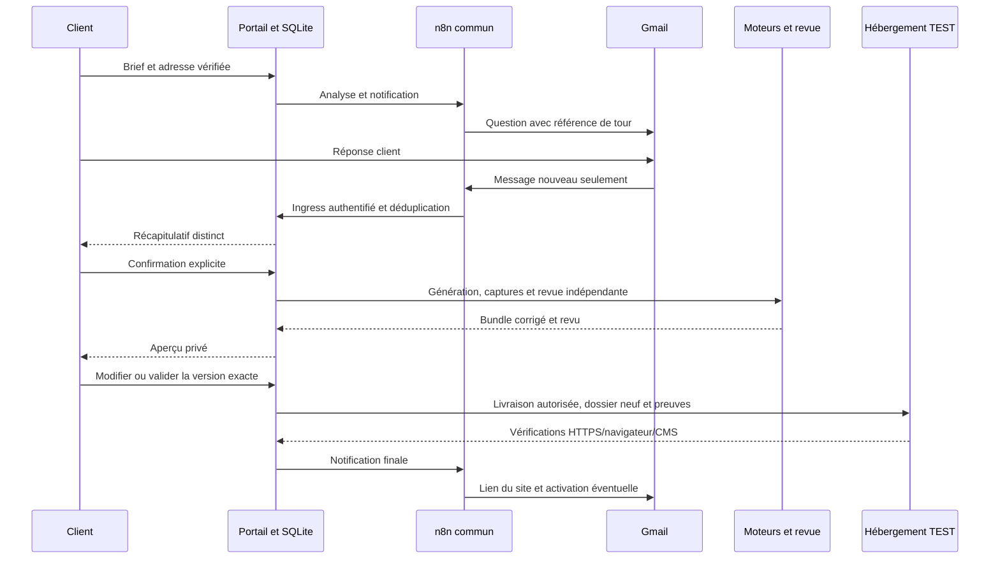
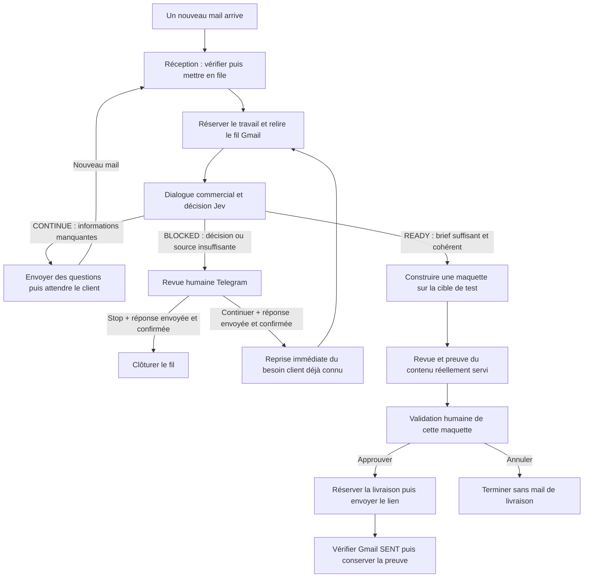
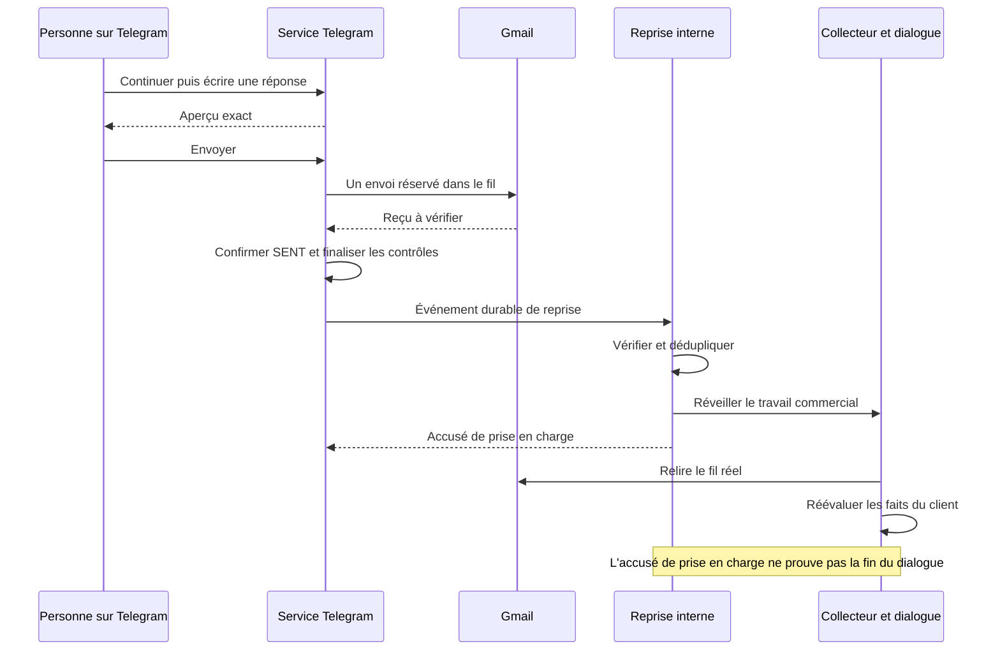
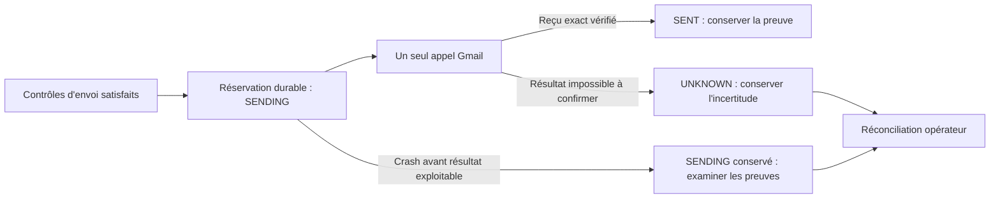

# Workflows et parcours de données — référence publique

## État courant — 21 octobre 2026

La nouvelle recette a depuis exercé trois réponses Gmail réellement admises,
les confirmations du brief et le rejet d'une réponse tardive sans nouveau job.
La génération a commencé, puis la perte des sessions VPN de production et de
l'hyperviseur a rendu la suite inobservable. Ce parcours partiel ne certifie pas
la livraison finale ; les détails et la distinction des étapes figurent dans le
[rapport de recette](RAPPORT-ARCHITECTURE-ET-RECETTE-PROD-20261021.md).

Le parcours commun portail/mail et le pipeline historique sont deux circuits
distincts. Le portail commun est actif dans la production principale ; la
copie de secours garde ses workflows dépubliés. Le lab utilise ses propres
graphes et ses données. Les anciens paragraphes du16octobre restent plus bas
comme historique, sans prévaloir sur cet état.

### Circuit commun portail/mail

| Graphe / composant | Entrée | Traitement | Sortie et garde |
| --- | --- | --- | --- |
| Liaison mail dans le portail | Compte connecté et adresse choisie | Challenge expirant envoyé puis confirmé par le même compte | Adresse vérifiée ; modifier le profil seul ne confirme pas le mail. |
| Lecteur Drive privé | Source explicitement partagée | Lecture bornée des formats admis | Sources privées rattachées au projet ; aucune interprétation inventée d'une image. |
| Lecture et scan des sources | Référence de source/événement admis | Extraction, provenance et scanner heuristique | Texte utilisable ou motif de rejet ; source problématique à remplacer/retirer explicitement. |
| Moteur commun | Brief, historique admissible et sources | Analyse structurée, directions artistiques, génération et revue via fournisseurs configurés | Réponses sous contrat ; le serveur conserve les autorités et les transitions. |
| Notifications privées | Outbox et mail actuellement vérifié | Envoi utile : vérification, question, récapitulatif, aperçu, clarification, livraison | Reçu fournisseur et corrélation au tour ; pas de mail à chaque étape technique. |
| Réponses Gmail vers portail | Un nouveau message du thread corrélé | Filtrage, pièces jointes et relais authentifié vers ingress | Première réponse admissible gagne ; une ancienne référence n'est pas réutilisée. |
| Builder privé | Confirmation explicite du récapitulatif | Pages inertes, captures, revue indépendante, corrections et seconde revue | Bundle immuable lié au propriétaire, job et manifeste ; pas d'URL publique d'aperçu. |
| Révision client | Modifier + retour obligatoire | Clarification, confirmation distincte des changements, nouvelle génération/revue | Nouvelle version ; l'ancienne approbation ne vaut pas approbation de la nouvelle. |
| Livraison finale | Validation client de la version exacte | Registre opérateur, gateway signé, réalisation/revue, publication SSH et comparaison HTTPS | Reçu lié aux mêmes octets ; CMS réel si capacité demandée/admissible. |

Les décisions client fictives d'une recette autonome sont exercées comme telles.
Elles ne constituent pas un accord opérateur de modifier la production. Ce
parcours commun n'a pas besoin de Telegram ; les validations du pipeline
historique restent celles de son propre contrat.

### Pipeline historique et fonctions annexes

Le premier graphe reçoit/filtre les mails admis et conserve le suivi. Le second
construit le dialogue commercial et le brief, avec décisions sourcées et gardes
de reprise. Le troisième produit une maquette et attend son accord de livraison.
Le quatrième réalise le site complet dans une cible TEST après les accords
requis. Les graphes de sources/images, journal/erreurs et reprise humaine sont
des auxiliaires ; ils ne remplacent ni le serveur de vérité ni une autorisation.

Les anciennes entrées Test Frontend et portail v2 restent présentes pour leurs
projets compatibles. Les automatisations de candidatures sont un autre projet,
préservé et non exercé par la recette de site. Aucun graphe historique n'est
republié ou relancé uniquement pour mettre la documentation à jour.

### Séparer les environnements et éviter les doubles

Une vraie boîte Gmail par environnement est prévue, avec OAuth, trigger,
expéditeur et corrélations séparés. C'est une décision à configurer, pas une
installation attestée par ce guide. En attendant, un seul serveur consomme
automatiquement les messages de production ; la copie de secours reste sans
workflows publiés et le lab utilise un connecteur opérateur de recette.
Un alias dans une boîte commune ne crée pas cette isolation. La déduplication
dans deux bases indépendantes n'empêche pas deux pollers concurrents de voir le
même message. Les états incertains ne sont jamais remis en file à l'aveugle.

### Lire une preuve de test

Le lab a réussi le parcours client et les contrôles navigateur avec de vrais
appels OpenCode/OpenAI, Gmail et n8n, puis un CMS réel sur hébergement local.
Ses trois webhooks de recette ne sont pas les cinq graphes communs de production.
Leurs identifiants/version publiées et le catalogue actif détaillé restent dans
la documentation privée, avec les domaines/chemins et points d'écoute réels.
Une recette sur la production et l'hébergement externe doit fournir ses propres
preuves ; une sonde de santé, un login ou un index200 ne la remplace pas.

Toute modification de production fait l'objet de la coordination réciproque
par mail définie dans l'[architecture actuelle](ARCHITECTURE.md). La validation
doit porter sur le changement précis ; une réserve d'un autre agent reste à
résoudre avant mutation, et une annonce n'est pas un verrou atomique.

## Historique du pipeline — descriptions relatives à leur date

# Comprendre les workflows : du premier mail à la maquette envoyée

**Point courant du 16 octobre 2026 :** la décision du dialogue mail utilise
désormais OpenAI Decisions ; deux nouveaux parcours jusqu'à une maquette
reçue sont documentés dans le [bilan des essais](RAPPORT-NOC-A-Z-TESTS-20261016.md).
Le portail conserve son ancienne version exécutée et son décideur Jev ; sa
migration cohérente avec images et site complet est préparée, non activée.
Telegram reste arrêté et désactivé. Les livraisons des deux essais mail
reposaient sur un harnais opérateur TEST explicite, sans clic Telegram natif.
Le gel demandé et les limites de reprise sont dans
[l'architecture actualisée](ARCHITECTURE.md#état-au-16-octobre-2026--gel-des-changements-et-préparation-de-reprise).
Les descriptions datées du 15 ci-dessous restent historiques lorsqu'elles
diffèrent de ce point ; aucun nouveau parcours n'est lancé pour la rédaction.

Ce guide explique ce que fait le projet lorsqu’une personne demande un site par mail : comment son message est reçu, comment le besoin est compris, dans quels cas un humain intervient et à quel moment une maquette peut être envoyée. Il explique aussi pourquoi certains traitements s’arrêtent et pourquoi il serait dangereux de simplement cliquer sur « relancer » dans tous les cas.

La lecture peut commencer sans connaître n8n. Les termes techniques utiles sont définis au moment où ils apparaissent, puis réunis dans un glossaire. Les noms de statuts sont conservés : ils permettent de faire le lien entre cette explication et ce que montre le système.

**État documentaire : 15 octobre 2026.** Ce texte reprend les sources et les preuves des interventions des 12, 13 et 14 octobre, puis la reprise immédiate intégrée le 15 octobre. Il conserve les limites de ces preuves. L’installation d’une correction, un essai avec des données fictives et un parcours complet avec un vrai échange sont trois résultats différents.

Cette version est publique. Les adresses opérationnelles, identifiants internes, chemins d’accès privés, données clients et informations d’authentification sont dans la documentation privée autorisée. Leurs valeurs ne sont pas nécessaires pour comprendre le fonctionnement décrit ici. Pour les machines, les services, les protocoles et les répertoires, lire aussi l’[architecture du projet](ARCHITECTURE.md).

## 1. Ce que le système doit accomplir

Le résultat attendu est simple à formuler : comprendre une demande de site, demander les précisions manquantes, produire une maquette lorsque le besoin est suffisamment clair et permettre à une personne de décider si le résultat peut être envoyé au client.

Pour y parvenir, le système doit résoudre plusieurs problèmes en même temps :

- reconnaître les mails qu’il a le droit de traiter ;
- éviter que deux traitements répondent au même message ;
- distinguer une exigence réellement formulée par le client d’une proposition de l’assistant ;
- demander de l’aide lorsque les sources ou la décision sont insuffisantes ;
- vérifier que la maquette présentée correspond au travail demandé ;
- conserver la preuve de ce qui a déjà été envoyé ;
- reprendre certains incidents sans créer un deuxième mail ou une deuxième construction.

Le projet reste dans un **périmètre de test** : comptes et destinataires autorisés, hébergement de maquette imposé et contrôles conservés. Une maquette visible sur cet hébergement est un résultat de test consultable. Elle ne vaut pas autorisation générale de mettre un site complet en production, de recevoir des paiements ou d’utiliser une autre cible d’hébergement.

Un **workflow** est une suite d’étapes dans n8n. Par exemple : recevoir un mail → vérifier son origine → enregistrer son traitement. Le **pipeline** est l’ensemble des workflows qui coopèrent. Un **nœud** est une étape à l’intérieur d’un workflow. Le nombre de nœuds aide à reconnaître une définition, mais ne prouve ni sa qualité ni sa version : deux versions différentes peuvent avoir le même nombre d’étapes.

## 2. La carte générale du parcours

Ce schéma montre les choix principaux. Des vérifications de source, d’identité, de version, de verrou et d’envoi interviennent entre plusieurs cases. Une flèche indique le parcours prévu quand ces conditions sont remplies ; elle ne signifie pas qu’un traitement peut ignorer un contrôle ou se poursuivre après n’importe quelle erreur.

Deux points méritent d’être retenus dès maintenant. **La première maquette de test peut être construite automatiquement lorsque le brief est prêt. L’envoi de son lien au client reste soumis à une validation humaine après construction et contrôle.** Par ailleurs, depuis le 15 octobre, « Continuer » dans la revue Jev peut provoquer une réévaluation immédiate après le mail humain confirmé ; l’ancienne obligation d’attendre le prochain mail client ne décrit plus ce parcours.

## 3. Quels workflows font quoi ?

Les noms ci-dessous sont ceux des définitions consultées. Leurs responsabilités sont complémentaires : un workflow reçoit, un autre comprend, un autre construit et plusieurs composants assurent le suivi.

| Nom du workflow | Son rôle concret | Taille de la définition publiée exportée consultée |
| --- | --- | ---: |
| **PIPELINE — 1. Réception des mails et suivi** | Filtrer les mails, conserver la file, réserver le travail, appeler le dialogue, enregistrer son bilan et gérer certaines reprises ou relances. | 89 nœuds |
| **PIPELINE — 2. Dialogue commercial et brief** | Relire la conversation, vérifier ses sources, faire décider Jev, préparer la réponse ou le brief et transmettre une première maquette admissible. | 95 nœuds après l’intégration du 15 octobre |
| **SERVICE — Décisions Jev du dialogue commercial** | Sélectionner les passages du client utiles à la décision, puis classer le besoin en `CONTINUE`, `READY` ou `BLOCKED`. | 9 nœuds |
| **PIPELINE — 3. Maquette puis validation humaine** | Soumettre une construction, suivre son résultat, contrôler la maquette et attendre la validation avant livraison. | 28 nœuds |
| **SUPPORT PIPELINE — Journal des événements** | Conserver les événements utiles et réveiller le traitement des notifications lorsque nécessaire. | 11 nœuds |
| **SUPPORT PIPELINE — Reprise ponctuelle** | Attendre un délai pour un travail identifié, puis réveiller la branche prévue. | 4 nœuds |
| **SUPPORT PIPELINE — Reprise humaine interne** | Recevoir la reprise liée à une réponse humaine confirmée, la dédupliquer, l’enregistrer durablement et réveiller la réception. | 9 nœuds |

Ce tableau décrit le parcours principal et son nouveau raccordement de reprise. Il ne prétend pas répertorier tous les workflows présents dans n8n : des supports d’alerte, des lanceurs de test, des versions de laboratoire et des candidats existent aussi. La présence d’un export dans les sources ne suffit pas à conclure qu’un workflow est actif, publié, accessible au même compte ou raccordé au parcours principal.

Les six premières définitions avaient été observées actives lors de la lecture précédente. L’installation et la publication du raccordement de reprise du 15 octobre sont consignées séparément. Ces constats datés ne garantissent pas que toutes les définitions restent identiques au moment d’une intervention future.

### Le service Telegram ne se confond pas avec un workflow n8n

Un service installé sur le serveur reçoit les actions Telegram et applique les contrôles de réponse humaine ou de validation de maquette. Il échange avec n8n, mais ne se réduit pas à une case du graphe commercial. Ce service est le consommateur unique des événements du bot : il ne faut pas lancer un deuxième programme qui lirait les mêmes réponses Telegram en parallèle.

Le **bridge OpenCode** est un autre service : il reçoit les demandes de construction autorisées, les place en file et fournit leur état. Les agents de construction travaillent ensuite sur la cible d’hébergement approuvée. Le détail de ces services et de leur emplacement relève de l’[architecture](ARCHITECTURE.md).

## 4. Première étape : recevoir un mail autorisé

### 4.1. Détecter le nouveau message

Le déclencheur Gmail natif interroge Gmail pour rechercher les nouveaux messages correspondant aux critères configurés. Il ne crée une exécution que lorsqu’il détecte un nouveau message admissible. Les anciens déclencheurs programmés chaque minute ont été retirés du parcours documenté : on ne lance plus trois traitements de file à vide simplement parce qu’une minute s’est écoulée.

Cela ne signifie pas qu’il n’existe aucune interrogation périodique : Gmail doit toujours être interrogé pour détecter les nouveaux mails, et le service Telegram doit toujours recevoir les actions du bot. Le changement porte sur le réveil du travail métier dans n8n.

### 4.2. Vérifier le périmètre

La réception contrôle notamment le compte de test, la date de mise en service ou le seuil prévu pour la source, l’origine du message et les règles d’exclusion des notifications automatiques. Ces gardes évitent de répondre à une boîte non autorisée, de reprendre sans distinction de vieux mails ou d’entrer dans une conversation avec une notification automatique du système.

Un message reçu par Gmail n’est donc pas automatiquement un message à traiter. Un rejet par une garde peut être le comportement correct. Il faut lire son motif avant de conclure à une panne.

La source réelle compte aussi : le système vérifie le message, le fil auquel il appartient et les métadonnées d’expéditeur ou de réponse. Il ne suffit pas qu’un texte ressemble à un ancien mail pour le déclarer autorisé ou déjà traité.

### 4.3. Conserver le travail dans une file

Un mail accepté est enregistré dans une **file d’attente**, parfois appelée **inbox** dans les sources. Cette table est la liste durable des messages reçus et de leur état de traitement. Elle permet de savoir qu’un travail reste à faire même si le traitement n’a pas démarré immédiatement.

Le dédoublonnage vérifie que le même message n’est pas remis en file comme s’il était nouveau. La réception conserve les références nécessaires pour relier le travail à son véritable message Gmail et à sa conversation. Une référence ne remplace pas le contenu source : le dialogue relit ensuite le vrai fil Gmail lorsqu’il doit décider.

L’enregistrement en file et la réussite de l’analyse sont deux événements différents. « Message collecté » signifie que le système a conservé le travail à faire ; cela ne signifie pas qu’une réponse a déjà été rédigée ou envoyée.

## 5. Deuxième étape : réserver le travail et appeler le dialogue

### 5.1. Pourquoi un verrou est nécessaire

Plusieurs événements peuvent arriver presque en même temps : un nouveau mail, un réveil différé, une action humaine ou une reprise. Sans coordination, deux exécutions pourraient prendre le même message et envoyer deux réponses.

Le **verrou du processeur** sert à réserver le droit de traiter une partie du travail. Le **claim** est la réservation du message pris en charge. Le **lease**, ou bail, est la durée pendant laquelle une réservation temporaire appartient à un traitement donné. L’identité du propriétaire et l’expiration sont vérifiées : « le verrou existe » n’est pas une preuve qu’il appartient à l’exécution courante.

La configuration générale et le verrou sont deux objets distincts. Une option « service activé » ne donne pas la propriété du verrou. Une colonne appartenant au verrou ne remplace pas la liste des comptes autorisés.

Ces protections valent pour les composants qui les respectent. Elles n’empêchent pas un autre programme, un ancien banc autonome ou un opérateur de faire un envoi en dehors de ce mécanisme. C’est pour cela qu’il faut conserver les historiques et identifier l’émetteur réel lors d’un diagnostic de doublon.

### 5.2. Traiter par petits lots

Les sources du parcours événementiel décrivent des lots limités à trois messages et cinquante notifications. Si du travail reste après un lot, un réveil ponctuel peut être programmé. L’objectif est d’avancer sans lancer une boucle illimitée qui monopoliserait le serveur.

La reprise tient compte du propriétaire des baux expirés pour ne pas perdre un travail resté marqué en cours. Elle prévoit aussi des bornes en cas de contention ou d’absence de progrès. Un verrou concurrent n’est pas une autorisation de le supprimer : il faut vérifier son propriétaire, son expiration et le travail qui peut encore s’exécuter.

Un arrêt brutal du serveur peut laisser un état que le simple passage du temps ne répare pas. La procédure de récupération explicite sert alors à examiner le travail manqué et les files avec les mêmes filtres. Elle ne doit pas ignorer les réservations d’envoi ni retraiter tous les anciens messages sans distinction.

### 5.3. Synchrone et asynchrone : qui attend qui ?

La réception appelle le dialogue commercial de façon **synchrone** : pour ce message, elle attend le résultat de l’appel avant d’enregistrer son bilan. Exemple : « j’envoie le message au dialogue, j’attends qu’il indique ce qu’il a fait, puis je classe le travail ».

Le lancement de la maquette depuis le dialogue est **asynchrone** : le dialogue transmet le travail sans attendre que toute la construction, la revue et la validation humaine soient terminées. Le journal peut également réveiller une branche de notifications sans attendre sa fin.

Un appel asynchrone accepté ne prouve donc pas que le travail demandé est terminé. Il faut suivre son état propre : construction, revue, décision humaine, livraison et reçu Gmail. Cette distinction explique pourquoi le mail peut avoir un bilan alors qu’une maquette est encore en cours.

## 6. Troisième étape : comprendre ce que le client demande

### 6.1. Lire la conversation réelle

Le dialogue vérifie à quel client et à quel projet le message appartient. Il relit le **fil Gmail physique**, c’est-à-dire la vraie conversation conservée par Gmail, avec ses messages et leur provenance. Un résumé ancien ou une mémoire locale ne doit pas faire croire qu’un historique incomplet est complet.

Lorsque le fil est clôturé par une décision humaine `CLOSED`, le parcours documenté le termine sans nouvelle réponse commerciale et sans nouvelle maquette. Un nouveau traitement ne doit pas effacer cette clôture en se contentant de relire un ancien message.

La mémoire du projet aide à suivre la discussion, mais son rattachement doit être unique et cohérent. Le système ne doit pas créer une nouvelle mémoire pour masquer une liaison ambiguë, ni attribuer à un projet les exigences d’un autre.

### 6.2. Séparer faits client et réponses de l’assistant

Le système doit distinguer deux types de phrases :

- « Je veux un formulaire de réservation », écrit par le client : c’est une demande qui peut contribuer au brief.
- « Nous pourrions ajouter un formulaire de réservation », écrit par l’assistant : c’est une proposition, qui ne devient pas automatiquement une exigence acceptée.

La distinction reste valable si une personne a rédigé la réponse dans Telegram avant son envoi par Gmail. Ce texte humain a le rôle de réponse de l’assistant. Il ne donne pas à l’IA le droit d’inventer que le client a choisi cette fonctionnalité.

Les messages assistant confirmés `SENT` peuvent être conservés dans l’historique ; leur éventuel HTML reste leur contenu littéral. Ils restent exclus des citations utilisées comme faits client. Un mail client uniquement en HTML sans alternative texte, un historique tronqué ou une pièce jointe dont la lecture n’est pas attestée peuvent conduire à une revue humaine.

### 6.3. Les rôles de GPT et de Jev

GPT conserve les fonctions de triage, de conseil et de rédaction. Jev intervient dans la décision sur le besoin : il sélectionne des citations du client, puis décide si la discussion doit continuer, si le brief est prêt ou si le système est bloqué. Le dialogue attend la réponse du service Jev avant de poursuivre cette branche.

Le but des citations est de pouvoir justifier la décision. Une réponse fluide de l’IA ne suffit pas : le système doit savoir sur quels passages du client elle repose. Les contrôles de provenance, de cohérence et de confiance restent applicables ; les seuils n’ont pas été abaissés pour faire passer un cas bloqué.

Une réponse structurée, appelée **JSON**, est contrôlée par le programme. Une sortie dans un format invalide n’est pas interprétée librement comme une approbation. La suite est bloquée ou orientée en revue selon le parcours concerné.

### 6.4. Ce que contient le brief

Le **brief** est le résumé exploitable du besoin. Six sujets sont attendus :

| Sujet | La question humaine correspondante | Exemple fictif de précision utile |
| --- | --- | --- |
| Objectif | Pourquoi créer ce site ? | Présenter une association et permettre de la contacter. |
| Public | À qui s’adresse-t-il ? | Aux adhérents et aux personnes qui souhaitent rejoindre l’association. |
| Type de site | Quel genre de site est attendu ? | Un site vitrine plutôt qu’une boutique. |
| Pages | Quelles pages faut-il prévoir ? | Accueil, activités, équipe et contact. |
| Fonctions | Que doit pouvoir faire le visiteur ? | Lire les horaires et envoyer une demande de contact. |
| Contraintes | Quelles limites ou obligations doivent être respectées ? | Une charte graphique donnée ou l’absence de paiement en ligne. |

Ces exemples sont pédagogiques ; ils ne décrivent aucun client du projet. Une réponse peut aussi préciser qu’il n’existe aucune exigence particulière sur un sujet. Cette absence doit être établie, pas remplie arbitrairement par l’IA.

## 7. Les décisions du dialogue et leurs conséquences

| Décision | Ce qu’elle veut dire | La suite prévue | Ce qu’elle ne prouve pas |
| --- | --- | --- | --- |
| `CONTINUE` | Des précisions client restent nécessaires. | Rédiger au plus deux questions, enregistrer l’échange puis attendre une réponse. | Que tout le brief est déjà connu. |
| `READY` | Le besoin est suffisamment clair, cohérent et justifié par les sources acceptées. | Préparer puis soumettre une première maquette de test si les autres gardes l’autorisent. | Qu’une maquette existe déjà ou qu’un humain l’a approuvée. |
| `BLOCKED` | Le système ne peut pas poursuivre de façon fiable. | Demander une intervention humaine ou conserver un blocage explicite. | Que le client a refusé son projet. |

Le dialogue reconnaît aussi des intentions telles que `ACK`, pour un accusé de réception, et `STATUS`, pour une demande de suivi. Un remerciement ou une question sur l’avancement ne doit pas devenir un nouveau brief ni relancer une construction.

Le signal technique `opencode_ready` signifie que le travail peut être soumis à la construction selon les règles du parcours. Il ne signifie ni « OpenCode a terminé », ni « le site est validé », ni « le client a reçu son lien ».

### Un exemple de parcours normal

Un client décrit un site vitrine, son public, ses pages et ses fonctions, mais ne précise pas certaines contraintes. Le dialogue décide `CONTINUE`, envoie des questions et attend. Le client répond. Le système relit le fil complet, retrouve les exigences confirmées et peut désormais décider `READY`.

La construction de la maquette peut alors être soumise. Une fois la maquette contrôlée, une personne la consulte et décide si son lien peut être envoyé. Le simple passage de `CONTINUE` à `READY` n’a donc envoyé aucune maquette par lui-même.

### Un exemple de blocage correct

Le client écrit : « Tous les détails sont dans le document joint », mais le parcours ne dispose pas d’une lecture attestée de cette pièce jointe. Inventer les pages ou prétendre avoir lu le document serait incorrect. Le système peut classer `BLOCKED` et présenter le cas à une personne sur Telegram.

Un blocage préserve ici la fidélité au besoin. Il faut distinguer ce résultat d’une panne technique, comme un fournisseur temporairement indisponible : les suites autorisées ne sont pas les mêmes.

## 8. La revue humaine sur Telegram, pas à pas

Cette revue intervient quand le dialogue ne sait pas traiter un message seul. Elle porte sur la réponse à la conversation commerciale. **Elle est distincte de la validation finale d’une maquette déjà construite.**

### 8.1. Présenter le message et demander une décision

Le message est lié à une revue en attente. Le bot présente le contenu nécessaire, y compris le mail complet, puis propose **Stop** ou **Continuer** pour le parcours Jev. Les longs contenus peuvent être découpés en plusieurs messages : le découpage ne doit pas les tronquer silencieusement.

Le système conserve le lien entre la demande, le fil Gmail, le projet, la révision, la conversation Telegram et la personne autorisée. Un bouton n’accorde pas un droit général sur tous les projets. Un ancien bouton ou une demande expirée ne doit pas autoriser une nouvelle action.

### 8.2. Rédiger dans le champ attendu

Après le choix, le bot demande le texte à envoyer. **ForceReply** désigne le champ de réponse rattaché à un message précis du bot. Répondre dans ce champ permet au système de savoir à quelle demande le texte appartient et qui l’a rédigé.

Écrire simplement un message libre dans le groupe n’équivaut pas à remplir ce champ. Avec la confidentialité Telegram du bot, ce message peut même ne pas être transmis au consommateur attendu. La rédaction doit donc rester attachée à la demande ouverte.

### 8.3. Relire l’aperçu exact

Le bot affiche le texte proposé pour Gmail et les actions **Envoyer**, **Modifier** ou **Annuler**. Modifier crée un nouvel aperçu et invalide les anciens boutons concernés. La personne qui confirme doit être celle autorisée pour cette rédaction.

La mention de version de test et le texte visible doivent correspondre au message réellement soumis. Une prévisualisation ne doit pas être présentée comme un envoi : il faut encore cliquer sur l’action prévue et passer les dernières gardes.

Les parcours historiques de revue d’une proposition IA peuvent avoir des libellés différents : certaines propositions déjà affichées conservent leur ancien passage par une prévisualisation. Cela ne change pas la nécessité de respecter le sens exact du bouton affiché. Un formulaire natif de revue n8n ou un laboratoire séparé ne remplace pas automatiquement cette autorisation Telegram.

### 8.4. Vérifier avant le vrai envoi

Le service contrôle notamment que la revue est toujours ouverte, que le message et le fil sont encore les bons, qu’aucune réponse client plus récente n’a rendu l’action obsolète, que le destinataire est autorisé et qu’aucun envoi incompatible n’a déjà été réservé.

Il acquiert le verrou requis, réserve durablement l’envoi, effectue un seul appel Gmail et vérifie le reçu. Une confirmation Gmail `SENT` doit correspondre au bon message, au bon fil et au bon destinataire. Une réponse réseau ambiguë ne devient pas automatiquement un nouvel essai.

### 8.5. Stop : clôturer après confirmation

Dans le parcours Jev, **Stop** signifie terminer cette discussion avec la réponse humaine prévue. La clôture durable intervient après le reçu Gmail confirmé. Le contrôle du fil est écrit sous verrou avant le classement final du mail comme traité.

Le système ne doit donc pas annoncer une fermeture durable simplement parce que quelqu’un a cliqué sur Stop, si l’envoi requis n’est pas encore confirmé. Lors d’un futur passage, le contrôle `CLOSED` empêche une réponse commerciale et une construction sur ce fil clôturé.

### 8.6. Continuer : le comportement actualisé le 15 octobre

Le parcours du 14 octobre envoyait la réponse humaine puis attendait un nouveau mail client. Le 15 octobre, un raccordement a été intégré pour **réévaluer immédiatement le brief client déjà présent après l’envoi humain confirmé**.

L’ordre devient : réponse humaine confirmée `SENT` → contrôle durable de la reprise → enregistrement de l’événement → réveil du collecteur → relecture du fil et nouvelle décision commerciale.

Cette reprise n’invente aucun fait. La réponse humaine reste un message de l’assistant. Le dialogue reprend les exigences réellement attribuables au client. Si elles suffisent déjà et passent les contrôles, il peut atteindre `READY`. S’il manque encore des informations, il peut produire des questions. S’il reste bloqué, il conserve un nouveau résultat de blocage et un diagnostic ; il ne rouvre pas aveuglément l’ancienne revue déjà résolue.

Si un message client plus récent est arrivé entre-temps, il peut rendre la reprise ancienne obsolète. Le nouveau message doit être traité selon sa source réelle, sans forcer la décision obtenue sur l’ancien contexte.

## 9. Comment la reprise immédiate reste contrôlée

La reprise du 15 octobre n’est pas un bouton « refaire toute l’exécution ». C’est un événement distinct, rattaché à une demande humaine et à son reçu Gmail confirmé.

### 9.1. Une identité propre pour une action nouvelle

Le mail humain et la réévaluation commerciale sont deux actions différentes. La reprise reçoit sa propre identité durable. Le système conserve le rattachement à la source Gmail physique, au fil, au projet, à la révision et à la réservation de la réponse humaine d’origine.

Cela permet de vérifier deux choses en même temps : la réponse humaine a bien été envoyée, et l’éventuelle suite commerciale n’est pas une répétition de cet envoi. La déduplication de la reprise ne consiste pas à comparer approximativement le corps de deux mails.

L’activation est datée. Le nouveau mécanisme ne doit pas reprendre automatiquement toutes les anciennes réponses humaines de l’historique. Une intervention récente n’autorise aucun rattrapage massif d’anciens tests.

### 9.2. Les phases de la transmission

| Phase de reprise | Ce qu’elle indique | Ce qu’il faut comprendre |
| --- | --- | --- |
| `PREPARED` | L’événement est préparé durablement, mais toutes les finalisations requises ne sont pas encore acquises. | Le travail commercial n’est pas déclaré repris à ce stade. |
| `READY` | Les contrôles préalables de la reprise sont satisfaits. | L’événement peut être transmis au récepteur prévu. |
| `DISPATCHING` | La tentative de transmission a commencé. | Une panne peut survenir après réception par l’autre service ; il faut conserver l’incertitude. |
| `ACCEPTED` | Le récepteur a accusé réception du bon événement. | Cela prouve une prise en charge, pas une maquette terminée ni un mail final envoyé. |
| `SUPERSEDED` | Un état ou un message plus récent remplace cette reprise. | Il faut suivre le contexte récent, pas forcer l’ancien. |
| `REJECTED` | Le récepteur a refusé la reprise selon son contrat. | Lire le motif et les contrôles ; ne pas modifier les identités pour contourner le refus. |
| `UNKNOWN` | Le résultat de la transmission est incertain. | Réconcilier les preuves avant toute nouvelle action. |

L’état d’interface **`RESUME_QUEUED`** indique que la suite a été enregistrée pour prise en charge. Il termine cette interaction Telegram ; il ne certifie pas la fin du traitement commercial. De la même manière, une réponse HTTP correcte ne certifie pas un succès de construction.

### 9.3. Les issues du nouveau tour commercial

La réévaluation peut produire un brief prêt et conserver le parcours automatique de première maquette de test. Dans ce cas, elle ne doit pas envoyer un deuxième mail qui répète simplement la confirmation humaine déjà partie.

Elle peut aussi décider de continuer les questions, reconnaître un accusé de réception sans construction ou demander une attention nouvelle. Les états de suivi tels que `RESUME_READY`, `RESUME_ACK` ou `RESUME_NEEDS_REVIEW` servent à distinguer ces issues. Ils ne doivent pas être confondus avec un statut de livraison Gmail.

Un nouvel échec ne remet jamais à zéro l’ancien envoi humain. Le diagnostic doit porter sur ce qui manque dans la reprise, pas tenter de renvoyer la réponse déjà confirmée.

## 10. Quatrième étape : construire une maquette vérifiable

### 10.1. Soumettre une demande autorisée

Quand le brief est `READY`, le dialogue peut soumettre une **première maquette de test** sans approbation humaine préalable de ce prompt. Les gardes exigent toujours un brief cohérent, une provenance valide, les indicateurs attendus et la cible de test enregistrée par l’opérateur.

Un sous-domaine écrit par le client ne donne pas le droit de construire sur n’importe quel hébergement. La destination autorisée vient de la configuration contrôlée du parcours. Les modes de site complet ou les formulaires opérateur sont des voies distinctes, avec leurs propres autorisations ; ils ne doivent pas être déduits du seul mot `READY`.

| Entrée ou mode | Son autorisation propre | Sa limite dans ce projet |
| --- | --- | --- |
| Première maquette automatique, `prototype` | Brief suffisant et cohérent, contrôles de source et gardes serveur satisfaits. | Cible de test imposée et validation humaine après construction avant livraison. |
| Mode `full_site`, site complet | Approbation humaine exigée par le backend, en plus des autres contrôles. | Le nom du mode n’accorde aucune publication de production ou accès à une autre cible. |
| Formulaire opérateur authentifié | Fin de discussion, prompt exact et choix du mode confirmés dans ce parcours distinct. | Il ne contourne ni le registre des cibles ni les règles d’envoi. |
| Lanceur manuel de l’étape 3 | Réutilisation du cas de test autorisé et de son brief conservé. | Il peut provoquer une vraie construction puis un vrai mail après validation ; ce n’est pas un simple aperçu sans effets. |

Le bridge transforme la demande en **job**, c’est-à-dire un travail suivi avec son identité, son projet, sa révision et son état. Le même travail n’est pas soumis à nouveau à chaque consultation d’avancement. Le contrôle de doublon sert à retrouver le travail existant lorsque son contrat l’autorise.

### 10.2. Ne pas écrire simultanément sur la même racine

Le runner organise les travaux en file et sérialise les constructions concernant la même racine d’hébergement : un travail peut rester `queued` pendant qu’un autre est `running`. Ces mots signifient « en attente » et « en cours » ; ils ne prouvent pas un résultat livré.

Les agents utilisent les rôles de planification, de construction et de revue prévus. Le planificateur encadre le travail ; le constructeur réalise la maquette ; une revue indépendante examine le résultat. Les agents restent limités à la cible et aux opérations autorisées.

Une nouvelle soumission peut remplacer la révision de référence d’un projet. Une ancienne maquette ne doit alors pas être livrée comme si elle correspondait au nouveau brief. Le contrôle de révision relie la construction et l’approbation au bon état du besoin.

### 10.3. Isoler chaque maquette

Chaque job dispose de son propre dossier et de sa propre URL. Une nouvelle maquette ne doit pas remplacer la page d’accueil de l’hébergement ni écraser la maquette d’un autre travail.

Si le travail doit remplacer du contenu existant, une sauvegarde restaurable doit être vérifiée avant modification. Si le dossier est neuf, il faut attester son absence préalable et prévoir le retour arrière par isolation. Une création neuve ne justifie pas d’inventer une archive antérieure qui n’existe pas.

Les maquettes peuvent représenter des fonctions simulées : panier fictif, formulaire de démonstration ou stockage dans le navigateur. La présence d’une interface ne prouve pas l’existence d’une authentification de production, d’un paiement réel ou d’une base commerciale. Ces limites doivent rester visibles.

### 10.4. Pourquoi le code de sortie d’OpenCode ne suffit pas

Un agent peut terminer sa commande sans avoir construit la maquette, par exemple parce qu’il a détecté un problème de cible ou de permissions. Une commande terminée normalement ne suffit donc pas à déclarer le site prêt.

Le résultat attendu est structuré et doit correspondre exactement au job et à sa révision. Il doit déclarer une construction réalisée, une revue positive et les contrôles de sauvegarde attendus. Une absence de résultat, des identités discordantes ou un format incorrect bloquent l’admissibilité à la livraison.

Cette déclaration reste une attestation des agents. Elle est complétée par une vérification technique du contenu réellement produit et servi.

### 10.5. La preuve de la maquette

Le vérificateur lit le fichier d’entrée exact sur l’hébergement par SSH, puis télécharge le contenu servi à l’URL HTTPS dédiée. Il vérifie les marqueurs du job et de la révision et compare les contenus au moyen d’une **empreinte SHA-256**.

Une empreinte est une valeur calculée à partir des octets d’un fichier. Si le contenu change, l’empreinte attendue change également. La comparaison vise à vérifier que la page présentée correspond au fichier et au travail concernés.

Les contrôles conservent la vérification TLS, refusent les redirections et bornent les lectures. Une page HTTP 200 isolée ne suffit pas : elle pourrait être une ancienne page ou un autre résultat. Inversement, un refus HTTP ne doit pas être transformé arbitrairement en succès.

Cette preuve porte principalement sur l’index comparé. Elle ne signifie pas que tous les assets, liens, formulaires et interactions ont été testés dans un navigateur. La revue des agents, le contrôle automatique de l’index et un essai navigateur sont des preuves complémentaires.

## 11. Cinquième étape : approuver la maquette et livrer son lien

### 11.1. Une approbation sur un résultat consultable

L’étape **`FINAL_REVIEW`** intervient après construction et vérification. Le bot présente l’URL réelle de la maquette et les éléments qui permettent de rattacher la décision au bon job, à sa révision et à son empreinte.

L’humain doit pouvoir examiner le résultat avant de choisir. **Approuver** autorise la livraison de cette maquette identifiée. **Annuler** termine cette livraison sans envoyer son lien. Une approbation générale d’une ancienne version ne doit pas autoriser une nouvelle maquette.

Les anciens boutons de construction préalable ne servent plus à autoriser automatiquement un nouveau prototype dans ce parcours. Les demandes anciennes incompatibles restent bloquées ; elles ne sont pas réarmées pour contourner la nouvelle séquence.

### 11.2. Réserver avant d’envoyer

Après approbation, le bridge revalide la preuve de la maquette et réserve la livraison de façon atomique dans son registre. **Atomique** signifie que l’opération de réservation est traitée comme un tout dans ce stockage : deux demandes concurrentes ne peuvent pas chacune gagner la même réservation.

Cette réservation n’est ni le reçu Gmail ni l’approbation humaine elle-même. C’est une protection supplémentaire avant l’envoi. L’intégration conserve aussi le registre des mails sortants.

Le lien envoyé doit être l’URL propre de l’artefact approuvé, pas une adresse fixe qui afficherait la dernière page déposée à la racine. La correspondance est revérifiée avant la livraison.

### 11.3. Confirmer la livraison

Le message Gmail est envoyé dans le fil prévu et sa confirmation est relue. Le statut `SENT` exige la preuve d’un nouveau message envoyé dans le bon fil avec le bon destinataire. Il ne prouve pas que le destinataire l’a reçu dans sa boîte principale, l’a ouvert ou a consulté la maquette.

L’annonce Telegram « maquette envoyée » doit dépendre de cette preuve, pas du simple démarrage de la construction ou d’une réponse HTTP. Une erreur de notification ne doit pas provoquer un deuxième mail au client.

Le registre du bridge peut conserver la réservation après livraison. Ce statut persistant empêche une nouvelle réservation ; il ne signifie pas que l’envoi a échoué ou qu’il faut recommencer.

## 12. Les états : ne pas confondre quatre questions différentes

Les sources utilisent plusieurs familles de statuts. C’est normal : « ai-je compris le besoin ? », « ai-je traité le mail ? », « ai-je envoyé le message ? » et « ai-je terminé la construction ? » sont des questions différentes.

| Famille | Exemple de question | Exemples d’états |
| --- | --- | --- |
| Décision sur le besoin | Le brief permet-il de poursuivre ? | `CONTINUE`, `READY`, `BLOCKED` |
| Bilan du travail reçu | Qu’est-il arrivé à ce message dans la file ? | `REPLIED`, `REVIEW`, `IGNORED`, `ATTENTION` |
| Envoi | A-t-on une preuve de l’expédition de ce mail ? | `PENDING`, `SENDING`, `SENT`, `UNKNOWN` |
| Construction ou reprise | Le travail transmis est-il en attente, exécuté ou confirmé ? | `queued`, `running`, `completed_review_required`, `ACCEPTED` |

### 12.1. Les bilans de la file

| Bilan | Comment le comprendre | Contrôle utile |
| --- | --- | --- |
| `REPLIED` | Le parcours classe le message comme répondu. | Vérifier le reçu Gmail et le registre si l’on veut établir un envoi réel. |
| `REVIEW` | Une revue humaine est en attente. | Lire la demande, son motif et son état actuel dans le circuit prévu. |
| `IGNORED` | Le message a été écarté ou ne demande pas de réponse dans ce parcours. | Lire le motif ; il peut s’agir d’un filtrage correct ou d’une conversation clôturée. |
| `ATTENTION` | Le traitement ne dispose pas d’une issue suffisamment sûre ou demande une vérification spécifique. | Lire le code et le contexte technique avant de choisir une action. |

La définition de `ATTENTION` n’est pas simplement « la même revue que `REVIEW` ». Le classificateur consulté l’utilise notamment lorsqu’aucun résultat reconnu ne permet de conclure, lorsqu’une reprise humaine produit `RESUME_NEEDS_REVIEW`, lorsqu’une reprise serait bloquée par un envoi déjà réservé ou lorsqu’une réservation existe sans preuve suffisante d’un envoi confirmé.

Le motif peut alors signaler une vérification d’exécution, une reprise interdite à cause de l’outbox ou un résultat Gmail inconnu. Le statut seul n’indique pas quelle réparation effectuer. Certaines erreurs IA admissibles sont reclassées en attente de reprise limitée ; elles ne deviennent pas toutes une nouvelle revue Telegram automatique.

Le parcours conserve aussi des états de gestion comme `ERROR`, `RETRY_REQUESTED` ou `RETRY_WAIT`, et les états propres à la reprise humaine. Ils expliquent pourquoi la liste des quatre bilans courants ne doit pas être utilisée comme une description exhaustive de toutes les lignes de toutes les tables.

### 12.2. Les états d’envoi et l’outbox

L’**outbox** est le registre durable des actions d’envoi. Il conserve leur identité, leur réservation et leur résultat. Il ne s’agit pas seulement du dossier « messages envoyés » de Gmail : c’est la mémoire utilisée par le système pour éviter un nouvel envoi du même travail.

| État | Sens | Conséquence attendue |
| --- | --- | --- |
| `PENDING` | Une action attend son traitement dans le composant concerné. | Les contrôles et la réservation restent nécessaires. |
| `SENDING` | Le système a réservé ou commencé l’envoi. | Ne pas remettre automatiquement en attente. |
| `SENT` | L’envoi a été confirmé avec les preuves requises. | Conserver ce fait et ne pas renvoyer le même travail. |
| `UNKNOWN` | Il est impossible de conclure sûrement sur le résultat. | Examiner les preuves avant toute décision ; aucun réenvoi aveugle. |

Les noms et transitions exacts dépendent du registre concerné. Un statut de notification Telegram ne remplace pas le statut Gmail. Une phase de reprise `ACCEPTED` ne remplace aucun des deux.

Ce schéma n’ajoute volontairement aucun retour automatique vers un nouvel appel Gmail. La réconciliation cherche à établir le fait réel et à corriger son suivi ; elle ne doit pas commencer par répéter l’action incertaine.

### 12.3. Pourquoi « inconnu » est un état utile

Supposons que Gmail accepte un mail, puis que le réseau coupe avant que le service reçoive sa confirmation. Le mail a peut-être été envoyé. Si le système traduit automatiquement l’erreur en « non envoyé » et recommence, le client peut recevoir deux réponses.

`UNKNOWN` conserve cette ambiguïté au lieu de la masquer. Il faut vérifier le vrai message Gmail, le fil, le destinataire et la réservation. Lorsqu’un reçu confirme l’envoi, on peut réconcilier les écritures de suivi sans renvoyer le mail.

La protection vise les doublons dans le parcours prévu ; elle n’est pas une garantie universelle « exactement une fois » malgré toutes les pannes de tous les services. Les incertitudes restent visibles et requièrent parfois un opérateur.

## 13. Les trois choses différentes que l’on appelle parfois « relancer »

### 13.1. Réessayer une analyse IA après une erreur ciblée

Le traitement autorise un petit nombre de reprises pour certaines erreurs d’analyse. Le classificateur consulté prévoit au plus deux nouvelles tentatives, avec un délai de deux minutes puis de cinq minutes, lorsque toutes les conditions correspondantes sont réunies.

Les codes concernés sont :

- `AI_OUTPUT_FORMAT_FAILED` : sortie de l’analyse dans un format refusé ;
- `AI_RATE_LIMIT` : limite temporaire du fournisseur ;
- `AI_TEMPORARY_UNAVAILABLE` : indisponibilité temporaire ciblée ;
- `AI_ANALYSIS_FAILED` : échec d’analyse reconnu par ce parcours.

La seule présence d’un de ces mots n’autorise pas un rejeu global : le résultat doit correspondre à l’erreur d’analyse attendue, le nombre de tentatives doit rester inférieur à la limite et aucun envoi ne doit déjà être réservé. Les nouvelles reprises humaines ne sont pas transformées en ces retries IA ordinaires.

Si une réservation sortante existe, le système doit vérifier son résultat et empêcher le nouvel essai qui risquerait de répondre à nouveau. Cette reprise concerne le traitement autorisé, pas la répétition d’un Gmail incertain.

### 13.2. Réévaluer après une réponse humaine sur Telegram

C’est le mécanisme ajouté le 15 octobre et détaillé plus haut. Il commence après la confirmation du mail humain, utilise un événement distinct et revérifie le contexte. Il n’a pas pour but de renvoyer la réponse écrite par l’opérateur.

La réévaluation immédiate peut produire une suite commerciale légitime sur le besoin client déjà présent. Si elle est obsolète ou incertaine, elle s’arrête avec cet état. Un arrêt ne donne pas le droit de réinitialiser l’ancienne revue.

### 13.3. Envoyer une relance au client qui ne répond pas

La relance client est un nouveau message de suivi dans le fil. Elle n’est admissible que pour une discussion encore ouverte et sous les gardes de source, de projet, de destinataire, de verrou et d’outbox.

**Les deux heures sont un délai minimum, pas un rendez-vous garanti à l’heure exacte.** Le parcours documenté consulte les candidatures à l’occasion du traitement d’un mail ou de notifications. Aucun minuteur permanent dédié à cette relance n’a été ajouté. Sans nouvel événement, une relance admissible peut donc attendre plus de deux heures.

La référence temporelle est le dernier envoi commercial confirmé `SENT`, et non la date de création du projet. Une réponse entrante plus récente dans le fil bloque la relance, même si cette réponse attend une revue humaine. La relance conserve une réservation unique par fil, quel que soit son résultat.

Une seule candidature peut être traitée par passage. Un fil possédant déjà sa réservation de relance n’est pas réarmé, y compris après `SENDING` ou `UNKNOWN`. Une erreur ou un redémarrage ne donnent pas le droit de recommencer cette relance comme si aucune tentative n’avait existé.

## 14. Le réveil ponctuel et le journal des événements

### Un réveil pour du travail identifié

Le workflow de reprise ponctuelle attend un délai puis rappelle la réception avec le type de travail prévu : processeur, notifications Telegram ou reprise explicite. Il ne s’agit pas d’un nouveau programme permanent qui parcourt tous les échecs pour les remettre en route.

Il sert notamment lorsqu’un travail reste en file, qu’un verrou était occupé ou qu’une reprise admissible doit attendre. Les bornes de répétition et l’arrêt en absence de progrès évitent qu’un dossier bloqué provoque indéfiniment de nouvelles exécutions.

Une contention persistante, une date de reprise invalide, un très gros reliquat ou un arrêt brutal peuvent nécessiter une intervention explicite. Le lancement manuel de récupération conserve les filtres et le dédoublonnage ; il ne doit pas se transformer en balayage de tous les vieux mails autorisant de nouveaux envois.

### Un journal pour suivre les étapes

Le journal conserve les événements utiles : message accepté, revue demandée, traitement répondu ou erreur, selon les branches concernées. Après une insertion confirmée, il peut réveiller le traitement des notifications Telegram de manière asynchrone.

L’écriture du journal et la livraison de la notification sont distinctes. Si la programmation du réveil échoue, l’événement peut rester en file pour un prochain réveil ou une intervention ; cet échec ne doit pas altérer les données métier renvoyées au traitement appelant.

Une ligne de journal prouve un enregistrement. Une notification `SENT` avec son reçu prouve un envoi de notification. Un reçu Gmail prouve l’envoi Gmail correspondant. Il faut garder ces trois niveaux séparés dans une explication de résultat.

## 15. Les diagnostics Telegram : utiles, mais distincts d’une livraison

Le diagnostic ajouté le 15 octobre décrit des étapes, états, codes et compteurs, sans reproduire les corps de mails, prompts, sorties brutes de modèles ou secrets. Il aide à comprendre où la reprise attend ou s’est arrêtée.

Il peut suivre un traitement long séparément de la première interaction. Ses recherches sont bornées et une notification dont le résultat est incertain ne doit pas être envoyée indéfiniment. Un message de diagnostic d’activation a été réellement reçu pendant l’intégration.

Un diagnostic peut indiquer « reprise enregistrée » ou « construction en attente ». Il faut le lire littéralement. Il ne doit pas être reformulé en « le client a reçu la maquette » sans la preuve Gmail finale.

## 16. Pièces jointes, PDF et Drive : ce qui est prouvé et ce qui reste à vérifier

Le système ne doit pas promettre une lecture de document parce qu’un fichier porte l’extension PDF ou qu’un lecteur existe quelque part dans les sources. Il faut savoir si ce lecteur est raccordé à ce parcours et si le contenu effectivement lu peut être attribué à la bonne source.

Le [rapport 26](RAPPORT-26-premiere-reponse-et-verification-pdf.md) atteste un essai de lecture d’un PDF simple contenant du texte dans une version antérieure : une page fictive et un texte attendu correctement extrait. Il décrit aussi les limites de taille, de nombre de pages et de volume de texte alors configurées. Ce test ne prouve pas le traitement de tous les PDF ni leur intégration complète au parcours Jev actuel.

Les limites documentées de ce lecteur sont de vingt pages et cinq Mio par fichier, jusqu’à cinq fichiers et dix Mio pour l’ensemble, avec des bornes de texte extrait. Un fichier vide, une extraction partielle ou une source non attestée ne doivent pas être présentés comme une lecture complète. Ces paramètres sont ceux du lecteur vérifié dans le rapport ; ils doivent être recontrôlés avant de les annoncer comme capacité actuelle de chaque branche.

La reconnaissance de caractères d’un scan, appelée **OCR**, n’est pas validée dans ce parcours. Un PDF contenant seulement des images n’est pas équivalent à un PDF dont le texte peut être extrait.

Les lecteurs Drive, les évolutions PDF et les corrections de mémoire documentaire préparés séparément restent des candidats tant que leur intégration et leur usage dans la version publiée ne sont pas attestés. Le fait qu’un agent ait terminé un lecteur ou qu’un workflow isolé fonctionne ne suffit pas à prouver que le dialogue l’appelle et transmet correctement ses citations à Jev.

Le laboratoire Jev reste lui aussi un environnement d’essai distinct du service utilisé dans le dialogue commercial. Il avait été observé inactif et non publié. Ses cas fictifs et son parcours de simulation Telegram ne doivent pas être présentés comme une nouvelle capacité métier automatiquement disponible au client.

Lorsqu’une capacité change réellement, l’annonce faite au client doit être mise à jour dans les consignes concernées et vérifiée. Il faut proposer des moyens compatibles attestés, sans prétendre avoir lu une source inaccessible ni demander à répétition le même lien comme si le problème venait forcément de ses permissions.

## 17. Comment examiner un blocage sans aggraver la situation

Le premier objectif est d’identifier ce qui s’est réellement produit. Recommencer l’exécution avant cette lecture peut effacer la compréhension de l’incident ou déclencher un doublon.

| Ce que l’humain voit | Explication possible | Ce qu’il faut vérifier d’abord |
| --- | --- | --- |
| Aucun traitement après un mail | Le mail n’a pas passé un filtre, le déclencheur n’a pas encore détecté le message ou un travail attend son propriétaire. | Source, date, compte autorisé, inscription en file et verrou. |
| `REVIEW` | Une décision humaine est attendue. | Revue actuelle, motif et interaction Telegram correspondante. |
| `ATTENTION` | Aucun bilan sûr, reprise bloquée ou état d’envoi à réconcilier. | Code précis, outbox et reçu éventuel. |
| Bouton Telegram sans effet attendu | Demande expirée, ancien bouton, mauvaise personne ou mauvaise demande. | Identité, conversation, bot, message lié, révision et durée de validité. |
| Texte écrit dans Telegram mais non pris en compte | Le texte n’a pas été écrit en réponse au champ demandé, ou ne correspond plus à la demande. | Rattachement ForceReply et auteur. |
| `RESUME_QUEUED` ou `ACCEPTED` | La reprise a été enregistrée ou reçue ; sa suite est distincte. | Événement durable, file du collecteur et résultat du nouveau tour. |
| `UNKNOWN` | L’action a peut-être franchi le réseau sans reçu exploitable. | Preuve du côté du service destinataire et réservation conservée. |
| Maquette en attente de validation | La construction peut être terminée, mais le mail final attend un humain. | Artefact exact et demande `FINAL_REVIEW`. |
| Maquette bloquée ou non vérifiable | Résultat absent, discordance de version, cible ou contrôle du contenu échoué. | État du job, raison fixe, preuve SSH/HTTPS et révision courante. |
| Pas de relance exactement après deux heures | La relance est opportuniste et ses gardes peuvent l’exclure. | Dernier SENT, réponse client plus récente, état du projet, événement déclencheur et réservation. |

Une vérification utile suit généralement cet ordre : source et version publiée → réservation et propriétaire → file du travail → revue ou reprise humaine → outbox et reçu → erreur externe ou preuve de construction. Le diagnostic exact dépend de l’étape concernée ; lire seulement le dernier message d’erreur peut masquer une réservation déjà créée en amont.

Il ne faut pas forcer `READY`, élargir les destinataires, supprimer un verrou encore détenu ou remettre `SENDING` et `UNKNOWN` en attente pour faire disparaître une erreur. Une correction de code ou de configuration ne remplace pas la réconciliation d’une action déjà partie.

## 18. Les pannes de construction demandent leur propre réconciliation

Un job resté `running` après un crash peut continuer à bloquer sa racine sans expiration automatique. Un autre incident peut laisser un job `queued` durablement sans worker chargé de le démarrer. Ces états ne permettent pas de conclure que rien n’a été écrit sur l’hébergement.

L’opérateur doit examiner les processus, la session des agents et les preuves du job avant réparation. Il ne faut pas créer une nouvelle construction simplement parce que l’interface tarde à afficher un résultat. Les anciens jobs dépourvus de la preuve actuelle ne sont pas réarmés comme s’ils avaient été construits selon le nouveau contrat.

De la même manière, une réponse de réservation de livraison ne prouve pas que Gmail a terminé. Le résultat de construction, l’autorisation humaine, la réservation et le reçu d’envoi doivent rester rattachés tout en conservant leurs significations différentes.

## 19. Modifier un workflow : ce qui change vraiment le fonctionnement

### Brouillon, version publiée et export

Un **brouillon** est une définition de travail dans n8n. La **version publiée** est la définition retenue pour le fonctionnement actif selon le parcours concerné. Un **export** est une copie enregistrée de cette définition dans les sources.

Modifier un export dans un dossier ne publie pas le workflow. Publier un workflow ne signifie pas que sa copie Windows ou son candidat partagé a été actualisé. Inversement, ouvrir une copie candidate ne démontre pas que le service actif utilise ce code.

Le constructeur avait été observé avec un brouillon différent de sa version publiée, même si les deux comptaient vingt-huit nœuds. Cette différence doit être relue avant toute évolution. Republier le brouillon entier pour changer une seule étape risquerait d’intégrer involontairement d’autres modifications.

### Une préparation proportionnée et traçable

Avant une modification autorisée, il faut conserver l’état courant, vérifier les changements concurrents et les réservations de travail, identifier les appelants autorisés et prévoir le retour arrière. Les confirmations humaines, les filtres de destinataires, la cible de test et les contrôles de source font partie du comportement à préserver.

Les contrôles doivent ensuite être décrits précisément : lecture statique, validation de configuration, essai avec services simulés, essai n8n avec données fictives ou parcours avec effets réels. Le mot « testé » sans ce contexte est trop vague pour conclure à une livraison fiable.

Une exécution manuelle peut envoyer un vrai Gmail, écrire un état durable ou lancer une vraie construction. Le mode manuel de l’éditeur n’est pas une isolation des effets externes. Les lanceurs de test doivent être identifiés et utilisés uniquement dans leur autorisation.

Les rôles Ansible historiques restent soumis aux réserves prévues par le projet. Cette documentation n’autorise ni leurs tests ni leur déploiement et n’exécute aucun parcours métier.

### Le retour arrière ne doit pas oublier les mails déjà partis

Il est possible de revenir à une définition ou à un code antérieur après revue, mais les registres d’envoi, de revue et de réservation ne doivent pas être restaurés à un état qui ferait oublier une action réelle.

Restaurer une ancienne outbox après un envoi confirmé peut rendre un mail à nouveau admissible et créer un doublon. Le retour arrière documentaire ou logiciel conserve donc l’historique, les fermetures humaines et les états incertains. Une sauvegarde sur le même serveur aide à revenir sur une modification, mais ne protège pas contre la perte de ce serveur ; la sauvegarde indépendante est une question distincte.

## 20. Où se trouvent les règles de fonctionnement dans les sources ?

Le tableau indique les dossiers fonctionnels du code, sans donner de chemin d’accès privé. Leur contenu est consulté depuis les sources du Pi ; le dépôt public humain ne les exécute pas.

| Dossier ou fichier de source | Ce qu’il permet de comprendre | Précaution de lecture |
| --- | --- | --- |
| `workflows/` | Exports des définitions et correspondance entre brouillon et publié. | Un export est une copie datée ; ne pas le publier automatiquement pour corriger une phrase. |
| `integrations/mail-events/` | Réveil sur événements, retrait des traitements à vide, files et reprise ponctuelle. | Les générateurs historiques reprennent un état daté ; leur réutilisation ne doit pas écraser une évolution ultérieure. |
| `integrations/reminders/` | Gardes de la relance unique, seuil de deux heures et réservation avant Gmail. | Le README distingue préparation candidate et intégration opérateur ; lire les ajouts les plus récents. |
| `integrations/decision-production/adapter.js` | Construction du contexte client, vérification des sources et application des décisions. | Les propositions assistant ne deviennent pas des exigences client. |
| `integrations/decision-production/production_bridge.py` | Liaison entre les revues Jev et le consommateur Telegram existant. | Ne pas confondre revue déclarée, réponse humaine et preuve Gmail. |
| `integrations/decision-production/commercial_resume.py` | Enregistrement durable et transmission unique de la reprise après réponse humaine. | L’accusé de réception de reprise ne prouve pas sa fin ; `UNKNOWN` reste à réconcilier. |
| `integrations/telegram-review/` | Saisie, prévisualisation, identité, expiration, verrou et envoi humain contrôlé. | Le README contient des paragraphes historiques ; l’actualisation du 15 octobre remplace l’attente systématique d’un nouveau client pour le parcours Jev. |
| `integrations/telegram-review/debug_trace.py` | Suivi technique borné et diagnostics dépourvus de contenu client brut. | Une trace est une information de suivi, pas une preuve de livraison. |
| `integrations/telegram-build-approval/` | Validation finale liée au job, à la révision et à l’artefact. | Aucun ancien bouton BUILD ne doit autoriser une nouvelle construction par contournement. |
| `integrations/opencode/runner.py` | File des constructions, exécution, états et réservation de livraison. | Un job bloqué ou incertain ne doit pas être réarmé sans examen. |
| `integrations/opencode/artifact.py` | Preuve de l’index servi, marqueurs et comparaison SSH/HTTPS. | La preuve de l’index ne certifie pas toutes les interactions du site. |
| `integrations/opencode/server.py` | Transport des demandes et lectures d’état entre n8n et le runner. | Une réponse API ne constitue pas à elle seule une construction ou un envoi réussi. |
| `integrations/client-capabilities/` | Explications des capacités annoncées au client, dont le texte et le PDF vérifié. | Mettre à jour ces annonces seulement après capacité intégrée et attestée. |
| `integrations/decision-lab/` | Essais isolés du moteur et de la revue sur données fictives. | Le laboratoire ne décrit pas automatiquement le parcours commercial actif. |

Les configurations privées, états SQLite, messages sources, résultats de jobs et secrets ont leurs propres emplacements et protections. L’architecture et l’inventaire privés détaillent leurs consommateurs, entrées, sorties, versionnement et sauvegardes sans reproduire de valeurs secrètes.

## 21. Ce qui a été vérifié, et ce qui reste ouvert

### La construction puis la livraison réelles

Le [rapport 36](RAPPORT-36-test-reel-maquette-et-validation.md) atteste un cas réel de construction sur l’hébergement de test, de vérification de contenu, de validation humaine, d’envoi Gmail confirmé et de notification Telegram de livraison. Le lanceur reprenait un brief déjà préparé : cet essai ne recommençait pas tout le parcours depuis un nouveau mail.

Il ne prouve pas la lecture du mail par le destinataire, l’exercice de toutes les interactions de la maquette dans un navigateur ou le comportement de toutes les reprises après panne.

### Le service Jev dans le dialogue commercial

Le [rapport 38](RAPPORT-38-jev-parcours-commercial-reel.md) atteste l’intégration du service de décision, des contrôles de provenance et du raccordement aux revues Telegram, avec cas fictifs, vrais appels de décision et bancs contrôlés. Il distingue ces vérifications du parcours complet d’un vrai client.

Ce rapport décrit l’état du 14 octobre. Son passage où « Continuer » attend le prochain mail client est historique : le raccordement de reprise immédiate décrit dans le présent guide a été intégré le 15 octobre. L’historique explique la progression du projet ; il ne doit pas remplacer la description courante.

### La reprise et le diagnostic du 15 octobre

Le [rapport 41](RAPPORT-41-reprise-telegram-et-diagnostic.md), les sources actualisées et les annonces de fin d’intégration attestent la publication du collecteur et du dialogue corrigés, l’installation des modules de reprise et le fonctionnement du point d’entrée interne. Le seul consommateur Telegram existant a été conservé.

Les contrôles consignés comprennent cent quarante-deux cas backend et natifs, cinq cas de diagnostic, quarante et un cas de l’adaptateur et un banc n8n isolé de dix blocs véritables du workflow avec quatre-vingts assertions. Ce banc utilisait des données fictives, sans fournisseur IA, mail, notification Telegram ni construction. Il a ensuite été désactivé et archivé. Un contrôle a aussi établi le refus d’un accès non authentifié, et un diagnostic Telegram d’activation a été reçu. Le module de diagnostic installé a également émis une trace à partir du résultat de ce banc fictif, avec un reçu Telegram confirmé. Ces notifications de contrôle restent distinctes d’un parcours client.

Ces résultats ne sont pas des tests lancés pendant la présente réécriture. Ils sont les preuves consignées pour l’intégration récente. Le parcours humain complet — nouveau mail, éventuel blocage, réponse Telegram, reprise, maquette et livraison après validation — n’est pas établi par ces seuls contrôles d’installation. Un essai arrivé à une revue humaine doit encore être suivi jusqu’à son résultat autorisé. Aucun ancien mail n’a été rejoué pour démontrer l’intégration du rapport 41.

### Les guides et les rapports d’origine

Le [rapport 39](RAPPORT-39-documentation-workflows.md) explique l’origine de la documentation initiale. Le [rapport 40](RAPPORT-40-documentation-en-francais-clair.md) décrit sa réécriture en français clair et ses compléments. Un rapport conserve l’état de sa mission à sa date ; le présent guide rassemble le fonctionnement courant et signale les évolutions.

La réécriture documentaire ne déclenche aucun Gmail, aucune réponse Telegram, aucun appel IA, aucune maquette et aucun test Ansible. Les travaux de rangement de fichiers et les candidats d’autres agents restent distincts de cette mise à jour.

## 22. Glossaire pour relire les écrans et les rapports

| Terme | Explication dans ce projet |
| --- | --- |
| **Workflow** | Enchaînement d’étapes dans n8n. |
| **Pipeline** | Ensemble des workflows et services qui réalisent le parcours mail–maquette. |
| **Nœud** | Étape d’un workflow : lecture, contrôle, décision, appel ou écriture. |
| **Déclencheur** | Événement ou action qui démarre un workflow. |
| **Fil / thread** | Conversation Gmail regroupant plusieurs messages. |
| **Source physique** | Véritable message et véritable conversation Gmail, utilisés pour vérifier la provenance. |
| **Inbox / file entrante** | Liste durable des messages reçus et de leur état de traitement. |
| **Claim** | Réservation d’un travail pour qu’un traitement le prenne en charge. |
| **Verrou** | Mécanisme coordonnant les traitements qui pourraient agir simultanément. |
| **Lease / bail** | Réservation temporaire avec propriétaire et expiration. |
| **CAS** | Mise à jour qui ne réussit que si l’état précédent correspond encore à l’état attendu. |
| **Outbox** | Registre durable des actions d’envoi et de leurs réservations ou résultats. |
| **Dédoublonnage** | Vérification empêchant de prendre le même travail comme s’il était nouveau. |
| **Idempotence** | Règle permettant de reconnaître une même demande et d’éviter de reproduire son effet. |
| **Synchrone** | L’appelant attend le résultat du travail appelé avant de continuer cette étape. |
| **Asynchrone** | Le travail est lancé et son résultat est suivi séparément. |
| **Brief** | Résumé du besoin justifié par les sources du client. |
| **Citation / provenance** | Passage client et origine qui permettent d’appuyer une exigence ou une décision. |
| **JSON** | Format structuré que le programme peut vérifier, au lieu d’interpréter librement un texte. |
| **ForceReply** | Champ Telegram demandant une réponse liée à un message précis du bot. |
| **TTL** | Durée de validité d’une demande ou d’un bouton. |
| **Nonce** | Valeur liée à une interaction pour éviter qu’un ancien clic autorise une autre action. |
| **Poller** | Programme qui interroge un service pour recevoir de nouveaux événements. |
| **Webhook** | Point de réception d’un appel HTTP ; celui de la reprise décrite reste interne. |
| **Bridge** | Service de liaison entre n8n et le système de construction OpenCode. |
| **Runner** | Composant qui organise et exécute les jobs de construction selon les règles du bridge. |
| **Job** | Travail de construction suivi avec sa propre identité. |
| **Révision** | Version exacte du besoin ou du résultat à laquelle une action doit correspondre. |
| **Artefact** | Résultat concret d’une construction, ici la maquette identifiée et vérifiable. |
| **Empreinte / SHA-256** | Valeur calculée à partir d’un contenu pour vérifier son identité ou détecter un changement. |
| **FINAL_REVIEW** | Attente de validation humaine après construction et contrôle, avant livraison. |
| **Atomique** | Opération traitée comme un tout dans le stockage concerné, notamment une réservation unique. |
| **Reçu SENT** | Preuve Gmail vérifiée que le message correspondant a été envoyé ; pas preuve de lecture. |
| **Réconciliation** | Comparaison des registres et des faits réels pour réparer le suivi sans répéter une action déjà partie. |
| **Brouillon** | Définition de travail d’un workflow, qui peut différer de la version publiée. |
| **Publié** | Définition retenue pour le fonctionnement actif dans le parcours concerné. |
| **Candidat** | Code ou workflow préparé pour revue ou essais, dont le déploiement n’est pas établi. |
| **Export** | Copie de définition conservée dans les sources ; pas une sauvegarde complète des données. |
| **Mock / simulation** | Remplacement contrôlé d’un service réel pendant un essai ; ne prouve pas un effet externe réel. |
| **OCR** | Reconnaissance de caractères dans une image ou un document scanné ; non validée ici. |

Pour reprendre l’exploitation, utiliser la documentation privée des machines, services et fichiers avec les permissions prévues. Pour comprendre le parcours humain, suivre les liens vers les [workflows ci-dessus](#2-la-carte-générale-du-parcours), l’[architecture](ARCHITECTURE.md) et les rapports datés en conservant la portée exacte de leurs preuves.
