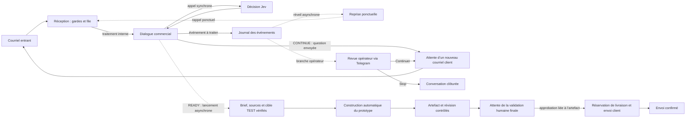

# Pipeline principal — guide public

**État documentaire au 14 octobre 2026.** Ce guide décrit la chaîne observée et ses limites ; ce n’est ni une procédure d’exploitation autonome ni une preuve de fonctionnement de bout en bout. Les noms ci-dessous sont les intitulés visibles des six workflows actifs observés.

## Vue d’ensemble

Les flèches pointillées représentent des déclenchements asynchrones, pas des étapes garanties dans une transaction atomique. L’appel à Jev est synchrone ; le lancement de la maquette depuis le dialogue est distinct et asynchrone. Le prototype peut donc être construit avant le clic humain : sa construction ne vaut ni approbation finale ni autorisation de publier un site complet. La branche « nouveau courriel client » exige une nouvelle entrée du client ; un texte écrit par l’opérateur Telegram ne devient pas un message du client.

## Les six workflows actifs

Ordre de lecture par rôle architectural (pas un ordre d’exécution fixe : les événements déterminent le parcours). Les états et nombres de nœuds proviennent d’une lecture seule des définitions datée du 14 octobre ; aucune définition n’a été exécutée pour établir ce tableau.

| Ordre | Workflow (nom UI exact) | État observé | Rôle et effet d’une modification |
|---:|---|---|---|
| 1 | `PIPELINE — 1. Réception des mails et suivi` | Actif, 89 nœuds | Entrée Gmail, gardes de source, file et verrou du processeur, routage et reprises. Une modification peut changer l’admission, le traitement d’un message ou le réarmement d’un fil. |
| 2 | `PIPELINE — 2. Dialogue commercial et brief` | Actif, 94 nœuds | Rattachement, lecture du fil, décision Jev, échange commercial, mémoire source-liée et branches de résultat. Une modification peut changer une réponse, un état métier ou l’autorisation de soumettre un brief. |
| 3 | `SERVICE — Décisions Jev du dialogue commercial` | Actif, 9 nœuds | Décision typée et choix des citations CLIENT. Une modification affecte les décisions prises par le dialogue ; aucun contrat de source documentaire distinct n’est établi ici. |
| 4 | `PIPELINE — 3. Maquette puis validation humaine` | Actif, 28 nœuds publiés | Soumission et suivi d’un job de prototype, puis validation liée à l’artefact avant la livraison. Une modification touche le chemin le plus sensible de la construction et de l’envoi. Le brouillon lu diffère de la définition publiée malgré le même nombre de nœuds : ne pas le publier ni l’importer automatiquement. |
| 5 | `SUPPORT PIPELINE — Journal des événements` | Actif, 11 nœuds | Persiste les événements et peut déclencher le réveil asynchrone de la branche opérateur. Une modification peut affecter la traçabilité ou le réveil. |
| 6 | `SUPPORT PIPELINE — Reprise ponctuelle` | Actif, 4 nœuds | Attente ponctuelle puis rappel de la réception pour reprendre un traitement. Ce n’est pas un polling permanent. Une modification peut influer sur la reprise et le délai de traitement. |

Les cinq autres définitions avaient un brouillon identique à la définition publiée lors de cette lecture. Il s’agit d’un constat ponctuel, à rafraîchir avant toute intervention.

## Entrée, suivi et reprise

1. La réception traite les entrées Gmail après ses gardes de compte TEST, date limite, source et auto-notifications, puis place les messages dans une file. Un verrou/claim évite que plusieurs processeurs prennent le même travail ; l’appel au dialogue est synchrone.
2. Le bilan d’un message est `REPLIED`, `REVIEW`, `IGNORED` ou `ATTENTION`. Les reprises sont bornées aux erreurs IA ciblées ; ce n’est pas une permission de relancer aveuglément tout échec.
3. Un déclenchement interne distingue le processeur, Telegram et une reprise explicite. Pour une discussion encore ouverte, une relance unique dans le fil après deux heures n’est possible qu’après confirmation de l’envoi précédent et sous gardes de source, verrou et outbox. `UNKNOWN` et `SENDING` ne sont jamais réarmés.
4. Le journal persiste les événements et peut réveiller la branche Telegram de manière asynchrone. Le workflow de reprise ponctuelle attend puis rappelle la réception ; aucun cron de polling permanent supplémentaire n’est décrit ici. Cette revue opérateur est distincte du mécanisme natif de revue humaine.

## Dialogue, décision et revue opérateur

- Le dialogue rattache prudemment le client et le projet, lit le fil Gmail physique complet et vérifie la clôture. Un fil `CLOSED` est ignoré sans réponse ni maquette.
- Le triage et le conseil GPT précèdent Jev. Jev choisit les citations CLIENT et renvoie une décision typée ; la rédaction GPT vient ensuite avec une sortie JSON stricte. Un message d’assistant marqué `SENT`, recopié à l’identique pour l’opérateur, n’ajoute aucune exigence client. Le HTML d’assistant est conservé littéralement.
- Un HTML client sans version texte, une source ou une pièce jointe non attestée, des sources partielles ou un projet ambigu conduit à `REVIEW`. Le brief a six champs : objectif, public, type, pages, fonctions et contraintes ; l’absence d’un champ peut être explicite. `READY` n’est permis qu’après validation des sources, de leur probabilité et de la cohérence. `ACK` et `STATUS` ne lancent pas de nouveau build.
- `CONTINUE` pose au plus deux questions, réserve puis envoie le courriel, enregistre la mémoire et attend un nouveau message client. `BLOCKED` passe en `REVIEW PENDING` et dans l’inbox `REVIEW`, puis attend le poller Telegram unique : l’opérateur reçoit le courriel complet avec `Stop` / `Continuer`, répond par texte via ForceReply et examine un aperçu `Envoyer` / `Modifier` / `Annuler`.
- Avant l’action, l’acteur, le chat, le bot, la source, le projet, la révision, le délai et la réception Gmail doivent correspondre. `Stop` inscrit durablement `CLOSED` après `SENT`, sous lease, avant de marquer l’inbox `REPLIED`. `Continuer` attend un nouveau courriel CLIENT et reprend la même boucle ; le texte opérateur n’est jamais attribué au client. Un résultat `UNKNOWN` n’est pas retenté à l’aveugle. Un JSON de rédaction invalide devient `BLOCKED` et n’autorise pas de build.

## Prototype et validation finale

Quand le brief est `READY`, une mémoire liée à la source et le brief littéral alimentent la branche commerciale autorisée et le workflow de maquette séparé, asynchrone (`waitForSubWorkflow=false`). L’appel à Jev, lui, attend sa réponse. Le signal « brief suffisant » / `opencode_ready` autorise la préparation d’un prototype, pas un site complet ni sa publication finale. La première maquette TEST peut commencer automatiquement avant toute approbation humaine finale.

Dans le workflow publié, le brief, la source et la cible TEST fixe doivent être contrôlés avant l’appel à l’API privée OpenCode. Le job est soumis une fois, puis suivi par polling borné sans nouvelle soumission. La suite exige un artefact avec révision, empreinte et revue attestées, une attente de validation humaine, puis une approbation liée au job et à l’artefact. Une réservation de livraison/outbox précède l’envoi client ; l’état `SENT` doit être confirmé. Aucun courriel client ne doit partir pour un artefact invalide ou non approuvé. L’approbation Jev `READY` ne publie pas un site final. Un exemple manuel bloqué et un formulaire opérateur existant sont distincts du parcours automatique.

## États, protections et modifications futures

`READY`, `CONTINUE`, `BLOCKED`, `CLOSED`, `REVIEW`, `IGNORED`, `ATTENTION`, `SENDING`, `UNKNOWN` et `SENT` ont des effets différents : ne pas les traiter comme des synonymes de succès ou de reprise.

Ces protections sont des consignes de travail, pas une ACL ni une barrière technique à une mission humaine ultérieure. Pour toute évolution, exiger une mission humaine explicite, un plan de retour arrière et une sauvegarde adaptée avant tout changement de données/état ; repartir de versions fraîchement relues ; distinguer brouillon et publié ; examiner le graphe, les scopes d’appel, les credentials et les gardes de source ; effectuer une revue statique avant tout test que la mission autorise. Ne pas : élargir une whitelist globale, désactiver un lease, dédupliquer au seul corps du message, forcer `READY`, convertir `UNKNOWN`/`SENDING` en `PENDING`, ni importer un brouillon candidat. Garder le laboratoire et les candidats séparés, les essais isolés, et les workflows étrangers hors périmètre.

Les intégrations documentaires Drive/PDF/mémoire candidates ne sont pas établies comme déployées dans le parent actif : aucun appel Drive effectif n’y a été constaté, le contrat de source Jev manque et le lecteur candidat est inactif/non publié. Ne pas présenter Drive, OCR ni la publication finale du site comme opérationnels.

### Diagnostic et essai proposé

Avant toute relance, diagnostiquer dans cet ordre : source et publication, lease/verrou, réservation de travail, file, acteur et conversation Telegram, TTL/délai, puis fournisseur. Ne jamais copier un secret dans un rapport ni exposer sa valeur pour dépanner. Un essai contrôlé par humain pourrait utiliser un nouveau message dans un compte TEST, le bot Telegram sans VPN et l’interface n8n privée si nécessaire ; cet essai n’a pas été exécuté ici.

**Limite de preuve :** les six définitions ont été lues en mode MCP lecture seule, pas exécutées. Les décisions de conception documentées ne prouvent pas un trajet réel client → Telegram → Gmail → client → maquette. Le nettoyage du rangement a été déclaré partiel, pas achevé. Le diagramme Mermaid est fourni en source ; son rendu visuel n’a pas été testé.
